ISO 6336-1:2019(E)

INTERNATIONAL STANDARD

Third edition 2019-11

Calculation of load capacity of spur and helical gears —

Part 1: Basic principles, introduction and general influence factors

Calcul de la capacité de charge des engrenages cylindriques à dentures droite et hélicoïdale —

Partie 1: Principes de base, introduction et facteurs généraux d'influence

COPYRIGHT PROTECTED DOCUMENT

© ISO 2019

All rights reserved. Unless otherwise specified, or required in the context of its implementation, no part of this publication may be reproduced or utilized otherwise in any form or by any means, electronic or mechanical, including photocopying, or posting on the internet or an intranet, without prior written permission. Permission can be requested from either ISO at the address below or ISO's member body in the country of the requester.

ISO copyright office

CP 401 • Ch. de Blandonnet 8

CH-1214 Vernier, Geneva

Phone: +41 22 749 01 11

Fax: +41 22 749 09 47

Email: copyright@iso.org

Website: www.iso.org

Published in Switzerland

# Contents

| Contents | Page |
| --- | --- |
| Foreword | vi |
| Introduction | vii |
| 1 Scope | 1 |
| 2 Normative references | 2 |
| 3 Terms, definitions, symbols and abbreviated terms | 2 |
| 3.1 Terms and definitions | 2 |
| 3.2 Symbols and abbreviated terms | 2 |
| 4 Basic principles | 11 |
| 4.1 Application | 11 |
| 4.1.1 Surface durability (pitting) | 11 |
| 4.1.2 Tooth bending strength | 11 |
| 4.1.3 Tooth flank fracture | 12 |
| 4.1.4 Strength and quality of materials | 12 |
| 4.1.5 Service life under variable load | 12 |
| 4.1.6 Scuffing | 12 |
| 4.1.7 Wear | 12 |
| 4.1.8 Micropitting | 12 |
| 4.1.9 Plastic-yielding | 12 |
| 4.1.10 Specific applications | 12 |
| 4.1.11 Safety factors | 13 |
| 4.1.12 Testing | 15 |
| 4.1.13 Manufacturing tolerances | 15 |
| 4.1.14 Implied accuracy | 15 |
| 4.1.15 Other considerations | 15 |
| 4.1.16 Influence factors | 16 |
| 4.1.17 Numerical formulae | 18 |
| 4.1.18 Succession of factors in the course of calculation | 18 |
| 4.1.19 Determination of allowable values of gear deviations | 18 |
| 4.2 Tangential load, torque and power | 18 |
| 4.2.1 General | 18 |
| 4.2.2 Nominal tangential load, nominal torque and nominal power | 19 |
| 4.2.3 Equivalent tangential load, equivalent torque and equivalent power | 19 |
| 4.2.4 Maximum tangential load, maximum torque and maximal power | 19 |
| 5 Application factor, $K_A$ | 19 |
| 5.1 General | 19 |
| 5.2 Method A — Factor $K_{A-A}$ | 20 |
| 5.2.1 Factor $K_{A-A}$ | 20 |
| 5.2.2 Factor $K_{HA-A}$ for pitting along ISO 6336-2 | 20 |
| 5.2.3 Factor $K_{FA-A}$ for tooth root breakage along ISO 6336-3 | 20 |
| 5.2.4 Factor $K_{FFA-A}$ for tooth flank fracture along ISO/TS 6336-4 | 20 |
| 5.2.5 Factor $K_{\vartheta A-A}$ for scuffing along ISO/TS 6336-20/ISO/TS 6336-21 | 21 |
| 5.2.6 Factor $K_{\lambda A-A}$ for micropitting along ISO/TS 6336-22 | 21 |
| 5.3 Method B — Factor $K_{A-B}$ | 21 |
| 5.3.1 General | 21 |
| 5.3.2 Guide values for application factor, $K_{A-B}$ | 21 |
| 6 Internal dynamic factor, $K_v$ | 24 |
| 6.1 General | 24 |
| 6.2 Parameters affecting internal dynamic load and calculations | 24 |
| 6.2.1 Design | 24 |
| 6.2.2 Manufacturing | 24 |
| 6.2.3 Transmission perturbance | 25 |
| 6.2.4 Dynamic response | 25 |
| 6.2.5 Resonances | 25 |
| 6.2.6 Application of internal dynamic factor for low loaded gears | 26 |
| 6.3 Principles and assumptions | 26 |
| 6.4 Methods for determination of dynamic factor | 27 |
| 6.4.1 Method A — Factor $K_{v-A}$ | 27 |
| 6.4.2 Method B — Factor $K_{v-B}$ | 27 |
| 6.4.3 Method C — Factor $K_{v-C}$ | 27 |
| 6.5 Determination of dynamic factor using Method B: $K_{v-B}$ | 28 |
| 6.5.1 General | 28 |
| 6.5.2 Running speed ranges | 28 |
| 6.5.3 Determination of resonance running speed (main resonance) of a gear pair | 29 |
| 6.5.4 Dynamic factor in subcritical range ( $N \leq N_S$ ) | 31 |
| 6.5.5 Dynamic factor in main resonance range ( $N_S < N \leq 1,15$ ) | 34 |
| 6.5.6 Dynamic factor in supercritical range ( $N \geq 1,5$ ) | 34 |
| 6.5.7 Dynamic factor in intermediate range ( $1,15 < N < 1,5$ ) | 34 |
| 6.5.8 Resonance speed determination for specific gear designs | 35 |
| 6.5.9 Calculation of reduced mass of gear pair with external teeth | 37 |
| 6.6 Determination of dynamic factor using Method C: $K_{v-C}$ | 38 |
| 6.6.1 General | 38 |
| 6.6.2 Graphical values of dynamic factor using Method C | 39 |
| 6.6.3 Determination by calculation of dynamic factor using Method C | 42 |
| 7 Face load factors, $K_{H\beta}$ and $K_{F\beta}$ | 43 |
| 7.1 Gear tooth load distribution | 43 |
| 7.2 General principles for determination of face load factors, $K_{H\beta}$ and $K_{F\beta}$ | 43 |
| 7.2.1 General | 43 |
| 7.2.2 Face load factor for contact stress, $K_{H\beta}$ | 44 |
| 7.2.3 Face load factor for tooth root stress, $K_{F\beta}$ | 44 |
| 7.3 Methods for determination of face load factor — Principles, assumptions | 44 |
| 7.3.1 General | 44 |
| 7.3.2 Method A — Factors $K_{H\beta-A}$ and $K_{F\beta-A}$ | 44 |
| 7.3.3 Method B — Factors $K_{H\beta-B}$ and $K_{F\beta-B}$ | 45 |
| 7.3.4 Method C — Factors $K_{H\beta-C}$ and $K_{F\beta-C}$ | 45 |
| 7.4 Determination of face load factor using Method B: $K_{H\beta-B}$ | 45 |
| 7.4.1 Number of calculation points | 45 |
| 7.4.2 Definition of $K_{H\beta}$ | 45 |
| 7.4.3 Stiffness and elastic deformations | 45 |
| 7.4.4 Static displacements | 49 |
| 7.4.5 Assumptions | 49 |
| 7.4.6 Computer program output | 49 |
| 7.5 Determination of face load factor using Method C: $K_{H\beta-C}$ | 49 |
| 7.5.1 General | 49 |
| 7.5.2 Effective equivalent misalignment, $F_{\beta y}$ | 51 |
| 7.5.3 Running-in allowance, $y_\beta$ , and running-in factor, $\chi_\beta$ | 51 |
| 7.5.4 Mesh misalignment, $f_{ma}$ | 61 |
| 7.5.5 Component of mesh misalignment caused by case deformation, $f_{ca}$ | 63 |
| 7.5.6 Component of mesh misalignment caused by shaft displacement, $f_{be}$ | 63 |
| 7.6 Determination of face load factor for tooth root stress using Method B or C: $K_{F\beta}$ | 64 |
| 8 Transverse load factors $K_{H\alpha}$ and $K_{F\alpha}$ | 65 |
| 8.1 Transverse load distribution | 65 |
| 8.2 Determination methods for transverse load factors — Principles and assumptions | 65 |
| 8.2.1 General | 65 |
| 8.2.2 Method A — Factors $K_{H\alpha-A}$ and $K_{F\alpha-A}$ | 65 |
| 8.2.3 Method B — Factors $K_{H\alpha-B}$ and $K_{F\alpha-B}$ | 66 |
| 8.3 Determination of transverse load factors using Method B — $K_{H\alpha-B}$ and $K_{F\alpha-B}$ | 66 |
| 8.3.1 General | 66 |
| 8.3.2 Determination of transverse load factor by calculation | 66 |
| 8.3.3 Transverse load factors from graphs | 67 |
| 8.3.4 Limiting conditions for $K_{H\alpha}$ | 67 |
| 8.3.5 Limiting conditions for $K_{F\alpha}$ | 67 |
| 8.3.6 Running-in allowance, $y_{\alpha}$ | 68 |
| 9 Tooth stiffness parameters, $c'$ and $c_{\gamma}$ | 71 |
| 9.1 Stiffness influences | 71 |
| 9.2 Determination methods for tooth stiffness parameters — Principles and assumptions | 71 |
| 9.2.1 General | 71 |
| 9.2.2 Method A — Tooth stiffness parameters $c'_{A}$ and $c_{\gamma-A}$ | 72 |
| 9.2.3 Method B — Tooth stiffness parameters $c'_{B}$ and $c_{\gamma-B}$ | 72 |
| 9.3 Determination of tooth stiffness parameters, $c'$ and $c_{\gamma}$ , according to Method B | 72 |
| 9.3.1 General | 72 |
| 9.3.2 Single stiffness, $c'$ | 73 |
| 9.3.3 Mesh stiffness, $c_{\gamma}$ | 77 |
| 10 Parameter of Hertzian contact | 77 |
| 10.1 Local radius of relative curvature | 77 |
| 10.2 Reduced modulus of elasticity, $E_{r}$ | 78 |
| 10.3 Local Hertzian contact stress, $p_{dyn,CP}$ | 78 |
| 10.3.1 Method A | 78 |
| 10.3.2 Method B | 79 |
| 10.4 Half of the Hertzian contact width, $b_{H}$ | 80 |
| 10.5 Load distribution along the path of contact | 80 |
| 10.5.1 Definition of contact points, CP, on the path of contact | 80 |
| 10.5.2 Load sharing factor, $X_{CP}$ | 82 |
| 10.6 Sum of tangential velocity, $v_{\Sigma,CP}$ | 90 |
| 11 Lubricant parameters at given temperature | 91 |
| 11.1 General | 91 |
| 11.2 Kinematic viscosity at a given temperature, $\nu_{\theta}$ | 91 |
| 11.3 Density of the lubricant at a given temperature $\theta$ , $\rho_{\theta}$ | 92 |
| Annex A (normative) Additional methods for determination of $f_{sh}$ and $f_{ma}$ | 93 |
| Annex B (informative) Guide values for crowning and end relief of teeth of cylindrical gears | 96 |
| Annex C (informative) Guide values for $K_{H\beta-C}$ for crowned teeth of cylindrical gears | 99 |
| Annex D (informative) Derivations and explanatory notes | 102 |
| Annex E (informative) Analytical determination of load distribution | 106 |
| Annex F (informative) General symbols used for calculation of load capacity of spur and helical gears | 128 |
| Bibliography | 133 |

# Foreword

ISO (the International Organization for Standardization) is a worldwide federation of national standards bodies (ISO member bodies). The work of preparing International Standards is normally carried out through ISO technical committees. Each member body interested in a subject for which a technical committee has been established has the right to be represented on that committee. International organizations, governmental and non-governmental, in liaison with ISO, also take part in the work. ISO collaborates closely with the International Electrotechnical Commission (IEC) on all matters of electrotechnical standardization.

The procedures used to develop this document and those intended for its further maintenance are described in the ISO/IEC Directives, Part 1. In particular, the different approval criteria needed for the different types of ISO documents should be noted. This document was drafted in accordance with the editorial rules of the ISO/IEC Directives, Part 2 (see www.iso.org/directives).

Attention is drawn to the possibility that some of the elements of this document may be the subject of patent rights. ISO shall not be held responsible for identifying any or all such patent rights. Details of any patent rights identified during the development of the document will be in the Introduction and/or on the ISO list of patent declarations received (see www.iso.org/patents).

Any trade name used in this document is information given for the convenience of users and does not constitute an endorsement.

For an explanation of the voluntary nature of standards, the meaning of ISO specific terms and expressions related to conformity assessment, as well as information about ISO's adherence to the World Trade Organization (WTO) principles in the Technical Barriers to Trade (TBT), see www.iso.org/iso/foreword.html.

This document was prepared by Technical Committee ISO/TC 60, Gears, Subcommittee SC 2, Gear capacity calculation.

This third edition cancels and replaces the second edition (ISO 6336-1:2006), which has been technically revised. It also incorporates the Technical Corrigendum ISO 6336-1:2006/Cor.1:2008.

The main changes compared to the previous edition are as follows:

— incorporation of ISO/TS 6336-4, ISO/TS 6336-20, ISO/TS 6336-21 and ISO/TS 6336-22 into Clause 4 (failure mode);

— update of application factors in Clause 5;

— integration of Clause 10 "Parameters of Hertzian contact";

— integration of Clause 11 "Lubricant parameters at given temperature".

A list of all parts in the ISO 6336 series can be found on the ISO website.

Any feedback or questions on this document should be directed to the user's national standards body. A complete listing of these bodies can be found at www.iso.org/members.html.

# Introduction

ISO 6336 (all parts) consists of International Standards, Technical Specifications (TS) and Technical Reports (TR) under the general title Calculation of load capacity of spur and helical gears (see Table 1).

— International Standards contain calculation methods that are based on widely accepted practices and have been validated.

— Technical Specifications (TS) contain calculation methods that are still subject to further development.

— Technical Reports (TR) contain data that is informative, such as example calculations.

The procedures specified in parts 1 to 19 of the ISO 6336 series cover fatigue analyses for gear rating. The procedures described in parts 20 to 29 of the ISO 6336 series are predominantly related to the tribological behavior of the lubricated flank surface contact. Parts 30 to 39 of the ISO 6336 series include example calculations. The ISO 6336 series allows the addition of new parts under appropriate numbers to reflect knowledge gained in the future.

Requesting standardized calculations according to the ISO 6336 series without referring to specific parts requires the use of only those parts that are currently designated as International Standards (see Table 1 for listing). When requesting further calculations, the relevant part or parts of the ISO 6336 series need to be specified. Use of a Technical Specification as acceptance criteria for a specific design need to be agreed in advance between the manufacturer and the purchaser.

Table 1 — Parts of the ISO 6336 series (status as of DATE OF PUBLICATION)

| Calculation of load capacity of spur and helical gears | International Standard | Technical Specification | Technical Report |
| --- | --- | --- | --- |
| Part 1: Basic principles, introduction and general influence factors | X |  |  |
| Part 2: Calculation of surface durability (pitting) | X |  |  |
| Part 3: Calculation of tooth bending strength | X |  |  |
| Part 4: Calculation of tooth flank fracture load capacity |  | X |  |
| Part 5: Strength and quality of materials | X |  |  |
| Part 6: Calculation of service life under variable load | X |  |  |
| Part 20: Calculation of scuffing load capacity (also applicable to bevel and hypoid gears) — Flash temperature method(replaces: ISO/TR 13989-1) |  | X |  |
| Part 21: Calculation of scuffing load capacity (also applicable to bevel and hypoid gears) — Integral temperature method(replaces: ISO/TR 13989-2) |  | X |  |
| Part 22: Calculation of micropitting load capacity(replaces: ISO/TR 15144-1) |  | X |  |
| Part 30: Calculation examples for the application of ISO 6336 parts 1,2,3,5 |  |  | X |
| Part 31: Calculation examples of micropitting load capacity(replaces: ISO/TR 15144-2) |  |  | X |

This document and the other parts of the ISO 6336 series provide a coherent system of procedures for the calculation of the load capacity of cylindrical involute gears with external or internal teeth. The ISO 6336 series is designed to facilitate the application of future knowledge and developments, also the exchange of information gained from experience.

Design considerations to prevent fractures emanating from stress raisers in the tooth flank, tip chipping and failures of the gear blank through the web or hub will need to be analysed by general machine design methods.

Several methods for the calculation of load capacity, as well as for the calculation of various factors, are permitted (see 4.1.16). The directions in ISO 6336 are thus complex, but also flexible.

Included in the formulae are the major factors which are presently known to affect gear tooth damages which are covered by the ISO 6336 series. The formulae are in a form that will permit the addition of new factors to reflect knowledge gained in the future.

Calculation of load capacity of spur and helical gears —

Part 1:

Basic principles, introduction and general influence factors

# 1 Scope

This document presents the basic principles of, an introduction to, and the general influence factors for the calculation of the load capacity of spur and helical gears. Together with the other documents in the ISO 6336 series, it provides a method by which different gear designs can be compared. It is not intended to assure the performance of assembled drive gear systems. It is not intended for use by the general engineering public. Instead, it is intended for use by the experienced gear designer who is capable of selecting reasonable values for the factors in these formulae based on the knowledge of similar designs and the awareness of the effects of the items discussed.

The formulae in the ISO 6336 series are intended to establish a uniformly acceptable method for calculating the load capacity of cylindrical gears with straight or helical involute teeth.

The ISO 6336 series includes procedures based on testing and theoretical studies as referenced by each method. The methods are validated for:

— normal working pressure angle from $15^{\circ}$ to $25^{\circ}$ ;

— reference helix angle up to $30^{\circ}$ ;

— transverse contact ratio from 1,0 to 2,5.

If this scope is exceeded, the calculated results will need to be confirmed by experience.

The formulae in the ISO 6336 series are not applicable when any of the following conditions exist:

— gears with transverse contact ratios less than 1,0;

— interference between tooth tips and root fillets;

— teeth are pointed;

— backlash is zero.

The rating formulae in the ISO 6336 series are not applicable to other types of gear tooth deterioration such as plastic deformation, case crushing and wear, and are not applicable under vibratory conditions where there can be an unpredictable profile breakdown. The ISO 6336 series does not apply to teeth finished by forging or sintering. It is not applicable to gears which have a poor contact pattern.

The influence factors presented in these methods form a method to predict the risk of damage that aligns with industry and experimental experience. It is possible that they are not entirely scientifically exact. Therefore, the calculation methods from one part of the ISO 6336 series is not applicable in another part of the ISO 6336 series unless specifically referenced.

The procedures in the ISO 6336 series provide rating formulae for the calculation of load capacity with regard to different failure modes such as pitting, tooth root breakage, tooth flank fracture, scuffing and micropitting. At pitch line velocities below 1 m/s the gear load capacity is often limited by abrasive wear (see other literature such as References $[23]$ and $[22]$ for further information on such calculation).

# 2 Normative references

The following documents are referred to in the text in such a way that some or all of their content constitutes requirements of this document. For dated references, only the edition cited applies. For undated references, the latest edition of the referenced document (including any amendments) applies.

ISO 53:1998, Cylindrical gears for general and heavy engineering — Standard basic rack tooth profile

ISO 1122-1:1998, Vocabulary of gear terms — Part 1: Definitions related to geometry

ISO 1328-1:2013, Cylindrical gears — ISO system of flank tolerance classification — Part 1: Definitions and allowable values of deviations relevant to flanks of gear teeth

ISO 21771:2007, Gears — Cylindrical involute gears and gear pairs — Concepts and geometry

ISO 6336-2, Calculation of load capacity of spur and helical gears — Part 2: Calculation of surface durability (pitting)

ISO 6336-3, Calculation of load capacity of spur and helical gears — Part 3: Calculation of tooth bending strength

ISO 6336-5, Calculation of load capacity of spur and helical gears — Part 5: Strength and quality of materials

ISO 6336-6, Calculation of load capacity of spur and helical gears — Part 6: Calculation of service life under variable load

# 3 Terms, definitions, symbols and abbreviated terms

## 3.1 Terms and definitions

For the purposes of this document, the terms and definitions given in ISO 1122-1:1998 and ISO 21771:2007 apply.

ISO and IEC maintain terminological databases for use in standardization at following addresses:

— ISO Online browsing platform: available at https://www.iso.org/obp

— IEC Electropedia: available at http://www.electropedia.org/

## 3.2 Symbols and abbreviated terms

For the purpose of this document, the symbols and abbreviated terms given in ISO 1122-1:1998, ISO 21771:2007 and Table 2 apply. Further general symbols and abbreviated terms used for the calculation of load capacity of spur and helical gears can be found in Annex F.

NOTE Symbols are based on, and are extensions of, the symbols given in ISO 701 and ISO 1328-1:2013. Only symbols for quantities used for the calculation of the particular factors treated in the ISO 6336 series are given, together with the preferred units.

Table 2 — Abbreviated terms and symbols used in this document

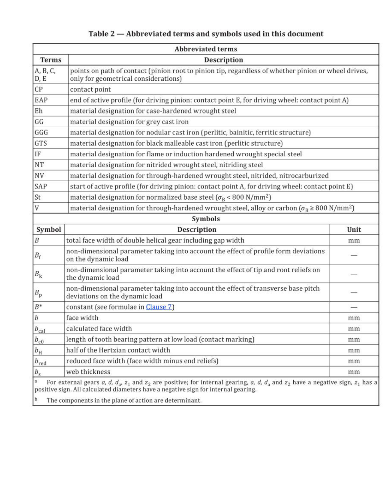

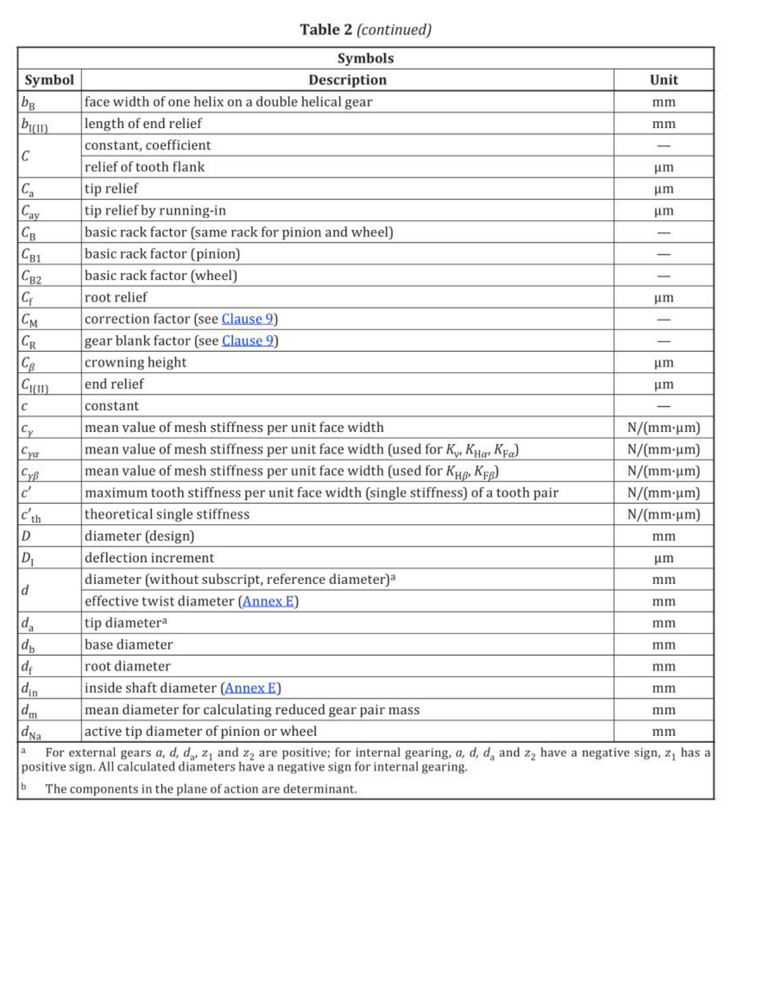

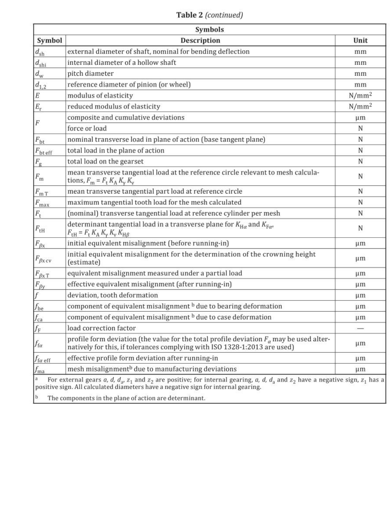

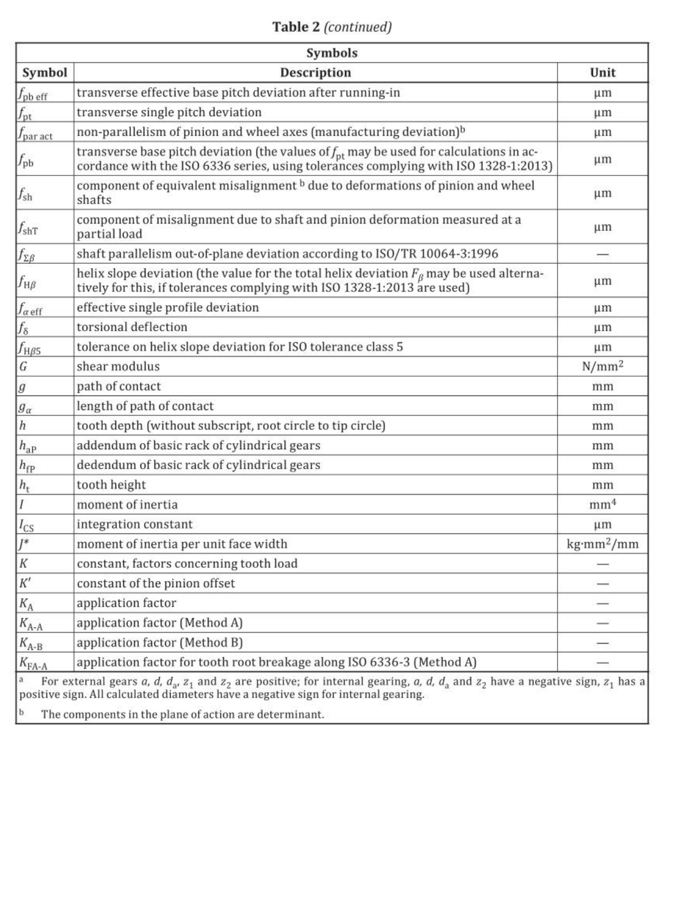

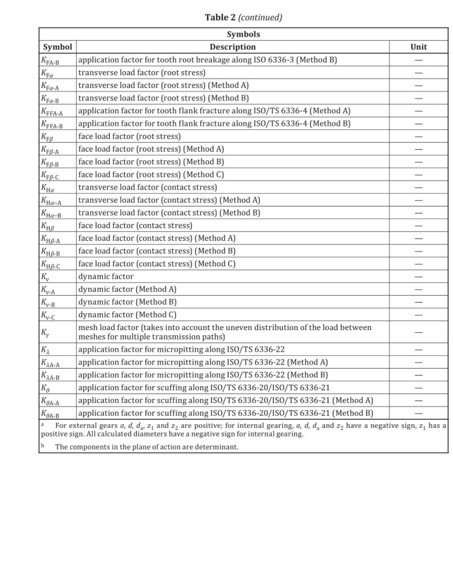

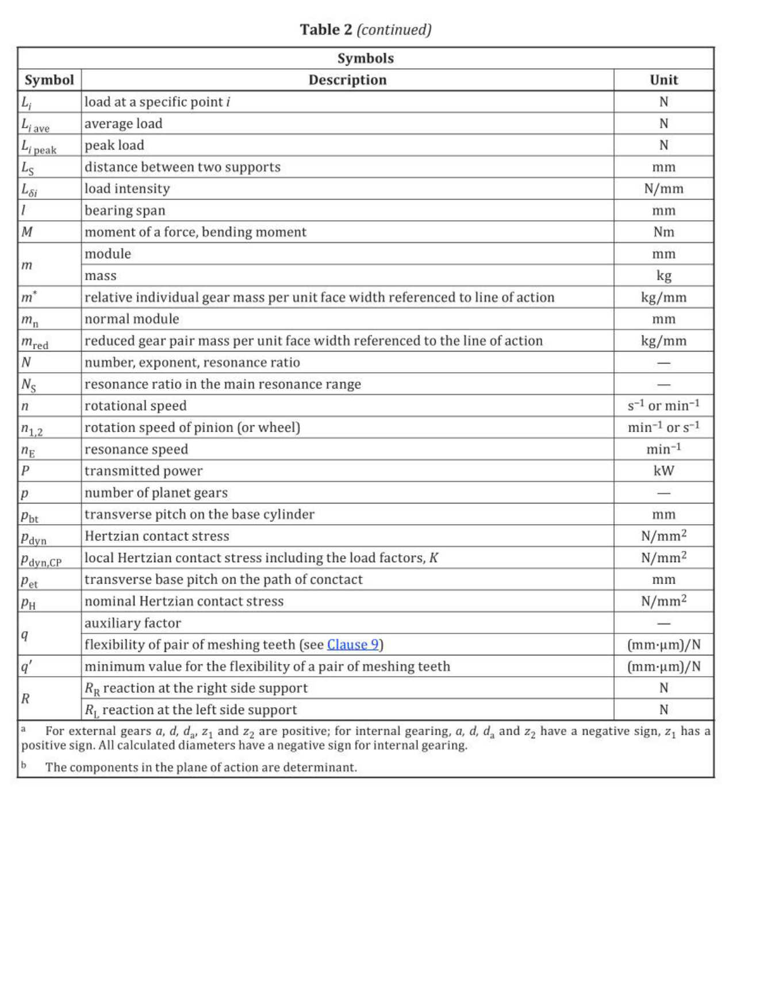

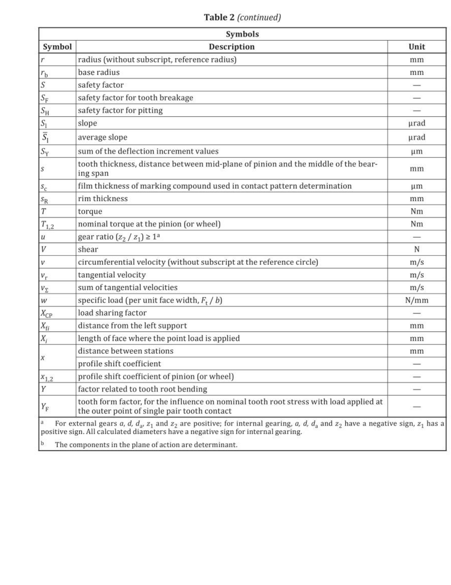

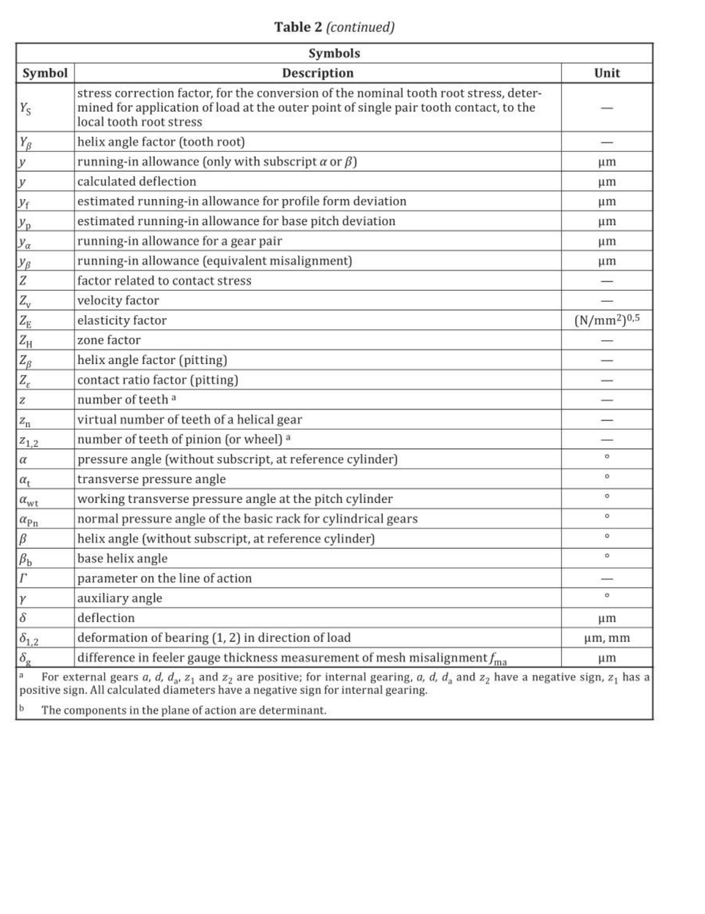

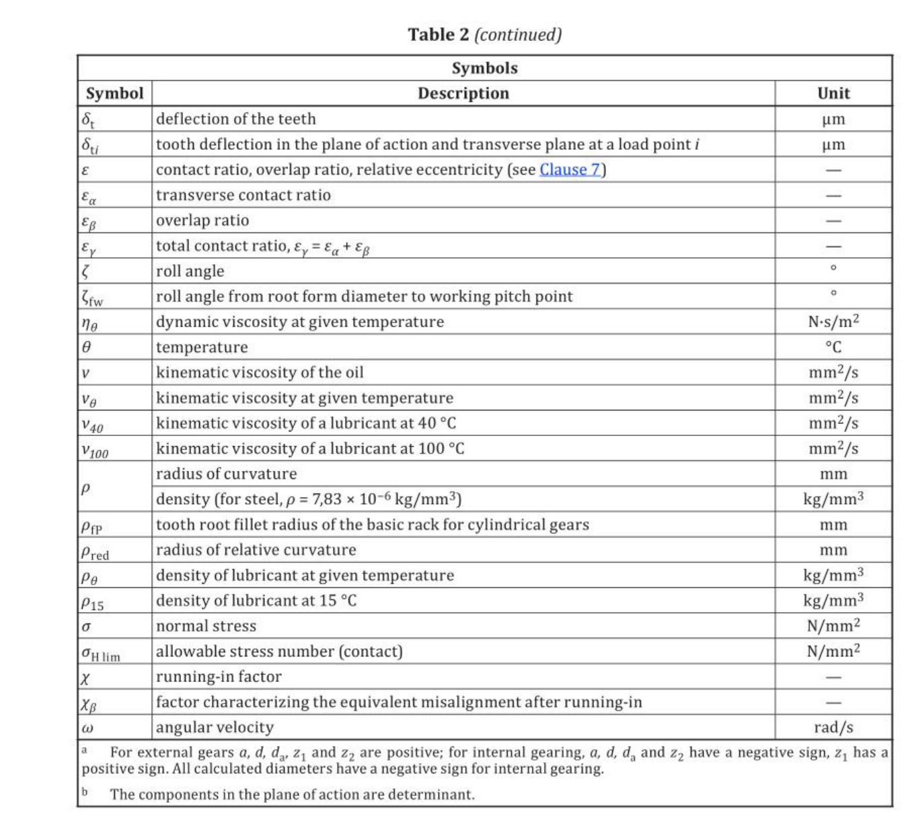

# 4 Basic principles

## 4.1 Application

### 4.1.1 Surface durability (pitting)

ISO 6336-2 specifies the fundamental formulae for use in the determination of the surface load capacity of cylindrical gears with involute external or internal teeth. In this document, surface durability refers to pitting also known as macropitting. It includes formulae for all influences on surface durability for which quantitative assessments can be made. It applies primarily to oil-lubricated transmissions but can also be used to obtain approximate values for (slow-running) grease-lubricated transmissions, as long as sufficient lubricant is present in the mesh at all times.

### 4.1.2 Tooth bending strength

ISO 6336-3 specifies the fundamental formulae for use in tooth bending stress calculations for involute external or internal spur and helical gears. In service, internal gears can experience failure modes other than tooth bending fatigue, i.e. fractures starting at the root diameter and progressing radially outward. ISO 6336-3 does not provide adequate safety against failure modes other than tooth bending fatigue. All load influences on tooth stress are included in so far as they are the result of loads transmitted by the gears and in so far as they can be evaluated quantitatively.

### 4.1.3 Tooth flank fracture

ISO/TS 6336-4 describes a procedure for the calculation of the tooth flank fracture load capacity of cylindrical spur and helical gears with external teeth. The method is based on theoretical and experimental investigations (References [2], [14], [15] and [19]) on case carburized test gears and gears from various industrial applications.

### 4.1.4 Strength and quality of materials

ISO 6336-5 describes contact and tooth-root stresses and gives numerical values for both limit stress numbers. It specifies requirements for material quality and heat treatment and comments on their influences on both limit stress numbers.

### 4.1.5 Service life under variable load

ISO 6336-6 specifies the information and standardized conditions necessary for the calculation of the service life (or safety factors for a required life) of gears subject to variable loading.

### 4.1.6 Scuffing

Formulae for scuffing resistance on cylindrical gears with involute internal or external teeth are included in ISO/TS 6336-20 and ISO/TS 6336-21.

### 4.1.7 Wear

So far, only limited attention has been devoted to the study of gear tooth wear. This subject primarily concerns gear teeth with low surface hardness or gears with improper lubrication. No attempt has been made to cover the subject in the ISO 6336 series.

### 4.1.8 Micropitting

ISO/TS 6336-22 covers micropitting rating, which is an additional type of surface distress that may occur on gear teeth.

### 4.1.9 Plastic-yielding

The ISO 6336 series does not extend to stress levels greater than those permissible at $10^{3}$ cycles or less, since stresses in this range may exceed the elastic limit of the gear tooth in bending or in surface compressive stress. Depending on the material and the load imposed, a single stress cycle greater than the limit level at $<10^{3}$ cycles could result in plastic yielding of the gear tooth.

### 4.1.10 Specific applications

#### 4.1.10.1 General

For the design of gears, it is very important to recognize that requirements for different fields of application vary considerably. The use of ISO 6336 (all parts) procedures for specific applications demands a realistic and knowledgeable appraisal of all applicable considerations, particularly:

— the allowable stress of the material and the number of load repetitions,

— the consequences of any percentage of failure (failure rate), and

— the appropriate safety factor.

The following three application fields exemplify the requirements of the above-mentioned characteristics.

#### 4.1.10.2 Vehicle final drive gears

For vehicle final drive gears, which operate at relatively low speed, coarse pitch teeth are chosen for adequate strength. As a consequence, pinions have small numbers of teeth ( $z_{1}$ of about 14), whereas a value $z_{1}$ of about 28 would be chosen for a comparatively high-speed gear of similar size. Thus, the tooth bending strength of the former would be about twice that of the latter.

The computed reliability of vehicle gears can be as low as 80 % to 90 % whereas that of high-speed industrial gears should be at least 99 %.

Comparison of applied gear designs has indicated that for about 10 000 cycles, the load transmitted by truck final drive gears is about four times greater than that transmitted by aircraft or space vehicle gears, where the material, quality, size and design are the same.

For low speed vehicle gears which are intended to have short lives (less than 100 000 cycles), small amounts of plastic deformation, pitting and abrasive wear can usually be tolerated. Consequently, the levels of surface stress which are permissible are substantially higher than would be permissible for long life, high speed gears.

#### 4.1.10.3 Main drive for aircraft and space vehicles

For main drives of aircraft and space vehicles, which are found in helicopter rotor drives and the main pump drives of space vehicle boosters, gears of the highest material quality and manufacturing accuracy are used. Such gears are extensively tested. For example, 10 to 20 transmissions of the same production series may be tested under operational conditions for the full design life. The tolerable wear rate is established on the basis of test results. Lubricant spray rate, position of injection points and direction of spray is optimized.

For these reasons, higher loading is permissible for a design life up to 100 times longer (in cycles of tooth loading), and speeds about 10 times greater than those of a typical vehicle transmission. The probability of damage in such cases shall not exceed 0,1 % to 1 %. Overall loading cannot be as high as for vehicle gears, since neither surface wear nor minor damage can be tolerated.

#### 4.1.10.4 Industrial high-speed gears

For industrial high-speed gears, where the pitch line velocities exceed 50 m/s, the pinions are often designed with 30 or more teeth with the objective of minimizing the risk of scuffing and wear.

Industrial high-speed gears should be better than 99 % reliable for a normal life of more than $10^{10}$ cycles. Extensive prototype testing is normally excluded because of the cost. As a consequence, the load capacity ratings of high-speed gears tend to be conservative with relatively high safety factors.

### 4.1.11 Safety factors

It is necessary to distinguish between the safety factor relative to each damage type — pitting, tooth root breakage, tooth flank fracture, scuffing, micropitting, etc. Note that at the moment for tooth flank fracture, no safety factor but a material exposure is calculated, see ISO/TS 6336-4.

For a given application, adequate gear load capacity is demonstrated by the computed values of each safety factor, S, being greater than or equal to the value of its respective minimum safety factor, $S_{min}$ .

Certain minimum values for safety factors shall be determined. Recommendations concerning these minimum values are made in the ISO 6336 series, but values are not proposed.

An appropriate probability of failure and the safety factor shall be carefully chosen to meet the required reliability at a justifiable cost. If the performance of the gears can be accurately appraised through testing of the actual unit under actual load conditions, a lower safety factor and more economical manufacturing procedures may be permissible.

The safety factor for pitting and tooth bending is defined as the ratio of the limiting stress number to the calculated stress.

The safety factor for scuffing is defined as the ratio of the limiting temperature to the calculated temperature.

The safety factor for micropitting is defined as the ratio of the calculated minimum specific film thickness to the permissible specific film thickness.

For tooth flank fracture, the material exposure is defined as the ratio of the local equivalent stress to the local material shear strength.

Safety factors based on load are permitted. When they are based on load the safety factor equals the specific calculated load capacity divided by the specific operating load transmitted. When the factor is based on load, this shall be stated clearly.

NOTE Safety factors based on load (power) are not necessarily directly proportional to S. For example, load safety factors relative to tooth bending are proportional to $S_{F}$ . Safety factors based on load (power) relative to pitting are proportional to $S_{H}^{2}$ .

In addition to the general requirements mentioned and the special requirements for each damage type, the minimum safety factors shall be chosen after careful consideration of the following influences.

Reliability of material data: ISO 6336 (all parts)-applicable materials, for which data are given in ISO 6336-5, and their abbreviations, are listed in Table 3. The allowable stress numbers used in the calculation are valid for a given probability of failure; the material values in ISO 6336-5 are valid for $1\%$ probability of failure. This risk of failure reduces with the increase of the safety factor and vice versa.

— Reliability of load values used for calculation: if loads or the response of the system to vibration, are estimated rather than measured, a larger minimum safety factor should be used.

— Variations in gear geometry due to manufacturing tolerances.

— Variations in alignment.

— Variations in material due to process variations in chemistry, cleanliness, and microstructure (material quality and heat treatment).

— Variations in lubrication and its maintenance over the service life of the gears.

Depending on the reliability of the assumptions on which the calculations are based (e.g. load assumptions) and according to the reliability requirements (consequences of damage occurrence), a corresponding minimum safety factor is to be chosen.

Where gears are produced under a specification or a request for proposal (quotation), in which the gear supplier is to provide gears or assembled gear drives having specified calculated capacities (ratings) in accordance with the ISO 6336 series, the value of the safety factor for each mode of failure (pitting, tooth root breakage, tooth flank fracture, scuffing, micropitting) is to be agreed upon between the parties.

Table 3 — Materials (according to ISO 6336-5)

| Material | Type | Abbreviation |
| --- | --- | --- |
| Normalized low carbon steels/cast steels | Wrought normalized low carbon steels | St |
| Normalized low carbon steels/cast steels | Cast steels | St (cast) |
| Cast iron materials | Black malleable cast iron (perlitic structure) | GTS (perl.) |
| Cast iron materials | Nodular cast iron (perlitic, bainitic, ferritic structure) | GGG (perl., bai., ferr.) |
| Cast iron materials | Grey cast iron | GG |
| Through-hardened wrought steels | Carbon steels, alloy steels | V |
| Through-hardened cast steels | Carbon steels, alloy steels | V(cast) |
| Case-hardened wrought steels |  | Eh |
| Flame or induction hardened wrought or cast steels |  | IF |
| Nitrided wrought steels/nitriding steels/through-hardening steels, nitrided | Nitriding steels | NT(nitr.) |
| Nitrided wrought steels/nitriding steels/through-hardening steels, nitrided | Through hardening steels | NV (nitr.) |
| Wrought steels, nitrocarburized | Through hardening steels | NV (nitrocar.) |

### 4.1.12 Testing

The most reliable known approach to the appraisal of overall system performance is that of testing a proposed new design. Where sufficient field or test experience is available, satisfactory results can be obtained by extrapolation of previous tests or field data.

When suitable test results or field data are not available, values for the rating factors should be chosen conservatively.

### 4.1.13 Manufacturing tolerances

Evaluation of rating factors should be based on the worst tolerance class limits specified for the component parts in the manufacturing process.

### 4.1.14 Implied accuracy

Where empirical values for rating factors are given by curves, curve fitting formulae are provided to facilitate computer programming. The constants and coefficients used in curve fitting often have significant digits in excess of those appropriate to the reliability of the empirical data.

### 4.1.15 Other considerations

#### 4.1.15.1 General

In addition to the factors considered in ISO 6336 (all parts) influencing load capacity, other interrelated system factors can have a significant influence on the overall transmission performance. The following factors are particularly significant.

#### 4.1.15.2 Lubrication

The ratings determined by the formulae for pitting, tooth root breakage and tooth flank fracture are valid only if the gear teeth are operated with a lubricant of proper viscosity and additives for the load, speed and surface finish, and if there is a sufficient quantity of lubricant supplied to the gear teeth to lubricate and maintain an acceptable operating temperature.

Additional information regarding tribological failure modes can be found in ISO/TS 6336-20, ISO/TS 6336-21 and ISO/TS 6336-22.

#### 4.1.15.3 Misalignment and deflection of foundations

Many gear systems depend on external supports such as machinery foundations to maintain alignment of the gear mesh. If these supports are poorly designed, initially misaligned, or become misaligned during operation through elastic or thermal deflection or other influences, overall gear system performance will be adversely affected.

#### 4.1.15.4 Deflections

Deflections of gear teeth, gear blanks, gear shafts, bearings and housings affect performance and distribution of total tooth load over meshing flanks. Since these deflections vary with load, it is impossible to obtain optimum tooth contact at different loads in those transmissions that encounter variable load. When gear tooth flanks are not modified, the face load factor increases with increasing deflection, thereby lowering rated capacity.

#### 4.1.15.5 System dynamics

The method of analysis used in the ISO 6336 series provides a dynamic factor in the formulae by derating the gears for increased loads caused by gear tooth inaccuracies and for harmonic effects. In general, simplified values are given for easy application. The dynamic response of the system results in additional gear tooth loads due to the relative motions of the connected masses of the driver and the driven equipment. The application factor, $K_{A}$ , is intended to account for the operating characteristics of the driving and driven equipment. It shall be recognized, however, that if the operating conditions of the driver, gearbox or driven equipment causes an excitation with a frequency that is near to one of the system's major natural frequencies, resonant vibrations can cause severe overloads which could be several times higher than the nominal load.

For critical service applications, it is recommended that a vibration analysis be performed. This analysis shall include the total system of driver, gearbox, driven equipment, couplings, mounting conditions and sources of excitation. Natural frequencies, mode shapes and the dynamic response amplitudes should be calculated. For pitting and bending fatigue ratings, the resulting load spectrum cumulative fatigue effect calculation is given in ISO 6336-6, if necessary or required.

#### 4.1.15.6 Contact pattern

The teeth of most cylindrical gears are modified in both profile and helix directions during the manufacturing operation to accommodate deflection of the shafts and mountings and thermal distortions. This results in a localized contact pattern during roll testing under light loads. Under design load, the contact should spread over the tooth flank without any concentration of the pattern at the edges. This influence shall be taken into account by the corresponding load distribution factor.

#### 4.1.15.7 Corrosion

Corrosion of gear tooth surfaces can significantly reduce the load carrying capacity of the teeth. Quantifying the extent of these reductions is beyond the scope of the ISO 6336 series.

### 4.1.16 Influence factors

#### 4.1.16.1 General

The influence factors presented in the ISO 6336 series are derived from results of research and field service. It is convenient to distinguish between the following.

a) Factors which are determined by gear geometry or which have been established by convention. They shall be calculated in accordance with the formulae given in the ISO 6336 series.

b) Factors which account for several influences and which are dealt with as independent of each other, but which may nevertheless influence each other to a degree for which no numerical value can be assigned. These include the factors $K_{A}$ , $K_{v}$ , $K_{H\alpha}$ , $K_{H\beta}$ or $K_{F\alpha}$ and the factors influencing allowable stress.

The factors $K_{v}$ , $K_{H\beta}$ and $K_{H\alpha}$ also depend on the magnitudes of the profile and helix modifications. Profile and helix modifications are only effective if they are significantly larger than the manufacturing deviations. For this reason, the influence of the profile and helix modifications may only be taken into consideration if the gear manufacturing deviations do not exceed specific limit values. The maximum allowable gear flank tolerances are stated, together with reference to ISO 1328-1:2013, for each factor.

The influence factors can be determined by various methods. These are qualified, as necessary, by adding subscripts A through C to the symbols. Unless otherwise specified, e.g. in an application standard, the more accurate of the methods is to be preferred for important transmissions. In cases of dispute, when the proof of accuracy and reliability is supplied, Method A is superior to Method B, and Method B to Method C.

It is recommended that supplementary subscripts be used whenever the method used for evaluation of a factor would not be readily identifiable.

In some applications it could be necessary to choose between factors which have been determined using alternative methods (e.g. the alternatives for the determination of the equivalent misalignment). When necessary, the relevant method can be indicated by extending the subscript, e.g. $K_{H\beta-B1}$ .

The ISO 6336 series is primarily intended for verifying the load capacity of gears for which essential calculation data are available by way of detail drawings, or in a similar form.

The data available at the primary design stage is usually restricted. It is therefore necessary, at this stage, to make use of approximations or empirical values for some factors. In such cases it is often permissible to substitute unity or some other constant for some factors. In doing so, it is necessary to verify that a good margin of safety is assured. Otherwise, the minimum safety factor shall be increased to account for these additional uncertainties.

More precise evaluation is possible when manufacture and inspection is completed, for then data obtained by direct measurement are available.

Contractual provisions relating to the nature of the calculation proof shall be agreed in advance between the manufacturer and the purchaser.

#### 4.1.16.2 Method A

Method A factors are derived from the results of full-scale load tests, precise measurements or comprehensive mathematical analysis of the transmission system on the basis of proven operating experience, or any combination of these. All gear and loading data shall be available. In such cases the accuracy and reliability of the method used shall be demonstrated and the assumptions clearly stated.

In general, and for the following reasons, Method A requires thorough knowledge and experience to use:

— the relevant relationships have not been more extensively researched than those in Methods B and C;

— details of the operating conditions are incomplete;

— suitable measuring equipment is not available;

— the costs of analysis and measurements exceed their value.

#### 4.1.16.3 Method B

Method B factors are derived with sufficient accuracy for most applications. Assumptions involved in their determination are listed. In each case, it is necessary to assess whether or not these assumptions apply to the conditions of interest. Additional subscripts should be inserted when necessary, e.g. $K_{v-B}$ .

#### 4.1.16.4 Method C

Method C is where simplified approximations are specified for some factors. The assumptions under which they have been determined are listed. On each occasion an assessment should be made as to whether or not these assumptions apply to the existing conditions. The additional subscript C shall be used when necessary, e.g. $K_{v-C}$ .

### 4.1.17 Numerical formulae

It is necessary to apply the numerical formulae specified in the ISO 6336 series with the stated units. Any exceptions are specially noted.

### 4.1.18 Succession of factors in the course of calculation

The factors $K_{v}$ , $K_{H\beta}$ or $K_{F\beta}$ and $K_{H\alpha}$ or $K_{F\alpha}$ depend on a nominal tangential load. They are also to some extent interdependent and shall therefore be calculated successively as follows:

a) $K_{v}$ with the load $F_{t} K_{A} K_{\gamma}$ ;

b) $K_{H\beta}$ or $K_{F\beta}$ with the load $F_{t}K_{A}K_{\gamma}K_{v}$ ;

c) $K_{H\alpha}$ or $K_{F\alpha}$ with the load $F_{t}K_{A}K_{\gamma}K_{v}K_{H\beta(F\beta)}$[^1] .

For the definition of $K_{\gamma}$ also see 4.2.1.

### 4.1.19 Determination of allowable values of gear deviations

The allowable values of flank deviations shall be determined in accordance with ISO 1328-1:2013.

## 4.2 Tangential load, torque and power

### 4.2.1 General

When assessing the load acting on gear teeth, all loads affecting the gearing shall be considered.

In the case of double helical gears, it is assumed that the total tangential load is divided equally between the two helices. If this is not the case, for examples as a consequence of externally applied axial loads, this shall be taken into consideration. The two halves of the double helical gear should be treated as two helical gears arranged in parallel.

Concerning multiple path transmissions, such as planetary gear systems or split path gear trains respectively when a gear drives two or more mating gears, the total tangential load is not quite evenly distributed to the various load paths (irrespective of design, circumferential velocity or accuracy of manufacture). Allowance is made for this by means of the mesh load factor $K_{\gamma}$ (see also 4.1.18) unless the power through each mesh is known and used for calculations. If possible, $K_{\gamma}$ should preferably be determined by measurement; alternatively, its value may be estimated from the literature (for example DNVGL-CG-0036 $^{[16]}$ , IEC 61400-4 $^{[12]}$ , AGMA 6123 $^{[13]}$ ).

For transmissions with only one load path respectively when a gear drives only one mating gear, the mesh load factor is $K_{\gamma} = 1, 0$ .

Thus, the following applies for the mesh load factor, $K_{\gamma}$ :

a) for transmissions with one load path: $K_{\gamma}=1,0$ ;

b) for multiple path transmissions when the power through each mesh is known and used for calculations: $K_{\gamma} = 1,0$ ;

c) for gear trains with multiple path transmissions with uneven distribution of the total tangential load over the individual meshes: $K_{\gamma} > 1,0$ .

If the operating speed is near a resonance speed, a careful study is necessary. See Clauses 5 and 6.

### 4.2.2 Nominal tangential load, nominal torque and nominal power

The nominal tangential load, $F_{t}$ , is determined in the transverse plane at the reference cylinder. It is derived from the nominal torque or power transmitted by the gear pair.

The load capacity rating of gears is effectively based on the input torque to the driven machine. This is the torque corresponding to the heaviest regular working condition. Alternatively, the nominal torque of the prime mover can be used as a basis if it corresponds to the torque requirement of the driven machine, or some other suitable basis can be chosen.

$F_{t}$ is defined as the nominal tangential load per mesh, i.e. for the mesh under consideration. T and P are defined accordingly. In the following formulae, $n_{1,2}$ is given in revolutions per minute.

$$
F _ {\mathrm{t}} = \frac {2000 T _ {1 , 2}}{d _ {1 , 2}} = \frac {19098 \times 1000 P}{d _ {1 , 2} n _ {1 , 2}} = \frac {1000 P}{v}\tag{1}
$$

$$
T _ {1, 2} = \frac {F _ {\mathrm{t}} d _ {1 , 2}}{2000} = \frac {1000 P}{\omega_ {1 , 2}} = \frac {9549 P}{n _ {1 , 2}}\tag{2}
$$

$$
P = \frac {F _ {t} v}{1000} = \frac {T _ {1 , 2} \omega_ {1 , 2}}{1000} = \frac {T _ {1 , 2} n _ {1 , 2}}{9549}\tag{3}
$$

$$
v = \frac {d _ {1 , 2} \omega_ {1 , 2}}{2000} = \frac {d _ {1 , 2} n _ {1 , 2}}{19098}\tag{4}
$$

$$
\omega_ {1, 2} = \frac {2000 v}{d _ {1 , 2}} = \frac {n _ {1 , 2}}{9549}\tag{5}
$$

> Editorial note (not part of the ISO text): The denominator 9 549 in Formula (5) is reproduced as printed in the source PDF (printed page 19).

> 编者校核注（非标准正文，ISO1-024，原标准印刷页 19）：式(4)为 v=dn/19098；式(5)为 ω=2000v/d=n/9549。代入式(4)，前一等式得到 n/9.549，与后一等式差1000倍。 此处保留原文；尚未核实本版正式勘误或权威解释。

### 4.2.3 Equivalent tangential load, equivalent torque and equivalent power

When the transmitted load is not uniform, consideration should be given not only to the peak load and its anticipated number of cycles, but also to intermediate loads and their numbers of cycles. This type of load is classed as a duty cycle and may be represented by a load spectrum. In such cases, the cumulative fatigue effect of the duty cycle is considered in rating the gear set, see 5.1.

### 4.2.4 Maximum tangential load, maximum torque and maximal power

This is the maximum tangential load, $F_{tmax}$ , (or corresponding torque, $T_{max}$ , corresponding power, $P_{max}$ ) in the duty cycle. Its magnitude can be limited by a suitably responsive safety clutch. $F_{tmax}$ , $T_{max}$ and $P_{max}$ are required to determine the safety factor due to loading corresponding to the static stress limit.

# 5 Application factor, $K_{A}$

## 5.1 General

The factor $K_{A}$ adjusts the nominal load, $F_{t}$ , in order to compensate for incremental gear loads from external sources. These additional loads are largely dependent on the characteristics of the driving and driven machines, as well as the masses and stiffness of the system, including shafts and couplings used in service.

For applications such as marine gears and others subjected to cyclic peak torque (torsional vibrations) and designed for infinite life, the application factor can be defined as the ratio between the peak cyclic torques and the nominal rated torque. The nominal rated torque is defined by the rated power and speed. It is the torque used in the load capacity calculations.

If the gear is subjected to a limited number of known loads in excess of the amount of the peak cyclic torques, this influence may be covered directly by means of cumulative fatigue or by means of an increased application factor, representing the influence of the load spectrum.

It is recommended that the purchaser and manufacturer/designer agree on the value of the application factor. Different values for $K_{A}$ may be specified and used for the rating against pitting, tooth root breakage, tooth flank fracture, scuffing and micropitting as detailed below. Variable load conditions may have a different impact with respect to different failure modes. It is therefore distinguished between $K_{HA}$ for pitting, $K_{FA}$ for bending strength and so on.

## 5.2 Method A — Factor $K_{A-A}$

### 5.2.1 Factor $K_{A-A}$

The application factors, $K_{HA-A}$ , for pitting, $K_{FA-A}$ , for tooth root breakage, $K_{FFA-A}$ , for tooth flank fracture, $K_{\vartheta A-A}$ , for scuffing, and, $K_{\lambda A-A}$ , for micropitting are determined based on a given load spectrum representing the duty cycle as detailed in the following subclauses. Load spectra in the context of the ISO 6336 series include all relevant conditions (e.g. torque, speed, temperature, direction of powerflow, ...) and are load duration distribution spectra.

The load spectra in this method are determined by means of careful measurements and a subsequent analysis of the measurement data, a comprehensive mathematical analysis of the system, or on the basis of reliable operational experience in the field of application concerned.

### 5.2.2 Factor $K_{HA-A}$ for pitting along ISO 6336-2

For pitting rating, a method of calculating the effect of the loads under this condition is given in ISO 6336-6. This method is based on the calculation principles documented in ISO 6336-2. Furthermore, knowledge about the basic S-N curve for the considered damage mechanism shall be available, either from experimental investigations or from reference values included in ISO 6336-2. For calculation, the equivalent tangential load according to ISO is represented by the nominal tangential load multiplied by the application factor, $K_{HA-A}$ , according to ISO 6336-6.

NOTE When calculating service life and/or safety according to ISO 6336-6, the application factor, $K_{\mathrm{HA - A}}$ , is set to 1,0.

### 5.2.3 Factor $K_{FA-A}$ for tooth root breakage along ISO 6336-3

For bending fatigue rating, a method of calculating the effect of the loads under this condition is given in ISO 6336-6. This method is based on the calculation principles documented in ISO 6336-3. Furthermore, knowledge about the basic S-N curve for the considered damage mechanism shall be available, either from experimental investigations or from reference values included in ISO 6336-3. For calculation, the equivalent tangential load according to ISO is represented by the nominal tangential load multiplied by the application factor, $K_{\mathrm{FA - A}}$ , according to ISO 6336-6.

NOTE When calculating service life according to ISO 6336-6, the application factor, $K_{FA-A}$ , is set to 1,0.

### 5.2.4 Factor $K_{FFA-A}$ for tooth flank fracture along ISO/TS 6336-4

For tooth flank fracture it is known that loads in the area of limited life may lead to a reduced endurance limit and should therefore be considered for rating. However, no general method to determine the cumulative effect of the duty cycle is presented in the ISO 6336 series as there are no methods available for calculating this service life. Correspondingly, the calculation of an equivalent torque value from the load spectrum is not applicable for the rating against this failure mode.

Application factors, $K_{FFA-A}$ , may be chosen as per Method B, see 5.3.

### 5.2.5 Factor $K_{\vartheta A-A}$ for scuffing along ISO/TS 6336-20/ISO/TS 6336-21

For scuffing, the rating shall be performed with all conditions in the load spectrum/duty cycle in order to identify the worst combination of speed, load and possibly other parameters such as lubricant, temperature, ageing of the lubricant, direction of powerflow, resulting in the lowest safety factor. In this case the application factor, $K_{\theta A-A}$ , is set to 1,0.

### 5.2.6 Factor $K_{\lambda A-A}$ for micropitting along ISO/TS 6336-22

For micropitting rating, no general method to determine the cumulative effect of the duty cycle is presented in the ISO 6336 series as there are no methods available for calculating the service life based on generic S-N curves. Correspondingly, the calculation of an equivalent torque value from the load spectrum is not applicable for the rating against this failure mode.

In order to estimate the risk of micropitting for the whole duty cycle, it is recommended to perform an experience-based detailed analysis of the occurring operating conditions in terms of load, speed, lubricant and temperature.

If no further information is available, the application factor, $K_{HA-A}$ , obtained for pitting damages may be applied as $K_{\lambda A-A}$ .

## 5.3 Method B — Factor $K_{A-B}$

### 5.3.1 General

The application factors, $K_{HA-B}$ , for pitting, $K_{FA-B}$ , for tooth root breakage, $K_{FFA-B}$ , for tooth flank fracture, $K_{\vartheta A-B}$ , for scuffing, and, $K_{\lambda A-B}$ , for micropitting shall be chosen as described below. The basis of Method B is a given nominal load, $F_{t}$ . The application factor, $K_{A-B}$ , is used to modify the value of $F_{t}$ to take into account loads, additional to nominal loads, which are imposed on the gears from external sources. This adjusted load $K_{A}\cdot F_{t}$ is then combined with all other relevant conditions (e.g. speed, temperature, direction of powerflow, etc.).

It is recommended that the purchaser and gearbox manufacturer agree on the value of $K_{A-B}$ which shall be chosen based on experience. If no further information is available, the values for $K_{A-B}$ as described below may be used.

### 5.3.2 Guide values for application factor, $K_{A-B}$

The empirical values given in Table 4 may be used for any application factors ( $K_{HA-B}$ for pitting, $K_{FA-B}$ for tooth root breakage, $K_{FFA-B}$ for tooth flank fracture, $K_{\vartheta A-B}$ for scuffing and $K_{\lambda A-B}$ for micropitting).

Table 4 — Application factor, $K_{A}$

| Working characteristic of driving machine | Working characteristic of driven machine | Working characteristic of driven machine | Working characteristic of driven machine | Working characteristic of driven machine |
| --- | --- | --- | --- | --- |
| Working characteristic of driving machine | Uniform | Light shocks | Moderate shocks | Heavy shocks |
| Uniform | 1,00 | 1,25 | 1,50 | 1,75 |
| Light shocks | 1,10 | 1,35 | 1,60 | 1,85 |
| Moderate shocks | 1,25 | 1,50 | 1,75 | 2,00 |
| Heavy shocks | 1,50 | 1,75 | 2,00 | ≥2,25 |

The value of $K_{A-B}$ is applied to the nominal torque of the machine under consideration. Alternatively, it may be applied to the nominal torque of the driving motor as long as this corresponds to the torque demand of the driving machine.

The values only apply to transmissions, which operate outside the resonance speed range under relatively steady loading. If operating conditions involve unusually heavy loading, motors with high starting torques, intermittent service or heavy repeated shock loading, or service brakes with a torque greater than the driving motor, the safety of the static and limited life gear load capacity shall be verified (see ISO 6336-2 and ISO 6336-3).

EXAMPLE 1 Turbine/generator: in this system, short-circuit torque of up to 6 times the nominal torque can occur. Such overloads can be shed by means of safety couplings.

EXAMPLE 2 Electric motor/compressor: if pump frequency and torsional natural frequency coincide, considerable alternating stresses can occur.

EXAMPLE 3 Heavy plate and billet rolling mills: initial pass shock torque up to 6 times the rolling torque can occur.

EXAMPLE 4 Drives with synchronous motors: alternating torque up to 5 times the nominal torque can occur briefly (approximately 10 amplitudes) on starting; however, hazardous alternating torque can often be completely avoided by the appropriate detuning measures.

Information and numerical values provided here cannot be generally applied. The magnitude of the peak torque depends on the mass spring system, the forcing term, safety precautions (safety coupling, protection for unsynchronized switching of electrical machines), etc.

Thus, in critical cases, careful analysis should be demanded. It is then recommended that agreement be reached on suitable actions.

If special application factors are required for specific purposes, these shall be applied (e.g. because of a variable duty list specified in the purchase order, for marine gears according to the rules of a classification authority).

Where there are additional inertial masses, torques resulting from the flywheel effect are to be taken into consideration. Occasionally, the braking torque provides the maximum loading and thus influences the calculation of the load capacity.

It is assumed the gear materials used will have adequate overload capacity. When materials used have only marginal overload capacity, designs should be laid out for endurance at peak loading.

The $K_{A-B}$ value for light, moderate and heavy shocks can be changed by using hydraulic couplings or torque matched elastic couplings, and especially vibration attenuating couplings when the characteristics of the couplings permit.

Table 5 to Table 7 show examples of working characteristics of different driving and driven machines.

Table 5 — Examples for driving machines with various working characteristics

| Working characteristic | Driving machine |
| --- | --- |
| Uniform | Electric motor (e.g. d.c. motor), steam or gas turbine with uniform operationa and small rarely occurring starting torquesb. |
| Light shocks | Steam turbine, gas turbine, hydraulic or electric motor (large, frequently occurring starting torquesb). |
| Moderate shocks | Multiple cylinder internal combustion engines. |
| Heavy shocks | Single cylinder internal combustion engines. |

a Based on vibration tests or on experience gained from similar installations.b See life factors,  $Z_{NT}$ ,  $Y_{NT}$ , for the material; ISO 6336-2 and ISO 6336-3 shall apply. Consideration of momentarily acting overload torques, see EXAMPLEs 1 to 4 following Table 4.

Table 6 — Industrial gears — Examples of working characteristics of driven machines

| Working characteristic | Driven machines |
| --- | --- |
| Uniform | Steady load current generator; uniformly loaded conveyor belt or platform conveyor; worm conveyor; light lifts; packing machinery; feed drives for machine tools; ventilators; light-weight centrifuges; centrifugal pumps; agitators and mixers for light liquids or uniform density materials; shears; presses, stamping  $machines^a$ ; vertical gear, running  $gear^b$ . |
| Light shocks | Non-uniformly (i.e. with piece or batched components) loaded conveyor belts or platform conveyors; machine-tool main drives; heavy lifts; crane slewing gear; industrial and mine ventilators; heavy centrifuges; centrifugal pumps; agitators and mixers for viscous liquids or substances of non-uniform density; multi-cylinder piston pumps; distribution pumps; extruders (general); calendars; rotating kilns; rolling mill  $stands^c$ , (continuous zinc and aluminium strip mills, wire and bar mills). |
| Moderate shocks | Rubber extruders; continuously operating mixers for rubber and plastics; ball mills (light); wood-working machines (gang saws, lathes); billet rolling  $mills^{c,d}$ ; lifting gear; single cylinder piston pumps. |
| Heavy shocks | Excavators (bucket wheel drives); bucket chain drives; sieve drives; power shovels; ball mills (heavy); rubber kneaders; crushers (stone, ore); foundry machines; heavy distribution pumps; rotary drills; brick presses; de-barking mills; peeling machines; cold  $strip^{c,e}$ ; briquette presses; breaker mills. |

$^a$  Nominal torque = maximum cutting, pressing or stamping torque. $^b$  Nominal torque = maximum starting torque. $^c$  Nominal torque = maximum rolling torque. $^d$  Torque from current limitation. $^e$   $K_{A-B}$  up to 2,0 because of frequent strip cracking.

Table 7 — High speed gears and gears of similar requirement — Examples of working characteristics of driven machines

| Working characteristic | Driven machine |
| --- | --- |
| Uniform | Centrifugal compressors for air conditioning installation, for process gas; dynamometer — test rig; base or steady load generator and exciter; paper machinery main drives. |
| Light shocks | Centrifugal compressors for air or pipelines; axial compressors; centrifugal fans; peak load generators and exciters; centrifugal pumps (all types other than those listed below); axial-flow rotary pumps; paper industry; Jordan or refining machine, machines, machine auxiliary drives, stamper. |
| Moderate shocks | Rotary-cam blower; rotary-cam compressor with radial flow; piston compressor (3 or more cylinders); ventilator suction-fans, mining and industrial (large, frequent start-up cycles); centrifugal boiler-feed pumps; rotary cam pumps, piston pumps (3 or more cylinders). |
| Heavy shocks | Piston compressor (2 cylinders); centrifugal pump (with water tank); sludge pump; piston pump (2 cylinders). |

# 6 Internal dynamic factor, $K_{v}$

## 6.1 General

The internal dynamic factor makes allowance for the effects of gear tooth accuracy and modifications as related to speed and load. High accuracy gearing requires less derating than low accuracy gearing.

It is generally accepted that the internal dynamic load on the gear teeth is influenced by both design and manufacturing.

The internal dynamic factor $K_{v}$ is defined as the ratio of the total mesh torque at the operating speed to the mesh torque with perfect gears.

The product of the application factor $K_{A}$ and the internal dynamic factor $K_{v}$ is defined as the ratio of the total mesh torque at the operating speed to the nominal transmitted (design) mesh torque.

"Perfect" gears are defined as having zero quasi static transmission error at the nominal transmitted (design) mesh torque. They can only exist for a single load and, with proper modifications, have zero dynamic effects [e.g. zero transmission error (perfect conjugate action), zero excitation, no fluctuation at tooth mesh frequency and no fluctuation at rotational frequencies]. With zero excitation from the gears, there is zero response at any speed.

## 6.2 Parameters affecting internal dynamic load and calculations

### 6.2.1 Design

The design parameters include the following:

— pitchline velocity;

— tooth load;

— inertia and stiffness of the rotating elements;

— tooth stiffness variation;

— lubricant properties;

— stiffness of bearings and case structure;

— critical speeds and internal vibration within the gear itself.

### 6.2.2 Manufacturing

The manufacturing considerations include the following:

— pitch deviations;

— runout of reference surfaces with respect to the axis of rotation;

— tooth flank deviations;

— compatibility of mating gear tooth elements;

— balance of parts;

— bearing fit and preload.

### 6.2.3 Transmission perturbance

Even when the input torque and speed are constant, significant vibration of the gear masses and resultant dynamic tooth loads can exist. These loads result from the relative displacements between the mating gears as they vibrate in response to an excitation known as transmission error. The ideal kinematics of a gear pair require a constant ratio between the input and output rotations. Transmission error is defined as the departure from uniform relative angular motion of a pair of meshing gears. It is influenced by all deviations from the ideal gear tooth form and spacing due to the design and manufacture of the gears, and to the operational conditions under which the gears shall perform. The latter include the following.

a) Pitch line velocity: the frequencies of excitation depend on the pitch line velocity and module.

b) Gear mesh stiffness variations as the gear teeth pass through the meshing cycle: this source of excitation is especially pronounced in spur gears. Spur and helical gears with total contact ratios greater than 2,0 have less stiffness variation.

c) Transmitted tooth load: since deflections are load-dependent, gear tooth profile modifications can be designed to give uniform velocity ratio only for one magnitude of load. Loads different from the design load will give increased transmission error.

d) Dynamic unbalance of the gears and shafts.

e) Application environment: excessive wear and plastic deformation of the gear tooth profiles increase the transmission error. Gears shall have a properly designed lubrication system, enclosure and seals to maintain a safe operating temperature and a contamination free environment.

f) Shaft alignment: gear tooth alignment is influenced by load and thermal deformations of the gears, shafts, bearings and housing.

g) Excitation induced by tooth friction.

### 6.2.4 Dynamic response

The effects of dynamic tooth loads are influenced by the following:

— mass of the gears, shafts, and other major internal components;

— stiffness of the gear teeth, gear blanks, shafts, bearings and housings;

— damping, the principal sources of which are the shaft bearings and seals, while other sources include hysteresis of the gear shafts and viscous damping at sliding interfaces and shaft couplings.

### 6.2.5 Resonances

When excitation frequencies (such as tooth meshing frequency and its harmonics) coincide or nearly coincide with a natural frequency of vibration of the gearing system, the resonant forced vibration can cause high dynamic tooth loading. When the magnitude of internal dynamic load at a speed involving resonance becomes large, operation near this speed should be avoided.

a) Gear blank resonance

The gear blanks of high speed, lightweight gearing can have natural frequencies within the operating speed range. If the gear blank is excited by a frequency which is close to one of its natural frequencies, the resonant deflections could cause high dynamic tooth loads. Also, there is the possibility of plate or shell mode vibrations which can cause the gear blank to fail. The dynamic factors, $K_{v}$ , (from the following Methods B and C) do not take account of gear blank resonance.

b) System resonance

The gearbox is only one component of a system comprised of a power source, gearbox, driven equipment and interconnecting shafts and couplings. The dynamic response of this system depends on the configuration of the system. In certain cases, a system could possess a natural frequency close to the excitation frequency associated with an operating speed. Under such resonant conditions, the operation shall be worked out carefully as mentioned above. For critical drives, a detailed analysis of the entire system is recommended. This should also be taken into account when determining the effects on the application factor.

### 6.2.6 Application of internal dynamic factor for low loaded gears

Gears that are loaded with a line load of lower than $(F_{\mathrm{t}} \cdot K_{\mathrm{A}} \cdot K_{\gamma}) / \mathrm{b} = 100 \, \mathrm{N/mm}$ are typically defined as low loaded gears related to the internal dynamic factor. For gears that are loaded with a line load of lower than $(F_{\mathrm{t}} \cdot K_{\mathrm{A}} \cdot K_{\gamma}) / \mathrm{b} = 50 \, \mathrm{N/mm}$ , a particular risk of vibration can exist dependant on gear accuracy and pitch line speeds.

Method B or C represents one model for the calculation of dynamic factor. This model is not valid for low loaded gears and values of $K_{v-B}$ or $K_{v-C} \geq 2$ might be calculated. When cases exist where $K_{v-B}$ or $K_{v-C} > 2$ , the problem becomes significantly more complex as the possibility of tooth flank separation exists and the interaction with the entire dynamic system of stiffness and damping is highly influential.

If the gears are operated outside of their resonance condition and the calculated dynamic factor is $K_{v-B}$ or $K_{v-C} > 2$ , the dynamic factor shall be set to $K_{v-B}$ or $K_{v-C} = 2$ . This value shall be used for load capacity calculations according to the ISO 6336 series, due to the described restrictions of the calculation model.

If the gears are operated within their resonance area $(N = 1)$ and the calculated dynamic factor is $K_{v-B}$ or $K_{v-C} > 2$ , the restriction recommended in 6.5.2 b) is valid: "Operation in this range should generally be avoided, ...", and a specific or more detailed analysis according to Method A should be performed to establish an appropriate dynamic factor, $K_{v}$ . This factor shall be used in the ISO 6336 (all parts) calculations.

In general, all dynamic investigations or detailed analyses should be defined based on experience and the requirements of the application. The gear designer may use higher or lower values than described above for $K_{v}$ Method B or C both outside and inside the resonance area based on their dynamic investigations or field experience.

## 6.3 Principles and assumptions

In accordance with the specifications of 4.1.16, methods for determining $K_{\mathrm{v}}$ are given in 6.4, 6.5 and 6.6, from Method A ( $K_{\mathrm{v - A}}$ ) to Method C ( $K_{\mathrm{v - C}}$ ).

Given optimum profile modification appropriate to the loading, a suitable overlap ratio and transverse contact ratio, even distribution of load over the face width, highly accurate teeth and high specific tooth loading, the value of the dynamic factor approaches 1,0. The calculated value of $K_{v}$ may be less than the value 1,0. If the calculated value of $K_{v}$ is less than 1,0, the value 1,0 shall be used for $K_{v}$ .

In gear trains which include multiple mesh gears such as idler gears and epicyclic gearing, planet and sun gears, there are several natural frequencies. These can be higher or lower than the natural frequency of a single gear pair which has only one mesh. When such gears run-in the supercritical range, resonance of higher natural frequencies occurs and may lead to a higher dynamic factor.

Transverse vibrations of the shaft gear systems will also influence the dynamic load. Transverse compliance of a shaft gear system can result in coupled vibrations where the pinion and/or wheel combine torsional and lateral vibrations. This results in more natural frequencies than the one formed by just a pinion and wheel and may lead to a higher dynamic factor, $K_{v}$ .

In the case of high specific loading, high values of $(F_{\mathrm{t}} \cdot K_{\mathrm{A}} \cdot K_{\gamma}) / \mathrm{b}$ , high values of $(v z_{1} / 100) \sqrt{u^{2} / (1 + u^{2})}$ , and having the corresponding accuracy of gear cutting, tooth tips and/or roots should be suitably relieved.

## 6.4 Methods for determination of dynamic factor

### 6.4.1 Method A — Factor $K_{v-A}$

The maximum tooth loads, including the internally generated dynamic additional loads and the uneven distribution of loads as described in Clause 8, are determined in Method A by measurement or by a comprehensive dynamic analysis of the general system. Under these circumstances $K_{\mathrm{v}}$ (just as $K_{\mathrm{H}\alpha}$ and $K_{\mathrm{F}\alpha}$ ) is assumed to have a value of 1,0.

$K_{v}$ can also be assessed by measuring the tooth root stresses of the gears when transmitting load at the working speed and at a lower speed, then comparing the results.

The factor $K_{v}$ may be determined by a comprehensive analytical procedure which is supported by experience of similar designs. Guidance on procedures can be found in the literature.

Reliable values of the dynamic factor, $K_{v}$ , can best be predicted by a mathematical model which has been satisfactorily verified by measurement.

### 6.4.2 Method B — Factor $K_{v-B}$

For this method the simplifying assumption is made that the gear pair consists of an elementary single mass and the spring system comprising the combined masses of pinion and wheel, the stiffness being the mesh stiffness of the contacting teeth. It is also assumed that each gear pair functions as a single stage gear pair, i.e. the influence of other stages in a multiple stage gear system is ignored. This assumption is permissible if the torsional stiffness of the shafts connecting the wheel of one stage with the pinion of the next is relatively low.

In accordance with this assumption, loads due to torsional vibration of the shafts and coupled masses are not covered by $K_{v}$ . These latter loads should be included with other externally applied loads (e.g. with the application factor).

It is further assumed, in the evaluation of dynamic factors by Method B, that damping at the gear mesh has an average value. (Other sources of damping such as friction at component interfaces, hysteresis, bearings, couplings, etc., are not taken into consideration.) Because of these additional sources of damping, the actual dynamic tooth loads are normally somewhat smaller than those calculated by this method. This does not apply in the range of main resonance (see 6.5.5).

Calculation of $K_{v}$ by this method is not recommended when the value $(v z_{1}/100)\sqrt{u^{2}/(1+u^{2})}$ is less than 3 m/s. Method C is sufficiently accurate for all cases in this range.

### 6.4.3 Method C — Factor $K_{v-C}$

Method C is derived from Method B by introducing the following additional simplifying assumptions.

a) The running speed range is subcritical.

b) Steel solid disc wheels.

c) The pressure angle $\alpha_{t}=20^{\circ}$ ; $f_{pb}=f_{pt}\cos20^{\circ}$ according to ISO/TR 10064-1.

d) Helix angle $\beta = 20^{\circ}$ for helical gearing (refers to $c', c_{\gamma \alpha}$ ).

e) Total contact ratio $\varepsilon_{\gamma}=2,5$ for helical gearing.

f) Tooth stiffness (see 9.3):

— For spur gears, $c' = 14 \text{ N/(mm} \cdot \mu\text{m)}, \quad c_{\gamma\alpha} = 20 \text{ N/(mm} \cdot \mu\text{m)};$

— For helical gears, $c' = 13.1 \, \text{N/(mm} \cdot \mu\text{m)}$ , $c_{\gamma\alpha} = 18.7 \, \text{N/(mm} \cdot \mu\text{m)}$ .

g) Tip relief $C_{a}=0\ \mu m$ and tip relief after running-in $C_{ay}=0\ \mu m$ .

h) Effective deviation $f_{pb\ eff} = f_{f\alpha\ eff}$

i) For assumed values for $f_{\mathrm{pb}}, y_{\mathrm{p}}$ and $f_{\mathrm{pb} \, \mathrm{eff}}$ , see Formulae (18) and (19).

The features described in 6.5.2 a) have not been taken into consideration in the application of Method C. The influence of specific loading is taken into account.

## 6.5 Determination of dynamic factor using Method B: $K_{v-B}$

### 6.5.1 General

According to the preconditions and assumptions given in 6.4.2, Method B is suited for all types of transmission (spur and helical gearing with any basic rack profile and any gear tolerance class) and, in principle, for all operating conditions. However, there are restrictions for certain fields of application and operation which will be noted in each case and should be taken into account.

The resonance ratio N (ratio of the running speed to the resonance speed) is determined as described in 6.5.3 [^2] . The entire running speed range can be divided into three sectors — subcritical, main resonance and supercritical. Formulae are provided for calculating $K_{v}$ in each sector.

NOTE The dynamic factors calculated from the formulae in 6.5.4 to 6.5.7 correspond to the experimentally determined mean dynamic tooth load values. In the subcritical and main resonance ranges, values of $K_{\mathrm{v}}$ derived from measurement data usually deviate from the calculated values by up to +10 %. Even greater deviations can occur when there are other natural frequencies in the gear and shaft system. See 6.5.2 a), 6.5.4 and 6.5.5.

### 6.5.2 Running speed ranges

a) Subcritical range (operation below resonance speed) [^3]

In this sector, resonances can exist if the tooth mesh frequency coincides with N = 1/2 and N = 1/3. Under such circumstances the dynamic loads can exceed the values calculated using Formula (13). The risk of this is slight for precision helical or spur gears, if the latter have suitable profile modification (gears to tolerance class 5 of ISO 1328-1:2013 or better). When the contact ratio of spur gears is small or if the accuracy is low, $K_{v}$ can be just as great as in the main resonance speed range. If this occurs, the design or operating parameters should be altered.

Resonances at N = 1/4, 1/5, ... are seldom troublesome because the associated vibration amplitudes are usually small.

When the specific loading $(F_{\mathrm{t}} \cdot K_{\mathrm{A}} \cdot K_{\gamma}) / b < 50 \, \mathrm{N/mm}$ , a particular risk of vibration exists (under some circumstances, with the separation of working tooth flanks) — above all for spur or helical gears of coarse tolerance class running at a higher speed.

b) Main resonance range (operation close to resonance speed)

Operation in this range should generally be avoided, especially for spur gears with unmodified tooth profiles, or helical gears of tolerance class 6 or coarser as specified in ISO 1328-1:2013. Helical gears of high accuracy with a high total contact ratio can function satisfactorily in this sector. Spur gears of tolerance class 5 or better as specified in ISO 1328-1:2013 shall have suitable profile modification.

c) Supercritical range (operation above resonance speed)

The same limitations on gear tolerance class as in b) apply to gears operating in this speed range. Resonance peaks can occur at N = 2, 3 ... in this range. However, in the majority of cases vibration amplitudes are small, since excitation loads with lower frequencies than the meshing frequency are usually small.

For some gears in this speed range, it is also necessary to consider dynamic loads due to transverse vibration of the gear and shaft assemblies (see 6.4.2). If the critical frequency is near the frequency of rotation, the associated effective value of $K_{\mathrm{v}}$ can exceed the value calculated using Formula (21) by up to $100\%$ . This condition should be avoided.

### 6.5.3 Determination of resonance running speed (main resonance) of a gear pair

This is as follows:

$$
n _ {\mathrm{E1}} = \frac {30000}{\pi z _ {1}} \sqrt {\frac {c _ {\gamma \alpha}}{m _ {\mathrm{red}}}}\tag{6}
$$

where $m_{red}$ is the relative mass of a gear pair, i.e. of the mass per unit face width of each gear, referred to its base radius or to the line of action.

$$
m _ {\mathrm{red}} = \frac {m _ {1} ^ {*} m _ {2} ^ {*}}{m _ {1} ^ {*} + m _ {2} ^ {*}} = \frac {J _ {1} ^ {*} J _ {2} ^ {*}}{J _ {1} ^ {*} r _ {\mathrm{b} 2} ^ {2} + J _ {2} ^ {*} r _ {\mathrm{b} 1} ^ {2}}\tag{7}
$$

where

$$
m _ {1, 2} ^ {*} = \frac {J _ {1 , 2} ^ {*}}{r _ {\mathrm{b} 1 , 2} ^ {2}}\tag{8}
$$

and $r_{b}$ is the base radius.

See 6.5.9 for the method of calculating an approximate value of $m_{\mathrm{red}}$ . See Clause 9 for the stiffness $c_{\gamma \alpha}$ .

If a specific transmission design does not align with the simplifications of Method B as described in 6.4.2, then Method A should be used. A method for deriving approximate values is specified for the following cases, see 6.5.8:

a) two neighbouring gears rigidly joined together;

b) one big wheel driven by two pinions;

c) simple planetary gears;

d) idler gears.

The ratio of pinion speed to resonance speed is termed the “resonance ratio”, $N(n_{1}$ is in revolutions per minute):

$$
N = \frac {n _ {1}}{n _ {\mathrm{E} 1}} = \frac {n _ {1} \pi z _ {1}}{30000} \sqrt {\frac {m _ {\mathrm{red}}}{c _ {\gamma \alpha}}}\tag{9}
$$

The resonance running speed $n_{E1}$ may be above or below the running speed calculated from Formula (6) because of stiffnesses and inertia which have not been included (shafts, bearings, housings, etc.) and as a result of damping. For reasons of safety, the resonance ratio in the main resonance range is defined by the following limits.

$$
N _ {S} <   N \leq 1, 15\tag{10}
$$

The lower limit, $N_{S}$ , is determined:

a) at loads such that $(F_{\mathrm{t}} \cdot K_{\mathrm{A}} \cdot K_{\gamma}) / b$ is less than 100 N/mm, as

$$
N _ {S} = 0, 5 + 0, 35 \sqrt {\frac {F _ {\mathrm{t}} K _ {\mathrm{A}} K _ {\gamma}}{100 b}}\tag{11}
$$

b) for loads where $(F_{\mathrm{t}} \cdot K_{\mathrm{A}} \cdot K_{\gamma}) / b \geq 100 \, \mathrm{N/mm}$ , as

$$
N _ {S} = 0, 85\tag{12}
$$

For resonance ratio, N, in the main resonance range, see Figure 1.

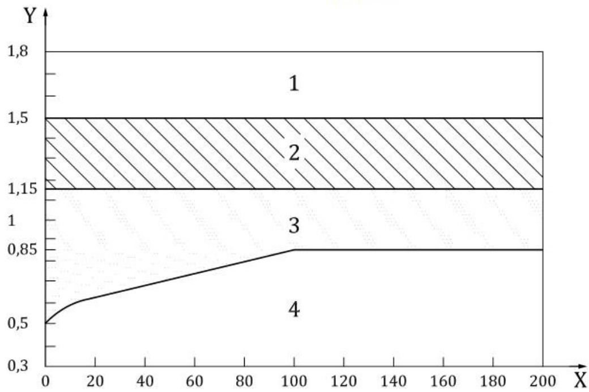

X specific loading, $\frac{F_{t} \cdot K_{A} \cdot K_{\gamma}}{b}$ N/mm
Y resonance ratio, N
1 supercritical range
2 intermediate range
3 main resonance range
4 subcritical range

Figure 1 — Resonance range

Thus, the following ranges result for the calculation of $K_{v}$ .

a) Subcritical range, $N \leq N_{S}$ (see 6.5.4).

b) Main resonance range, $N_{S} < N \leq 1,15$ (see 6.5.5). This field should be avoided. Refined analysis by Method A is recommended for $K_{v}$ .

c) Intermediate range, $1,15 < N \leq 1,5$ (see 6.5.7). Refined analysis by Method A is recommended.

d) Supercritical range, N > 1,5 (see 6.5.6).

### 6.5.4 Dynamic factor in subcritical range ( $N \leq N_{S}$ )

See 6.5.2 a) for special features; the majority of industrial gears operate in this range.

$$
K _ {\mathrm{v}} = (N K) + 1\tag{13}
$$

where

$$
K = \left(C _ {\mathrm{v} 1} B _ {\mathrm{p}}\right) + \left(C _ {\mathrm{v} 2} B _ {\mathrm{f}}\right) + \left(C _ {\mathrm{v} 3} B _ {\mathrm{k}}\right)\tag{14}
$$

$C_{v1}$ allows for pitch deviation effects and is assumed to be constant at $C_{v1}=0,32$ (see Figure 2);

$C_{v2}$ allows for tooth profile deviation effects and can be read from Figure 2

or determined in accordance with Table 8;

$C_{v3}$ allows for the cyclic variation effect in mesh stiffness and can be read from Figure 2 or determined in accordance with Table 8.

Table 8 — Formulae for calculation of factors $C_{\mathrm{v1}}$ to $C_{\mathrm{v7}}$ and $C_{\mathrm{ay}}$ for the determination of $K_{\mathrm{v - B}}$ , Method B (formulae relate to curves in Figures 2 and 3)

|  | $1 < {\varepsilon }_{\gamma } \leq 2$ | ${\varepsilon }_{\gamma } > 2$ |  |
| --- | --- | --- | --- |
| ${C}_{\mathrm{v}1}$ | 0,32 | 0,32 |  |
| ${C}_{\mathrm{v}2}$ | 0,34 | $\frac{0,{57}}{{\varepsilon }_{\gamma } - 0,3}$ |  |
| ${C}_{\mathrm{v}3}$ | 0,23 | $\frac{0,{096}}{{\varepsilon }_{\gamma } - 1,{56}}$ |  |
| ${C}_{\mathrm{v}4}$ | 0,90 | $\frac{0,{57} - 0,{05}{\varepsilon }_{\gamma }}{{\varepsilon }_{\gamma } - 1,{44}}$ |  |
| ${C}_{\mathrm{v}5}$ | 0,47 | 0,47 |  |
| ${C}_{\mathrm{v}6}$ | 0,47 | $\frac{0,{12}}{{\varepsilon }_{\gamma } - 1,{74}}$ |  |
|  | $1 < {\varepsilon }_{\gamma } \leq 1,5$ | $1,5 < {\varepsilon }_{\gamma } \leq 2,5$ | ${\varepsilon }_{\gamma } > 2,5$ |
| ${C}_{\mathrm{v}7}$ | 0,75 | $0,{125}\sin \left\lbrack {\pi \left( {{\varepsilon }_{\gamma } - 2}\right) }\right\rbrack + 0,{875}$ | 1,0 |

NOTE 1  ${C}_{\text{ay }} = \frac{1}{18}\left( {\frac{{\sigma }_{\text{Hlim }}}{97} - {18},{45}}\right) ^{2} + 1,5$ NOTE 2 When the material of the pinion (1) is different from that of the wheel (2),  ${C}_{\text{ay }1}$  and  ${C}_{\text{ay }2}$  are calculated separately, then  ${C}_{\text{ay }} = 0,5\left( {{C}_{\text{ay }1} + {C}_{\text{ay }2}}\right)$ .

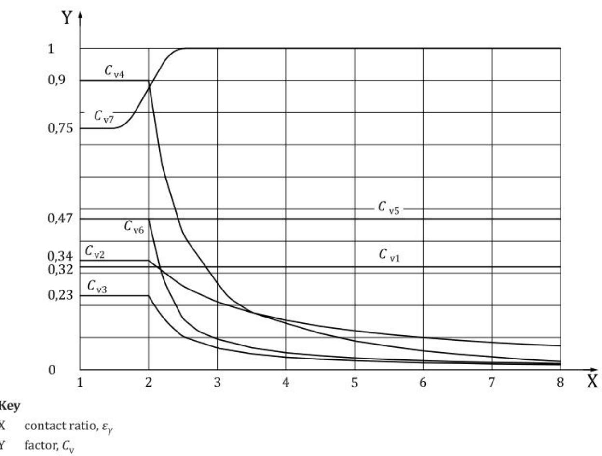  
NOTE For the formulae used for calculation, see Table 8.  
Figure 2 — Values of $C_{v1}$ to $C_{v7}$ for determination of $K_{v-B}$ (Method B)

X allowable stress number, $\sigma_{Hlim}$ , N/mm $^{2}$

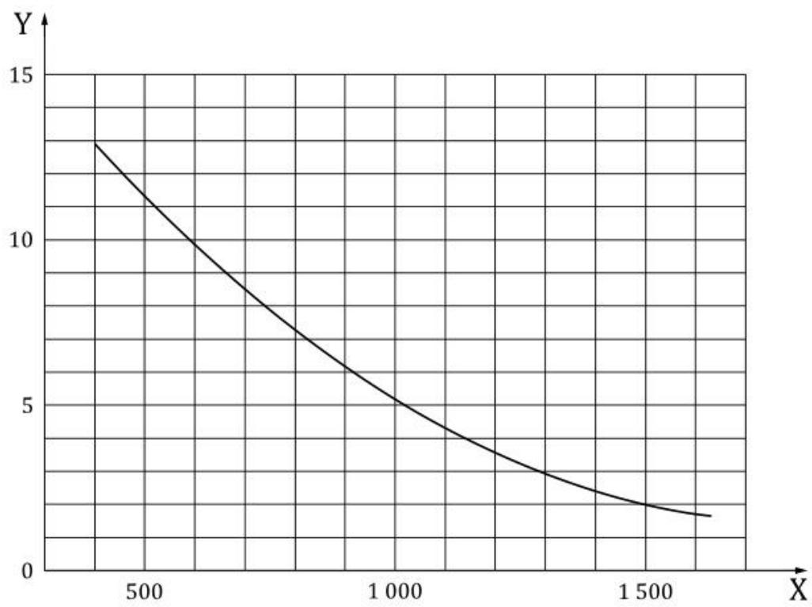  
Y tip relief, $C_{ay}$ , $\mu m$

NOTE When the pinion material (1) is different from the wheel (2) then $C_{ay} = 0, 5 \left( C_{ay1} + C_{ay2} \right)$ .

Figure 3 — Tip relief $C_{\mathrm{ay}}$ produced by running-in (see Table 8 for calculation)

$B_{p}, B_{f}$ and $B_{k}$ are non-dimensional parameters to take into account the effect of tooth deviations and profile modifications on the dynamic load [^4] .

$$
B _ {\mathrm{p}} = \frac {c ^ {\prime} f _ {\mathrm{pbeff}}}{K _ {\mathrm{A}} K _ {\gamma} (F _ {\mathrm{t}} / b)} \tag{15}
$$

$$
B _ {\mathrm{f}} = \frac {c ^ {\prime} f _ {\mathrm{f} \alpha \text {eff}}}{K _ {\mathrm{A}} K _ {\gamma} (F _ {\mathrm{t}} / b)} \tag{16}
$$

$$
B _ {\mathrm{k}} = \left| 1 - \frac {c ^ {\prime} \cdot \min (C _ {\mathrm{a} 1} + C _ {\mathrm{f} 2} , C _ {\mathrm{a} 2} + C _ {\mathrm{f} 1})}{K _ {\mathrm{A}} K _ {\gamma} (F _ {\mathrm{t}} / b)} \right| \tag{17}
$$

The effective base pitch and profile deviations are those of the “run-in” pinion and wheel. Initial deviations are generally modified during early service (running-in). The values of $f_{pb\ eff}$ and $f_{f\alpha\ eff}$ are determined by deducting estimated running-in allowances ( $y_{p}$ and $y_{f}$ ) as follows:

$$
f _ {\mathrm{pb} \text { eff }} = f _ {\mathrm{pb}} - y _ {\mathrm{p}}\tag{18}
$$

$$
f _ {\mathrm{f} \alpha \mathrm{eff}} = f _ {\mathrm{f} \alpha} - y _ {\mathrm{f}}\tag{19}
$$

Considerations of probability suggest that, in general, magnitudes of transmission deviation will not be greater than the allowable values of $f_{pb}$ and $f_{f\alpha}$ for the wheel, which are larger. They are therefore used in Formulae (18) and (19) respectively; these are usually the values for the largest wheel.

In the event that neither experimental nor service data on relevant material running-in characteristics are available (Method A), it can be assumed that $y_{p} = y_{\alpha}$ , with $y_{\alpha}$ from Figure 17 or 18 or 8.3.6.2. $y_{f}$ can be determined in the same way as $y_{\alpha}$ when the profile deviation $f_{f\alpha}$ is used instead of base pitch deviation $f_{pb}$ .

$C_{a}$ is the design amount for profile modification (tip relief at the beginning and end of tooth engagement).

A value $C_{ay}$ resulting from running-in is to be substituted for $C_{a}$ in Formula (17) in the case of gears without a specified profile modification. The value of $C_{ay}$ can be obtained from Figure 3 or calculated according to Table 8.

See Clause 9 for single tooth stiffness c'.

### 6.5.5 Dynamic factor in main resonance range ( $N_{S} < N \leq 1,15$ )

Subject to restriction (see 6.5.2 b), this factor is equal to

$$
K _ {\mathrm{v}} = \left(C _ {\mathrm{v} 1} B _ {\mathrm{p}}\right) + \left(C _ {\mathrm{v} 2} B _ {\mathrm{f}}\right) + \left(C _ {\mathrm{v} 4} B _ {\mathrm{k}}\right) + 1\tag{20}
$$

See 6.5.4 for details regarding $C_{\mathrm{v1}}, C_{\mathrm{v2}}, B_{\mathrm{p}}, B_{\mathrm{f}}$ and $B_{\mathrm{k}}$ .

$C_{v4}$ takes into account resonant torsional oscillations of the gear pair, excited by cyclic variation of the mesh stiffness. Its value can be taken from Figure 2 or calculated as indicated in Table 8.

NOTE The dynamic factor at this speed is strongly influenced by damping. The real value of the dynamic factor can deviate from the calculated value [see Formula (20)] by up to 40 %. This is especially true for spur gears with incorrectly designed profile modification.

### 6.5.6 Dynamic factor in supercritical range (N ≥ 1,5)

Most high precision gears used in turbine and other high-speed transmissions operate in this sector; see 6.5.2 c) for features.

$$
K _ {\mathrm{v}} = \left(C _ {\mathrm{v} 5} B _ {\mathrm{p}}\right) + \left(C _ {\mathrm{v} 6} B _ {\mathrm{f}}\right) + C _ {\mathrm{v} 7}\tag{21}
$$

In this range, the influences on $K_{\mathrm{v}}$ of $C_{\mathrm{v5}}$ and $C_{\mathrm{v6}}$ correspond to those of $C_{\mathrm{v1}}$ and $C_{\mathrm{v2}}$ on $K_{\mathrm{v}}$ in the subcritical range. See 6.5.4 for data on these factors and on $B_{\mathrm{p}}$ and $B_{\mathrm{f}}$ .

$C_{v7}$ takes into account the component of load which, due to mesh stiffness variation, is derived from tooth bending deflections during substantially constant speed.

$C_{v5}, C_{v6}$ and $C_{v7}$ can be obtained from Figure 2 or calculated according to Table 8.

### 6.5.7 Dynamic factor in intermediate range (1,15 < N < 1,5)

In this range, the dynamic factor is determined by linear interpolation between $K_{v}$ at N = 1,15 as specified in 6.5.5 and $K_{v}$ at N = 1,5 as specified in 6.5.6.

$$
K _ {\mathrm{v}} = K _ {\mathrm{v}} (N = 1, 5) + \frac {K _ {\mathrm{v}} (N = 1 , 15) - K _ {\mathrm{v}} (N = 1 , 5)}{0 , 35} (1, 5 - N)\tag{22}
$$

See 6.5.5 and 6.5.6 for details and explanatory notes.

### 6.5.8 Resonance speed determination for specific gear designs

#### 6.5.8.1 General

The resonance speed determination for specific transmission designs, which do not align with the simplifications of Method B as described in 6.4.2 should be made with the use of Method A. However, other methods may be used to approximate the effects. Some examples are as follows.

#### 6.5.8.2 Two rigidly connected coaxial gears

The mass of the larger of the connected gears is to be included. The mass of the smaller gear can often be ignored. This gives a useable approximation when the diameters of the connected gears are markedly different (see also 6.5.3).

#### 6.5.8.3 One large wheel driven by two pinions

See also 6.4.2. As the mass of the wheel is normally much greater than the masses of the pinions, each mesh can be considered separately, i.e

— as a pair comprising the first pinion and the wheel, and

— as a pair comprising the second pinion and the wheel.

#### 6.5.8.4 Planetary gears

Because of the many transmission paths which include stiffnesses other than mesh stiffness, the vibratory behaviour of planetary gears is very complex. The calculation of dynamic load factors using simple formulae, such as Method B, is generally quite inaccurate. Nevertheless, Method B modified as follows can be used for a first estimate of $K_{v}$ . This estimate should, if possible, be verified by means of a subsequent detailed theoretical or experimental analysis, or on the basis of operating experience. See also the comments in 6.4.2.

a) Ring gear rigidly connected to the gear case

In this case, the mass of the ring gear can be assumed to be infinite, the ring gear works as a rigid connection of the vibrating system. Under the presupposition that the vibrating system is decoupled from the other driving elements (connection with low stiffness against torsion), the remaining system consisting of sun and planets including the tooth contact between the sun and the planet and respectively, between the planet and the ring gear, possesses two resonance frequencies. These can be determined in a similar fashion to Formula (6) using two reduced masses, $m_{red,1}$ , $m_{red,2}$ , where, instead of $c_{\gamma\alpha}$ , the single tooth contact stiffness of a planet is to be used and the tooth number of the sun for $z_{1}$ . The reduced masses, $m_{red,1}$ and $m_{red,2}$ , can be determined as follows.

$$
m _ {\mathrm{red}, 1} = \frac {m _ {\mathrm{pla}} ^ {*} m _ {\mathrm{sun}} ^ {*}}{\left(p m _ {\mathrm{pla}} ^ {*}\right) + m _ {\mathrm{sun}} ^ {*}}\tag{23}
$$

$$
m _ {\mathrm{red}, 2} = m _ {\mathrm{pla}} ^ {*}\tag{24}
$$

with

$$
m _ {\mathrm{pla}} ^ {*} = \frac {\pi}{8} \frac {d _ {\mathrm{mpla}} ^ {4}}{d _ {\mathrm{bpla}} ^ {2}} \left(1 - q _ {\mathrm{pla}} ^ {4}\right) \rho_ {\mathrm{pla}}\tag{25}
$$

where

$m^{*}_{sun}$ is the moment of inertia per unit face width of the sun gear, divided by $r^{2}_{b\ sun}$ , where $r_{b\ sun} = d_{b\ sun} / 2$ ;

$m^{*}_{pla}$ is the moment of inertia per unit face width of a planet gear, divided by $r^{2}_{bpla}$ , where $r_{bpla} = d_{bpla} / 2$ ;

p is the number of planet gears in the gear stage under consideration;

$d_{m\ pla}$ is the mean diameter for calculating reduced gear pair mass for planetary gears, see Formula (31);

$q_{pla}$ is the auxiliary factor for planetary gears, see Formula (32);

$\rho_{pla}$ is the density.

It shall be observed that $F_{t}$ in Formulae (15) to (17) is equal to the whole peripheral load of the sun divided by the number of planets p. The dynamic factor, $K_{v,1/2}$ , can be estimated using the resonance speed, $n_{E,1/2}$ , calculated with $m_{red,1/2}$ ; for further calculation the larger of the two factors $K_{v,1/2}$ is to be used.

b) Rotating ring gear

In this case, it is mostly necessary to make a detailed analysis of the vibrating system. Only in the special case of much greater reduced masses of the sun, $m^{*}_{sun}$ , and the ring gear, $m^{*}_{ring}$ , the calculation described in 6.5.8.3 can be assumed:

$$
m _ {\mathrm{ring}} ^ {*} = \frac {\pi}{8} \frac {d _ {\mathrm{mring}} ^ {4}}{d _ {\mathrm{bring}} ^ {2}} \left(1 - q _ {\mathrm{ring}} ^ {4}\right) \rho_ {\mathrm{ring}}\tag{26}
$$

where

$m^{*}_{ring}$ is the moment of inertia per unit face width of the ring gear, divided by $r^{2}_{bring}$ , where $r_{bring} = d_{bring} / 2$ ;

$d_{\mathrm{m\,ring}}$ is the mean diameter for calculating reduced gear pair mass for ring gears, see Formula (31);

$q_{ring}$ is the auxiliary factor for ring gears, see Formula (32).

#### 6.5.8.5 Idler gears

The following calculation procedure is an extension of the approximate two mass model and falls under the limitations of 6.4.2.

For the calculation of the resonant frequencies of an idler gear, it is necessary to use a mechanical model with several degrees of freedom. Using the presuppositions made in Method B or C [^5] , this model can be reduced to three degrees of freedom. With the system of formulae belonging to this substituting model, two resonant frequencies (resonant speeds, $n_{E1,2}$ ) can be calculated:

$$
n _ {\mathrm{E1,2}} = \frac {30000}{\pi z _ {1}} \sqrt {\frac {1}{2} \left(B \pm \sqrt {B ^ {2} - 4 C}\right)}\tag{27}
$$

with

$$
B = c _ {\gamma \alpha , 1 / 2} \left(\frac {1}{m _ {1} ^ {*}} + \frac {1}{m _ {2} ^ {*}}\right) + c _ {\gamma \alpha , 2 / 3} \left(\frac {1}{m _ {2} ^ {*}} + \frac {1}{m _ {3} ^ {*}}\right)\tag{28}
$$

$$
C = c _ {\gamma \alpha , 1 / 2} c _ {\gamma \alpha , 2 / 3} \frac {m _ {1} ^ {*} + m _ {2} ^ {*} + m _ {3} ^ {*}}{m _ {1} ^ {*} m _ {2} ^ {*} m _ {3} ^ {*}}\tag{29}
$$

where

$m^{*}_{1/2/3}$ are the moments of inertia per unit face width of the smaller gear (pinion), the idler gear and the larger gear, related to the path of contact;

$c_{\gamma\alpha,1/2}$ is the mesh stiffness of the combination driving gear — idler gear;

$c_{\gamma\alpha,2/3}$ is the mesh stiffness of the combination idler gear — driven gear.

For the calculation of the mesh stiffness, see Clause 9.

$K_{v}$ may be determined by Method B using N as the least favorable ratio, i.e. the N ratio which results in the highest $K_{v}$ shall be considered.

### 6.5.9 Calculation of reduced mass of gear pair with external teeth

Approximate values of reduced mass which are sufficiently accurate can be derived from the following formulae:

$$
m _ {\mathrm{red}} = \frac {\pi}{8} \left(\frac {d _ {\mathrm{m} 1}}{d _ {\mathrm{b} 1}}\right) ^ {2} \frac {d _ {\mathrm{m} 1} ^ {2}}{\frac {1}{\left(1 - q _ {1} ^ {4}\right) \rho_ {1}} + \frac {1}{\left(1 - q _ {2} ^ {4}\right) \rho_ {2} u ^ {2}}}\tag{30}
$$

where

$d_{b1}$ is the base diameter;

$$
d _ {\mathrm{m1,m2}} = \frac {d _ {\mathrm{a1,a2}} + d _ {\mathrm{f1,f2}}}{2}\tag{31}
$$

$$
q _ {1} = \frac {d _ {\mathrm{i} 1}}{d _ {\mathrm{m} 1}}; q _ {2} = \frac {d _ {\mathrm{i} 2}}{d _ {\mathrm{m} 2}}\tag{32}
$$

See Figure 4.

Formulae (30) to (32) apply to external double helical, external single helical and external spur gears. They ignore the masses of web and hub because of their negligible influence on the moment of inertia.

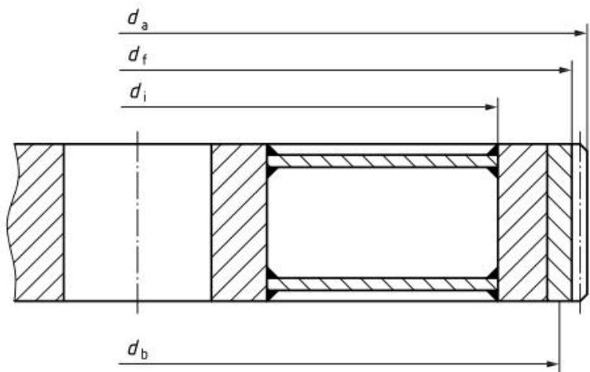  
Figure 4 — Definitions of the various diameters

For pinions and wheels of solid construction:

$$
1 - q _ {1} ^ {4} = 1; 1 - q _ {2} ^ {4} = 1\tag{33}
$$

The calculation of $(1 - q_{1}^{4})$ or $(1 - q_{2}^{4})$ for a gear rim whose rim width differs from the face width is only valid where the masses of the rim are directly connected to the gear rim. More distant masses on the same shaft are ignored, since the stiffness of the interconnecting shaft is generally of minor significance compared to tooth stiffness.

## 6.6 Determination of dynamic factor using Method C: $K_{v-C}$

### 6.6.1 General

In conjunction with the conditions and assumptions described in 6.4.3, Method C supplies average values which can be used for industrial transmissions and gear systems with similar requirements in the following fields of application:

a) subcritical running speed range, i.e. $(v z_{1}/100)\sqrt{u^{2}/(1+u^{2})}<10\ \text{m/s}$ , where the restrictions in 6.4.3 a) apply accordingly;

b) external and internal spur gears;

c) basic rack profile as specified in ISO 53;

d) spur and helical gears with $\beta \leq 30^{\circ}$ ;

e) pinion with relatively low number of teeth, $z_{1} < 50$ ;

f) solid disc wheels or heavy steel gear rim [^6] .

Method C can also generally be used, with restrictions for the following fields of application:

g) all types of cylindrical gears, if $(v z_{1} / 100)\sqrt{u^{2} / (1 + u^{2})} < 3\mathrm{m / s}$ ;

h) lightweight gear rim [^6] ;

i) helical gears where $\beta > 30^{\circ}$[^6] .

$K_{\mathrm{v}}$ can be read from graphs (see 6.6.2) or computed (see 6.6.3). The method gives similar values.

### 6.6.2 Graphical values of dynamic factor using Method C

$$
K _ {\mathrm{v}} = \left(f _ {\mathrm{F}} K _ {350} N\right) + 1\tag{34}
$$

$f_{F}$ takes into account the influence of the load on the dynamic factor, $K_{350}$ , the influence of the gear tolerance class at the specific loading of 350 N/mm and N is the resonance ratio [see Formula (9)].

The curves for gear tolerance class in Figures 5 and 6 extend only to the value $(v z_{1} / 100)\sqrt{u^{2} / (1 + u^{2})} = 3\mathrm{m / s}$ , which is not generally exceeded for this tolerance class.

a) For helical gears with overlap ratio $\varepsilon_{\beta} \geq 1$ (also approximately for $\varepsilon_{\beta} > 0,9$ ), the correction factor $f_{F}$ shall be in accordance with Table 9 and $(K_{350} N)$ shall be in accordance with Figure 5.

b) For spur gears, the correction factor $f_{\mathrm{F}}$ shall be in accordance with Table 10 and $(K_{350}N)$ shall be in accordance with Figure 6.

c) For helical gears with overlap ratio $\varepsilon_{\beta} < 1$ , the value $K_{\mathrm{v}}$ is determined by linear interpolation between values in accordance with a) and b):

$$
K _ {\mathrm{v}} = K _ {\mathrm{v} \alpha} - \varepsilon_ {\beta} \left(K _ {\mathrm{v} \alpha} - K _ {\mathrm{v} \beta}\right)\tag{35}
$$

where

$K_{v\alpha}$ is the dynamic factor for spur gears using b);

$K_{v\beta}$ is the dynamic factor for helical gears using a).

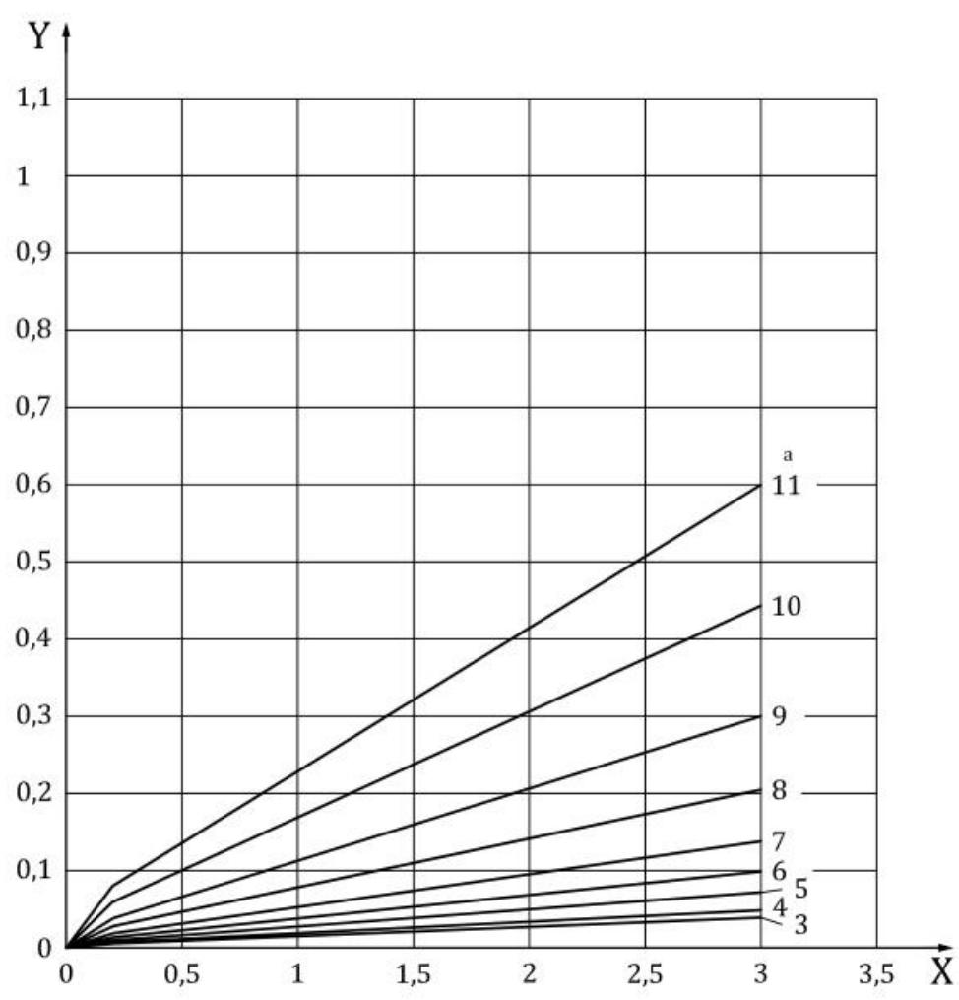

$$
X \quad \left(v z _ {1} / 100\right) \sqrt {u ^ {2} / \left(1 + u ^ {2}\right)}
$$

$$
Y \quad K _ {350} N
$$

a Gear tolerance class in accordance with ISO 1328-1:2013, helical gears.

Figure 5 — Values of $K_{350}N$ for helical gears with $\varepsilon_{\beta}\geq 1$

X $(vz_{1} / 100)\sqrt{u^{2} / (1 + u^{2})}$

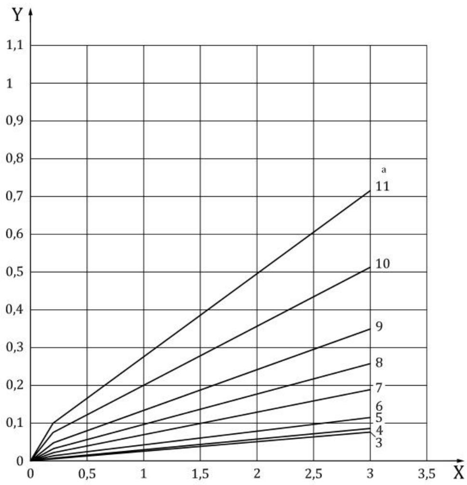  
Y $K_{350}N$  
a Gear tolerance class in accordance with ISO 1328-1:2013, spur gears.

Figure 6 — Value of $K_{350}$ N for spur gears  
Table 9 — Load correction factor, ${f}_{\mathrm{F}}$ ,for helical gears

| Gear tolerance classa | Load correction factor,  $f_{F}$ | Load correction factor,  $f_{F}$ | Load correction factor,  $f_{F}$ | Load correction factor,  $f_{F}$ | Load correction factor,  $f_{F}$ | Load correction factor,  $f_{F}$ | Load correction factor,  $f_{F}$ | Load correction factor,  $f_{F}$ |
| --- | --- | --- | --- | --- | --- | --- | --- | --- |
| Gear tolerance classa | ≤100 | 200 | 350 | 500 | 800 | 1 200 | 1 500 | 2 000 |
| 3 | 1,96 | 1,29 | 1 | 0,88 | 0,78 | 0,73 | 0,70 | 0,68 |
| 4 | 2,21 | 1,36 | 1 | 0,85 | 0,73 | 0,66 | 0,62 | 0,60 |
| 5 | 2,56 | 1,47 | 1 | 0,81 | 0,65 | 0,56 | 0,52 | 0,48 |
| 6 | 2,82 | 1,55 | 1 | 0,78 | 0,59 | 0,48 | 0,44 | 0,39 |
| 7 | 3,03 | 1,61 | 1 | 0,76 | 0,54 | 0,42 | 0,37 | 0,33 |
| 8 | 3,19 | 1,66 | 1 | 0,74 | 0,51 | 0,38 | 0,33 | 0,28 |
| 9 | 3,27 | 1,68 | 1 | 0,73 | 0,49 | 0,36 | 0,30 | 0,25 |
| 10 | 3,35 | 1,70 | 1 | 0,72 | 0,47 | 0,33 | 0,28 | 0,22 |
| 11 | 3,39 | 1,72 | 1 | 0,71 | 0,46 | 0,32 | 0,27 | 0,21 |

$(F_{t} K_{A} K_{\gamma})/b$ N/mm

NOTE 1 Interpolate for intermediate values.NOTE 2 Consider the worst tolerance class between pinion and gear.a Gear tolerance class in accordance with ISO 1328-1:2013.

Table 10 — Load correction factor, $f_{\mathrm{F}}$ , for spur gears

| Gear tolerance classa | Load correction factor,  $f_{\text{F}}$ | Load correction factor,  $f_{\text{F}}$ | Load correction factor,  $f_{\text{F}}$ | Load correction factor,  $f_{\text{F}}$ | Load correction factor,  $f_{\text{F}}$ | Load correction factor,  $f_{\text{F}}$ | Load correction factor,  $f_{\text{F}}$ | Load correction factor,  $f_{\text{F}}$ |
| --- | --- | --- | --- | --- | --- | --- | --- | --- |
| Gear tolerance classa | ≤100 | 200 | 350 | 500 | 800 | 1 200 | 1 500 | 2 000 |
| 3 | 1,61 | 1,18 | 1 | 0,93 | 0,86 | 0,83 | 0,81 | 0,80 |
| 4 | 1,81 | 1,24 | 1 | 0,90 | 0,82 | 0,77 | 0,75 | 0,73 |
| 5 | 2,15 | 1,34 | 1 | 0,86 | 0,74 | 0,67 | 0,65 | 0,62 |
| 6 | 2,45 | 1,43 | 1 | 0,83 | 0,67 | 0,59 | 0,55 | 0,51 |
| 7 | 2,73 | 1,52 | 1 | 0,79 | 0,61 | 0,51 | 0,47 | 0,43 |
| 8 | 2,95 | 1,59 | 1 | 0,77 | 0,56 | 0,45 | 0,40 | 0,35 |
| 9 | 3,09 | 1,63 | 1 | 0,75 | 0,53 | 0,41 | 0,36 | 0,31 |
| 10 | 3,22 | 1,67 | 1 | 0,73 | 0,50 | 0,37 | 0,32 | 0,27 |
| 11 | 3,30 | 1,69 | 1 | 0,72 | 0,48 | 0,35 | 0,30 | 0,24 |

$(F_{\text{t}} K_{\text{A}} K_{\gamma})/b$ N/mm

NOTE 1 Interpolate for intermediate values.NOTE 2 Consider the worst tolerance class between pinion and gear.a Gear tolerance class in accordance with ISO 1328-1:2013.

### 6.6.3 Determination by calculation of dynamic factor using Method C

a) For spur gears and helical gears with overlap ratio $\varepsilon_{\beta} \geq 1$ (also approximately for $\varepsilon_{\beta} > 0,9$ )

$$
K _ {\mathrm{v}} = 1 + \left(\frac {K _ {1}}{K _ {\mathrm{A}} K _ {\gamma} \frac {F _ {\mathrm{t}}}{b}} + K _ {2}\right) \frac {v z _ {1}}{100} K _ {3} \sqrt {\frac {u ^ {2}}{1 + u ^ {2}}}\tag{36}
$$

where numerical values for $K_{1}$ and $K_{2}$ shall be as specified in Table 11, and $K_{3}$ shall be in accordance with Formula (37) or Formula (38). If $(F_{\mathrm{t}}K_{\mathrm{A}}K_{\gamma})/b$ is less than 100 N/mm, this value is assumed to be equal to 100 N/mm. See 6.5.2 a).

$$
\text {   If   } \frac {v z _ {1}}{100} \sqrt {\frac {u ^ {2}}{1 + u ^ {2}}} \leq 0, 2 \text {   then   } K _ {3} = 2, 0\tag{37}
$$

$$
\text {   If   } \frac {v z _ {1}}{100} \sqrt {\frac {u ^ {2}}{1 + u ^ {2}}} > 0, 2 \text {   then   } K _ {3} = - 0, 357 \frac {v z _ {1}}{100} \sqrt {\frac {u ^ {2}}{1 + u ^ {2}}} + 2, 071\tag{38}
$$

Table 11 — Values of factors $K_{1}$ and $K_{2}$ for calculation of $K_{\mathrm{v - C}}$ by Formula (36)

|  | $K_1$ Tolerance class as specified in ISO 1328-1:2013 | $K_1$ Tolerance class as specified in ISO 1328-1:2013 | $K_1$ Tolerance class as specified in ISO 1328-1:2013 | $K_1$ Tolerance class as specified in ISO 1328-1:2013 | $K_1$ Tolerance class as specified in ISO 1328-1:2013 | $K_1$ Tolerance class as specified in ISO 1328-1:2013 | $K_1$ Tolerance class as specified in ISO 1328-1:2013 | $K_1$ Tolerance class as specified in ISO 1328-1:2013 | $K_1$ Tolerance class as specified in ISO 1328-1:2013 | $K_2$ Alltoleranceclasses |
| --- | --- | --- | --- | --- | --- | --- | --- | --- | --- | --- |
|  | 3 | 4 | 5 | 6 | 7 | 8 | 9 | 10 | 11 | $K_2$ Alltoleranceclasses |
| Spur gears | 2,1 | 3,9 | 7,5 | 14,9 | 26,8 | 39,1 | 52,8 | 76,6 | 102,6 | 0,019 3 |
| Helical gears | 1,9 | 3,5 | 6,7 | 13,3 | 23,9 | 34,8 | 47,0 | 68,2 | 91,4 | 0,008 7 |

Consider the worst tolerance class between pinion and gear.

b) For helical gears with overlap ratio $\varepsilon_{\beta} < 1$ :

The value $K_{v}$ is determined by linear interpolation between values determined for spur gears ( $K_{v\alpha}$ ) and helical gears ( $K_{v\beta}$ ) in accordance with 6.6.2 c). See Formula (35).

# 7 Face load factors, $K_{H\beta}$ and $K_{F\beta}$

## 7.1 Gear tooth load distribution

The face load factor takes into account the effects of the nonuniform distribution of load over the gear face width on the surface stress ( $K_{H\beta}$ ) and on the tooth root stress ( $K_{F\beta}$ ).

See 7.2.2 and 7.2.3 for definitions of the face load factors.

The extent to which the load is unevenly distributed depends on the following influences:

a) the gear tooth manufacturing accuracy — lead, profile and spacing;

b) alignment of the axes of rotation of the mating gear elements;

c) elastic deflections of gear unit elements — shafts, bearings, housings and foundations which support the gear elements;

d) bearing clearances;

e) Hertzian contact and bending deformations at the tooth surface including variable tooth stiffness;

f) thermal deformations due to the operating temperature (especially important for gears with large face widths);

g) centrifugal deflections due to the operating speed;

h) helix modifications including tooth crowning and end relief;

i) running-in effects;

j) total tangential tooth load (including increases due to application factor, $K_{A}$ , mesh load factor, $K_{\gamma}$ , and dynamic factor, $K_{v}$ );

k) additional shaft loads (e.g. from belt or chain drives);

l) gear geometry.

## 7.2 General principles for determination of face load factors, $K_{H\beta}$ and $K_{F\beta}$

### 7.2.1 General

Uneven load distribution along the face width is caused by an equivalent mesh misalignment in the plane of action, comprising load induced elastic deformation of gears and housing and displacements of bearings; it can also be caused by manufacturing deviations and thermal distortions.

When combined, the housing and gear manufacturing deviations, deflections of the housing and displacements of bearings always result in a straight-line deviation within the plane of action. Elastic deformations of shafts and gear bodies always result in non-linear deviations, as well as the deformations produced by thermal distortion resulting from uneven temperature distribution over the face width. The undulations and the flank form deviation are superimposed on the resulting mesh alignment. The unevenness of load distribution is reduced by running-in in accordance with the running-in effects characteristic of the material combination.

### 7.2.2 Face load factor for contact stress, $K_{H\beta}$

$K_{H\beta}$ takes into account the effect of the load distribution over the face width on the contact stress and is defined as the ratio of the maximum load per unit face width to the average load per unit face width.

$$
K _ {\mathrm{H} \beta} = \frac {w _ {\max}}{w _ {\mathrm{m}}} = \frac {F _ {\max} / b}{F _ {\mathrm{m}} / b}\tag{39}
$$

The tangential loads at the reference cylinder are used for an approximate calculation, i.e. using the transverse specific loading $[F_{\mathrm{m}}/b = (F_{\mathrm{t}} K_{\mathrm{A}} K_{\gamma} K_{\mathrm{v}})/b]$ at the reference cylinder and the corresponding maximum local loading.

### 7.2.3 Face load factor for tooth root stress, $K_{F\beta}$

$K_{F\beta}$ takes into account the effect of the load distribution over the face width on the stresses at the tooth root. It depends on the variables which are determined for $K_{H\beta}$ and also on the face width to tooth depth ratio, b/h.

## 7.3 Methods for determination of face load factor — Principles, assumptions

### 7.3.1 General

Several methods in accordance with the specifications of 4.1.16 are given in 7.3.2 to 7.3.4 for the determination of the face load factors.

A detailed contact analysis is recommended when the face/diameter ratio, b/d, of the pinion is greater than 1,5 for through hardened gears and greater than 1,2 for surface hardened gears.

When equivalent misalignments due to mechanical and thermal deformations are compensated for by helix modification (possibly varying over the face width), a nearly uniform load distribution over the face width can be achieved for a given operating condition, if there is a high degree of manufacturing accuracy. In this case the value of the face load factor approaches unity. See Annex B for guidance data on face crowning and end relief. See 4.1.16 for tolerance class limitations. For further information and guide values for $K_{\mathrm{H}\beta -\mathrm{C}}$ for crowned teeth of cylindrical gears see Annex C.

### 7.3.2 Method A — Factors $K_{H\beta-A}$ and $K_{F\beta-A}$

By this method, the load distribution over the face width is determined by means of a comprehensive analysis of all the influence factors. The load distribution over the face width of gears under load can be assessed from the measured values of tooth root strain, during operation at the working temperature or, with limitations, by a critical examination of the tooth bearing pattern.

Data to be given in the delivery specification or drawing include

a) maximum (permissible) face load factor, or

b) maximum permissible total mesh misalignment under operating load and temperature, for which the face load factor can be derived using a precise calculation method where it is also necessary that all other relevant influences be known.

### 7.3.3 Method B — Factors $K_{H\beta-B}$ and $K_{F\beta-B}$

By this method, the load distribution along the face width is determined by means of computer-aided calculations. This method depends on the elastic deflections under load, the static displacements and the stiffness of the whole elastic system (see 7.4). The load distribution in a gear mesh and the deformations of the elastic system affect each other. Therefore, one of the following methods shall be used:

— iterative method (see Dudley/Winter $^{[21]}$ );

— influence factors.

### 7.3.4 Method C — Factors $K_{H\beta-C}$ and $K_{F\beta-C}$

By using this method, account is taken of those components of equivalent misalignment due to pinion and pinion shaft deformations and also those due to manufacturing deviations. Means of evaluating approximate values of the variables include calculation, measurement and experience, either individually or in combination (see 7.5 and 7.6 respectively). As explained in 7.2.2, Method C involves the assumption that gear body elastic deflections produce, in the mesh, a linearly increasing separation over the face width of the working tooth flanks (see Annex D for further information). That equivalent misalignment, inclusive of manufacturing deviations, involves similar separation of working flanks, which is implicit in this assumption.

Figures 7 and 8 illustrate the influences of equivalent misalignment, according to these assumptions, and the tooth load, on the load distribution.

## 7.4 Determination of face load factor using Method B: $K_{H\beta-B}$

### 7.4.1 Number of calculation points

The load distribution is calculated for 10 increments along the face width.

### 7.4.2 Definition of $K_{H\beta}$

$K_{H\beta}$ is defined as the ratio of the maximum load per unit face width, $w_{max}$ , compared to the average load per unit face width, $w_{m}$ . The basic model of the gear mesh is a spur tooth pair having the same number of teeth, transverse module and face width of the gear pair being analysed.

$$
K _ {\mathrm{H} \beta} = \frac {w _ {\max}}{w _ {\mathrm{m}}} = \frac {F _ {\max} / b}{F _ {\mathrm{m}} / b}\tag{40}
$$

### 7.4.3 Stiffness and elastic deformations

#### 7.4.3.1 General

The effective stiffness used for the calculation of the load distribution is the stiffness of the whole elastic system. Examples are given in Annex E. It is the addition of the following elastic elements:

— gear mesh;

— gear body;

— stiffness of shaft/hub connections, pinion and gear shaft;

— stiffness of the bearings;

— stiffness of the housing;

— stiffness of the foundation.

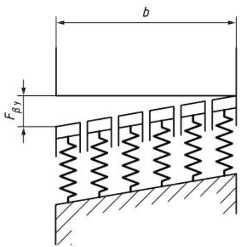

a) Without load  
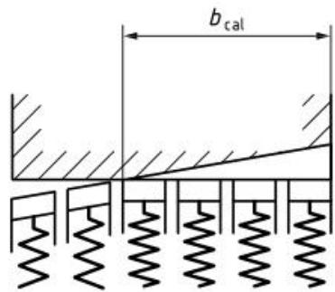

b) Low load and/or large value of equivalent misalignment (large value of $F_{\beta y}$ )  
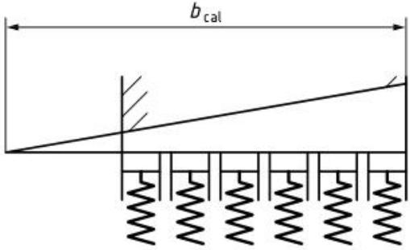  
c) High load and/or small value of equivalent misalignment (small value of $F_{\beta y}$ )  
Figure 7 — Distribution of load along face width with linear equivalent misalignment (illustration of principle)

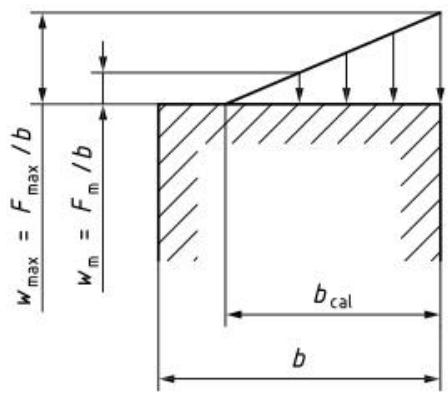

$$
w _ {\max} = \frac {F _ {\max}}{b} = \frac {2 F _ {\mathrm{m}}}{b} \cdot \frac {b}{b _ {\mathrm{cal}}}
$$

a) Low load and/or large value of $F_{\beta y}$ , $b_{cal}/b \leq 1$  
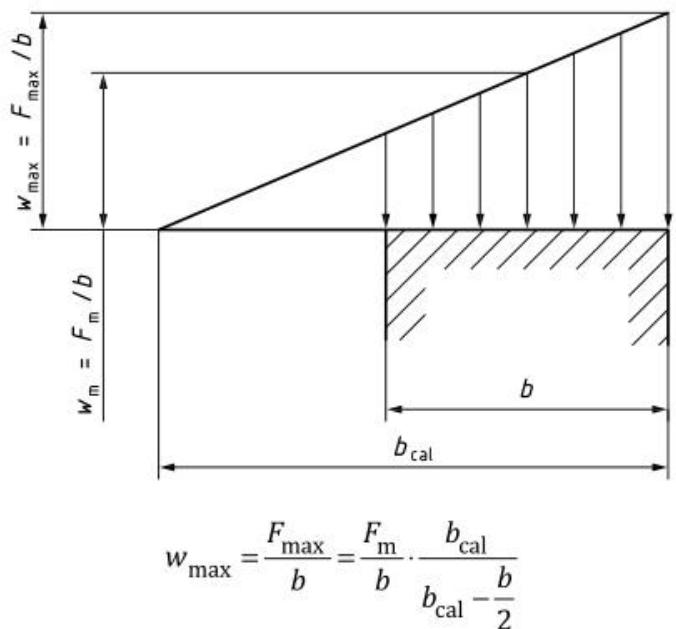  
b) High load and/or small value of $F_{\beta y}$ , $b_{cal}/b > 1$  
Figure 8 — Calculation of load per the unit face width $F_{\text{max}} / b$ with linear distribution of the load on the face width $F_{\text{m}} = F_{\text{t}} K_{\text{A}} K_{\gamma} K_{\text{v}}$

#### 7.4.3.2 Gear mesh

The stiffness of each increment results from the method of calculating the deformations. The stiffness of each spring is the mean value of mesh stiffness $c_{\gamma\beta}$ according to Clause 9. The load is assumed to be in the zone of single tooth contact without load sharing. The load sharing between helical teeth is not considered. In certain gears such as thin rimmed gears, the stiffness can vary. Similarly, at ends of the face width the stiffness values can be less than in the centre face. These effects are ignored in Method B.

#### 7.4.3.3 Gear body

The deformations of the gear body due to bending and torsion can be considered by regarding the gear body as a part of the shaft. Different diameters are used for calculating the bending and torsional deformation in the area of the gear mesh, which should be between the root and the tip diameter of the pinion/gear. The value for bending is $(d_{\mathrm{a}} - d_{\mathrm{f}})/2 + d_{\mathrm{f}}$ . For torsion it is the root diameter plus 0,4 modules. The load is in the plane of action for bending.

#### 7.4.3.4 Stiffness of shaft/hub connection, pinion and gear shaft

For normally shrink-fitted gears or other parts (e.g. a pulley), the shaft is stiffened to a diameter midway $d_{\mathrm{mid}}$ between hub diameter and bore $d_{\mathrm{bore}}$ , see Figure 9. For webbed gears, replace $d_{f}$ with the outer hub diameter.

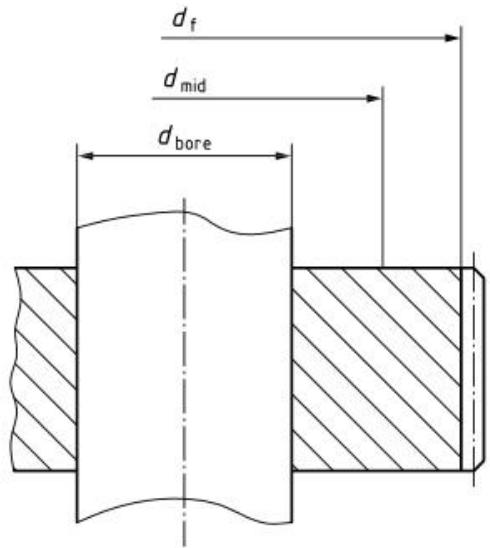  
Figure 9 — Definitions of various diameters

The bending deflections of the pinion and gear shaft (with variable inside and outside diameter, integral part) shall be calculated according to the linear bending theory. The bending deflections can be caused by all gear meshes and by all other external loads (belts, chains, couplings, etc.). The diameter in the tooth area to be used for bending is $(d_{\mathrm{a}} - d_{\mathrm{f}})/2 + d_{\mathrm{f}}$ . The load is in the plane of action for bending. The torsional deformation of the pinion and gear have only to be calculated in the area of the gear mesh. It shall be considered that the torque is decreasing along the face width. A diameter of root diameter plus 0,4 modules should be used.

#### 7.4.3.5 Stiffness of the bearings

The elastic deformations of the bearings may be calculated by the input of stiffness values for the applied load. If exact stiffness values are not known, minimum and maximum values shall be chosen to verify the influence of the bearing deformations.

#### 7.4.3.6 Stiffness of the housing

The elastic deformations of the housing may be determined by calculation or empirical means. In the case of tapered bearings, the axial deflection of the housing due to gear loads and external thrust loads shall be considered in determining the bearing clearances and resulting shaft positions at the bearings.

#### 7.4.3.7 Stiffness of the foundation

The elastic deformations of the foundation may be determined by calculation or empirical means.

### 7.4.4 Static displacements

#### 7.4.4.1 Shaft working position in bearings

The operating bearing clearances shall be considered, including the effects of manufacturing variations, thermal expansion, interference fits, axial clearance in tapered bearings and oil film thickness in plain bearings.

#### 7.4.4.2 Manufacturing deviations

Manufacturing variations (permissible variations in gears, housings, etc.) may be estimated from drawing tolerances or established manufacturing standards. The use of ISO 1328 (all parts) for tooth alignment $f_{H\beta}$ is permitted for the estimate of total manufacturing variation, provided that contact checking at assembly is used to verify that its use is appropriate.

### 7.4.5 Assumptions

The methods used for determining the values of bearing deformations, bearing clearances, housing deformation and the values for manufacturing deviations shall be stated. If influence factors are neglected, it shall be justified that they are low enough in magnitude.

### 7.4.6 Computer program output

In order to verify the computer calculations, the output of the program shall include the full list of input values and all relevant intermediate results. To understand the input assumptions and the output value of $K_{H\beta}$ , the following data is required in tabular graphic form:

— deflections of the shafts (bending and twist);

— bearing forces;

— gear data;

— load distribution;

— load distribution factor.

## 7.5 Determination of face load factor using Method C: $K_{H\beta-C}$

### 7.5.1 General

The formulae for the calculations of elastic deflections of the pinion and pinion shaft ( $f_{sh}$ ) are simplified and are based on the following assumptions.

a) The deflections of the wheel and wheel shaft are not included in the basic calculations; normally these elements are sufficiently stiff so that their deflections can be ignored, but if it is required to include them, they shall be assessed independently, and corresponding amounts added to $f_{ma}$ with the correct sign.

b) Deformations of the gear case and of the bearings are not included in the basic calculations; normally these elements are sufficiently stiff so that their deflections can be ignored (noting that it is deflection differences which are important), but if it is required to include them they shall be assessed independently, and corresponding amounts added to $f_{ma}$ with the correct sign.

c) No effect of bearing clearances is included. If the configuration is such that the clearances can result in significant shaft tilting, then this tilt shall be assessed independently, and corresponding amounts added to $f_{ma}$ with the correct sign.

d) The torsional and bending deflection of a pinion with the actual load distribution are assumed to be not significantly different from those determined with loading distributed evenly over the face width. This assumption is valid for low calculated values of $K_{H\beta}$ and becomes increasingly less valid for higher values.

e) The bearings do not absorb any bending moments.

f) The pinion configuration is in accordance with Figure 13. Note that the restriction that the pinion is towards the centre of the shaft span (0 ≤ s / l ≤ 0,3) does not apply if suitable helix correction is used. Note also that the factor K' takes into account the stiffening effect of the pinion body.

g) The pinion shaft has a constant diameter ( $d_{sh}$ ), is solid (or hollow shaft with $d_{shi}/d_{sh} < 0.5$ ) or can at least be satisfactorily so approximated.

h) The shaft material is steel.

i) Any additional external loads acting on the pinion shaft (e.g. from shaft couplings) have a negligible effect on the bending deflection of the shaft across the gear face width.

There are three commonly arising conditions which are not covered by the formulae of 7.5.3.5 but which can be easily dealt with by slight variants on those formulae.

— Where the ratio is unity or near unity and the torqued ends of the shaft are at opposite sides of the box (e.g. rod mill pinion), the torsional deflections of each gear are the same and in the opposite sense, thus compensating for each other, but the bending deflections add.

— Simple planetary gear trains: planet/annulus mesh. As with all idler gears, there is no torsional deflection on the pinion (planet) and the main bending deflection is usually that of the pin in the carrier (caused by loads of the meshing with both the sun and annulus gears).

— Simple planetary gear trains: sun/planet mesh. The torsional deflection of the sun gear is due to the multiple meshes but its bending deflection is zero. However, the deflection of the carrier can also be important at this mesh.

For further information on the derivation of the $f_{sh}$ formulae, see Annex D. Note in particular that so as to simplify the procedures for the evaluation of $K_{H\beta}$ by Method C, equivalent mesh misalignment due to elastic deflections is assumed to follow a straight line and that a correction constant (1,33, see D.3) is introduced to compensate. With increasing curvature of the elastic deformation line, as occurs when gear pairs are heavily loaded or pinion face width to diameter ratios are large, or both, the assumptions may lead to increasing differences between the calculated and actual distributions of the load; thus, the accuracy of the calculated $K_{H\beta-C}$ becomes worse as its magnitude increases.

The face load factor, $K_{H\beta-C}$ , is calculated from the mean load intensity across the face ( $F_{m}/b$ ), the mesh stiffness ( $c_{\gamma\beta}$ ), and an effective total mesh misalignment ( $F_{\beta y}$ ). One of two formulae is used: Formula (41) or (43), depending upon whether the contact is calculated to extend across the full face width (see Figures 7 and 8).

Throughout this clause, in the case of double helical gears $(b = 2b_{\mathrm{B}})$ , and the smaller of the values for pinion or wheel shall be substituted for b or $b_{B}$ — this being the width at the tooth roots excluding tooth end chamfering or rounding.

a) $b_{cal} / b \leq 1$ corresponding to $\frac{F_{\beta y} c_{\gamma\beta}}{2 F_{m} / b} \geq 1$ :

$$
K _ {\mathrm{H} \beta} = \sqrt {\frac {2 F _ {\beta \mathrm{y}} c _ {\gamma \beta}}{F _ {\mathrm{m}} / b}} \geq 2\tag{41}
$$

$$
b _ {\mathrm{cal}} / b = \sqrt {\frac {2 F _ {\mathrm{m}} / b}{F _ {\beta \mathrm{y}} c _ {\gamma \beta}}}\tag{42}
$$

b) $b_{cal} / b > 1$ corresponding to $\frac{F_{\beta y} c_{\gamma\beta}}{2 F_{m} / b} < 1$ :

$$
K _ {\mathrm{H} \beta} = 1 + \frac {F _ {\beta \mathrm{y}} c _ {\gamma \beta}}{2 F _ {\mathrm{m}} / b}\tag{43}
$$

$$
b _ {\mathrm{cal}} / b = 0, 5 + \frac {F _ {\mathrm{m}} / b}{F _ {\beta \mathrm{y}} c _ {\gamma \beta}}\tag{44}
$$

The value of effective misalignment to be used is obtained by combining two elements:

a) the effect of manufacturing error (of all relevant components) is included through $f_{ma}$ in accordance with 7.5.4;

b) the effect of elastic deflections of the pinion and pinion shaft are included through $f_{sh}$ as in 7.5.3.5 to form an initial equivalent misalignment $F_{\beta x}$ , which is then reduced by a running-in allowance to form $F_{\beta y}$ .

The way in which the two elements are combined depends upon the helix modification (crowning, helix correction, end relief, or none) applied to the mesh (see 7.5.3.4).

### 7.5.2 Effective equivalent misalignment, $F_{\beta y}$

The following formula can be used for common transmission designs:

$$
F _ {\beta \mathrm{y}} = F _ {\beta \mathrm{x}} - y _ {\beta} = F _ {\beta \mathrm{x}} \chi_ {\beta}\tag{45}
$$

where $F_{\beta x}$ is the initial equivalent misalignment, i.e. the absolute value of the sum of deformations, displacements and manufacturing deviations of pinion and wheel, measured in the plane of action, and which can be determined in accordance with Method C (see 7.5.3.4).

### 7.5.3 Running-in allowance, $y_{\beta}$ , and running-in factor, $\chi_{\beta}$

#### 7.5.3.1 General

$y_{\beta}$ is the amount by which the initial equivalent misalignment is reduced by running-in since operation was commenced. $\chi_{\beta}$ is the factor characterizing the equivalent misalignment after running-in. It is convenient to use $\chi_{\beta}$ in calculations, but only as long as $y_{\beta}$ is proportional to $F_{\beta x}$ . The important influences include

— pinion and wheel material,

— surface hardness,

— rotational speed at the reference circle,

— type of lubricant,

— surface treatment,

— abrasive in the oil, and

— initial equivalent misalignment, $F_{\beta x}$ (as a result of deformations, displacements and manufacturing deviations).

$y_{\beta}$ and $\chi_{\beta}$ do not take into account the effects of running-in operations obtained by manufacturing processes such as lapping. Removal of material by such means shall be taken into account in the value of $f_{ma}$ .

In the absence of direct, assured data from experiment or operating experience (Method A), $y_{\beta}$ can be determined in accordance with Method B given in 7.5.3.2 or 7.5.3.3.

#### 7.5.3.2 Determination of $y_{\beta}$ and $\chi_{\beta}$ by calculation

The values from Formulae (46) to (53) reproduce the curves in Figures 10 and 11 (see Table 3 for abbreviations used).

a) For St, St (cast), V, V (cast), GGG (perl., bai.), GTS (perl.):

$$
y _ {\beta} = \frac {320}{\sigma_ {\mathrm{Hlim}}} F _ {\beta \mathrm{x}}\tag{46}
$$

$$
\chi_ {\beta} = 1 - \frac {320}{\sigma_ {\mathrm{Hlim}}}\tag{47}
$$

where $y_{\beta} \leq F_{\beta X}$ and $\chi_{\beta} \geq 0$ and where

> 编者校核注（非标准正文，ISO1-020，原标准印刷页 52）：物理页60式(46)及其定义使用 F_{βx}（小写 x）；同页条件印 yβ ≤ F_{βX}（大写 X）。 此处保留原文；尚未核实本版正式勘误或权威解释。

$$
\mathrm{for} v \leq 5 \mathrm{m/s}
$$

there is no restriction;

for 5 m/s < v ≤ 10 m/s the upper limit of $y_{\beta}$ is 25 600/ $\sigma_{H\lim}$ , corresponding to $F_{\beta x} = 80 \mu m$ ;

for v > 10 m/s the upper limit of $y_{\beta}$ is $12\,800/\sigma_{H\lim}$ , corresponding to $F_{\beta x} = 40\,\mu m$ ;

$$
\mathrm{for} \sigma_ {\mathrm{Hlim}}
$$

ISO 6336-5 shall apply.

b) For GG, GGG (ferr.):

$$
y _ {\beta} = 0, 55 F _ {\beta \mathrm{x}}\tag{48}
$$

$$
\chi_ {\beta} = 0, 45\tag{49}
$$

where

$$
\text { for   } v \leq 5 \text {   m / s } \quad \text { there   is   no   restriction; }
$$

for 5 m/s < v ≤ 10 m/s the upper limit of $y_{\beta}$ is 45 μm, corresponding to $F_{\beta x} = 80 \mu m$ ;

for v > 10 m/s the upper limit of $y_{\beta}$ is 22 $\mu$ m, corresponding to $F_{\beta x} = 40 \mu m$ .

c) For Eh, IF, NT (nitr.), NV (nitr.), NV (nitrocar.)

$$
y _ {\beta} = 0, 15 F _ {\beta \mathrm{x}}\tag{50}
$$

$$
\chi_ {\beta} = 0, 85\tag{51}
$$

where for all velocities, the upper limit of $y_{\beta}$ is 6 $\mu$ m, corresponding to $F_{\beta x} = 40 \mu m$ .

When the material of the pinion differs from that of the wheel, the values for the pinion ( $y_{\beta1}$ and $\chi_{\beta1}$ ) and the values for the wheel ( $y_{\beta2}$ and $\chi_{\beta2}$ ) are to be determined separately. Then, the average values of each ( $y_{\beta}$ and $\chi_{\beta}$ ) from Formulae (52) and (53), are used for the calculations:

$$
y _ {\beta} = \frac {y _ {\beta 1} + y _ {\beta 2}}{2} \tag{52}
$$

$$
\chi_ {\beta} = \frac {\chi_ {\beta 1} + \chi_ {\beta 2}}{2}\tag{53}
$$

\_\_\_\_ Eh, IF, NT (nitr.), NV (nitr.), NV (nitrocar.), all speeds

#### 7.5.3.3 Graphical values of $y_{\beta}$

The value $y_{\beta}$ can be read from Figures 10 and 11 as a function of the initial equivalent misalignment $F_{\beta x}$ and the value of $\sigma_{H\lim}$ for the material (see Table 3 for abbreviated terms used).

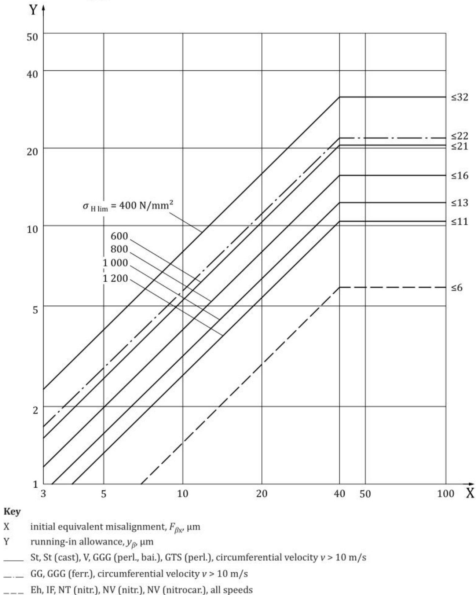  
Figure 10 — Running-in allowance for gear pair (see also Figure 11)

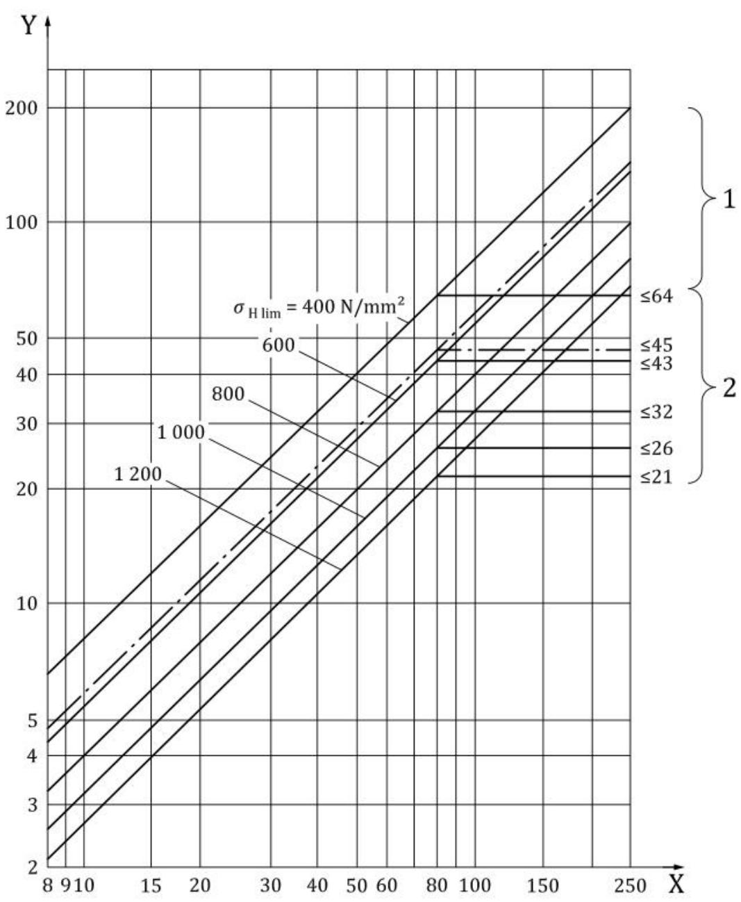  
X initial equivalent misalignment, $F_{\beta x}$ , $\mu m$  
Y running-in allowance, $y_{\beta}$ , $\mu$ m  
1 circumferential velocity $v \leq 5 \, m/s$  
2 circumferential velocity 5 m/s < v ≤ 10 m/s  
St, St (cast), V, GGG (perl., bai.), GTS (perl.), circumferential velocity v ≤ 10 m/s  
\_\_..\_\_ GG, GGG (ferr.), circumferential velocity v ≤ 10 m/s

Figure 11 — Running-in allowance for a gear pair (see also Figure 10)

#### 7.5.3.4 Determination of initial equivalent misalignment, $F_{\beta x}$ (see Annex D)

The value $F_{\beta x}$ is the absolute value of the sum of manufacturing deviations and pinion and shaft deflections, measured in the plane of action [see WARNING in b)].

Of the components of deformations, displacement and deviation, only those in the plane of action are determinant for the calculation of $F_{\beta x}$ .

a) Gear pairs of which the size and suitability of the contact pattern are not proven and the bearing pattern under load is imperfect [^7] :

See Annex D for an explanation of the factor 1,33 in Formula (54).

$$
F _ {\beta \mathrm{x}} = 1, 33 B _ {1} f _ {\mathrm{sh}} + B _ {2} f _ {\mathrm{ma}}; F _ {\beta \mathrm{x}} \geq F _ {\beta \mathrm{xmin}}\tag{54}
$$

With $B_{1}$ and $B_{2}$ taken from Table 12.

Allowance should be made in $f_{ma}$ for the effects of adjustment measures (lapping, running-in at part load), crowning or end relief, or similarly, for that of the position of the contact pattern.

b) Gear pairs with verification of the favourable position of the contact pattern (e.g. by modification of the teeth or adjustment of bearings) [^7][^8] :

$$
F _ {\beta \mathrm{x}} = \left| 1, 33 B _ {1} f _ {\mathrm{sh}} - f _ {\mathrm{H} \beta 5} \right|; F _ {\beta \mathrm{x}} \geq F _ {\beta \mathrm{x} \min}\tag{55}
$$

with $B_{1}$ taken from Table 12.

Table 12 — Constants for use in Formulae (54) and (55)

| No. | Helix modification | Helix modification | Formula constants | Formula constants |
| --- | --- | --- | --- | --- |
| No. | Type | Amount | $B_1$ | $B_2$ |
| 1 | None | — | 1 | 1 |
| 2 | Central crowning only | $C_\beta = 0,5 f_{\text{ma}}^{\text{a}}$ | 1 | 0,5 |
| 3 | Central crowning only | $C_\beta = 0,5 (f_{\text{ma}} + f_{\text{sh}})^{\text{a}}$ | 0,5 | 0,5 |
| $4^b$ | Helix correction only | Corrected shape calculated to match torque being analysed | $0,1^c$ | 1,0 |
| 5 | Helix correction plus central crowning | Case 2 plus case 4 | $0,1^c$ | 0,5 |
| 6 | End relief | appropriate amount  $C_{\text{I(II)}}^{\text{d}}$ | 0,7 | 0,7 |

aAppropriate crowning,  $C_\beta$ , see Annex B.bPredominantly applied for applications with constant load conditions.cValid for very best practice of manufacturing, otherwise higher values appropriate.dSee Annex B.

A check shall be made to ascertain which of the helices of double helical gears has the larger equivalent misalignment and, consequently, is determinate for $K_{H\beta}$ .

By subtracting $f_{H\beta5}$ , which is the helix slope deviation tolerance for ISO tolerance class 5 (see ISO 1328-1:2013), allowance is made for the compensatory roles of elastic deformation and manufacturing deviations. See Annex D for explanatory notes to Formula (55).

Subject to achieving the requisite contact patterns, $F_{\beta x}$ can be calculated using Formula (55) for gears which have been processed by lapping, running-in at part load or other adjustment means, as well as for gears with carefully designed crowning or end relief. For crowned gears, the contact pattern centre shall be suitably offset from the mid face position. Concerning double helical gears, it is necessary to ascertain whether the less deformed helix of the pinion has the largest value of $F_{\beta x}$ .

WARNING — When, apart from pinion body and pinion shaft deformations, $f_{sh}$ , those of the wheel/wheel shaft, $f_{sh2}$ , and the gear case, $f_{ca}$ , and also the displacements of the bearings, $f_{be}$ , are to be taken into consideration, Formulae (54) and (55) are to be extended to become Formula (56) (see also 7.5.5 and 7.5.6):

$$
F _ {\beta \mathrm{x}} = 1, 33 B _ {1} f _ {\mathrm{sh}} + f _ {\mathrm{sh2}} + f _ {\mathrm{ma}} + f _ {\mathrm{ca}} + f _ {\mathrm{be}}; f _ {\mathrm{m}} \geq f _ {\mathrm{H} \beta 5}\tag{56}
$$

The signs of $f_{sh2}$ , $f_{ca}$ and $f_{be}$ shall be carefully heeded; if precise information is not available, it is essential that positive signs are chosen (so that the calculated values tend to be safe). Only the bending deflection, if any, of the wheel shaft, is likely to be of consequence to $f_{sh2}$ ; previously this amount was taken as the wheel shaft misalignment component of $f_{be}$ . Nevertheless, in general the approximations according to Formulae (54) and (55) are satisfactory.

The following influences shall be heeded, as a rule, the elastic deformations of “relatively flexible” spur gears tend to compensate for manufacturing misalignment. On the other hand, because of the axial component of $F_{m}$ in single helical gears, additional misalignment can be induced.

Special measures can be taken to secure even distribution of load over the face width. These include set up bearings, lapping the gears, or running-in the gears as a specified process, in service. By way of a further example, a spur gear or a double helical gear can be mounted directly on a spherical roller bearing and so be free to take up an attitude of mean, balanced alignment.

Uneven distribution of the body temperature of a large high-speed gear can cause deformation near mid face width resulting in heavy local loading. Either allowance for this deformation shall be included in $K_{H\beta}$ , or it shall be compensated for by suitable helix modification.

Similar measures shall be taken when deformation is induced by a large centrifugal force.

Furthermore, the body temperature of a high-speed helical pinion is usually higher than that of the mating wheel. This creates additional misalignment which shall be accounted for in the calculations.

c) For gears having ideal contact pattern, full helix modification, under load (for both helices of double helical gears):

$$
F _ {\beta \mathrm{x}} = F _ {\beta \mathrm{x} \min}\tag{57}
$$

where $F_{\beta x \min}$ is the greater of the two values:

$$
F _ {\beta \mathrm{x} \min} = (0, 005 \mathrm{mm} \cdot \mu \mathrm{m} / \mathrm{N}) \frac {F _ {\mathrm{m}}}{b}, \text { or } F _ {\beta \mathrm{x} \min} = 0, 5 f _ {\mathrm{H} \beta}\tag{58}
$$

Helix modification is intended to compensate for the torsion and bending deflections of the pinion and wheel, also the deformations or displacements of other components under operating loads and, if known, the tooth alignment deviation of the mating wheel [^9] .

$F_{\beta x}$ would be equal to 0 at the design loading of gear pairs having optimum helix modification, i.e. the face load factor $K_{\mathrm{H}\beta}$ would be equal to 1. However, in the interest of safety, the minimum value in accordance with Formulae (57) and (58) is to be used as the equivalent misalignment.

Similarly, Formula (55) can be used in designing suitable crowning.

See 7.5.3.5 for the determination of $f_{\mathrm{sh}}$ , the equivalent misalignment due to pinion and pinion shaft deflections. See 7.5.4 for the determination of mesh misalignment due to manufacturing deviations $f_{\mathrm{ma}}$ .

See 7.5.2 for the determination of the running-in allowance, $y_{\beta}$ , i.e. the amount by which the equivalent misalignment is reduced.

For some common arrangements of gear pairs, guidance on the calculation of $F_{\beta x}$ is included in Figure 13 a) to e), in which particular regard is paid to the contact pattern position. A comprehensive analysis is recommended for other, more complex, arrangements.

#### 7.5.3.5 Equivalent misalignment, $f_{sh}$

##### 7.5.3.5.1 General

The value $f_{sh}$ takes into account the components of equivalent misalignment resulting from bending and twisting of the pinion and pinion shaft, and its value may be determined as follows. For additional methods to determine $f_{sh}$ , Annex A shall apply.

##### 7.5.3.5.2 Approximate calculation of $f_{sh}$

The following calculation is sufficiently accurate for many common designs. Formulae (59) and (60) are based on the following conventions. The bending component is the result of the slope of the shaft deflection in the middle of the gearface multiplied with the facewidth $b$ , where $F_{\mathrm{m}}$ is the load assumed to be acting in the middle of the gear face. The torsional component is calculated for a solid cylinder of diameter $d_{1}$ , with the load distributed evenly over the face width. In reality, a smaller diameter is determinant; also, the load is not evenly distributed; however, the inaccuracies in the assumptions tend to balance each other out. The formula is valid when the elastic modulus and Poisson's ratio of the material are those of steel. Based on practical experience, Formulae (59) and (60) also include a constant empirical term. Concerning hollow shafts, the deflection component $f_{\mathrm{sh}}$ , derived from either of these formulae, is sufficiently accurate, provided that the bore diameter does not exceed $0.5d_{\mathrm{sh}}$ .

For both spur and single helical gears:

$$
f _ {\mathrm{sh}} = \frac {F _ {\mathrm{m}}}{b} k _ {\text {unit}} \cdot \left[ \left| B ^ {*} + K ^ {\prime} \frac {l \cdot s}{d _ {1} ^ {2}} \cdot \left(\frac {d _ {1}}{d _ {\mathrm{sh}}}\right) ^ {4} - 0, 3 \right| + 0, 3 \right] \cdot \left(\frac {b}{d _ {1}}\right) ^ {2}\tag{59}
$$

with B\* equal to 1 if the total power is transmitted through a single engagement,

and $k_{unit}=0,023\frac{mm\cdot\mu m}{N}$ .

See 7.2.2 for $F_{m}/b$ .

For double helical gears:

$$
f _ {\mathrm{sh}} = \frac {F _ {\mathrm{m}}}{b} \cdot 2 \cdot k _ {\text {unit}} \cdot \left[ \left| B ^ {*} + K' \frac {l \cdot s}{d _ {1} ^ {2}} \left(\frac {d _ {1}}{d _ {\mathrm{sh}}}\right) ^ {4} - 0, 3 \right| + 0, 3 \right] \cdot \left(\frac {b _ {\mathrm{B}}}{d _ {1}}\right) ^ {2}\tag{60}
$$

with B\* equal to 1,5, if the total power is transferred by a single engagement,

and $k_{\mathrm{unit}} = 0,023\frac{\mathrm{mm}\cdot\mu\mathrm{m}}{\mathrm{N}}$

See 7.2.2 for $F_{\mathrm{m}} / b$

If there is more than one power path, then only k % of the input is through one gear mesh (e.g. as in the case of grooved roller mill gears) and the following applies:

- $B ^ {*} = 1 + 2 (100 - k) / k \quad \text { for   spur   and   single   helical   gears; }$

- $B ^ {*} = 0, 5 + (200 - k) / k \quad \text { for   double   helical   gears. }$

The constant, $K'$ , makes allowances for the position of the pinion in relation to the torqued end. It can be taken from Figure 13.

A comprehensive analysis is recommended for other arrangements or where the values for s/l exceed those specified in Figure 13, and also where there are additional shaft loads, e.g. from belt pulleys or chain wheels.

Substitute the absolute value $f_{sh}$ in Formulae (54) and (55). See Figure 12 and 7.5.3.4 for information on the compensation of $f_{sh}$ by $f_{ma}$ .

##### 7.5.3.5.3 Face width to be used in Formulae (59) and (60) for crowned spur and helical gears

This type of helix modification is employed in order to compensate for manufacturing deviations and load-induced deformations of the gears, and in particular to relieve the tooth endloading. Gears are usually crowned symmetrically about the mid face width. See Annex D for recommendations on the extent of crowning.

If the height of the crowning is greater than that specified in Annex B, the reduced width $b_{(b)}$ is to replace the face width b in formulae used for calculating load capacity (see Figure B.1). This is determined from values of $C_{\beta(b)}$ calculated in accordance with Formula (B.1) or (B.2). It is to be assumed that the tooth ends outside $b_{(b)}$ are not bearing any load.

##### 7.5.3.5.4 Face width to be used in Formulae (59) and (60) for spur and helical gears with end relief

This type of helix modification is used to protect the tooth ends from the overloading caused by equivalent misalignment. Usually, the relief applied is the same at both ends of the teeth. See Annex B for a recommendation on the amount of end relief.

If the amount of end relief is greater than is specified in Annex B, a reduced width $b_{(b)}$ shall replace the face width b in the formulae used for calculating load capacity (see Figure B.2). This is determined from values of $C_{\mathrm{I(II)(b)}}$ calculated in accordance with Formulae (B.3) or (B.4). It is to be assumed that the tooth ends outside $b_{(b)}$ are not bearing any load.

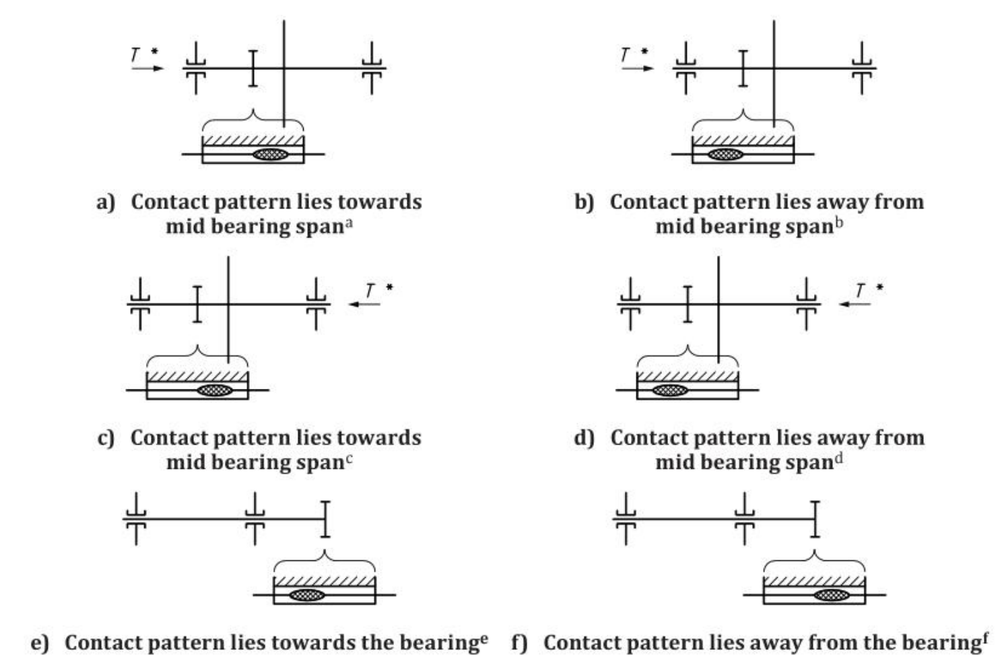

Key

$T^{*}$ input or output torqued end, not dependent on direction of rotation

NOTE 1 a) to d) are the most common mounting arrangements with pinion between bearings.

NOTE 2 e) to f) have overhung pinions.

NOTE 3 B\* is equal to 1 for spur and single helical gears and is equal to 1,5 for double helical gears. The peak load intensity occurs on the helix near the torqued end. See also 7.5.3.5.

a $F_{\beta x}$ in accordance with Formula (55) (compensatory).

b $F_{\beta x}$ in accordance with Formula (54) (additive).

c

$F_{\beta x}$ in accordance with Formula (54) $|K'| \cdot l \cdot s / d_1^2(d_1 / d_{sh})^4 \leq B^*$ (additive);

$F_{\beta x}$ in accordance with Formula (55) $|K^{\prime}|\cdot l\cdot s / d_{1}^{2}(d_{1} / d_{\mathrm{sh}})^{4} > B^{*}$ (compensatory).

d

$F_{\beta x}$ in accordance with Formula (54) $|K^{\prime}|\cdot l\cdot s / d_{1}^{2}(d_{1} / d_{sh})^{4}\geq B^{*} - 0,3$ (additive);

$F_{\beta x}$ in accordance with Formula (55) $|K^{\prime}|\cdot l\cdot s / d_{1}^{2}(d_{1} / d_{\mathrm{sh}})^{4} <   B^{*} - 0,3$ (compensatory).

e $F_{\beta x}$ in accordance with Formula (54) (additive).

f $F_{\beta x}$ in accordance with Formula (55) (compensatory).

Figure 12 — Rules for determination of $F_{\beta x}$ with regard to contact pattern position

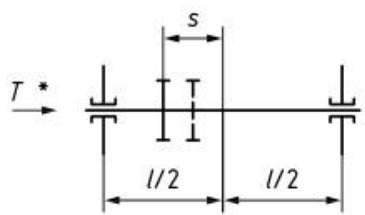

a) $K' = 0,48$ with stiffening and $K' = 0,8$ without stiffening $^{a}$ (with $s/l < 0,3$ )

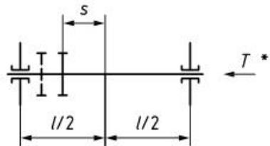

b) $K' = -0,48$ with stiffening and $K' = -0,8$ without stiffening $^{a}$ (with $s/l < 0,3$ )

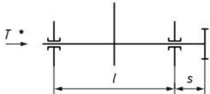

c) $K' = 1,33$ with stiffening and $K' = 1,33$ without stiffening $^a$ (with $s/l < 0,3$ )

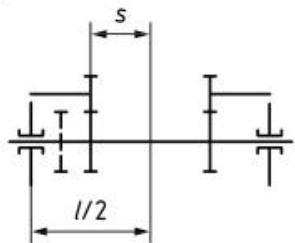

d) $K' = -0,36$ with stiffening and $K' = -0,6$ without stiffening $^{a}$ (with $s/l < 0,3$ )

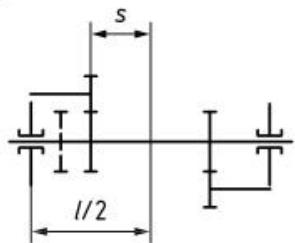

e) $K' = -0,6$ with stiffening and $K' = -1,0$ without stiffening $^{a}$ (with $s/l < 0,3$ )

Key

$T^{*}$ is the input or output torqued end, not dependent on direction of rotation.

NOTE 1 Dashed line indicates the less deformed helix of a double helical gear.

NOTE 2 $f_{sh}$ is determined from the diameter in the gaps of double helical gearing mounted centrally between bearings.

When $d_{1}/d_{sh} \geq 1,15$ , stiffening is assumed; when $d_{1}/d_{sh} < 1,15$ , stiffening is not assumed. For the selection of the factor $K'$ it is assumed that scarcely any or no stiffening at all is to be expected when a pinion slides on a shaft and feather key or a similar fitting, nor when normally shrink fitted.

Figure 13 — Constant, $K'$ , to take into account the pinion offset

##### 7.5.3.5.5 Specified maximum value for $f_{sh}$

Sometimes experience with similar gear units enables the choice of an appropriate value of $f_{sh}$ to be made.

EXAMPLE 1 $f_{sh} \approx 0 \mu m$ in the case of a very rigid design; deformations are neglected.

EXAMPLE 2 $f_{sh} = 6 \mu m$ is occasionally specified as a maximum value for some turbine transmissions; the gears are to be designed accordingly.

When calculations are based on such assumptions, the assumptions shall be validated by computations or measurements.

##### 7.5.3.5.6 Value $f_{sh}$ corresponding to the gear quality

For certain gears, the value of $f_{sh}$ is specified as a percentage of the allowable helix slope deviation. The gears are to be designed accordingly.

$$
f _ {\mathrm{sh}} = 1, 0 f _ {\mathrm{H} \beta}\tag{61}
$$

As for 7.5.3.5.5, assumptions shall be validated by computations or measurements.

### 7.5.4 Mesh misalignment, $f_{ma}$

#### 7.5.4.1 General

$f_{ma}$ is the maximum separation between the tooth flanks of the meshing teeth of mating gears, when the teeth are held in contact without significant load, the shaft journals being in their working attitudes.

$f_{ma}$ depends on the way in which the deviations of individual components in the plane of action combine, i.e. whether the helix slope deviation, $f_{H\beta}$ , of each gear and the alignment deviation of the shafts are additive or compensatory, or whether the alignment of the shafts is adjustable (e.g. by means of adjustable bearings).

For purposes of load capacity calculations in accordance with this document, the methods given in 7.5.4.2 to 7.5.4.5 can be used for the determination of $f_{ma}$ . For additional methods to determine $f_{ma}$ , Annex A shall apply.

It is recommended that the values used for $f_{ma}$ be verified by checking the contact pattern in the working attitude.

#### 7.5.4.2 Derivation of $f_{\mathrm{ma}}$ from deviations of individual components

This is to be done after inspection and measurement of gears, bearings and the gear case.

The maximum mesh misalignment involves the most unfavourable combination of individual deviations:

$$
f _ {\mathrm{ma} \max} = \max \left(\left| f _ {\mathrm{par\,act}} + f _ {\mathrm{H} \beta 1 \mathrm{act}} + f _ {\mathrm{H} \beta 2 \mathrm{act}} \right|\right)\tag{62}
$$

The minimum mesh misalignment from the most favourable combination:

$$
f _ {\mathrm{ma} \min} = \min \left(\left| f _ {\mathrm{par\,act}} + f _ {\mathrm{H} \beta 1 \mathrm{act}} + f _ {\mathrm{H} \beta 2 \mathrm{act}} \right|\right)\tag{63}
$$

where $f_{H\beta1\ act}$ and $f_{H\beta2\ act}$ are the measured values of helix slope deviation of pinion and wheel (in accordance with ISO 1328-1:2013). The values can vary in size and direction around the circumference.

The combined effect of the helix slope deviation of pinion and wheel, i.e. $\sum f_{H\beta} = \left( f_{H\beta1\text{act}} + f_{H\beta2\text{act}} \right)$ can be determined as follows.

The pinion and wheel, assembled on their shafts, are mounted on roller blocks which are aligned in parallel pairs and the contact patterns are generated. By moving one of the blocks, the tooth flanks are brought into contact over the entire face width. The $\Sigma f_{H\beta}$ can then be derived from the non-parallelism of the blocks.

$f_{par\ act}$ is the measured value of shaft misalignment, due to in plane and out of plane deviations of either of the shafts. In the event of radial run out of one or more journals, $f_{par\ act}$ can vary with the angle of rotation. Care shall be taken with the sign of each individual deviation.

A mean value derived from Formula (A.7) is to be used in gear load capacity calculations.

In this procedure, the influence of bearing clearances is neglected.

#### 7.5.4.3 Specified maximum value of $f_{ma}$

Sometimes permissible limits for the total manufacturing deviation, $f_{\mathrm{ma}}$[^10] , are specified.

EXAMPLE 1 $f_{ma\ max} = 0 \mu m$ is sometimes demanded for accurate high-speed transmissions; due to high precision of manufacturing, deviations can be neglected.

EXAMPLE 2 $f_{ma\ max} = 15 \mu m$ can be a realistic value for certain industrial transmissions.

A mean value derived from Formula (A.6) is to be used in gear load capacity calculations.

#### 7.5.4.4 $f_{ma}$ for a given accuracy

Inspection after assembly is recommended in the case of gears without any modification or adjustment. See also 7.5.4.1.

If, according to ISO 1328-1:2013, for a given gear quality class helix slope deviation tolerances are given as $f_{\mathrm{H}\beta 1}$ and $f_{\mathrm{H}\beta 2}$ for pinion and wheel respectively, and if the alignment of axes tolerances is given as $f_{\Sigma \beta}$ according to ISO/TR 10064-3, then the most unfavorable combination of deviations (pinion, wheel, case) would be

$$
f _ {\mathrm{ma}} = f _ {\mathrm{H} \beta 1} + f _ {\mathrm{H} \beta 2} + f _ {\Sigma \beta} \frac {b}{l}\tag{64}
$$

Experience has shown that, within many manufacturing environments, aggregate misalignments are close to this value with sufficient frequency for it to be advisable for it to be used in the calculation. However, the distribution of a dimension within its tolerance band is influenced very much by the quality control regime, and in other circumstances the statistical effects mean that a lower aggregate value is appropriate. For example, if controls are in place to ensure that most gears are well within tolerance, with only a small percentage near the limit, and to ensure that helix variation within any single gear is negligible, then statistical studies show that in only about 10 % of cases will the deviations combine to exceed a total value of $1,0 f_{H\beta2}$ .

$$
f _ {\mathrm{ma}} = 1, 0 f _ {\mathrm{H} \beta 2}\tag{65}
$$

In most circumstances, the appropriate value to be used lies between these two extremes, and a useful formulation for use in cases of an average quality control regime is

$$
f _ {\mathrm{ma}} = \sqrt {f _ {\mathrm{H} \beta 1} ^ {2} + f _ {\mathrm{H} \beta 2} ^ {2}}\tag{66}
$$

The selection of an appropriate value rests with the user of the ISO 6336 series, but if the chosen value is less than that given by Formula (66), then the user shall be able to justify that selection.

a) For gear pairs with provision for adjustment (lapping or running-in under light load, adjustable bearings or appropriate helix angle modification) and gear pairs suitably crowned, the no load mesh misalignment can, to a great extent, be compensated for by means of adjustment measures such as re working of bearings, bearing housings, etc. Satisfactory contact over the face width of the gears can often be achieved by these methods and by means of the other measures mentioned above. See Annex B for guide values for crowning.

If data from experience are not available, it can be assumed that properly effected adjustments will reduce the value of $f_{\mathrm{ma}}$ by $50\%$ ; this is taken into account by the factor $B_{2}$ in Formula (54).

b) For gear pairs with well-designed end relief, in the absence of data from experience and subject to skilled execution, this is taken into account by the factor $B_{2}$ in Formula (54). See Annex B for guide values for end relief.

#### 7.5.4.5 Determination of $f_{ma}$ with gears assembled in gear case

After assembly in the gear case, it may be possible to measure mesh misalignment directly with the top of the case removed. Values of $f_{ma\ max}$ and $f_{ma\ min}$ are determined from measurements made around the circumference, using feeler gauges; $f_{ma}$ is then derived from Formula (A.7).

For wide gears without helix modification mounted in journal bearings with relatively large clearances, the following procedure may be used. The shaft journals are supported in their working attitudes. The mating gear is clamped to prevent rotation. Bring the working faces into light contact, then insert feeler gauges between the flanks at both ends of the mesh. The mesh misalignment, $f_{ma}$ , is equal to the difference between the thicknesses of the gauges:

$$
f _ {\mathrm{ma}} = \delta_ {\mathrm{g}} \left(\frac {b}{l}\right)\tag{67}
$$

where

$\delta_{g}$ is the difference in the feeler gauge indications;

b is the face width;

l is the distance between the feeler gauges.

When the helices of gears are modified, the amount is included in the difference $\delta_{g}$ , which can also be determined as the difference in thickness of two lead wires which have been inserted between the flanks, where they are subjected to light load.

### 7.5.5 Component of mesh misalignment caused by case deformation, $f_{ca}$

Case deformation may be ignored when the gears are assembled in rigid cases. The deflections of other cases $f_{ca}$ may be determined by testing or, approximately, by using the finite element method.

### 7.5.6 Component of mesh misalignment caused by shaft displacement, $f_{be}$

In some cases, the effects of bearing clearances and bearing deflections are greater than those of shaft and wheel blank deflections.

The components of misalignment in the plane of action as a result of bearing deflections, and journal displacements in bearings clearances, can usually be neglected when the pinion and wheel of spur or double helical gears are positioned midway between bearings of equal stiffness and clearance.

When gears are not positioned in this way, bearing deflections and displacements (clearances) can influence the distribution of load over the face width. This is also valid for single helical or overhung gears.

Since only the relative misalignments due to bearing deflections and displacements of the common axis of the pinion bearings, $f_{be1}$ , and that of the wheel, $f_{be2}$ , influence the equivalent misalignment, the directions and signs of the misalignments of bearings axes are to be given careful attention. The following formula is valid for the simplest arrangement of a mating pair, with each gear alone on a shaft with two bearings:

$$
f _ {\mathrm{be}} = f _ {\mathrm{be} 1} + f _ {\mathrm{be} 2} \text { or } f _ {\mathrm{be}} = f _ {\mathrm{be} 1} - f _ {\mathrm{be} 2}\tag{68}
$$

For a gear mounted between the bearings, see Figure 14:

$$
f _ {\mathrm{be}} = \frac {b}{l} \left(\delta_ {1} - \delta_ {2}\right)\tag{69}
$$

For an overhung gear, see Figure 15:

$$
f _ {\mathrm{be}} = \frac {b}{l} \left(\delta_ {1} + \delta_ {2}\right)\tag{70}
$$

where $\delta_{1}$ and $\delta_{2}$ are the deflections of bearing 1 and bearing 2 parallel to the plane of action.

The effect of the tilting moment, due to the axial component of the tooth load, of single helical gears, shall be taken into account.

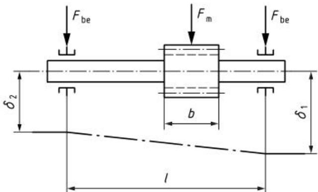

Figure 14 — Loading and deflections for gear mounted between the bearings [see Formula (69)]  
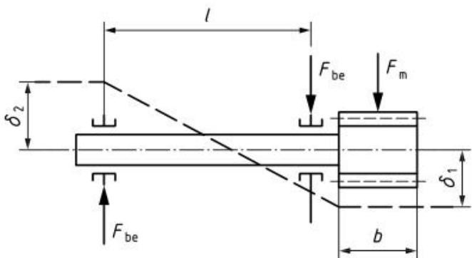  
Figure 15 — Loading and deflections for overhung gear [see Formula (70)]

## 7.6 Determination of face load factor for tooth root stress using Method B or C: $K_{F\beta}$

$K_{F\beta}$ takes into account the effect of the load distribution over the face width on the stresses at the tooth root. It depends on the variables which are determined for $K_{H\beta}$ and also on the face width to tooth depth ratio, b/h.

Determination by calculation:

$$
K _ {\mathrm{F} \beta} = \left(K _ {\mathrm{H} \beta}\right) ^ {N _ {\mathrm{F}}}\tag{71}
$$

$$
N _ {\mathrm{F}} = \frac {(b / h) ^ {2}}{1 + b / h + (b / h) ^ {2}}\tag{72}
$$

The smaller of the values $b_{1}/h_{1}$ , $b_{2}/h_{2}$ is to be used as b/h. Boundary condition: when b/h < 3, substitute 3 for b/h. For double helical gears, $b_{B}$ is to be used instead of b.

# 8 Transverse load factors $K_{H\alpha}$ and $K_{F\alpha}$

## 8.1 Transverse load distribution

The transverse load factors, $K_{H\alpha}$ , for surface stress and $K_{F\alpha}$ for tooth root stress, account for the effect of the nonuniform distribution of transverse load between several pairs of simultaneously contacting gear teeth as follows.

The transverse load factors are defined as the ratio of the maximum tooth load occurring in the mesh of a gear pair at near zero speed to the corresponding maximum tooth load of a similar gear pair which is free from inaccuracies. The main influences are

a) deflections under load,

b) profile modifications,

c) tooth manufacturing accuracy, and

d) running-in effects.

## 8.2 Determination methods for transverse load factors — Principles and assumptions

### 8.2.1 General

Several methods for the determination of transverse load factors in accordance with the specifications given in 4.1.16 are listed below.

With optimum profile modification appropriate to loading, high manufacture accuracy, even load distribution over the face width and a high specific loading level, the transverse load factor approaches unity.

### 8.2.2 Method A — Factors $K_{H\alpha-A}$ and $K_{F\alpha-A}$

As stated in 6.4.1, the maximum tooth loads (including the inner dynamic tooth loads and the effect of uneven distribution of loading) can be determined directly by measurement or by a comprehensive mathematical analysis. $K_{H\alpha}$ and $K_{F\alpha}$ are then assumed to be unity (as is $K_{v}$ ).

The load distribution, in the tangential direction only, can also be determined by comprehensive analysis of all influence factors. The division of the total tangential load between simultaneously meshing tooth pairs can be derived from strain gauge measurements, made at the tooth roots of gears transmitting load at low speeds.

Information to be stated in the drawing or specification documents is the following:

— maximum (permissible) total tooth load, or

— maximum (permissible) transverse load factor, or — all data (in particular, information relating to the effective difference of base pitch) necessary for making an accurate analysis.

### 8.2.3 Method B — Factors $K_{H\alpha-B}$ and $K_{F\alpha-B}$

This method involves the assumption that the average difference between the base pitches of the pinion and wheel is the major parameter in determining the distribution of load between several pairs of teeth in the mesh zone. See 7.5.3.4 b) and footnote 7).

## 8.3 Determination of transverse load factors using Method B — $K_{H\alpha-B}$ and $K_{F\alpha-B}$

### 8.3.1 General

According to the conditions and assumptions described in 8.2.3 and footnotes 10) and 11), Method B is suitable for all types of gearing (spur or helical with any basic rack profile and any accuracy). Transverse load factors can be determined by calculation or graphically. The two methods give identical results.

### 8.3.2 Determination of transverse load factor by calculation [^11]

The calculations are as follows:

a) values $K_{\mathrm{H}\alpha}$ and $K_{\mathrm{F}\alpha}$ for gears with total contact ratio $\varepsilon_{\gamma} \leq 2$

$$
K _ {\mathrm{H} \alpha} = K _ {\mathrm{F} \alpha} = \frac {\varepsilon_ {\gamma}}{2} \left(0, 9 + 0, 4 \frac {c _ {\gamma \alpha} \left(f _ {\mathrm{pb}} - y _ {\alpha}\right)}{F _ {\mathrm{tH}} / b}\right)\tag{73}
$$

b) values $K_{H\alpha}$ and $K_{F\alpha}$ for gears with total contact ratio $\varepsilon_{\gamma} > 2$

$$
K _ {\mathrm{H} \alpha} = K _ {\mathrm{F} \alpha} = 0, 9 + 0, 4 \sqrt {\frac {2 (\varepsilon_ {\gamma} - 1)}{\varepsilon_ {\gamma}}} \frac {c _ {\gamma \alpha} (f _ {\mathrm{pb}} - y _ {\alpha})}{F _ {\mathrm{tH}} / b}\tag{74}
$$

where the following are to be determined:

$c_{\gamma\alpha}$ is the mesh stiffness in accordance with Clause 9;

$f_{pb}$ is the larger of the base pitch deviations of pinion or wheel; 50 % of this tolerance may be used, when profile modifications compensate for the deflections of the teeth at the actual load level;

NOTE The base pitch deviation, $f_{pb}$ , accounts for the total effect of all gear tooth deviations which affect the transverse load factor. If, nevertheless, the profile form deviation, $f_{f\alpha}$ , is greater than the base pitch deviation, the profile form deviation is to be taken instead of the base pitch deviation.

$y_{\alpha}$ is the running-in allowance as specified in 8.3.6;

$F_{tH}$ is the determinant tangential load in a transverse plane, $F_{tH} = F_{t} K_{A} K_{\gamma} K_{v} K_{H\beta}$ .

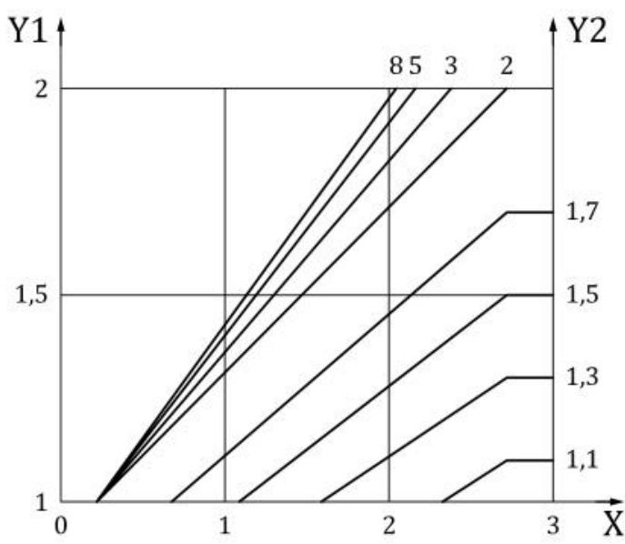

Key

$$
\begin{array}{l l} \text {X} & q _ {\alpha} = \frac {c _ {\gamma \alpha} \left(f _ {\mathrm{pb}} - y _ {\alpha}\right)}{F _ {\mathrm{tH}} / b} \\ \text {Y1} & K _ {\mathrm{F} \alpha}, K _ {\mathrm{H} \alpha} \\ \text {Y2} & \varepsilon_ {\gamma} \end{array}
$$

Figure 16 — Determination of transverse load factors, $K_{H\alpha}$ and $K_{F\alpha}$ , by Method B (see 8.3.4 and 8.3.5 for limiting conditions)

### 8.3.3 Transverse load factors from graphs

$K_{H\alpha}$ and $K_{F\alpha}$ can be read from Figure 16; the curves are consistent with Formulae (73) and (74).

### 8.3.4 Limiting conditions for $K_{H\alpha}$

When, in accordance with Formula (73) or (74)

$$
K _ {\mathrm{H} \alpha} > \frac {\varepsilon_ {\gamma}}{\varepsilon_ {\alpha} Z _ {\varepsilon} ^ {2}}\tag{75}
$$

then for $K_{H\alpha}$ substitute $\frac{\varepsilon_{\gamma}}{\varepsilon_{\alpha} Z_{\varepsilon}^{2}}$ and when $K_{H\alpha} < 1,0$ , then for $K_{H\alpha}$ substitute as the limit value 1,0. See 8.3.5.

### 8.3.5 Limiting conditions for $K_{F\alpha}$

When, in accordance with Formula (73) or (74)

$$
K _ {\mathrm{F} \alpha} > \frac {\varepsilon_ {\gamma}}{0 , 25 \varepsilon_ {\alpha} + 0 , 75}\tag{76}
$$

then for $K_{F\alpha}$ substitute $\frac{\varepsilon_{\gamma}}{0,25\varepsilon_{\alpha}+0,75}$ and when $K_{F\alpha}<1,0$ then for $K_{F\alpha}$ substitute as limit value 1,0.

With limiting values in accordance with Formulae (73) and (74), the least favourable distribution of load is assumed, implying that the entire tangential load is transferred by only one pair of mating teeth. Furthermore, it is recommended that the accuracy of helical gears be so chosen that $K_{H\alpha}$ and $K_{F\alpha}$ are not greater than $\varepsilon_{\alpha}$ . As a consequence, it may be necessary to limit the base pitch deviation tolerances of gears of coarse tolerance class.

### 8.3.6 Running-in allowance, $y_{\alpha}$

#### 8.3.6.1 General

The value $y_{\alpha}$ is the amount by which the initial base pitch deviation is reduced by running-in from the start of operation. See 7.5.3 for the main influences. $y_{\alpha}$ does not account for an allowance due to any extent of running-in as a controlled measure, being part of the production process, e.g. lapping. This adjustment is to be taken into consideration when considering the gear accuracy.

$y_{\alpha}$ may be determined in accordance with 8.3.6.2 or 8.3.6.3 (Method B) where direct, verified values from experimentation or experience are lacking (Method A).

The value for the base pitch deviation $f_{pb}$ determined in accordance with 8.3.2 or 6.5.4 should be used in both methods. The formulae and graphs should also be applied analogously for the profile form deviation, $f_{f\alpha}$ .

#### 8.3.6.2 Determination by calculation

The running-in allowance $y_{\alpha}$ may be calculated using Formulae (77) to (80). These are consistent with the curves in Figures 17 and 18 (see Table 3 for abbreviations used).

a) For St, St(cast), V, V(cast), GGG(perl., bai.) and GTS(perl.):

$$
y_{\alpha}=\frac{160}{\sigma_{\mathrm{Hlim}}}f_{\mathrm{pb}} \tag{77}
$$

where

— for $v\leq 5\ \mathrm{m/s}$ there is no restriction;

— for $5\ \mathrm{m/s}<v\leq10\ \mathrm{m/s}$ the upper limit of $y_{\alpha}$ is $12\,800/\sigma_{\mathrm{Hlim}}\ \mu\mathrm{m}$, corresponding to $f_{\mathrm{pb}}=80\ \mu\mathrm{m}$;

— for $v>10\ \mathrm{m/s}$ the upper limit of $y_{\alpha}$ is $6\,400/\sigma_{\mathrm{Hlim}}\ \mu\mathrm{m}$, corresponding to $f_{\mathrm{pb}}=40\ \mu\mathrm{m}$.

b) For GG and GGG(ferr.):

$$
y_{\alpha}=0,275f_{\mathrm{pb}} \tag{78}
$$

where

— for $v\leq 5\ \mathrm{m/s}$ there is no restriction;

— for $5\ \mathrm{m/s}<v\leq10\ \mathrm{m/s}$ the upper limit of $y_{\alpha}$ is $22\ \mu\mathrm{m}$, corresponding to $f_{\mathrm{pb}}=80\ \mu\mathrm{m}$;

— for $v>10\ \mathrm{m/s}$ the upper limit of $y_{\alpha}$ is $11\ \mu\mathrm{m}$, corresponding to $f_{\mathrm{pb}}=40\ \mu\mathrm{m}$.

c) For Eh, IF, NT(nitr.), NV(nitr.) and NV(nitrocar.): for all velocities but with the restriction that the upper limit of $y_{\alpha}$ is 3 $\mu$ m corresponding to $f_{pb} = 40 \mu m$

$$
y _ {\alpha} = 0, 075 f _ {\mathrm{pb}}\tag{79}
$$

When the materials differ, $y_{\alpha1}$ should be determined for the pinion material and $y_{\alpha2}$ for the wheel. The average value is used for the calculation:

$$
y _ {\alpha} = \frac {y _ {\alpha 1} + y _ {\alpha 2}}{2}\tag{80}
$$

#### 8.3.6.3 Graphical values

$y_{\alpha}$ may be read from Figures 17 and 18 as a function of the base pitch deviation, $f_{pb}$ , and the material value, $\sigma_{H\lim}$ (see Table 3 for abbreviations used).

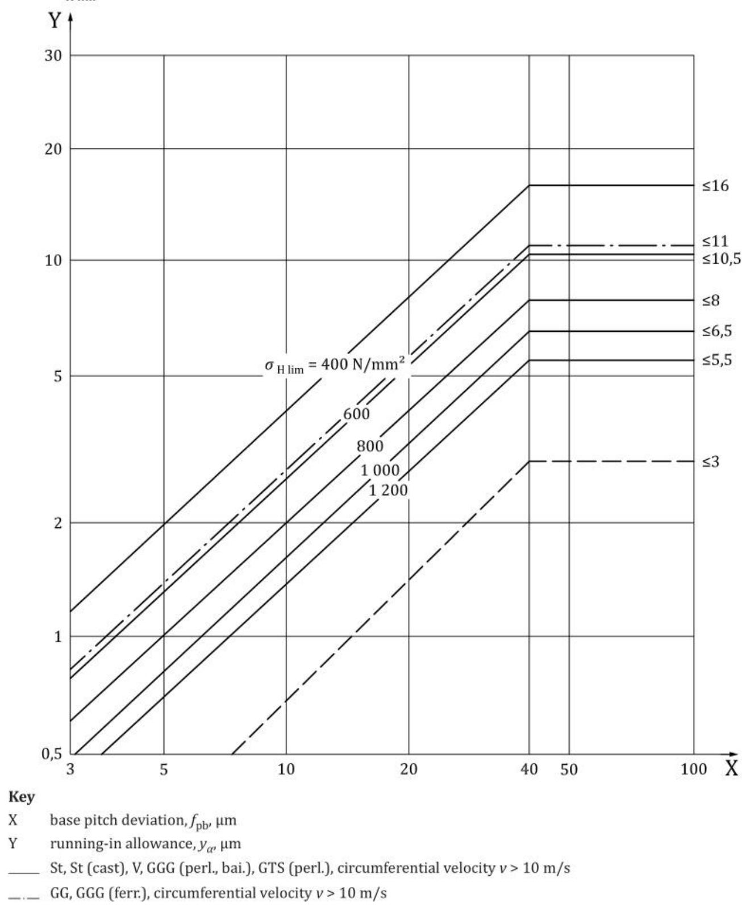  
实线（solid line）：St, St (cast), V, GGG (perl., bai.), GTS (perl.), circumferential velocity v > 10 m/s  
点划线（dash-dot line）：GG, GGG (ferr.), circumferential velocity v > 10 m/s  
虚线（dashed line）：Eh, IF, NT (nitr.), NV (nitr.), NV (nitrocar.), all circumferential velocities

Figure 17 — Determination of running-in allowance, $y_{\alpha}$ , of gear pair (see also Figure 18)

Figure 17 is derived from Figure 10. If the materials of the pinion and the wheel are different, $y_{\alpha}$ shall be determined in accordance with Formula (80).  
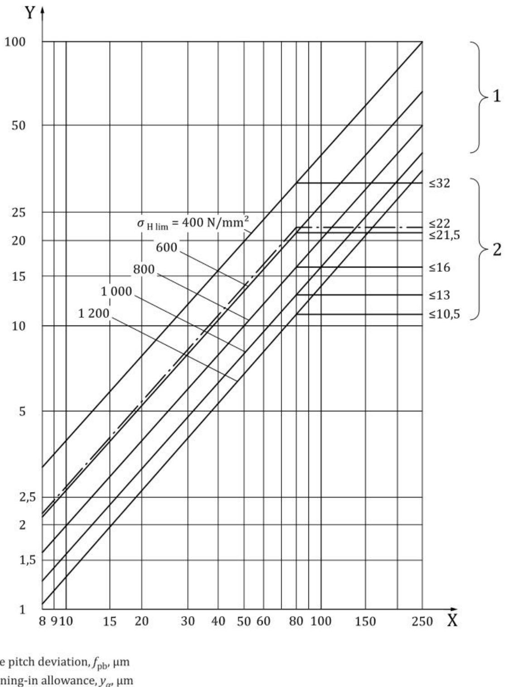  
X base pitch deviation, $f_{pb}$ , $\mu m$  
Y running-in allowance, $y_{\alpha}, \mu m$  
1 circumferential velocity $v \leq 5$ m/s  
2 circumferential velocity 5 m/s < v ≤ 10 m/s  
St, St (cast), V, GGG (perl., bai.), GTS (perl.), circumferential velocity $v \leq 10$ m/s  
\_\_..\_\_ GG, GGG (ferr.), circumferential velocity $v \leq 10$ m/s

Figure 18 — Determination of running-in allowance, $y_{\alpha}$ , of gear pair (see also Figure 17)

Figure 18 is derived from Figure 11. If the materials of the pinion and the wheel are different, $y_{\alpha}$ shall be determined in accordance with Formula (80).

# 9 Tooth stiffness parameters, $c'$ and $c_{\gamma}$

## 9.1 Stiffness influences

A tooth stiffness parameter represents the requisite load over 1 mm face width, directed along the line of action [^12] to produce, in line with the load, the deformation amounting to 1 $\mu$ m of one or more pairs of deviation free teeth in contact. This deformation is equal to the base circle length of arc, corresponding to the load induced rotation angle of one gear of the pair when the mating gear is held fast.

Single stiffness, $c'$ , is the maximum stiffness of a single pair of spur gear teeth. It is approximately equal to the maximum stiffness of a tooth pair in single pair contact [^13] . The value $c'$ for helical gears is the maximum stiffness calculated in the transverse plane for one tooth pair; $c'$ is needed for the calculation of the dynamic factor, $K_{v}$ .

Mesh stiffness, $c_{\gamma}$ , is the mean value of stiffness of all the teeth in a mesh. For the determination of the dynamic factor, $K_{v}$ , and transverse load factors, $K_{H\alpha}$ and $K_{F\alpha}$ , the tangent of the load deflection curve at the pertinent load is used for evaluation of $c_{\gamma\alpha}$ (see 9.3.3.1). For the determination of the face load factors $K_{H\beta}$ and $K_{F\beta}$ , the slope of a line drawn in the load deflection graph between the original and the pertinent load point is used for evaluation of $c_{\gamma\beta}$ (see 9.3.3.2).

The main influences affecting tooth stiffness are

a) tooth data (number of teeth, basic rack profile, addendum modification, helix angle, transverse contact ratio),

b) blank design (rim thickness, web thickness),

c) specific load normal to the tooth flank,

d) shaft hub connection,

e) roughness and waviness of the tooth surface,

f) mesh misalignment of the gear pair, and

g) modulus of elasticity of the materials.

## 9.2 Determination methods for tooth stiffness parameters — Principles and assumptions

### 9.2.1 General

Several methods of determining tooth stiffness parameters in accordance with the rules given in 4.1.16 are described in 9.2.2 to 9.2.3. For Method B, these stiffness values apply for accurate gears; lower values can be expected for less accurate gears.

### 9.2.2 Method A — Tooth stiffness parameters $c'_{A}$ and $c_{\gamma-A}$

In this method, the tooth stiffness is determined by a comprehensive analysis including all influences. This can be done by making direct measurements on the gear pair of interest. Values based on the theory of elasticity can be calculated or determined by finite element methods.

### 9.2.3 Method B — Tooth stiffness parameters $c'_{B}$ and $c_{\gamma-B}$

This method is based on studies of the elastic behaviour of solid disc spur gears.

With the help of a series expansion, a sample expression was derived for cylindrical gears conjugate to a standard basic rack profile according to ISO 53; see NOTE in 9.3.2.2. This was based on an assumed specific loading of $F_{\mathrm{t}} / b = 300 \, \mathrm{N/mm}$ . Using this method, theoretical single stiffnesses, $c'_{\mathrm{th}}$ , are obtained.

Differences between these theoretical results and the results of measurements are adjusted by means of a correction factor, $C_{M}$ , and extension section to adjust for low specific loading.

Additional correction factors, determined by measurement and theoretical means, allow this method to be applied to gears consisting of rims and webs (factor $C_{R}$ ), similar to gears conjugate to other basic rack profiles (factor $C_{B}$ ) and helical gears (factor $\cos\beta$ ).

By superposition of the single stiffness of all tooth pairs simultaneously in contact, an expression for the calculation of $c_{\gamma}$ was developed. Its accuracy was verified by measurement results.

## 9.3 Determination of tooth stiffness parameters, $c'$ and $c_{\gamma}$ , according to Method B

### 9.3.1 General

Subject to the conditions and assumptions described in 9.2.3, $c'$ and $c_{\gamma}$ as determined by Method B are, in general, sufficiently accurate for the calculation of the dynamic factor and face load factors as well as for the determination of profile and helix modifications for gears in accordance with the following:

a) external gears;

b) any basic rack profile;

c) spur and helical gears with $\beta \leq 45^{\circ}$ ;

d) steel/steel gear pairs;

e) any design of gear blank;

f) shaft hub fitting spreads the transfer of torque evenly around the circumference (pinion integral with shaft, interference fit or splined fitting);

g) specific load $(F_{\mathrm{t}}K_{\mathrm{A}})/b\geq100\ \mathrm{N/mm}$

NOTE The numbers of teeth of virtual spur gears in the normal section can be calculated approximately as:

$$
z _ {n 1} \approx \frac {z _ {1}}{\cos^ {3} \beta} \text { and } z _ {n 2} \approx \frac {z _ {2}}{\cos^ {3} \beta}\tag{81}
$$

Method B can also be used, either approximately or with further auxiliary factors, for gears in accordance with the following:

— internal gears;

— materials combination other than steel/steel;

— shaft hub assembly other than under f), e.g. with fitted key;

— specific load $(F_{\mathrm{t}} K_{\mathrm{A}} K_{\gamma}) / b < 100 \, \mathrm{N/mm}$ .

### 9.3.2 Single stiffness, $c'$

#### 9.3.2.1 General

For gears having features listed under 9.3.1 a) to g) the following formula provides acceptable average values:

$$
c ^ {\prime} = c _ {\mathrm{th}} ^ {\prime} C _ {\mathrm{M}} C _ {\mathrm{R}} C _ {\mathrm{B}} \cos \beta\tag{82}
$$

#### 9.3.2.2 Theoretical single stiffness, $c'_{th}$

$c'_{th}$ is appropriate to solid disc gears and to the specified standard basic rack tooth profile. $c'_{th}$ for a helical gear is the theoretical single stiffness relevant to the appropriate virtual spur gear (see NOTE in 9.3.1 above).

$c'_{th}$ can be calculated for gear teeth having the basic rack profile specified in the following NOTE using Formulae (83) and (84).

$$
c _ {\mathrm{th}} ^ {\prime} = \frac {1}{q ^ {\prime}}\tag{83}
$$

Where $q'$ is the minimum value for the flexibility of a pair of teeth (compare with definition of $c'$ in 9.1);

$$
q ^ {\prime} = C _ {1} + \frac {C _ {2}}{z _ {\mathrm{n1}}} + \frac {C _ {3}}{z _ {\mathrm{n2}}} + C _ {4} x _ {1} + \frac {C _ {5} x _ {1}}{z _ {\mathrm{n1}}} + C _ {6} x _ {2} + \frac {C _ {7} x _ {2}}{z _ {\mathrm{n2}}} + C _ {8} x _ {1} ^ {2} + C _ {9} x _ {2} ^ {2}\tag{84}
$$

See Table 13 for coefficients $C_{1}$ to $C_{9}$ .

NOTE Series progression in accordance with 9.2.2 for gears with basic rack profile: $\alpha_{\mathrm{P}} = 20^{\circ}$ , $h_{\mathrm{aP}} = m_{\mathrm{n}}$ , $h_{\mathrm{fP}} = 1,2\mathrm{m}_{\mathrm{n}}$ , and $\rho_{\mathrm{fP}} = 0,2m_{\mathrm{n}}$ . Formulae (83) and (84) apply for the range $x_{1} \geq x_{2}$ ; $-0,5 \leq x_{1} + x_{2} \leq 2,0$ . Deviations of actual values from calculated values in range $100 \leq F_{\mathrm{bt}} / b \leq 1600\mathrm{N / mm}$ are between $+5\%$ and $-8\%$ .

Table 13 — Coefficients for Formula (84)

| $C_1$ | $C_2$ | $C_3$ | $C_4$ | $C_5$ | $C_6$ | $C_7$ | $C_8$ | $C_9$ |
| --- | --- | --- | --- | --- | --- | --- | --- | --- |
| 0,047 23 | 0,155 51 | 0,257 91 | -0,006 35 | -0,116 54 | -0,001 93 | -0,241 88 | 0,005 29 | 0,001 82 |

#### 9.3.2.3 Correction factor, $C_{M}$

$C_{M}$ accounts for the difference between the measured values and the theoretical calculated values for solid disc gears:

$$
C _ {\mathrm{M}} = 0, 8\tag{85}
$$

#### 9.3.2.4 Gear blank factor, $C_{R}$

$C_{R}$ accounts for the flexibility of gear rims and webs. The following provides mean values of $C_{R}$ , suitable for use when the mating gear body is equally stiff or stiffer.

For solid disc gears:

$$
C _ {\mathrm{R}} = 1, 0\tag{86}
$$

The adoption of these average values is permissible considering the other uncertainties. Thus, for instance, the tooth stiffness of a gear of webbed design is not constant over the face width.

a) Determination by calculation: $C_{R}$ can be calculated using Formula (87). It is consistent with curves in Figure 19, within -1 % to +7 %.

$$
C _ {\mathrm{R}} = 1 + \frac {\ln (b _ {\mathrm{s}} / b)}{5 \mathrm{e} ^ {s _ {\mathrm{R}} / (5 m _ {\mathrm{n}})}}\tag{87}
$$

b) Graphical values: $C_{R}$ can be read from Figure 19 as a function of gear rim thickness $s_{R}$ and central web thickness $b_{s}$ .

when $b_{s}/b < 0,2$ substitute $b_{s}/b = 0,2;$

when $b_{s}/b > 1,2$ substitute $b_{s}/b = 1,2;$

when $s_{R}/m_{n}<1$ substitute $s_{R}/m_{n}=1$ .

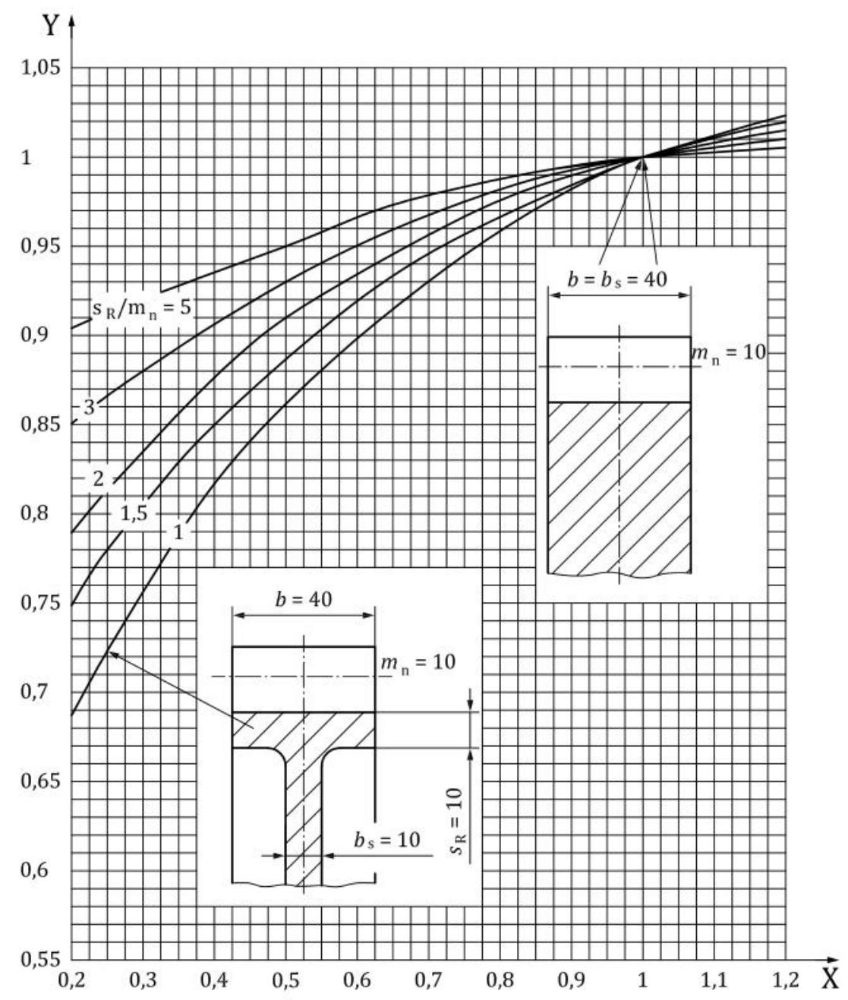  
X $b_s/b$  
Y wheel blank factor, $C_{R}$  
Figure 19 — Gear blank factor, $C_{R}$ — Mean values for mating gears of similar or stiffer wheel blank design

#### 9.3.2.5 Basic rack factor, $C_{B}$

$C_{B}$ accounts for the deviations of the actual basic rack profile of the gear from the standard basic rack profile for which ISO 53:1998 shall apply.

$$
C _ {\mathrm{B}} = \left[ 1, 0 + 0, 5 \left(1, 2 - h _ {\mathrm{fp}} / m _ {\mathrm{n}}\right) \right] \left[ 1, 0 - 0, 02 \left(20 ^ {\circ} - \alpha_ {\mathrm{Pn}}\right) \right]\tag{88}
$$

When the pinion basic rack dedendum is different from that of the wheel, the arithmetic mean of $C_{B1}$ for a gear pair conjugate to the pinion basic rack and $C_{B2}$ for a gear pair conjugate to the basic rack of the wheel is used:

$$
C _ {\mathrm{B}} = 0, 5 \left(C _ {\mathrm{B} 1} + C _ {\mathrm{B} 2}\right)\tag{89}
$$

#### 9.3.2.6 Additional information

The following is also relevant:

a) Helical gearing

The theoretical single stiffness of the teeth of virtual spur gears of a helical gear pair is transformed by the term $\cos\beta$ in Formula (82) from the normal into the transverse theoretical single stiffness $c'_{th}$ of the teeth of the helical gears. Consequently, $c_{\gamma\beta}$ and $c_{\gamma\alpha}$ are defined in the transverse direction in the plane of action.

b) Internal gearing

Approximate values of the theoretical single stiffnesses of internal gear teeth can also be determined from Formulae (83) and (84), by the substitution of infinity for $z_{n2}$ .

c) Material combinations

For material combinations other than steel with steel, the value of $c'$ can be determined from the following formula:

$$
c ^ {\prime} = c _ {\mathrm{St/St}} ^ {\prime} \left(\frac {E}{E _ {\mathrm{St}}}\right)\tag{90}
$$

where

$$
E = \left(\frac {2 E _ {1} E _ {2}}{E _ {1} + E _ {2}}\right)\tag{91}
$$

$(E/E_{\mathrm{St}})$ is equal to 0,74 for steel/grey cast iron and is equal to 0,59 for grey cast iron/grey cast iron.

d) Shaft and gear assembly

If the pinion or the wheel or both are assembled on the shaft(s) with a fitted key, the single stiffness, under constant load, varies between maximum and minimum values twice per revolution.

The minimum value is approximately equal to the single stiffness with interference or spline fits.

When one gear of a pair is press-fitted onto a shaft with a fitted key, and the mating gear is assembled with its shaft by means of an interference or splined fitting, the average value of single stiffness is about 5 % greater than the minimum. When both gears of a pair are push fitted onto shafts with fitted keys, the average single stiffness is about 10 % greater than the minimum.

e) Specific load ( $F_{t} K_{A} K_{\gamma} / b$ ) < 100 N/mm

At low specific loading, the single stiffness decreases with reduced load [^14] . By way of approximation, when $(F_{\mathrm{t}} K_{\mathrm{A}} K_{\gamma}) / b < 100 \mathrm{~N/mm}$ :

$$
c ^ {\prime} = c _ {\mathrm{th}} ^ {\prime} C _ {\mathrm{M}} C _ {\mathrm{B}} C _ {\mathrm{R}} \cos \beta \left(\frac {F _ {\mathrm{t}} K _ {\mathrm{A}} K _ {\gamma} / b}{100}\right) ^ {0, 25}\tag{92}
$$

### 9.3.3 Mesh stiffness, $c_{\gamma}$

#### 9.3.3.1 Mesh stiffness, $c_{\gamma\alpha}$

$c_{\gamma\alpha}$ is used for the calculation of the internal dynamic factor $K_{v}$ , see Clause 6, and the transverse load factors, $K_{H\alpha}$ and $K_{F\alpha}$ , see Clause 8.

Following the methods quoted in 9.2.3 for spur gears with $\varepsilon_{\alpha} \geq 1,2$ and helical gears with $\beta \leq 30^{\circ}$ , the mesh stiffness:

$$
c _ {\gamma \alpha} = c ^ {\prime} (0, 75 \varepsilon_ {\alpha} + 0, 25)\tag{93}
$$

with $c'$ according to Formula (82). The value $c_{\gamma \alpha}$ can be up to 10 % less than values from Formula (93) when for spur gears $\varepsilon_{\alpha} < 1,2$ .

#### 9.3.3.2 Mesh stiffness, $c_{\gamma \beta}$

$c_{\gamma\beta}$ is used for the calculation of the face load factors $K_{H\beta}$ and $K_{F\beta}$ , see Clause 7.

For $c_{\gamma\beta}$ , a value as follows is used:

$$
c _ {\gamma \beta} = 0, 85 c _ {\gamma \alpha}\tag{94}
$$

with $c_{\gamma\alpha}$ according to Formula (93).

# 10 Parameter of Hertzian contact

## 10.1 Local radius of relative curvature

The local normal radius of relative curvature, $\rho_{red,CP}$ , can be calculated according to formula (95).

$$
\rho_ {\mathrm{red,CP}} = \frac {\rho_ {\mathrm{red,t,CP}}}{\cos \beta_ {b}}\tag{95}
$$

where

$\rho_{red,t,CP}$ is the local transverse radius of relative curvature at the contact point, CP;

$\beta_{b}$ is the base helix angle.

The local transverse radius of relative curvature, $\rho_{\mathrm{red,t,CP}}$ , can be determined according to formula (96)

$$
\rho_ {\mathrm{red,t,CP}} = \frac {\rho_ {\mathrm{t1,CP}} \cdot \rho_ {\mathrm{t2,CP}}}{\rho_ {\mathrm{t1,CP}} + \rho_ {\mathrm{t2,CP}}}\tag{96}
$$

where

$$
\rho_ {\mathrm{t1,2,CP}} = \sqrt {\frac {d _ {\mathrm{CP1,2}} ^ {2} - d _ {\mathrm{b1,2}} ^ {2}}{4}}\tag{97}
$$

$\rho_{t1,2,CP}$ is the transverse radius of curvature on the pinion/wheel at the contact point, CP;

$d_{b1,2}$ is the base diameter of pinion/wheel;

$d_{CP1,2}$ is the diameter of pinion/wheel at the contact point, CP.

## 10.2 Reduced modulus of elasticity, $E_{r}$

For mating gears of different material and modulus of elasticity $E_{1}$ and $E_{2}$ , the reduced modulus of elasticity, $E_{r}$ , can be determined by formula (98). For mating gears of the same material $E = E_{1} = E_{2}$ formula (99) may be used.

$$
E _ {\mathrm{r}} = \frac {2}{\left(\frac {1 - \nu _ {1} ^ {2}}{E _ {1}} + \frac {1 - \nu _ {2} ^ {2}}{E _ {2}}\right)} \tag{98}
$$

$$
E _ {\mathrm{r}} = \frac {E}{1 - \nu ^ {2}} \text { for } E _ {1} = E _ {2} = E \text { and } \nu _ {1} = \nu _ {2} = \nu \tag{99}
$$

where

$E_{r}$ is the reduced modulus of elasticity;

$E_{1}$ is the modulus of elasticity of pinion;

$E_{2}$ is the modulus of elasticity of wheel;

$\nu_{1}$ is the Poisson's ratio of the pinion;

$\nu_{2}$ is the Poisson's ratio of the wheel.

## 10.3 Local Hertzian contact stress, $p_{dyn,CP}$

### 10.3.1 Method A

By this method, the local nominal Hertzian contact stress, $p_{H,CP,A}$ , in each considered contact point, CP, over face width and height is determined by means of a detailed contact analysis, for example based on a full 3D elastic contact model. This method depends e.g. on the elastic deflections under load, the static displacements and on the stiffness of the whole elastic system.

$$
p _ {\mathrm{dyn}, \mathrm{CP}, \mathrm{A}} = p _ {\mathrm{H}, \mathrm{CP}, \mathrm{A}} \cdot \sqrt {K _ {\mathrm{A}} \cdot K _ {\gamma} \cdot K _ {\mathrm{v}}}\tag{100}
$$

where

$p_{H,CP,A}$ is the local nominal Hertzian contact stress, calculated with a 3D load distribution program;

$K_{A}$ is the application factor;

$K_{\gamma}$ is the mesh load factor;

$K_{v}$ is the dynamic factor.

Where either $K_{A} \cdot K_{\gamma}$ or $K_{v}$ influences are already considered in the 3D elastic mesh contact model either or both $K_{A} \cdot K_{\gamma}$ and $K_{v}$ should be set as 1,0 in Formula (100).

### 10.3.2 Method B

#### 10.3.2.1 General

By this method, the nominal Hertzian contact stress, $p_{H,CP,B}$ , is calculated according to Formula (102) for several defined contact points. A detailed contact analysis is not performed. The total load in the case of drive trains with multiple transmission paths or planetary gear systems is not quite evenly distributed over the individual meshes. This is to be taken into consideration by inserting a mesh load factor, $K_{\gamma}$ , to follow $K_{A}$ in Formula (101), to adjust the average load per mesh as necessary.

$$
p _ {\mathrm{dyn,CP,B}} = p _ {\mathrm{H,CP,B}} \cdot \sqrt {K _ {\mathrm{A}} \cdot K _ {\gamma} \cdot K _ {\mathrm{v}} \cdot K _ {\mathrm{H} \alpha} \cdot K _ {\mathrm{H} \beta}}\tag{101}
$$

where

$p_{H,CP,B}$ is the local nominal Hertzian contact stress;

$K_{A}$ is the application factor;

$K_{\gamma}$ is the mesh load factor;

$K_{v}$ is the dynamic factor;

$K_{H\alpha}$ is the transverse load factor;

$K_{H\beta}$ is the face load factor.

NOTE Local Hertzian contact stress for gears with a total contact ratio $\varepsilon_{\alpha} > 2$ can only be calculated according to Method A.

#### 10.3.2.2 Local nominal Hertzian contact stress, $p_{H,CP,B}$

The nominal Hertzian contact stress, $p_{H,CP,B}$ , is used to determine the local Hertzian contact stress, $p_{dyn,CP,B}$ (see 10.3.2.1). To take the influence of different profile modifications into account, the load sharing factor $X_{CP}$ is introduced. For the calculation of the local nominal Hertzian contact stress the local nominal radius of relative curvature is used.

$$
p _ {\mathrm{H,CP,B}} = \sqrt {\frac {E _ {\mathrm{r}}}{2 \pi}} \cdot \sqrt {\frac {F _ {\mathrm{t}} \cdot X _ {\mathrm{CP}}}{b \cdot \rho_ {\mathrm{red,CP}} \cdot \cos \alpha_ {\mathrm{t}}}}\tag{102}
$$

where

b is the face width;

$F_{t}$ is the transverse tangential load at reference cylinder;

$X_{CP}$ is the load sharing factor (see 10.5);

$E_{r}$ is the reduced modulus of elasticity (see 10.2);

$\alpha_{t}$ is the transverse pressure angle;

$\rho_{red,CP}$ is the local normal radius of relative curvature (see 10.1).

## 10.4 Half of the Hertzian contact width, $b_{H}$

Half of the Hertzian contact width, $b_{H}$ , can be calculated according to Formula (103).

$$
b _ {\mathrm{H,CP}} = 4 \cdot \rho_ {\mathrm{red,CP}} \cdot \frac {p _ {\mathrm{dyn,CP}}}{E _ {\mathrm{r}}}\tag{103}
$$

where

$p_{dyn,CP}$ is the local Hertzian contact stress at the contact point, CP;

$\rho_{red,CP}$ is the local radius of relative curvature at the contact point, CP;

$E_{r}$ is the reduced modulus of elasticity.

## 10.5 Load distribution along the path of contact

### 10.5.1 Definition of contact points, CP, on the path of contact

The contact point, CP, is located between the start of active profile, SAP, (for driving pinion: contact point contact point A, for driving wheel: contact point E) and end of active profile, EAP, (for driving pinion: contact point E, for driving wheel: contact point A) on the path of contact according to Figure 20. It describes the actual contact point between pinion and wheel in a certain meshing position, $g_{\text{CP}}$ .

CP =

$$
\mathbf{A}\quad g_{\mathrm{CP}} = g_{\mathrm{A}} = 0\ \mathrm{mm}\quad\text{the pinion lower end point on the path of contact}\tag{104}
$$

$$
\mathbf {A B} g _ {\mathrm{CP}} = g _ {\mathrm{AB}} = \left(g _ {\alpha} - p _ {\mathrm{et}}\right) / 2 \text {   the   midway   point   between   A   and   B   }\tag{105}
$$

$$
B \quad g _ {C P} = g _ {B} = g _ {\alpha} - p _ {e t} \text {   the   pinion   lower   point   of   single   pair   tooth   contact   }\tag{106}
$$

$$
\mathbf{C} \quad g _ {\mathrm{CP}} = g _ {\mathrm{C}} = \frac {d _ {\mathrm{b} 1}}{2} \cdot \tan \alpha_ {\mathrm{wt}} - \sqrt {\frac {d _ {\mathrm{Na} 1} ^ {2}}{4} - \frac {d _ {\mathrm{b} 1} ^ {2}}{4}} + g _ {\alpha}\quad \text{the pitch point}\tag{107}
$$

$$
\mathbf {D} \quad g _ {\mathrm{CP}} = g _ {\mathrm{D}} = p _ {\mathrm{et}} \text {   the   pinion   upper   point   of   single   pair   tooth   contact   }\tag{108}
$$

$$
\mathbf {D E} g _ {\mathrm{CP}} = g _ {\mathrm{DE}} = \left(g _ {\alpha} - p _ {\mathrm{et}}\right) / 2 + p _ {\mathrm{et}} \text {   the   midway   point   between   D   and   E   }\tag{109}
$$

$$
\mathbf{E}\quad g_{\mathrm{CP}} = g_{\mathrm{E}} = g_{\alpha}\quad\text{the pinion upper end point on the path of contact}\tag{110}
$$

The CP-circle diameter of pinion, $d_{CP1}$ , and wheel, $d_{CP2}$ , are dependent on the location of the contact point, CP, on the path of contact, $g_{CP}$ , and can be calculated according to Formula (111) and Formula (112).

$$
d _ {\mathrm{CP} 1} = 2 \cdot \sqrt {\frac {d _ {\mathrm{b} 1} ^ {2}}{4} + \left(\sqrt {\frac {d _ {\mathrm{Na} 1} ^ {2}}{4} - \frac {d _ {\mathrm{b} 1} ^ {2}}{4}} - g _ {\alpha} + g _ {\mathrm{CP}}\right) ^ {2}}\tag{111}
$$

$$
d _ {\mathrm{CP2}} = 2 \cdot \sqrt {\frac {d _ {\mathrm{b} 2} ^ {2}}{4} + \left(\sqrt {\frac {d _ {\mathrm{Na} 2} ^ {2}}{4} - \frac {d _ {\mathrm{b} 2} ^ {2}}{4}} - g _ {\mathrm{CP}}\right) ^ {2}}\tag{112}
$$

where

$d_{Na1}$ is the active tip diameter of pinion (see Figure 20);

$d_{Na2}$ is the active tip diameter of wheel (see Figure 20);

$d_{b1}$ is the base diameter of pinion (see Figure 20);

$d_{b2}$ is the base diameter of wheel (see Figure 20);

$g_{CP}$ is the parameter on the path of contact (see Figure 20);

$g_{\alpha}$ is the length of path of contact (see Figure 20).

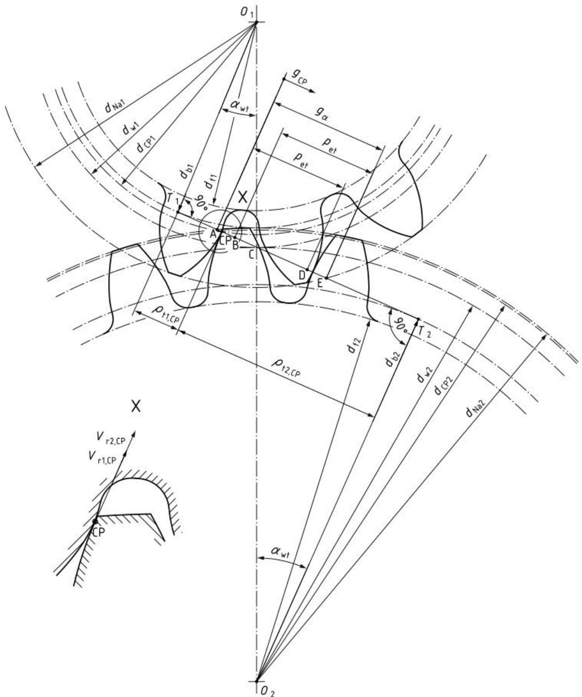  
Figure 20 — Definition of contact point CP on the line of action

### 10.5.2 Load sharing factor, $X_{CP}$

#### 10.5.2.1 General

The load sharing factor, $X_{CP}$ , accounts for the load sharing of succeeding pairs of meshing teeth. The load sharing factor is presented as a function of the linear parameter $g_{CP}$ on the path of contact $^{[17]}$ (see also 10.5.1).

Depending on manufacturing deviations and type and amount of profile modifications the real local load sharing may differ from its theoretical value. Due to such effects a preceding pair of meshing teeth may cause an instantaneous increase or decrease of the theoretical load sharing factor, independent of similar effects on a succeeding pair of meshing teeth at a later time. The value of $X_{CP}$ does not exceed 1,0 (for cylindrical gears), which means full transverse single tooth contact. The region of transverse single tooth contact may be extended by an irregularly varying location of a dynamic load.

The load sharing factor, $X_{CP}$ , depends on the type of gear transmission and on the profile modification. In case of buttressing of helical teeth (no profile modification) the load sharing factor is combined with a buttressing factor, $X_{but,CP}$ $^{[17]}$ .

#### 10.5.2.2 Spur gears with unmodified profiles

The load sharing factor for a spur gear with unmodified profile is conventionally supposed to have a discontinuous trapezoidal shape; see Figure 21. However, due to manufacturing inaccuracies, in each path of double contact the load sharing factor will increase for protruding flanks and decrease for other flanks. The representative load sharing factor is an envelope of possible curves; see Figure 22.

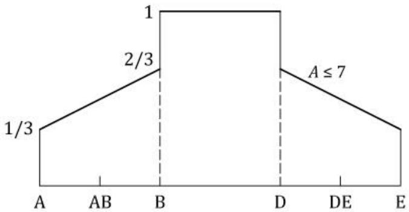  
Figure 21 — Load sharing factor for cylindrical spur gears with unmodified profiles and tolerance class ≤ 7

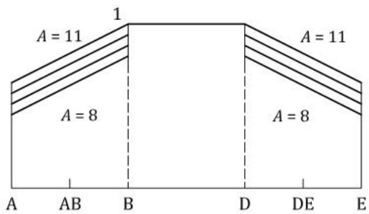  
Figure 22 — Load sharing factor for cylindrical gears with unmodified profiles and tolerance class 8

$$
X _ {\mathrm{CP}} = \frac {A - 3}{12} + \frac {1}{3} \cdot \frac {g _ {\mathrm{CP}}}{g _ {\mathrm{B}}} \quad \text { for } g _ {\mathrm{A}} \leq g _ {\mathrm{CP}} <   g _ {\mathrm{B}}\tag{113}
$$

$$
X _ {\mathrm{CP}} = 1, 0\quad \mathrm{for} g _ {\mathrm{B}} \leq g _ {\mathrm{CP}} \leq g _ {\mathrm{D}}\tag{114}
$$

$$
X _ {\mathrm{CP}} = \frac {A - 3}{12} + \frac {1}{3} \cdot \frac {g _ {\alpha} - g _ {\mathrm{CP}}}{g _ {\alpha} - g _ {\mathrm{D}}} \quad \text { for } g _ {\mathrm{D}} <   g _ {\mathrm{CP}} \leq g _ {\mathrm{E}}\tag{115}
$$

where

A = 7 for tolerance class ≤ 7 according to ISO 1328-1:2013;

A = tolerance class for class $\geq$ 8 according to ISO 1328-1:2013.

#### 10.5.2.3 Spur gears with profile modification

a) Load sharing factor for cylindrical spur gears with adequate profile modification on pinion and wheel (see Figure 23)

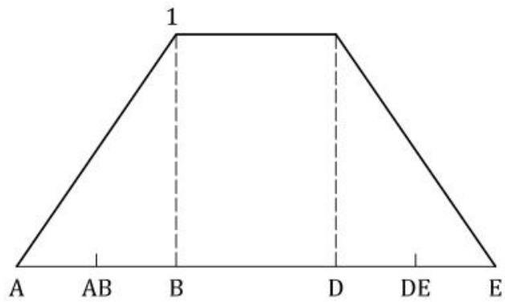  
Figure 23 — Load sharing factor for cylindrical spur gears with adequate profile modification

$$
X _ {\mathrm{CP}} = \frac {g _ {\mathrm{CP}}}{g _ {\mathrm{B}}} \quad \text { for } g _ {\mathrm{A}} \leq g _ {\mathrm{CP}} \leq g _ {\mathrm{B}}\tag{116}
$$

$$
X _ {\mathrm{CP}} = 1, 0 \quad \text { for } g _ {\mathrm{B}} <   g _ {\mathrm{CP}} <   g _ {\mathrm{D}}\tag{117}
$$

$$
X _ {\mathrm{CP}} = \frac {g _ {\alpha} - g _ {\mathrm{CP}}}{g _ {\alpha} - g _ {\mathrm{D}}} \quad \text { for } g _ {\mathrm{D}} \leq g _ {\mathrm{CP}} \leq g _ {\mathrm{E}}\tag{118}
$$

b) Load sharing factor for cylindrical spur gears with adequate profile modification on the addendum of the wheel and/or the dedendum of the pinion (see Figure 24)

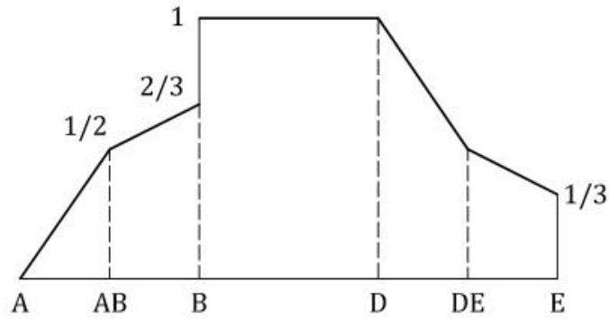  
Figure 24 — Load sharing factor for cylindrical spur gears with adequate profile modification on the addendum of the wheel and/or the dedendum of the pinion

$$
X _ {\mathrm{CP}} = \frac {g _ {\mathrm{CP}}}{g _ {\mathrm{B}}}\quad \mathrm{for} g _ {\mathrm{A}} \leq g _ {\mathrm{CP}} \leq g _ {\mathrm{AB}}\tag{119}
$$

$$
X _ {\mathrm{CP}} = \frac {1}{3} + \frac {1}{3} \cdot \frac {g _ {\mathrm{CP}}}{g _ {\mathrm{B}}} \quad \text { for } g _ {\mathrm{AB}} <   g _ {\mathrm{CP}} <   g _ {\mathrm{B}}\tag{120}
$$

$$
X _ {\mathrm{CP}} = 1, 0\quad \mathrm{for} g _ {\mathrm{B}} \leq g _ {\mathrm{CP}} <   g _ {\mathrm{D}}\tag{121}
$$

$$
X _ {\mathrm{CP}} = \frac {g _ {\alpha} - g _ {\mathrm{CP}}}{g _ {\alpha} - g _ {\mathrm{D}}} \quad \text { for } g _ {\mathrm{D}} \leq g _ {\mathrm{CP}} \leq g _ {\mathrm{DE}}\tag{122}
$$

$$
X _ {\mathrm{CP}} = \frac {1}{3} + \frac {1}{3} \cdot \frac {g _ {\alpha} - g _ {\mathrm{CP}}}{g _ {\alpha} - g _ {\mathrm{D}}} \quad \text { for } g _ {\mathrm{DE}} <   g _ {\mathrm{CP}} \leq g _ {\mathrm{E}}\tag{123}
$$

c) Load sharing factor for cylindrical spur gears with adequate profile modification on the addendum of the pinion and/or the dedendum of the wheel (see Figure 25)

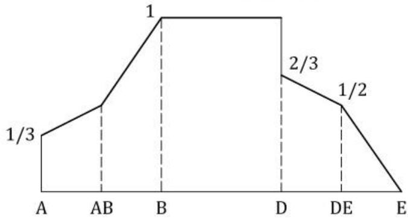  
Figure 25 — Load sharing factor for cylindrical spur gears with adequate profile modification on the addendum of the pinion and/or the dedendum of the wheel

$$
X _ {\mathrm{CP}} = \frac {1}{3} + \frac {1}{3} \cdot \frac {g _ {\mathrm{CP}}}{g _ {\mathrm{B}}}\quad \mathrm{for} g _ {\mathrm{A}} \leq g _ {\mathrm{CP}} \leq g _ {\mathrm{AB}}\tag{124}
$$

$$
X _ {\mathrm{CP}} = \frac {g _ {\mathrm{CP}}}{g _ {\mathrm{B}}}\quad \mathrm{for} g _ {\mathrm{AB}} <   g _ {\mathrm{CP}} \leq g _ {\mathrm{B}}\tag{125}
$$

$$
X _ {\mathrm{CP}} = 1, 0\quad \text { for } g _ {\mathrm{B}} <   g _ {\mathrm{CP}} \leq g _ {\mathrm{D}}\tag{126}
$$

$$
X _ {\mathrm{CP}} = \frac {1}{3} + \frac {1}{3} \cdot \frac {g _ {\alpha} - g _ {\mathrm{CP}}}{g _ {\alpha} - g _ {\mathrm{D}}}\quad \text { for } g _ {\mathrm{D}} <   g _ {\mathrm{CP}} \leq g _ {\mathrm{DE}}\tag{127}
$$

$$
X _ {\mathrm{CP}} = \frac {g _ {\alpha} - g _ {\mathrm{CP}}}{g _ {\alpha} - g _ {\mathrm{D}}}\quad \mathrm{for} g _ {\mathrm{DE}} <   g _ {\mathrm{CP}} \leq g _ {\mathrm{E}}\tag{128}
$$

#### 10.5.2.4 Buttressing factor, $X_{but,CP}$

Helical gears may have a buttressing effect near the end points A and E of the path of contact, due to the oblique contact lines. This applies to cylindrical helical gears with no profile modification.

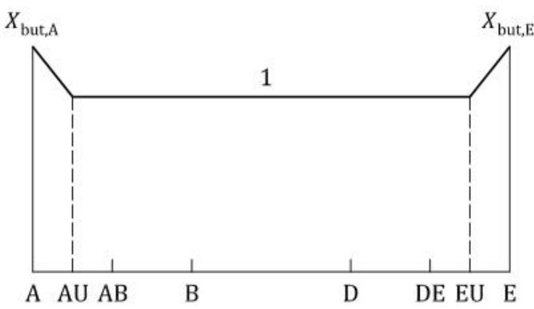  
Figure 26 — Buttressing factor, $X_{but,CP}$

The buttressing is expressed by means of a factor $X_{but,CP}$ ; see Figure 26, marked by the following values.

$$
g _ {\mathrm{AU}} - g _ {\mathrm{A}} = g _ {\mathrm{E}} - g _ {\mathrm{EU}} = 0, 2 \mathrm{mm} \cdot \sin \beta_ {\mathrm{b}}\tag{129}
$$

with

$$
g _ {\mathrm{A}} = 0 \mathrm{mm}
$$

$$
g _ {\mathrm{E}} = g _ {\alpha}
$$

$$
X _ {\mathrm{but,A}} = X _ {\mathrm{but,E}} = 1, 3\quad \mathrm{if} \varepsilon_ {\beta} \geq 1, 0\tag{130}
$$

$$
X _ {\mathrm{but,A}} = X _ {\mathrm{but,E}} = 1 + 0, 3 \cdot \varepsilon_ {\beta}\quad \mathrm{if} \varepsilon_ {\beta} <   1, 0\tag{131}
$$

$$
X _ {\mathrm{but,AU}} = X _ {\mathrm{but,EU}} = 1, 0\tag{132}
$$

$$
X _ {\text { but,CP }} = X _ {\text { but,A }} - \frac {g _ {\mathrm{CP}}}{0 , 2 \mathrm{mm} \cdot \sin \beta_ {\mathrm{b}}} \cdot (X _ {\text { but,A }} - 1) \quad \text { for } g _ {\mathrm{A}} \leq g _ {\mathrm{CP}} <   g _ {\mathrm{AU}}\tag{133}
$$

$$
X _ {\mathrm{but,CP}} = 1, 0\quad \text{for } g_{\mathrm{AU}} \leq g_{\mathrm{CP}} \leq g_{\mathrm{EU}}\tag{134}
$$

$$
X _ {\mathrm{but,CP}} = X _ {\mathrm{but,E}} - \frac {g _ {\alpha} - g _ {\mathrm{CP}}}{0 , 2 \mathrm{mm} \cdot \sin \beta_ {\mathrm{b}}} \cdot (X _ {\mathrm{but,E}} - 1) \quad \text { for } g _ {\mathrm{EU}} <   g _ {\mathrm{CP}} \leq g _ {\mathrm{E}}\tag{135}
$$

where $\varepsilon_{\beta}$ is the overlap ratio.

#### 10.5.2.5 Helical gears with $\varepsilon_{\beta} \leq 0,8$ and unmodified profiles

Helical gears with a contact ratio $\varepsilon_{\alpha} \geq 1$ and overlap ratio $\varepsilon_{\beta} \leq 0.8$ , have single contact and limited double contact of tooth pairs. Hence, they can be treated similar to spur gears, considering the geometry in the transverse plane, as well as the buttressing effect. See Figure 27.

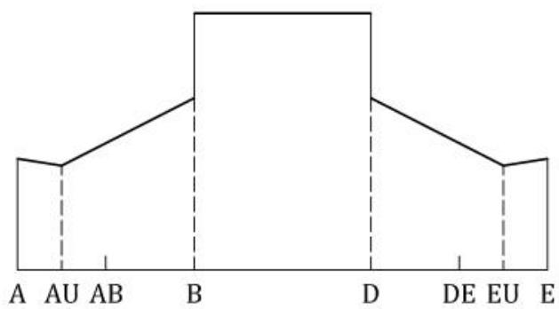  
Figure 27 — Load sharing factor for cylindrical helical gears with $\varepsilon_{\beta} \leq 0.8$ and unmodified profiles, including buttressing effect

The load sharing factor is obtained by multiplying the $X_{CP}$ in 10.5.2.2 with the buttressing factor, $X_{but,CP}$ , in 10.5.2.4.

#### 10.5.2.6 Helical gears with $\varepsilon_{\beta} \leq 0,8$ and profile modification

Helical gears with a contact ratio $\varepsilon_{\alpha} \geq 1$ and overlap ratio $\varepsilon_{\beta} \leq 0,8$ , have single contact and limited double contact of tooth pairs. Hence, they can be treated similar to spur gears, considering the geometry in the transverse plane. See Figure 28, Figure 29 and Figure 30.

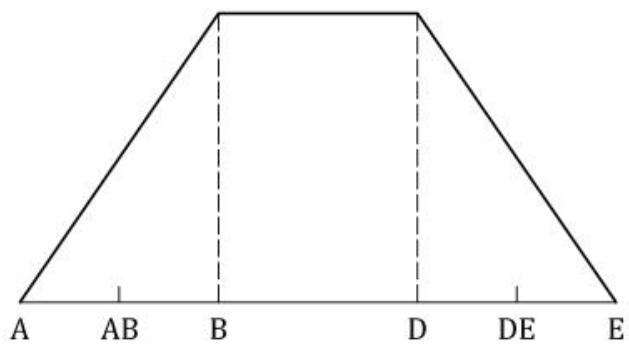  
Figure 28 — Load sharing factor for cylindrical helical gears with $\varepsilon_{\beta} \leq 0.8$ and adequate profile modification

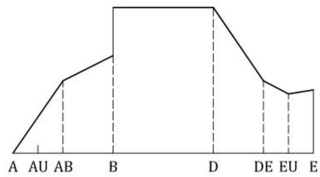  
Figure 29 — Load sharing factor for cylindrical helical gears with $\varepsilon_{\beta} \leq 0.8$ and adequate profile modification on addendum of the wheel and/or the dedendum of the pinion

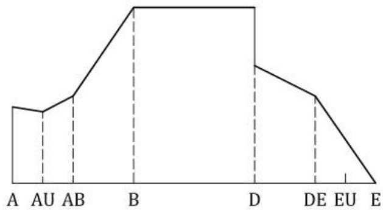  
Figure 30 — Load sharing factor for cylindrical helical gears with $\varepsilon_{\beta} \leq 0.8$ and adequate profile modification on the addendum of the pinion and/or the dedendum of the wheel

The load sharing factor is obtained by multiplying the $X_{CP}$ in 10.5.2.3 with the buttressing factor, $X_{but,CP}$ , in 10.5.2.4.

#### 10.5.2.7 Helical gears with $\varepsilon_{\beta} \geq 1,2$ and unmodified profiles

The buttressing effect of local high mesh stiffness at the end of oblique contact lines for helical gears with $\varepsilon_{\alpha} \geq 1$ and $\varepsilon_{\beta} \geq 1,2$ , is assumed to act near the ends A and E along the helix teeth over a constant length, which corresponds to a transverse relative distance 0,2 mm $\sin\beta_{b}$ ; see Figure 31. See also 10.5.2.3 and Figure 26.

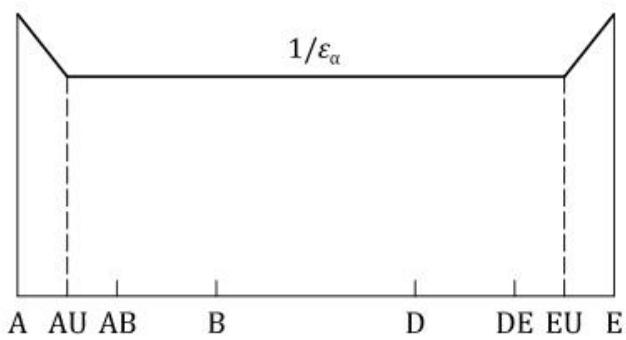  
Figure 31 — Load sharing factor for cylindrical helical gears with 1,2 and unmodified profiles

The load sharing factor is obtained by multiplying the value $1/\varepsilon_{\alpha}$ , representing the mean load, with the buttressing factor, $X_{but,CP}$ .

$$
X _ {\mathrm{CP}} = \frac {1}{\varepsilon_ {\alpha}} \cdot X _ {\mathrm{but,CP}}\tag{136}
$$

where $\varepsilon_{\alpha}$ is the transverse contact ratio.

#### 10.5.2.8 Helical gears with $\varepsilon_{\beta} \geq 1,2$ and profile modification

Tip relief on the pinion (respectively wheel) reduces $X_{\mathrm{CP}}$ in the range DE-E (respectively A-AB) and increases $X_{\mathrm{CP}}$ in the range AB-DE, see Figure 32, Figure 33 and Figure 34. The extensions of tip relief at both ends A-AB and DE-E of the path of contact are assumed to be equal and to result in a contact ratio $\varepsilon_{\alpha} = 1$ for unloaded gears; see Figure 32.

a) Load sharing factor for cylindrical helical gears with $\varepsilon_{\beta} \geq 1,2$ and adequate profile modification on pinion and wheel

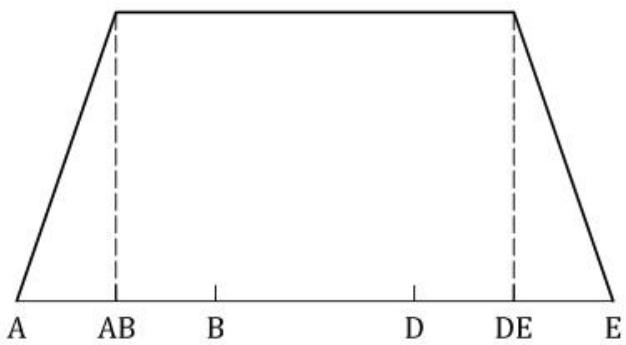  
Figure 32 — Load sharing factor for cylindrical helical gears with $\varepsilon_{\beta} \geq 1,2$ and adequate profile modification

$$
X _ {\mathrm{CP}} = \left[ \frac {1}{\varepsilon_ {\alpha}} + \frac {(\varepsilon_ {\alpha} - 1)}{\varepsilon_ {\alpha} \cdot (\varepsilon_ {\alpha} + 1)} \right] \cdot \frac {g _ {\mathrm{CP}}}{g _ {\mathrm{AB}}}\quad \mathrm{for} g _ {\mathrm{A}} \leq g _ {\mathrm{CP}} \leq g _ {\mathrm{AB}}\tag{137}
$$

$$
X _ {\mathrm{CP}} = \frac {1}{\varepsilon_ {\alpha}} + \frac {\left(\varepsilon_ {\alpha} - 1\right)}{\varepsilon_ {\alpha} \cdot \left(\varepsilon_ {\alpha} + 1\right)}\quad \mathrm{for} g _ {\mathrm{AB}} <   g _ {\mathrm{CP}} \leq g _ {\mathrm{DE}}\tag{138}
$$

$$
X _ {\mathrm{CP}} = \left[ \frac {1}{\varepsilon_ {\alpha}} + \frac {(\varepsilon_ {\alpha} - 1)}{\varepsilon_ {\alpha} \cdot (\varepsilon_ {\alpha} + 1)} \right] \cdot \frac {g _ {\alpha} - g _ {\mathrm{CP}}}{g _ {\alpha} - g _ {\mathrm{DE}}}\quad \mathrm{for} g _ {\mathrm{DE}} <   g _ {\mathrm{CP}} \leq g _ {\mathrm{E}}\tag{139}
$$

b) Load sharing factor for cylindrical helical gears with $\varepsilon_{\beta} \geq 1,2$ and adequate profile modification on the addendum of the wheel and/or the dedendum of the pinion

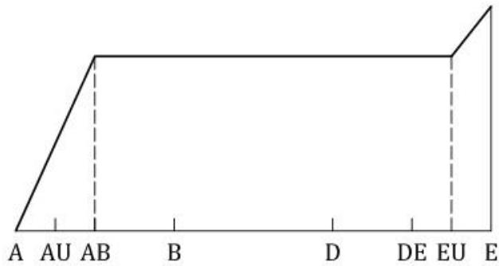  
Figure 33 — Load sharing factor for cylindrical helical gears with $\varepsilon_{\beta} \geq 1,2$ and adequate profile modification on the addendum of the wheel and/or the dedendum of the pinion

$$
X _ {\mathrm{CP}} = \left[ \frac {1}{\varepsilon_ {\alpha}} + \frac {\left(\varepsilon_ {\alpha} - 1\right)}{2 \cdot \varepsilon_ {\alpha} \cdot \left(\varepsilon_ {\alpha} + 1\right)} \right] \cdot \frac {g _ {\mathrm{CP}}}{g _ {\mathrm{AB}}}\quad \mathrm{for} g _ {\mathrm{A}} \leq g _ {\mathrm{CP}} \leq g _ {\mathrm{AB}}\tag{140}
$$

$$
X _ {\mathrm{CP}} = \frac {1}{\varepsilon_ {\alpha}} + \frac {(\varepsilon_ {\alpha} - 1)}{2 \cdot \varepsilon_ {\alpha} \cdot (\varepsilon_ {\alpha} + 1)}\quad \text { for } g _ {\mathrm{AB}} <   g _ {\mathrm{CP}} \leq g _ {\mathrm{EU}}\tag{141}
$$

$$
X _ {\mathrm{CP}} = \left[ \frac {1}{\varepsilon_ {\alpha}} + \frac {\left(\varepsilon_ {\alpha} - 1\right)}{2 \cdot \varepsilon_ {\alpha} \cdot \left(\varepsilon_ {\alpha} + 1\right)} \right] \cdot X _ {\mathrm{but,CP}}\quad \mathrm{for} g _ {\mathrm{EU}} <   g _ {\mathrm{CP}} \leq g _ {\mathrm{E}}\tag{142}
$$

c) Load sharing factor for cylindrical helical gears with $\varepsilon_{\beta} \geq 1,2$ and adequate profile modification on the addendum of the pinion and/or the dedendum of the wheel

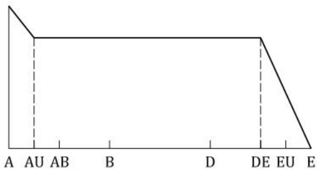  
Figure 34 — Load sharing factor for cylindrical helical gears with $\varepsilon_{\beta} \geq 1,2$ and adequate profile modification on the addendum of the pinion and/or dedendum of the wheel

$$
X _ {\mathrm{CP}} = \left[ \frac {1}{\varepsilon_ {\alpha}} + \frac {\left(\varepsilon_ {\alpha} - 1\right)}{2 \cdot \varepsilon_ {\alpha} \cdot \left(\varepsilon_ {\alpha} + 1\right)} \right] \cdot X _ {\text {but,CP}} \quad \text {for} g _ {\mathrm{A}} \leq g _ {\mathrm{CP}} \leq g _ {\mathrm{AU}}\tag{143}
$$

$$
X _ {\mathrm{CP}} = \frac {1}{\varepsilon_ {\alpha}} + \frac {\left(\varepsilon_ {\alpha} - 1\right)}{2 \cdot \varepsilon_ {\alpha} \cdot \left(\varepsilon_ {\alpha} + 1\right)}\quad \mathrm{for} g _ {\mathrm{AU}} <   g _ {\mathrm{CP}} \leq g _ {\mathrm{DE}}\tag{144}
$$

$$
X _ {\mathrm{CP}} = \left[ \frac {1}{\varepsilon_ {\alpha}} + \frac {\left(\varepsilon_ {\alpha} - 1\right)}{2 \cdot \varepsilon_ {\alpha} \cdot \left(\varepsilon_ {\alpha} + 1\right)} \right] \cdot \frac {g _ {\alpha} - g _ {\mathrm{CP}}}{g _ {\alpha} - g _ {\mathrm{DE}}} \quad \text { for } g _ {\mathrm{DE}} <   g _ {\mathrm{CP}} \leq g _ {\mathrm{E}}\tag{145}
$$

#### 10.5.2.9 Helical gears with $0,8 < \varepsilon_{\beta} < 1,2$

Due to the fact that gears are not infinite stiff, the overlap ratio changes depending on the load. To take this into account, for helical gears with calculated overlap ratios $0,8 < \varepsilon_{\beta} < 1,2$ , an interpolation between the load sharing factor $X_{\mathrm{CP}}(\varepsilon_{\beta} = 0,8)$ for $\varepsilon_{\beta} = 0,8$ (see 10.5.2.5 for unmodified profiles respectively 10.5.2.6 for modified profiles) and $X_{\mathrm{CP}}(\varepsilon_{\beta} = 1,2)$ for $\varepsilon_{\beta} = 1,2$ (see 10.5.2.7 for unmodified profiles respectively 10.5.2.8 for modified profiles) has to be performed. For helical gears with $0,8 < \varepsilon_{\beta} < 1,2$ , $X_{\mathrm{CP}}$ is calculated as follows:

$$
X _ {\mathrm{CP}} \left(\varepsilon_ {\beta}\right) = X _ {\mathrm{CP}} \left(\varepsilon_ {\beta} = 0, 8\right) \cdot \frac {1 , 2 - \varepsilon_ {\beta}}{0 , 4} + X _ {\mathrm{CP}} \left(\varepsilon_ {\beta} = 1, 2\right) \cdot \frac {\varepsilon_ {\beta} - 0 , 8}{0 , 4}\tag{146}
$$

## 10.6 Sum of tangential velocity, $v_{\Sigma,CP}$

The sum of the tangential velocities at a contact point, CP, is calculated according to Formula (147). The velocity for pinion, $v_{r1,CP}$ , and wheel, $v_{r2,CP}$ , in a certain contact point, CP, on the tooth flank depends on the diameter at pinion, $d_{CP1}$ , and the diameter at wheel, $d_{CP2}$ , of point CP.

$$
v _ {\Sigma , \mathrm{CP}} = v _ {\mathrm{r1,CP}} + v _ {\mathrm{r2,CP}}\tag{147}
$$

where

$$
v _ {\mathrm{r1,CP}} = 2 \cdot \pi \cdot \frac {n _ {1}}{60} \cdot \frac {d _ {\mathrm{w1}}}{2000} \cdot \sin \alpha_ {\mathrm{wt}} \cdot \sqrt {\frac {d _ {\mathrm{CP1}} ^ {2} - d _ {\mathrm{b1}} ^ {2}}{d _ {\mathrm{w1}} ^ {2} - d _ {\mathrm{b1}} ^ {2}}}\tag{148}
$$

$$
v _ {\mathrm{r2,CP}} = 2 \cdot \pi \cdot \frac {n _ {1}}{u \cdot 60} \cdot \frac {d _ {\mathrm{w2}}}{2000} \cdot \sin \alpha_ {\mathrm{wt}} \cdot \sqrt {\frac {d _ {\mathrm{CP2}} ^ {2} - d _ {\mathrm{b2}} ^ {2}}{d _ {\mathrm{w2}} ^ {2} - d _ {\mathrm{b2}} ^ {2}}}\tag{149}
$$

$v_{r1,CP}$ is the tangential velocity on pinion (see Figure 20);

$v_{r2,CP}$ is the tangential velocity on wheel (see Figure 20);

$d_{b1}$ is the base diameter of pinion;

$d_{b2}$ is the base diameter of wheel;

$d_{w1}$ is the pitch diameter of pinion;

$d_{w2}$ is the pitch diameter of wheel;

$d_{CP1}$ is the diameter of the pinion at contact point CP (see Figure 20 and 10.5);

$d_{CP2}$ is the diameter of the wheel at contact point CP (see Figure 20 and 10.5);

$n_{1}$ is the rotation speed of pinion;

$u = z_{2}/z_{1}$ is the gear ratio;

$\alpha_{wt}$ is the working transverse pressure angle at the pitch cylinder.

# 11 Lubricant parameters at given temperature

## 11.1 General

The dynamic viscosity at given temperature, $\eta_{\theta}$ , can be calculated according to Formula (150).

$$
\eta_ {\theta} = 10 ^ {- 6} \cdot \nu _ {\theta} \cdot \rho_ {\theta}\tag{150}
$$

where

$\nu_{\theta}$ is the kinematic viscosity of the lubricant at a given temperature (see 11.2);

$\rho_{\theta}$ is the density of the lubricant at a given temperature (see 11.3).

## 11.2 Kinematic viscosity at a given temperature, $\nu_{\theta}$

The kinematic viscosity at a given temperature, $\nu_{\theta}$ , can be calculated from the kinematic viscosity, $\nu_{40}$ , at 40 °C and the kinematic viscosity, $\nu_{100}$ , at 100 °C on the basis of Formula (151). Extrapolation for a temperature higher than 140 °C should be confirmed by measurement.

$$
\log \left[ \log \left(\nu _ {\theta} + 0, 7\right) \right] = A \cdot \log (\theta + 273) + B\tag{151}
$$

where

$$
A = \frac {\log \left[ \log \left(\nu _ {40} + 0 , 7\right) / \log \left(\nu _ {100} + 0 , 7\right) \right]}{\log (313 / 373)}\tag{152}
$$

$$
B = \log \left[ \log \left(\nu _ {40} + 0, 7\right) \right] - A \log (313)\tag{153}
$$

θ is a given temperature,

$\nu_{40}$ is the kinematic viscosity of the lubricant at $40^{\circ}$ C;

$\nu_{100}$ is the kinematic viscosity of the lubricant at $100^{\circ}$ C.

## 11.3 Density of the lubricant at a given temperature $\theta, \rho_{\theta}$

If the density of the lubricant at a given temperature $\theta, \rho_{\theta}$ , is not available, it can be approximated based on the density of the lubricant at $15^{\circ}\mathrm{C}$ according to Formula (154).

$$
\rho_ {\theta} = \rho_ {15} \cdot \left[ 1 - 0, 7 \cdot \frac {(\theta + 273) - 289}{\rho_ {15}} \right]\tag{154}
$$

where

$\rho_{15}$ is the density of the lubricant at $15^{\circ}$ C according to the lubricant data sheet;

θ is a given temperature.

If no data for $\rho_{15}$ is available, then Formula (155) can be used for approximation of mineral oils.

$$
\rho_ {15} = 43, 37 \cdot \log \nu _ {40} + 805, 5\tag{155}
$$

where $\nu_{40}$ is the kinematic viscosity of the lubricant at $40^{\circ}C$ .

# Annex A (normative) — Additional methods for determination of $f_{sh}$ and $f_{ma}$

## A.1 Determination of $f_{sh}$ from contact pattern

Once the transmission has been assembled, the equivalent misalignment, $f_{sh}$ , can be calculated for gears with or without helix modification from the width of the contact pattern without load and with part load. Equipment suitable for the application of part load shall be available.

Since the mesh stiffness falls off sharply at low specific loading, the specific loading at partial load should be at least 100 N/mm.

Care shall be taken to ensure that the pinion and wheel shaft journals are in their working attitudes during contact pattern development (appropriate bearing clearances).

The procedure is as follows:

a) Determine the mesh misalignment, $f_{\mathrm{ma}}$ , in accordance with 7.5.4.2.

b) Measure contact pattern length, $b_{calT}$ , under partial load, $F_{mT}$ , and calculate $b_{calT}/b$ .

It is necessary that the part load be chosen such that the contact pattern dimension, $b_{cal}$ , is less than the face width ( $b_{cal}/b < 1$ ); however, the smallest load should not be less than 10 % of the full load. The maximum length of contact pattern should not exceed 85 % of the face width ( $b_{cal}/b < 0.85$ ), in order to ensure that the contact pattern width is less than the face width (the type of load distribution for $b_{cal} = b$ is not clearly defined, see Figures 7 and 8).

c) Determine the equivalent misalignment, $F_{\beta x T}$ , under partial load (see Clause 9 for tooth stiffness $c_{\gamma\beta}$ ):

$$
F _ {\beta \mathrm{xT}} = \frac {2 F _ {\mathrm{mT}}}{\left[ b \left(\frac {b _ {\mathrm{calT}}}{b}\right) ^ {2} c _ {\gamma \beta} \right]}\tag{A.1}
$$

d) Calculate $f_{shT}$ under partial load:

$$
f _ {\mathrm{shT}} = \left| F _ {\beta \mathrm{xT}} - f _ {\mathrm{ma}} \right|\tag{A.2}
$$

e) Compute $f_{sh}$ under full load (linear extrapolation):

$$
f _ {\mathrm{sh}} = f _ {\mathrm{shT}} \left(\frac {F _ {\mathrm{m}}}{F _ {\mathrm{mT}}}\right)\tag{A.3}
$$

NOTE Depending on the design, the accuracy of the method can be seriously impaired when the nonlinear deflection components are induced at larger partial loads.

b

## A.2 Determination of $f_{ma}$

### A.2.1 Determination of $f_{\mathrm{ma}}$ on basis of no load contact pattern

Under ideal conditions $f_{ma}$ can be derived from

$$
f _ {\mathrm{ma}} = \left(\frac {b}{b _ {\mathrm{c0}}}\right) s _ {\mathrm{c}}\tag{A.4}
$$

where $b_{c0}$ is the length, at low loading, of the contact pattern of the assembled gears and $s_{c}$ is the thickness of the coating of marking compound (see Figure A.1) [^15] . If gears are crowned or end relieved, a more detailed analysis is necessary.

  
Figure A.1 — Length of contact pattern $b_{c0}$ and face width b

The coating thickness of common marking compounds is in the range 2 $\mu$ m to 20 $\mu$ m; 6 $\mu$ m can be used as a mean value consistent with good working practice.

If the minimum length of contact pattern is stated on the drawing, it is convenient to determine the maximum permissible mesh misalignment.

$$
f _ {\mathrm{ma} \max} = \frac {b s _ {\mathrm{c}}}{b _ {\mathrm{c0} \min}}\tag{A.5}
$$

A mean value suitable for use in preliminary design calculations is

$$
f _ {\mathrm{ma}} = \frac {2}{3} f _ {\mathrm{ma} \max}\tag{A.6}
$$

After final assembly in the gear case, maximum and minimum values of mesh misalignment, $f_{ma\ max}$ and $f_{ma\ min}$ , can be determined from the minimum or the maximum lengths of the contact pattern respectively. These values enable the recalculation of the preliminary rated load capacity:

$$
f _ {\mathrm{ma}} = 0, 5 \left(f _ {\mathrm{mamax}} + f _ {\mathrm{mamin}}\right)\tag{A.7}
$$

$$
f _ {\mathrm{ma} \max} = \left(\frac {b}{b _ {\mathrm{c0min}}}\right) s _ {\mathrm{c}}\tag{A.8}
$$

$$
f _ {\mathrm{ma} \min} = \left(\frac {b}{b _ {\mathrm{c0} \max}}\right) s _ {\mathrm{c}}\tag{A.9}
$$

The contact patterns shall be created with pinion and wheel shaft journals in their working attitudes.

### A.2.2 Determination of $f_{ma}$ from length of the contact pattern under partial load and theoretically determined deformations

The following conditions are necessary for application:

The elastic deflections of pinion, wheel, shafts, casing and bearings, $f_{sh}$ , $f_{sh2}$ , $f_{ca}$ and $f_{be}$ (see 7.5.3.4), are to be determined using an accurate calculation method. As a rule, Method C is not sufficiently accurate for the purpose. As indicated, the individual deflections shall be carefully considered.

The length of the contact pattern, $b_{calT}$ , at partial loading, $F_{mT}$ (see A.1), is measured and the equivalent misalignment, $F_{\beta xT}$ , at partial loading is determined using Formula (A.10):

$$
F _ {\beta \mathrm{xT}} = \frac {2 F _ {\mathrm{mT}}}{\left[ b \left(\frac {b _ {\mathrm{calT}}}{b}\right) ^ {2} c _ {\gamma \beta} \right]}\tag{A.10}
$$

When calculating mesh misalignment, it is necessary to distinguish between the two cases.

Case 1: the elastic deflections augment the mesh misalignment (see, for example, Figure 12):

$$
f _ {\mathrm{ma}} = F _ {\beta \mathrm{xT}} - \left| \left(f _ {\mathrm{sh}} + f _ {\mathrm{sh2}} + f _ {\mathrm{ca}} + f _ {\mathrm{be}}\right) _ {\mathrm{T}} \right|\tag{A.11}
$$

Case 2: the elastic deflections tend to compensate for the mesh misalignment (see, for example, Figure 12):

$$
f _ {\mathrm{ma}} = F _ {\beta \mathrm{xT}} + \left| \left(f _ {\mathrm{sh}} + f _ {\mathrm{sh2}} + f _ {\mathrm{ca}} + f _ {\mathrm{be}}\right) _ {\mathrm{T}} \right|\tag{A.12}
$$

When gears are crowned or end-relieved, an accurate analysis is necessary.

When the length of the contact pattern varies around the circumference, $f_{ma\ max}$ shall be derived from the minimum length, $f_{ma\ min}$ shall be derived from the maximum length, and then $f_{ma}$ shall be derived from Formula (A.7).

# Annex B (informative) — Guide values for crowning and end relief of teeth of cylindrical gears

## B.1 General

Well-designed crowning and end relief have a beneficial influence on the distribution of load over the face width of a gear (see Clause 7). Design details should be based on a careful estimate of the deformations and manufacturing deviations of the gearing of interest. If deformations are considerable, helix angle modification might be superposed over crowning or end relief, but well-designed helix modification is preferable.

## B.2 Amount of crowning, $C_{\beta}$

The following non-mandatory rule is drawn from experience; the amount of crowning which is necessary to obtain acceptable distribution of load can be determined as follows:

Subject to the limitations, $10 \mu m \leq C_{\beta} \leq 40 \mu m$ plus a manufacturing tolerance of $5 \mu m$ to $10 \mu m$ , and that the value $b_{cal}/b$ would have been greater than 1 had the gears not been crowned, $C_{\beta} = 0.5 F_{\beta x cv}$ [see Figure 8)].

The initial equivalent misalignment, $F_{\beta x\text{ cv}}$ , should be calculated as though the gears were not crowned, using a modified version of Formula (54) in which $1,0f_{\text{sh}}$ is substituted for $1,33f_{\text{sh}}$ — see Formula (B.1).

Furthermore, $f_{sh}$ shall be determined as though the gears were not crowned in accordance with 7.5.3.5.

  
Figure B.1 — Amount of crowning, $C_{\beta(b)}$ , and width, $b_{(b)}$ (see 7.5.3.5)

So as to avoid excessive loading of tooth ends, instead of deriving $f_{ma}$ from 7.5.4, the value shall be calculated as

$$
f _ {\mathrm{mac}} = 1, 5 f _ {\mathrm{H} \beta}\tag{B.1}
$$

Thus, the crowning amount:

$$
C _ {\beta} = 0, 5 \left(f _ {\mathrm{sh}} + 1, 5 f _ {\mathrm{H} \beta}\right)\tag{B.2}
$$

When the gears are of such stiff construction that $f_{sh}$ can for all practical purposes be neglected, or when the helices have been modified to compensate for deformation at mid face width, the following value can be substituted:

$$
C _ {\beta} = f _ {\mathrm{H} \beta}\tag{B.3}
$$

Subject to the restriction $10 \mu m \leq C_{\beta} \leq 25 \mu m$ plus a manufacturing tolerance of about $5 \mu m$ , 60 % to 70 % of the above values are adequate for extremely accurate and reliable high-speed gears.

## B.3 Amount, $C_{\mathrm{I(II)}}$ , and width, $b_{\mathrm{I(II)}}$ , of end relief

### B.3.1 Method B.3.1

This method is based on an assumed value for the equivalent misalignment of the gear pair, without end relief and on the recommendations for the amount of gear crowning. The following is non-mandatory.

a) Amount of end relief

For through hardened gears, $C_{I(II)} = F_{\beta x \text{ cv}}$ plus a manufacturing tolerance of 5 $\mu$ m to 10 $\mu$ m.

Thus, by analogy with $F_{\beta x cv}$ in B.2, $C_{I(II)}$ should be approximately

$$
C _ {\mathrm{I(II)}} = f _ {\mathrm{sh}} + 1, 5 f _ {\mathrm{H} \beta}\tag{B.4}
$$

For surface hardened and nitrided gears: $C_{\mathrm{I(II)}} = 0.5 F_{\beta x \, cv}$ plus a manufacturing tolerance of 5 $\mu$ m to 10 $\mu$ m.

  
Figure B.2 — Amount, $C_{\mathrm{I(II)-(b)}}$ , and width, $b_{(b)}$ , of end relief (see 7.5.3.5)

Thus, by analogy with $F_{\beta x_{cv}}$ in B.2, $C_{I(II)}$ should be approximately

$$
C _ {\mathrm{I(II)}} = 0, 5 \left(f _ {\mathrm{sh}} + 1, 5 f _ {\mathrm{H} \beta}\right)\tag{B.5}
$$

When the gears are of such stiff construction that $f_{sh}$ can for all practical purposes be neglected, or when the helices have been modified to compensate deformation, proceed in accordance with Formula (B.2).

60 % to 70 % of the above values is appropriate for very accurate and reliable gears with high circumferential velocities.

b) Width of end relief

For approximately constant loading and higher circumferential velocities, $b_{\mathrm{I(II)}}$ is the smaller of the values $(0,1\ b)$ or $(1,0\ m)$ .

The following is appropriate for variable loading, low and average speeds:

$$
b _ {\mathrm{red}} = (0, 5 \text {   to   } 0, 7) b\tag{B.6}
$$

### B.3.2 Method B.3.2

This method is based on the deflection of gear pairs assuming uniform distribution of load over the face width:

$$
\delta_ {\mathrm{bth}} = F _ {\mathrm{m}} / \left(b c _ {\gamma \beta}\right), \text {where} F _ {\mathrm{m}} = F _ {\mathrm{t}} K _ {\mathrm{A}} K _ {\gamma} K _ {\mathrm{v}}\tag{B.7}
$$

For highly accurate and reliable gears with high circumferential velocities, the following are appropriate:

$$
C _ {\mathrm{I(II)}} = (2 \text {to} 3) \delta_ {\mathrm{bth}}\tag{B.8}
$$

$$
b _ {\mathrm{red}} = (0, 8 \text {   to   } 0, 9) \cdot b\tag{B.9}
$$

For similar gears of less accuracy:

$$
C _ {\mathrm{I(II)}} = (3 \text {to} 4) \delta_ {\mathrm{bth}}\tag{B.10}
$$

$$
b _ {\mathrm{red}} = (0, 7 \text {   to   } 0, 8) b\tag{B.11}
$$

# Annex C (informative) — Guide values for $K_{H\beta-C}$ for crowned teeth of cylindrical gears

## C.1 General

The purpose of this annex is to allow the analysis of the more general (non-optimum) crowning condition.

## C.2 $K_{H\beta-C}$ for crowned gears

### C.2.1 General

Clause 7 covers the calculation of $K_{\mathrm{H}\beta}$ for crowned gears where the crowning height, $C_{\beta}$ , is one of two precise values. This annex covers the more general crowning condition.

### C.2.2 Non-dimensional crowning height, $C_{\beta}^{*}$

This is calculated as follows:

$$
C _ {\beta} ^ {*} = \frac {C _ {\beta} c _ {\gamma \beta}}{F _ {\mathrm{m}} / b}\tag{C.1}
$$

### C.2.3 Nondimensional mesh misalignment, $F_{\beta \mathrm{x}}^{*}$

This is calculated as follows:

$$
F _ {\beta \mathrm{x}} ^ {*} = \left(1, 33 B _ {3} f _ {\mathrm{sh}} + f _ {\mathrm{ma}}\right) \frac {c _ {\gamma \beta}}{F _ {\mathrm{m}} / b}\tag{C.2}
$$

where

$B_{3}$ is equal to 0,1 if a helix modification carefully calculated to match the torque being analysed is applied;

$B_{3}$ is otherwise equal to 1,0.

### C.2.4 Graphical values

The value of $K_{H\beta}$ can be read from Figure C.1.

  

Key: X — crowning height $C_{\beta}^{*}$; Y — face load factor $K_{H\beta}$.
Figure C.1 — Face load factors, $K_{H\beta}$ , for crowned gears

### C.2.5 Determination by calculation

If $C_{\beta}^{*} = 0$ , then:

$$
\text { if } F _ {\beta \mathrm{x}} ^ {*} <   2 \text { then } K _ {\mathrm{H} \beta} = 1 + \frac {F _ {\beta \mathrm{x}} ^ {*}}{2}\tag{C.3}
$$

$$
\text { if } F _ {\beta \mathrm{x}} ^ {*} \geq 2 \text { then } K _ {\mathrm{H} \beta} = \sqrt {2 F _ {\beta \mathrm{x}} ^ {*}}
$$

$$
\text { If } C _ {\beta} ^ {*} > 1, 5 \text { and } F _ {\beta x} ^ {*} <   \left\{4 C _ {\beta} ^ {*} \left[ 1 - \left(\frac {1 , 5}{C _ {\beta} ^ {*}}\right) ^ {1 / 3} \right] \right\}, \text { then: }
$$

$$
K _ {\mathrm{H} \beta} = \left(2, 25 C _ {\beta} ^ {*}\right) ^ {1 / 3}\tag{C.4}
$$

If $C_{\beta}^{*} > (0,25F_{\beta x}^{*})$ and $F_{\beta x}^{*} < 1,5$ , then:

$$
K _ {\mathrm{H} \beta} = 1 + \frac {C _ {\beta} ^ {*}}{3} + \frac {\left(F _ {\beta \mathrm{x}} ^ {*}\right) ^ {2}}{16 C _ {\beta} ^ {*}}\tag{C.5}
$$

If none of the above applies, and $C_{\beta}^{*} > (0,25 F_{\beta x}^{*})$ , then use iteration as follows.

Set $q = 1,0$ as the seed value

$$
k = \sqrt {\frac {q}{C _ {\beta} ^ {*}}}\tag{C.6}
$$

$$
m = \frac {F _ {\beta \mathrm{x}} ^ {*}}{8 C _ {\beta} ^ {*}} + \frac {k - 1}{2}\tag{C.7}
$$

$$
t = 4 C _ {\beta} ^ {*} m (k - m)\tag{C.8}
$$

$$
A = \frac {2 q k - C _ {\beta} ^ {*} m ^ {3}}{3} - \frac {m t}{2}\tag{C.9}
$$

$$
q = q - \frac {1 , 5 (A - 1)}{k}\tag{C.10}
$$

Continue until A is close to unity, then $K_{H\beta} = q$ .

If none of the above applies, then obtain value by linear interpolation.

# Annex D (informative) — Derivations and explanatory notes

## D.1 General

The explanatory notes in this annex are intended to assist the user's understanding of the formulae used in this document.

## D.2 Derivation of $K_{H\beta}$ from elastic torsional and bending deflections of pinion

Figure D.1 shows the deformation of a pinion due to bending and torsion when the load is distributed uniformly.

The following is the formula of torsional deflection under uniform load distribution:

$$
f _ {\mathrm{t}} (\xi) = \frac {8}{\pi} \frac {F _ {\mathrm{m}} / b}{0 , 39 E} \left(\frac {b}{d _ {1}}\right) ^ {2} \xi \left(1 - \frac {\xi}{2}\right)\tag{D.1}
$$

The maximum value of $f_{t}$ occurs at $\xi = 1$ and is

$$
f _ {\mathrm{tmax}} (\xi) = \frac {4}{\pi} \frac {F _ {\mathrm{m}} / b}{0 , 39 E} \left(\frac {b}{d _ {1}}\right) ^ {2}\tag{D.2}
$$

Mean value

$$
f _ {\mathrm{tm}} = \int_ {0} ^ {1} f _ {\mathrm{t}} (\xi) d \xi = \frac {2}{3} f _ {\mathrm{tmax}}\tag{D.3}
$$

The following is the formula of the bending deflection when the load is evenly distributed across the face width.

$$
f _ {\mathrm{b}} = \frac {8}{3 \pi} \frac {F _ {\mathrm{m}} / b}{E} \left(\frac {b}{d _ {1}}\right) ^ {4} \left[ \xi^ {4} - 2 \xi^ {3} + 3 \left(1 - \frac {l}{b}\right) \xi^ {2} + 2 \left(\frac {3}{2} \frac {l}{b} - 1\right) \xi \right]\tag{D.4}
$$

The maximum value of $f_{b}$ occurs at $\xi = 1/2$ and is

$$
f _ {\mathrm{b} \max} = \frac {2}{\pi} \frac {F _ {\mathrm{m}} / b}{E} \left(\frac {b}{d _ {1}}\right) ^ {4} \left(\frac {l}{b} - \frac {7}{12}\right)\tag{D.5}
$$

Mean value

$$
f _ {\mathrm{bm}} = \frac {4}{3 \pi} \frac {F _ {\mathrm{m}} / b}{E} \left(\frac {b}{d _ {1}}\right) ^ {4} \left(\frac {l}{b} - \frac {3}{5}\right)\tag{D.6}
$$

Key $f_{tm}$ mean value for torsional deflection $f_{bm}$ mean value for bending deflection $f_{tmax}$ maximum torsional deflection of the pinion $f_{bmax}$ maximum bending deflection of the pinion a $F_{m}/b$ under a uniform load distribution.

b Bending component only.

c Torsional component only.

d Mean value of tooth deflection.

e Torsional and bending component.

Figure D.1 — Deflection of pinion shaft and pinion teeth

From which follows as an approximation:

$$
f _ {\mathrm{bm}} = \frac {2}{3} f _ {\mathrm{bmax}}\tag{D.7}
$$

The total deformation component of equivalent misalignment is the sum of the mean values of torsional and bending deflections.

$$
\frac {1}{2} F _ {\beta \mathrm{x}} = f _ {\mathrm{bm}} + f _ {\mathrm{tm}} = \frac {2}{3} \left(f _ {\mathrm{bmax}} + f _ {\mathrm{tmax}}\right)\tag{D.8}
$$

To obtain the deformation component of $F_{\beta y}$ inclusive of a proportional amount of the running-in allowance, it is necessary to multiply the deformation component of equivalent misalignment by the factor $\chi_{\beta}$ .

The face load factor $K_{H\beta}$ is as defined in 7.2.2:

$$
K _ {H \beta} = \frac {(F / b) _ {\max}}{F _ {\mathrm{m}} / b}\tag{D.9}
$$

If the deflections calculated above are introduced into Formula (D.9), the following is obtained:

$$
\begin{array}{r l} {K _ {\mathrm{H} \beta}} & {= \frac {c _ {\gamma \beta} \left[ \frac {F _ {\mathrm{m}}}{b c _ {\gamma \beta}} \left(f _ {\mathrm{tm}} + f _ {\mathrm{bm}} - y _ {\beta}\right) 1000 \right]}{c _ {\gamma \beta} \frac {F _ {\mathrm{m}} / b}{c _ {\gamma \beta}}}} \\ & {= 1 + \frac {c _ {\gamma \beta} \chi_ {\beta} \left(f _ {\mathrm{tm}} + f _ {\mathrm{bm}}\right) 1000}{F _ {\mathrm{m}} / b}} \\ & {= 1 + \frac {2}{3} \frac {c _ {\gamma \beta}}{F _ {\mathrm{m}} / b} \chi_ {\beta} \left(f _ {\mathrm{tmax}} + f _ {\mathrm{bmax}}\right) 1000} \end{array}\tag{D.10}
$$

> 编者校核注（非标准正文，ISO1-026，原标准印刷页 104）：式(D.10)首行方括号中基准挠度分式与变形项相邻而无加号，下一行却以 1 加变形项表示。 此处保留原文；尚未核实本版正式勘误或权威解释。

## D.3 Explanatory notes to Formulae (54) and (55)

The factor 1,33 in Formulae (54), (55) and (56) corrects the error arising from the assumption that the elastic deformation $f_{\mathrm{sh}}$ is linear. Using the linear deformation formulation with $1,33f_{\mathrm{sh}}$ , the same value of $K_{\mathrm{H}\beta}$ is calculated as with the actual parabolic deformation and $1,0f_{\mathrm{sh}}$ (see Figure D.2).

The following applies to Formula (55):

When correct patterns which are suitable in both size and position are obtained, one or more of the following is implied:

a) components have been correctly manufactured and assembled in accordance with an adequate design specification;

b) manufacturing deviations of the assembled components partially cancel each other and the deviations may be less than the permissible values according to ISO 1328-1:2013;

c) manufacturing component, $f_{ma}$ , and the deformation component, $f_{sh}$ , of mesh alignment are mutually compensatory.

  
a) Actual deflection occurring

  
b) Assumed deflection

NOTE $K_{\mathrm{H}\beta} = \frac{F_{\max} / b}{F_{\mathrm{m}} / b} = \frac{f_{\max,\mathrm{p}}}{f_{\mathrm{m}}} = 1 + \frac{\Delta f_{\mathrm{sh,p}}}{f_{\mathrm{m}}} = 1 + \frac{1,33\Delta f_{\mathrm{sh,l}}}{f_{\mathrm{m}}}$

where $f\left(f=w/c_{\gamma}\right)$ is the tooth deflection.

a Consider $\Delta f_{sh,p}$ for parabolic deflection.

b Consider $\Delta f_{sh,l}$ for linear deflection.

Figure D.2 — Elastic deflection of the pinion, $f_{sh}$ , (principle) — Comparison of actual and assumed progression

# Annex E (informative) — Analytical determination of load distribution

## E.1 General

In this annex a method for the evaluation of the load distribution across the teeth of parallel axis gears is described. This method covers the most important deflections such as shaft bending and torsional deflections, and tooth deflections. Other deflections affecting the gear teeth alignment, e.g. due to bearing, housing and gear body deformations can be taken into account by a similar approach. The determination of the deflections is demonstrated by the example shown in Figure E.1.

All theoretical values such as deflections, tooth modifications, lead variation, shaft misalignment, gap and tooth stiffness shall be calculated in the transverse direction in the plane of action.

Key
1 shaft 1 10 mesh 2
2 shaft 2 11 mesh 3
3 shaft 3 12 plane of action for mesh 2
4 shaft 4 13 base diameter for member typical
5 reference end and origin of shaft for mesh 2 14 base cylinder
6 reference end and origin of shaft for mesh 3 15 plane of action for mesh 3
7 driver LH 16 driven LH
8 driver RH 17 driven RH
9 mesh 1 18 bearing

+BT axis along the line of action in the center of the face width of the target mesh

+BTN axis normal to the plane of action in the center of the face width of the target mesh

+BTZ axis perpendicular to +BT and +BTN for a cartesian coordinate system

a Base tangent coordinate system for mesh 2.

Figure E.1 — Example general case gear arrangement (base tangent coordinate system)

## E.2 Shaft bending deflection

### E.2.1 General

Gears transmitting power will impose loads and moments on their shafts, which will cause elastic deflections. These deflections can affect the alignment of the gear teeth and therefore affect the load distribution across the gear face width.

A simplified computer program integration method for calculating the bending deflection of a stepped shaft with radial loads imposed and two bearing supports is presented as follows. Rules for calculating the bending deflection when calculating the load distribution factor are also presented.

The method described shall be extended if necessary:

— If shafts are supported by more than 2 bearings, an alternative calculation should be used (Transfer matrix method, Finite element method, ...).

— If rolling bearings are present, clearance and stiffness based on ISO/TS 16281 may be considered.

— For shafts with conical elements or other non-cylindrical elements, the deflections can be calculated by a corresponding approach.

In all cases, the resulting displacements shall be combined in the transverse direction in the plane of action of the gear set.

### E.2.2 Simplified bending calculation routine

As explained in Clause 7, when calculating shaft deflections, the area of the gear teeth is broken into 10 separate load application increments. If required, the face width of the gear shall be subdivided into more than 10 increments in order to improve the resolution of the calculation e.g. in case of end relief modifications.

However, to simplify the explanation of the deflection calculation method, the following model and explanation will be of a stepped shaft with two supports, three changes in diameter and two point loads, as shown in Figure E.2 and Table E.1.

  
Key  
1 to 7 station numbers (see Table E.1)  
Figure E.2 — Example shaft

Table E.1 — Calculation data and results

> 编者校核注（非标准正文，ISO1-028，原标准印刷页 110）：表E.1续表首区间平均斜率印0.49279，端点斜率为0和0.09856；区间变形增量印1.08414。端点算术平均约0.04928。 此处保留原文；尚未核实本版正式勘误或权威解释。

All modelling will be from the left-hand support moving toward the right-hand support. Deflection at supports is zero. The gearing loads and any other external loads are used to obtain the free body load diagram. In the load diagram the loads, $F_{i}$ , and the distances, $X_{fi}$ , from left support to load location are specified.

Using standard static load analyses, calculate the reaction, $R_{R}$ , at the right-side support by summing the moments about the left support:

$$
R _ {\mathrm{R}} = \frac {\sum [ (F _ {i}) (X _ {\mathrm{fi}}) ]}{L _ {\mathrm{S}}}\tag{E.1}
$$

where F is the load applied, in newtons (N), for cylindrical gears $F_{bt eff}$ should be used:

$$
F _ {\mathrm{bteff}} = \left(\frac {F _ {t}}{\sin \alpha_ {\mathrm{wt}}} \cdot K _ {\gamma} \cdot K _ {\mathrm{A}} \cdot K _ {\mathrm{v}}\right)\tag{E.2}
$$

The following considerations apply:

— In planetary stages it is recommended to consider load distribution factor, $K_{\gamma}$ ; otherwise $K_{\gamma} = 1.0$ is used.

Application factor, $K_{A}$ , shall be considered in the calculation of $F_{bt\ eff}$ for calculations with nominal load. When using a load spectrum according ISO 6336-6, $K_{A} = 1.0$ shall be used.

— Dynamic factor, $K_{v}$ , represents vibration due gear tooth internal dynamic effects. The deflection of the shaft may — because of inertia — at high frequencies not be influenced by dynamic factor, $K_{v}$ . For the calculation of $F_{bt\ eff}$ , $K_{v}$ may be set to unity.

$L_{S}$ is the distance between the two supports, in millimetres (mm);

$X_{fi}$ is the distance from left support to load location, $F_{i}$ , in millimetres (mm).

$$
X _ {\mathrm{fi}} = x _ {i} + X _ {\mathrm{f} (i - 1)} \dots i = 1, 2, 3, \dots , n\tag{E.3}
$$

Then calculate the radial reaction at the left using the total sum of the loads:

$$
R _ {\mathrm{L}} = \sum F _ {i} - R _ {\mathrm{R}}\tag{E.4}
$$

It is critical that sign convention be maintained during the calculations with the preceding formulae. The basic formula for small deflection of a stepped shaft is

$$
\frac {d ^ {2} y}{d x ^ {2}} = \frac {M}{E \cdot I}\tag{E.5}
$$

where

x is the distance between stations, in millimetres (mm);

M is the bending moment, in newton metres (N m);

I is the moment of inertia, in millimetres to the power of four (mm $^{4}$ );

E is the modulus of elasticity, in newtons per square millimetre (N/mm $^{2}$ );

y is the deflection, in micrometres ( $\mu$ m).

Integrating Formula (E.5) twice gives the deflection. The following step-by-step procedure applied to the stepped shaft as shown in Figure E.2 will illustrate the procedure evaluating shaft deflection. A tabulated form as shown in Table E.1 lends itself to the process.

Step 1: Divide the shaft into lengths with intervals beginning at each force and at each change in section (see Figure E.2).

Step 2: Label the ends of intervals with station numbers beginning at the left support with station i = 1 and ending at the right support with station i = n.

Step 3: List station numbers, i, on alternate lines in column 1 of the calculation sheet (see Table E.1).

Step 4: List free body forces in column 4 on the same lines as the station numbers at which they occur. Care should be taken to designate proper signs to forces (upward forces are considered positive in this example).

Step 5: Calculate the shear, $V_{i}$ , at each station by summing the values in column 4. Tabulate each shear value in column 5, one station below the station for which it is calculated. The last shear value should be numerically equal, but opposite in sign, to the last force listed in column 4.

$$
V _ {i + 1} = V _ {i} + F _ {i} \dots i = 1, 2, 3, \dots , n - 1\tag{E.6}
$$

where

V is the shear, in newtons (N);

i is the station number;

n is the station number at right support.

Step 6: In column 6, on the same line as the station number, list the distance to the preceding station.

Step 7: Calculate the bending moment, $M_{i}$ , at each station and list the value in column 7. The value at the first station is zero. Values at succeeding stations are obtained by summing the products of the shear force, $V_{i}$ (column 5), and the distance between stations, $x_{i}$ (column 6). The moment at the first and last station, i = 1 and i = n, should be zero (i.e. $M_{1} = 0, 0$ and $M_{n} = 0, 0$ ).

$$
M _ {i + 1} = M _ {i} + \left(V _ {i + 1}\right) \left(x _ {i + 1}\right) \dots i = 1, 2, 3, \dots , n\tag{E.7}
$$

Step 8: Calculate the moment of inertia, $I_{i}$ , in bending for each interval and each diameter. Place the I value in column 8.

$$
I _ {i} = \frac {\pi \left(d _ {\mathrm{sh} i} ^ {4} - d _ {\mathrm{in} i} ^ {4}\right)}{64} \dots i = 1, 2, 3, \dots , n\tag{E.8}
$$

where

$d_{sh}$ is the outside shaft diameter — bending, in millimetres (mm);

$d_{in}$ is the inside shaft diameter — bending, in millimetres (mm).

Step 9: Multiply each $I_{i}$ value by the modulus of elasticity, E, and insert the $E \cdot I_{i}$ value in column 9 on the same lines as the corresponding $I_{i}$ values. Dividing the $E \cdot I_{i}$ values by $10^{3}$ before tabulating them in column 9 results in units of $\mu m$ for the rest of the tabulation.

$$
E \cdot I _ {i} = (E) (I _ {i}) \dots i = 1, 2, 3, \dots , n - 1\tag{E.9}
$$

Step 10: Divide each bending moment $M_{i}$ value in column 7 by the $E \cdot I_{i}$ value in column 9 which precedes and follows it. List these values, $M / (E \cdot I)_{\mathrm{ui}}$ and $M / (E \cdot I)_{\mathrm{li}}$ , in column 10.

$$
M / (E \cdot I) _ {\mathrm{ui}} = \frac {M _ {i}}{E \cdot I _ {i}} \dots i = 1, 2, 3, \dots , n - 1\tag{E.10}
$$

$$
M / (E \cdot I) _ {l i} = \frac {M _ {i + 1}}{E \cdot I _ {i}} \dots i = 1, 2, 3, \dots , n - 1\tag{E.11}
$$

Step 11: Obtain the average $M / (E \cdot I)$ values, $\left[\overline{M / (E \cdot I)}\right]_i$ , for each interval by averaging the values on the lines on which the station is listed and the following line. List the average values on the lines between stations in column 11.

$$
\left[ \overline {{{{M / (E \cdot I)}}}} \right] _ {i} = \frac {M / (E \cdot I) _ {\mathrm{ui}} + M / (E \cdot I) _ {\mathrm{li}}}{2} \dots i = 1, 2, 3, \dots , n - 1\tag{E.12}
$$

Step 12: Calculate the slope value, $S_{l_i}$ , in column 12 starting with zero at station 1 (i.e., $S_{l_1} = 0$ ). Succeeding values are obtained by summing the products of $\left[\overline{M / (E \cdot I)}\right]_i$ from column 11 and the $x_i$ value on the next lower line of column 6. These values are listed on the same lines as the stations.

$$
S _ {\mathrm{li} + 1} = S _ {\mathrm{li}} + \left[ \overline {{{M / (E \cdot I)}}} \right] _ {i} \left(x _ {i + 1}\right) \dots i = 1, 2, 3, \dots , n - 1\tag{E.13}
$$

Step 13: Average the slope values in column 12 at the beginning and end of each interval. These values, $\overline{S_{li}}$ , are listed on the lines between stations in column 13.

$$
\overline {{{{S _ {\mathrm{l} i}}}}} = \frac {S _ {\mathrm{l} i} + S _ {\mathrm{l} i + 1}}{2} \dots i = 1, 2, 3, \dots , n - 1\tag{E.14}
$$

Step 14: Obtain the deflection increment values, $D_{\mathrm{li}}$ , in column 14 by multiplying the average slope value in column 13 and the $x_{i}$ value from the next lower line in column 6.

$$
D _ {\mathrm{li}} = \left(\overline {{S _ {\mathrm{li}}}}\right) \left(x _ {i + 1}\right) \dots i = 1, 2, 3, \dots , n - 1\tag{E.15}
$$

Step 15: Evaluate the integration constant, which depends on the type of shaft. For the simply supported shaft with no load outside of the supports as shown in Figure E.2, the constant is obtained by summing the deflection increment values in column 14 to obtain $S_{y}$ . The sign of $S_{y}$ is changed and the sum divided by the distance between the reaction, $L_{s}$ , to obtain the integration constant per millimetre of length.

$$
S _ {\mathrm{y}} = \sum_ {i = 1} ^ {\mathrm{n-1}} D _ {\mathrm{li}}\tag{E.16}
$$

$$
L _ {\mathrm{S}} = \sum_ {i = 1} ^ {\mathrm{n}} x _ {i}\tag{E.17}
$$

$$
I _ {C} = \frac {S _ {\mathrm{y}}}{L _ {\mathrm{S}}}\tag{E.18}
$$

> 编者校核注（非标准正文，ISO1-023，原标准印刷页 113）：第15步要求改变 S_y 的符号并除以 L_s；式(E.18)却印 I_C=S_y/L_s。 此处保留原文；尚未核实本版正式勘误或权威解释。

Other shaft configurations will change the integration constant.

Step 16: The integration constant for each increment, $I_{CSi}$ , is now calculated. Multiply integration constant $I_{C}$ calculated in step 15, by $x_{i}$ value on the next lower line from column 6 to obtain the constant for each increment. List these values in column 15 on the same line as the average slope and deflection increments.

$$
I _ {\mathrm{CS} i} = \left(I _ {\mathrm{C}}\right) \left(x _ {i + 1}\right) \dots i = 1, 2, 3 \dots , n - 1\tag{E.19}
$$

Step 17: Column 16 is the calculated deflection. Place zero at left support location, i.e. $y_{1} = 0, 0$ , because support locations shall have zero deflection. For all other stations the deflection values are obtained by summing together the deflection increment and integration constant values from columns 14 and 15.

These deflection values are inserted on the same line as the station. As a math check when summing the values of $y_{i}$ , the calculated value at the right support location, $y_{n}$ , should be very close to zero.

$$
y _ {i + 1} = y _ {i} + D _ {\mathrm{li}} + I _ {\mathrm{CSi}} \dots i = 1, 2, 3, \dots , n - 1\tag{E.20}
$$

### E.2.3 Assumptions

When using the shaft bending deflection routine explained in E.2.2 to calculate the load distribution, the following assumptions apply.

— This is a two-dimensional deflection analysis.

— Shear deflections are not included. The shaft deflection calculation may further be refined if the shear deformation is taken into account, using a Timoshenko beam model. This may be necessary to achieve sufficient accuracy for shafts with a low length to diameter ratio, e.g. planet pins, when $l/d_{sh} < 3$ . (l: Bearing span; $d_{sh}$ : External diameter of shaft).

— The length between any two stations is critical to the accuracy of this calculation. Rules for station length are: no longer than 1/2 diameter of the station; no longer than 3 times the shortest station of the non-gear tooth portion of the shaft; no longer than 30 mm.

When in doubt about the number of stations, if adding more does not significantly change the calculation results, the number of original stations is adequate.

When calculating the bending deflection for the load distribution factor, the following rules also apply.

— Only forces acting in the plane of action of the subject mesh are considered.

— When calculating shaft deflections, the area of the gear teeth is broken into ten equal increments.

— The effective bending outside diameter of the teeth is $(d_{\mathrm{a}} - d_{\mathrm{f}})/2 + d_{\mathrm{f}}$ . For gears mounted onto a shaft by means of an interference fit, the equivalent shaft diameter to determine the shaft stiffness may be adjusted, e.g. according to 7.4.3.4.

— The moment couple applied to single helical gears due to the thrust component of the tooth loading can be modelled as equal positive and negative forces at a location just to the left and right of the gear tooth area.

Figure E.3 shows the calculated shaft diagrams.

a) Shear diagram, $V$  

b) Moment diagram, M  

c) $M / (E \cdot I)$ diagram  

d) Slope curve  
  
e) Deflection curve  
Figure E.3 — Calculated shaft diagrams

## E.3 Shaft torsional deflection

### E.3.1 General

Meshing gear sets transmitting torque will also twist the shafts that carry the gear elements. The twist will cause deflection at the teeth that will affect the load distribution across their face width.

### E.3.2 Torsional deflection

The torque input end is subjected to full torque. The torque value decreases along the face until it becomes zero at the other end. Hence the direction of the torque path is of importance.

Consider a cylindrical shaft with circular cross section with outside effective twist diameter, d, inside diameter, $d_{in}$ , and station length, $X_{j}$ , as shown in Figure E.4.

The formula for torsional twist can be found in the machinery design text. The torsional deflection shall be calculated over the length of the tooth face. The twist shall be converted from radians to a deflection in the plane of action. Formula (E.21) is in a form that allows summation using the discrete stations used in this document. This results in the formula:

$$
f _ {\delta i} = \frac {(10 ^ {3}) \cdot (\sum_ {j = 1} ^ {i} L _ {j}) \cdot (\sum_ {j = 1} ^ {i - 1} X _ {j}) \cdot 4 \cdot d ^ {2}}{G \cdot \pi \cdot (d ^ {4} - d _ {\mathrm{in}} ^ {4})}\tag{E.21}
$$

where

$f_{\delta i}$ is the torsional deflection at a station, in micrometres ( $\mu m$ );

$L_{j}$ is the load at a station, in newtons (N);

$X_{j}$ is the distance between adjacent stations, in millimetres (mm);

d is the effective twist diameter (see E.2.3), in millimetres (mm);

$d_{in}$ is the inside diameter, in millimetres (mm);

i is the station number;

G is the shear modulus $G=0,5\cdot\frac{E}{1+\nu}$ .

At the first point of interest on the tooth where j = 1, the summation of $X_{j}$ will be zero and the torsional deflection is zero. Continued calculation of the torsional twist toward the end of the tooth face where torque is being applied results in a maximum torsional deflection, see Figure E.4.

Formula (E.21) is an approximation which yields reasonable results for gearing. The theoretically correct formula would be an integration.

A slightly more accurate approximation is found in Formula (E.22).

$$
f _ {\delta i} = \frac {(10 ^ {3}) \left[ \sum_ {k = 1} ^ {i - 1} \left(\sum_ {j = 1} ^ {k} L _ {j} X _ {\mathrm{k}}\right) \right] 8 d ^ {2}}{G \pi (d ^ {4} - d _ {\mathrm{in}} ^ {4})}\tag{E.22}
$$

Key

$L_{i}$ load on teeth

a Undeformed position.

b Face width.

c Torsional deflection.

d Torque input.

Figure E.4 — Torsional stations

### E.3.3 Rules

Since the angle is small, it is assumed that the deflection in the plane of action is proportional to the twist angle.

The rules that apply to this shaft torsional deflection are

— the outside effective twist diameter of tooth increment is the root diameter plus 0,4 times the normal module, and

— the twist of all elements except the target mesh being analyzed is ignored.

WARNING — Formulae (E.21) and (E.22) only cover torques in the target mesh that arise from gear tooth loading. Other torques can require additional modelling.

### E.3.4 Gap analysis

#### E.3.4.1 General

Elastic bending and torsional deflections, tooth modifications, lead variations and shaft misalignments cause the gear teeth to not be in contact across the entire face width. The distance between noncontacting points along the face width of the mating teeth is defined as the gap. This gap is closed to some degree when the gear set is loaded due to the compliance of the gear teeth along the face width of the target mesh.

#### E.3.4.2 Bending deflection

Use the values obtained from the bending analysis for each shaft station of the target mesh. Retain the positive or negative sign of the bending deflection.

#### E.3.4.3 Torsional deflection

Use the values from the torsional analysis for each shaft station of the target mesh. Retain the positive or negative sign of torsional deflection.

#### E.3.4.4 Tooth modification

Tooth modification accounts for flank line (helix) modification like crowning, helix angle modification or other (see also ISO 21771:2007). The sign convention for tooth modification as illustrated in Table E.2 is the following: if the load direction on the teeth is positive, removal of metal at an individual increment is entered as a positive value; if the direction of load on the teeth is negative, the removal of metal at an individual increment is entered as a negative value.

#### E.3.4.5 Lead variation

The actual lead variation of the gear set is not available at the design stage. At this stage, lead variation based on the expected ISO 1328-1:2013 tolerance of the gear set may be used. The lead variation shall be incorporated so as to increase the total mesh gap (check both directions).

At final verification stage use actual lead variation measured for the gear set. The lead variation corresponding to material removal from the tooth flank has the same sign as the load on the tooth flank when it is entered in Table E.2.

#### E.3.4.6 Shaft misalignment

Shaft misalignment accounts for the error in concentricity of the bearing diameters on the shaft, bearing clearance, housing bore nonparallelism, etc. At design stage, values should be based on the expected manufacturing accuracy. Incorporate the expected shaft misalignment so as to increase mesh gap (check both directions).

Unless otherwise determined, values of $f_{ma}$ described in 7.5.4 may be used.

At final verification stage, use actual shaft misalignment. The shaft misalignment that corresponds to material removal on the tooth flank has the same sign as the load on the tooth flank when entered in Table E.2.

Use the deflections, modifications, variations and misalignment values with proper positive or negative signs for each shaft of the target mesh to form Table E.2. In Table E.2 the shaft gap is the algebraic sum of all deflections, tooth modifications, lead variation and misalignment. The difference between the individual shaft gap positions is the total mesh gap. To evaluate load distribution by the iterative method, the relative gap is used. Relative mesh gap at each station of interest is obtained by subtracting the least total mesh gap from the total mesh gap at the station. The last column in Table E.2 reflects the relative mesh gap.

Table E.2 is an example of the mesh gap evaluated for mesh number 3 of general arrangement shown in Figure E.1.

Table E.2 — Evaluation of mesh gap for mesh No. 3, in micrometres ( $\mu$ m)

Figures E.5, E.6 and E.7 show the mesh gaps for shafts No. 3 and No. 4 as well as the total mesh gap.  
  
Figure E.5 — Shaft No. 3 gap

  
Figure E.6 — Shaft No. 4 gap

  
Figure E.7 — Total mesh gap

## E.4 Load distribution

### E.4.1 General

The calculation process to determine the load distribution factor is described in the flowchart of Figure E.11.

### E.4.2 Tooth deflection

This method uses the concept of a mesh stiffness constant, $c_{\gamma\beta}$ , to compare the tooth load intensity and tooth deflection with the total load and overall mesh gap. For simplicity, the plane of action along the line of action is used and multiple teeth in contact are ignored. Effectively, the mesh is analyzed as if it were a spur set. For the purpose of illustrating this concept, this clause will use only 6 increments in the mesh area. Hertzian contact and tooth bending deflections are combined to produce a mesh stiffness constant, $c_{\gamma\beta}$ , and the mesh is assumed to be a set of independent springs (as shown in Figure E.8).

The tooth deflection at a given point is a linear function of the load intensity at that point and the mesh stiffness as shown in Formula (E.23) below.

$$
L _ {\delta i} = \delta_ {t i} c _ {\gamma \beta}\tag{E.23}
$$

where

$L_{\delta i}$ is the load intensity, in newtons per millimetre (N/mm);

$\delta_{ti}$ is the tooth deflection in the plane of action and transverse plane at a load point “i”, in micrometres ( $\mu$ m);

$c_{\gamma\beta}$ is the mean value of mesh stiffness per unit face width (N/mm/ $\mu$ m) considered in the base plane of the equivalent virtual cylindrical gear.

E.3 explains the methods used to calculate the mesh gap. This gap in the mesh shall be accommodated by deflection of the teeth, $\delta_{t}$ , as shown in Figure E.8 and Formula (E.23).

a Mesh gap, $\delta_{i}$

b Face width.

Figure E.8 — Tooth increment with spring constant, $c_{\gamma\beta}$ , load, L, and deflection, $\delta$

### E.4.3 Mesh gap analysis

The mesh gap analysis divides the target mesh into discrete equal length increments, $X_{i}$ , with point loads, $L_{i}$ , applied in the centre of each of these increments (see Figure E.9). For double helical, analyze each helix separately. Since the method for calculating mesh gap uses point loads, while the tooth deflections per Formula (E.23) are based on load intensity, the point loads shall be converted to load intensity. This is shown in Formula (E.24).

$$
L _ {\delta i} = \frac {L _ {i}}{X _ {i}}\tag{E.24}
$$

where

$X_{i}$ is the length of face where the point load is applied;

$L_{i}$ is the load at a specific point “i”, in newtons (N);

$L_{\delta i}$ is the load intensity, in newtons per millimetre (N/mm).

a Bearing.

b Face width.

Figure E.9 — Deflection increments

Note that load is not applied directly on the ends of the tooth. This should improve the accuracy as mesh stiffness is generally lower at the ends of the teeth, but it is assumed constant in this analysis. Also note that the tooth is divided into equal-length increments such that all values of $X_{i}$ are equal. In addition, the sum of the individual loads shall equal the total load on the gearset as shown in Formula (E.25).

$$
L _ {1} + L _ {2} + L _ {3} + \dots + L _ {n} = F _ {\mathrm{bteff}}\tag{E.25}
$$

where

$F_{bt\ eff}$ is the total load in the plane of action, BTP, in newtons (N), see formula (E.2);

n is the total number of discrete increments across the face width.

The difference in load intensity between any two points, i and j, is proportional to the difference in mesh gap between these two points multiplied by the tooth stiffness constant. Notice the switch in terms. The absolute tooth deflection is not used, rather the change in mesh gap which is equal to the change in tooth deflection is used. Therefore, Formula (E.26) below can be derived from Formula (E.23) (see Figure E.10):

$$
L _ {\delta i} - L _ {\delta j} = \left(\delta_ {i} - \delta_ {j}\right) c _ {\gamma \beta}\tag{E.26}
$$

In terms of the point loads used in the mesh gap analysis, Formula (E.26) may be rewritten as

$$
\frac {L _ {i}}{X _ {i}} - \frac {L _ {j}}{X _ {j}} = \left(\delta_ {i} - \delta_ {j}\right) c _ {\gamma \beta}\tag{E.27}
$$

b Total pinion deflection.

a Face width.

c Total gear deflection.

d Mesh gap, $\delta_{i}$

Figure E.10 — Mesh gap increment grid

### E.4.4 Summation and load solution

Areas with greater mesh gap have lower tooth load and areas with lower mesh gap have higher tooth load. Using Figure E.10 as a guide, note that in Formula (E.27) as mesh gap, $\delta_{i}$ , gets larger, the load, $L_{i}$ , shall get smaller.

One location is selected as a reference, in this example it is location "1" (see Figure E.10). A sum of the values for all locations referenced to location "1" can then be created. This is done by setting term "j" in Formula (E.27) to location "1" and rearranging the formula as shown below:

$$
\frac {L _ {i}}{X _ {i}} - \frac {L _ {j}}{X _ {j}} = \left(\delta_ {i} - \delta_ {j}\right) c _ {\gamma \beta}\tag{E.28}
$$

> 编者校核注（非标准正文，ISO1-029，原标准印刷页 125）：式(E.28)前文要求将式(E.27)中的 j 设为位置1，随后式(E.28)仍印 L_j/X_j 和 δ_j。 此处保留原文；尚未核实本版正式勘误或权威解释。

or:

$$
L _ {1} = X _ {1} \left(\frac {L _ {i}}{X _ {i}} - \left(\delta_ {i} - \delta_ {1}\right) c _ {\gamma \beta}\right)\tag{E.29}
$$

and:

$$
L _ {i} = X _ {i} \left(\frac {L _ {1}}{X _ {1}} - \left(\delta_ {i} - \delta_ {1}\right) c _ {\gamma \beta}\right)\tag{E.30}
$$

> 编者校核注（非标准正文，ISO1-030，原标准印刷页 125）：式(E.29)以减号表达 L₁，式(E.30)也以减号表达 Lᵢ；若两式作为互为移项的等式，符号关系不一致。 此处保留原文；尚未核实本版正式勘误或权威解释。

Sum up the values for all locations using Formula (E.28) and obtain Formula (E.31) below. Only one value of tooth stiffness, $c_{\gamma\beta}$ , is used and the tooth face width is broken into equally spaced segments:

$$
\left(\frac {L _ {1}}{X _ {1}} - \frac {L _ {1}}{X _ {1}}\right) + \left(\frac {L _ {2}}{X _ {2}} - \frac {L _ {1}}{X _ {1}}\right) + \dots + \left(\frac {L _ {n}}{X _ {n}} - \frac {L _ {1}}{X _ {1}}\right) = \left[ \left(\delta_ {1} - \delta_ {1}\right) + \left(\delta_ {2} - \delta_ {1}\right) + \dots + \left(\delta_ {n} - \delta_ {1}\right) \right] c _ {\gamma \beta}\tag{E.31}
$$

Simplifying Formula (E.31) gives

$$
\left(\frac {L _ {1}}{X _ {1}} + \frac {L _ {2}}{X _ {2}} + \dots + \frac {L _ {n}}{X _ {n}}\right) = \left[ \left(\delta_ {i} - \delta_ {1}\right) + \left(\delta_ {2} - \delta_ {1}\right) + \dots + \left(\delta_ {n} - \delta_ {1}\right) \right] c _ {\gamma \beta}\tag{E.32}
$$

> 编者校核注（非标准正文，ISO1-027，原标准印刷页 125）：式(E.31)左侧各项含 −L₁/X₁；原文称简化后，式(E.32)左侧这些减项消失，右侧未见对应补偿。 此处保留原文；尚未核实本版正式勘误或权威解释。

> 编者校核注（非标准正文，ISO1-031，原标准印刷页 125）：式(E.31)右侧首项为 δ₁−δ₁；紧随“简化”说明的式(E.32)右侧首项却印 δᵢ−δ₁。 此处保留原文；尚未核实本版正式勘误或权威解释。

The sum of all loads always equals the plane of action load, $F_{bt eff}$ , and all values of $X_{i}$ are equal, so:

$$
\left(\frac {L _ {1}}{X _ {1}} + \frac {L _ {2}}{X _ {2}} + \dots + \frac {L _ {n}}{X _ {n}}\right) = \frac {F _ {\mathrm{bteff}}}{X _ {n}}\tag{E.33}
$$

Solving the formulae for the value of $L_{1}$ gives:

$$
L _ {1} = \frac {F _ {\mathrm{bteff}}}{i} - \frac {c _ {\gamma \beta} X _ {i}}{i} \left[ \left(\delta_ {1} - \delta_ {1}\right) + \left(\delta_ {2} - \delta_ {1} -\right) + \dots + \left(\delta_ {n} - \delta_ {1}\right) \right]\tag{E.34}
$$

> Editorial note (not part of the ISO text): The trailing minus sign inside the second parenthesis of Formula (E.34) is reproduced as printed (printed page 125).

> 编者校核注（非标准正文，ISO1-025，原标准印刷页 125）：式(E.34)第二括号印有 (δ₂−δ₁−)，末尾减号后无操作数。 此处保留原文；尚未核实本版正式勘误或权威解释。

> 编者校核注（非标准正文，ISO1-032，原标准印刷页 125）：式(E.31)–(E.33)以 n 表示求和末项；求解 L₁ 的式(E.34)两处分母却印 i，段数与分母的关系不明。 此处保留原文；尚未核实本版正式勘误或权威解释。

Using Formula (E.30), the rest of the values for loads can be calculated.

### E.4.5 $K_{\mathrm{H}\beta}$ evaluation from loads

For the first iteration, a uniform load distribution across the mesh is assumed and gaps are calculated. From these initial gaps, an uneven load distribution is calculated. This new load distribution is then used to calculate a new set of gaps. This iteration process is continued until the newly calculated gaps differ from the previous ones by only a small amount. Usually only a few, 2 or 3, iterations are required to get an acceptable error (less than $0,1\%$ change in gaps calculated between 2 consecutive iterations).

The loads that correspond to the final iteration that results in negligible change in gaps calculated are then used to calculate the load distribution factor, $K_{H\beta}$ . This is defined as the highest or peak load divided by the average load.

$$
K _ {\mathrm{H} \beta} = \frac {L _ {i \text { peak }}}{L _ {i \text { ave }}}\tag{E.35}
$$

where:

$$
L _ {i \text { ave }} = \frac {F _ {\mathrm{bteff}}}{n}\tag{E.36}
$$

### E.4.6 Partial face contact

Initially, all loads on the face width are assumed to be in the same direction, i.e. have the same sign. If there is not full contact across the face width some increments will have their load value change sign. This indicates tooth separation and there is no tooth contact at that location and, therefore, the load shall be zero at that location. The method used to correct this condition relies on the difference in load between increments being a function of the change in deflection between increments. Therefore, even if a change in sign is calculated, the difference in load between increments with tooth contact will be correct.

To find the actual loads at these increments, do the following. Sum all the loads that had a change in sign and divide by the total number of loads that had a change in sign. Subtract this value from each load that did not have a change in sign. Set the value of load to zero at all increments that had a change in sign. The sum of loads at all increments that have contact will now equal the total load on the face width and the difference in load between these increments will not have changed.

### E.4.7 Restatement of rules

The rules that govern the loads on the face width are the following.

— The sum of the individual loads on the face width, $L_{i}$ , shall equal the total load on the gearset, $F_{g}$ .

— The change in load intensity, $L_{i} - L_{j}$ , between any two locations on the face width shall equal the change in tooth deflection, $\delta_{ti} - \delta_{tj}$ , or change in mesh gap, $\delta_{i} - \delta_{j}$ , between those locations.

— Areas on the face width with more mesh gap (mesh misalignment) have lower tooth load and areas with lower mesh gap (mesh misalignment) have higher tooth load.

— Areas where load changes sign represent areas where the teeth are not in contact and their sum shall be included in the loads that did not change sign, i.e., $\Sigma L_{i} = F_{bt eff}$ .

— The face width shall be divided into 10 (or more) increments for the actual gap analysis and load distribution factor calculations.

\- If the calculation is executed either with inconstant tooth stiffness or with tooth face width not broken into equally spaced segments, then Formula E.34 is not valid. In this case, the load distribution has to be calculated by iteration of $L_{1}$ until $\Sigma L_{i} = F_{\text{bt eff}}$ is reached.

  
Figure E.11 — Flow chart for analytical method for load distribution

# Annex F (informative) — General symbols used for calculation of load capacity of spur and helical gears

Table F.1 contains all symbols and abbreviations which are generally used for the calculation of the load capacity of spur and helical gears, but which are not explicitly used in this document. Table F.1 supports the user when calculating load capacities and provides further information beyond Table 2 regarding symbols, abbreviated terms and their description.

Table F.1 — Abbreviated terms and symbols

# Bibliography

[1] ISO 54:1996, Cylindrical gears for general engineering and for heavy engineering — Modules

[2] ISO 701:1998, International gear notation — Symbols for geometrical data

[3] ISO 4287, Geometrical Product Specifications (GPS) — Surface texture: Profile method — Terms, definitions and surface texture parameters

[4] ISO 4288, Geometrical Product Specifications (GPS) — Surface texture: Profile method — Rules and procedures for the assessment of surface texture

[5] ISO/TS 6336-4, Calculation of load capacity of spur and helical gears — Part 4: Calculation of tooth flank fracture load capacity

[6] ISO/TS 6336-20, Calculation of load capacity of spur and helical gears — Part 20: Calculation of scuffing load capacity (also applicable to bevel and hypoid gears) — Flash temperature method

[7] ISO/TS 6336-21, Calculation of load capacity of spur and helical gears — Part 21: Calculation of scuffing load capacity (also applicable to bevel and hypoid gears) — Integral temperature method

[8] ISO/TS 6336-22, Calculation of load capacity of spur and helical gears — Part 22: Calculation of micropitting load capacity

[9] ISO/TS 16281, Rolling bearings — Methods for calculating the modified reference rating life for universally loaded bearings

[10] ISO/TR 10064-1, Cylindrical gears — Code of inspection practice — Part 1: Inspection of corresponding flanks of gear teeth

[11] ISO/TR 10064-3:1996, Code of inspection practice — Part 3: Recommendations relative to gear blanks, shaft centre distance and parallelism of axes

[12] IEC 61400-4, Wind turbines — Part 4: Design requirements for wind turbine gearboxes

[13] AGMA 6123-C16, Design Manual for Enclosed Epicyclic Gear Drives

[14] ANSI/AGMA 2101-D04, Fundamental Rating Factors and Calculation Methods for Involute Spur and Helical Gear Teeth (Metric edition of ANSI/AGMA 2001-D04)

[15] DIN 3990, Grundlagen für die Tragfähigkeitsberechnung von Gerad- und Schrägstirnrädern, Beuth Verlag GmbH, Berlin, Köln, 31, Dezember 1987

[16] DNVGL-CG-0036 Class Guideline — DNV GL — CG — 036, Calculation of gear rating for marine transmissions, Edition 2015

[17] Det Norske Veritas Classif. Note 41.2, Calculation of gear rating for marine transmissions, 1993.

[18] JGMA 6101-01, Calculation of Bending Strength for Spur and Helical Gears, March 1988 (only in Japanese)

[19] JGMA 6102-01, Calculation of Surface Durability (Pitting Resistance) for Spur and Helical Gears, March 1989 (only in Japanese)

[20] TGL 10545, Tragfähigkeitsberechnung von außenverzahnten Stirnrädern, November 1988

[21] DUDLEY D.W., WINTER H. Zahnräder — Berechnung, Entwurf und Herstellung nach amerikanischen Erfahrungen, Springer Verlag, Berlin, 1961

[22] KÖNIG J., FELBERMAIER M., TOBIE T., STAHL K. Influence of Low Circumferential Speeds on the Lubrication Conditions and the Damage Characteristics of Case-Hardened Gears. Available at

https://www.stle.org/images/pdf/STLE\_ORG/AM2018%20Presentations/Gears/STLE2018\_Gears%20II\_Session%207F\_J.%20Koenig\_Influence%20of%20Low%20Circumfential%20Speeds%20on%20the%20Lubrication%20Conditions.pdf

[23] WINTER H., WEISS T. Some Factors Influencing the Pitting, Micro-Pitting (Frosted Areas) and Slow Speed Wear of Surface Hardened Gears. Available at: https://www.researchgate.net/publication/245365090\_Some\_Factors\_Influencing\_the\_Pitting\_Micro-Pitting\_Frosted\_Areas\_and\_Slow\_Speed\_Wear\_of\_Surface\_Hardened\_Gears

ISO 6336-1:2019(E)

ICS 21.200

Price based on 134 pages

© ISO 2019 — All rights reserved

[^1]: $K_{H\beta}$ is also to be used in the evaluation of $K_{F\alpha}$, since for tooth bending it is $K_{H\beta}$ which represents the determinant load due to uneven distribution of $F_t$ over the face width (see 7.2.2).

[^2]: When it is known in advance that gears will operate in the supercritical sector, there is no need to evaluate the resonance speed. As a consequence, the dynamic factor can be directly determined in accordance with 6.5.6.

[^3]: For a definition of $N$, see Formula (9). In practice, the calculated resonance sector is broadened to ensure a safe margin. See Formulae (10) and (11) and the preamble thereto.

[^4]: Formula (17) is not suitable for the determination of an “optimum” tip relief $C_a$. The amount $C_a$ of tip relief may only be used in Formula (17) for gears of ISO tolerance class in the range 1 to 5 as specified in ISO 1328-1:2013. For gears in the range 6 to 11, $B_k=1,0$. Also see 4.1.16.

[^5]: These presuppositions are a connection with low stiffness of torsion to the other driving elements and a high flexural strength of the gear shafts.

[^6]: If the rim is very light or if helical gears have a very large overlap ratio, values obtained from Figure 5 or 6 are too unfavourable. Thus, calculated values tend to be safe. The same applies when gears are made of cast iron.

[^7]: Running clearances in rolling bearings should be very small under working conditions. Large clearances can contribute considerably to equivalent misalignment, $F_{\beta x}$. When this is the case, a more accurate calculation using Formula (56), or a contact pattern check under load is recommended.

[^8]: With a favourable position of the contact pattern, the elastic deformations and the manufacturing deviations compensate each other. See Figure 12 (compensatory).

[^9]: Helix angle modification is an alteration of the helix angle, a consequence of which is that the axial pitch is also modified. The latter concept is useful when dealing with gears having large overlap ratios and consideration of axial pitch is often necessary.

[^10]: Appropriate control measures should be adopted to ensure that this value is maintained.

[^11]: Formulae (73) and (74) are based on the assumption that the base pitch deviations appropriate to the gear tolerance class specified are distributed around the circumference of the pinion and wheel as is consistent with normal manufacturing practice. They do not apply when the gear teeth have some intentional deviation.

[^12]: The tooth deflection can be determined approximately using $F_t$ ($F_m$, $F_{tH}$, ...) instead of $F_{bt}$. Conversion from $F_t$ to $F_{bt}$ (load tangent to the base cylinder) is covered by the relevant factors, or the modifications resulting from this conversion can be ignored when compared with other uncertainties (e.g. tolerances on the measured values).

[^13]: $c'$ at the outer limit of single pair tooth contact can be assumed to approximate the maximum value of single stiffness when $\varepsilon_{\alpha}>1,2$.

[^14]: When $(F_t K_A K_{\gamma})/b>100\ \mathrm{N/mm}$, $c'$ can be assumed to be constant.

[^15]: Precise knowledge of the coating thickness is of great importance. In case of doubt, the actual coating thickness should be determined.
