ISO 6336-2:2019(E)

INTERNATIONAL STANDARD

Third edition 2019-11

Calculation of load capacity of spur and helical gears —

Part 2: Calculation of surface durability (pitting)

Calcul de la capacité de charge des engrenages cylindriques à dentures droite et hélicoïdale —

Partie 2: Calcul de la tenue en fatigue à la pression de contact (écaillage)

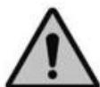

COPYRIGHT PROTECTED DOCUMENT

© ISO 2019

All rights reserved. Unless otherwise specified, or required in the context of its implementation, no part of this publication may be reproduced or utilized otherwise in any form or by any means, electronic or mechanical, including photocopying, or posting on the internet or an intranet, without prior written permission. Permission can be requested from either ISO at the address below or ISO's member body in the country of the requester.

ISO copyright office

CP 401 • Ch. de Blandonnet 8

CH-1214 Vernier, Geneva

Phone: +41 22 749 01 11

Fax: +41 22 749 09 47

Email: copyright@iso.org

Website: www.iso.org

Published in Switzerland

# Contents

Foreword v  
Introduction vi  
1 Scope 1  
2 Normative references 1  
3 Terms, definitions, symbols and abbreviated terms 2  
3.1 Terms and definitions 2  
3.2 Symbols and abbreviated terms 2  
4 Pitting damage and safety factors 6  
5 Basic formulae 7  
5.1 General 7  
5.2 Safety factor for surface durability (against pitting), $S_{\mathrm{H}}$ 8  
5.3 Contact stress, $\sigma_{\mathrm{H}}$ 8  
5.4 Permissible contact stress, $\sigma_{\mathrm{HP}}$ 9  
5.4.1 General 9  
5.4.2 Determination of permissible contact stress, $\sigma_{\mathrm{HP}}$ — Principles, assumptions and application 10  
5.4.3 Permissible contact stress, $\sigma_{\mathrm{HP}}$ : Method B 10  
5.4.4 Permissible contact stress for limited and long life: Method B 11  
6 Zone factor, $Z_{\mathrm{H}}$ , and contact factors, $Z_{\mathrm{B}}$ and $Z_{\mathrm{D}}$ 13  
6.1 General 13  
6.2 Zone factor, $Z_{\mathrm{H}}$ 14  
6.2.1 General 14  
6.2.2 Graphical values 14  
6.2.3 Determination by calculation 14  
6.3 Contact factors, $Z_{\mathrm{B}}$ and $Z_{\mathrm{D}}$ , for $\varepsilon_{\alpha} \leq 2$ 14  
6.4 Contact factors, $Z_{\mathrm{B}}$ and $Z_{\mathrm{D}}$ , for $\varepsilon_{\alpha} > 2$ 17  
7 Elasticity factor, $Z_{\mathrm{E}}$ 17  
8 Contact ratio factor, $Z_{\varepsilon}$ 18  
8.1 General 18  
8.2 Determination of contact ratio factor, $Z_{\varepsilon}$ 18  
8.2.1 Graphical values 18  
8.2.2 Determination by calculation 19  
8.3 Calculation of transverse contact ratio, $\varepsilon_{\alpha}$ , and overlap ratio, $\varepsilon_{\beta}$ 20  
8.3.1 Transverse contact ratio, $\varepsilon_{\alpha}$ 20  
8.3.2 Overlap ratio, $\varepsilon_{\beta}$ 20  
9 Helix angle factor, $Z_{\beta}$ 21  
10 Strength for contact stress 21  
10.1 General 21  
10.2 Allowable stress numbers (contact), $\sigma_{\mathrm{Hlim}}$ : Method B 21  
10.3 Allowable stress number values: Method BR 22  
11 Life factor, $Z_{\mathrm{NT}}$ (for flanks) 22  
11.1 General 22  
11.2 Life factor, $Z_{\mathrm{NT}}$ : Method A 22  
11.3 Life factor, $Z_{\mathrm{NT}}$ : Method B 22  
12 Influence of lubricant film, factors $Z_{\mathrm{L}}, Z_{\mathrm{v}}$ and $Z_{\mathrm{R}}$ 24  
12.1 General 24  
12.2 Influence of lubricant film: Method A 24  
12.3 Influence of lubricant film, factors $Z_{\mathrm{L}}, Z_{\mathrm{v}}$ and $Z_{\mathrm{R}}$ : Method B 24  
12.3.1 General 24

12.3.2 Factors $Z_{\mathrm{L}}, Z_{\mathrm{v}}$ and $Z_{\mathrm{R}}$ for reference stress 25    
12.3.3 Factors $Z_{\mathrm{L}}, Z_{\mathrm{v}}$ and $Z_{\mathrm{R}}$ for static stress 30    
13 Work hardening factor, $Z_{\mathrm{W}}$ 30    
13.1 General 30    
13.2 Work hardening factor, $Z_{\mathrm{W}}$ : Method A 30    
13.3 Work hardening factor, $Z_{\mathrm{W}}$ : Method B 31    
13.3.1 Surface-hardened steel pinion with through-hardened steel gear 31    
13.3.2 Through-hardened steel pinion with through-hardened steel gear 33    
13.3.3 Surface-hardened steel pinion with ductile iron gear 34    
14 Size factor, $Z_{\mathrm{X}}$ 36    
Bibliography 37

# Foreword

ISO (the International Organization for Standardization) is a worldwide federation of national standards bodies (ISO member bodies). The work of preparing International Standards is normally carried out through ISO technical committees. Each member body interested in a subject for which a technical committee has been established has the right to be represented on that committee. International organizations, governmental and non-governmental, in liaison with ISO, also take part in the work. ISO collaborates closely with the International Electrotechnical Commission (IEC) on all matters of electrotechnical standardization.

The procedures used to develop this document and those intended for its further maintenance are described in the ISO/IEC Directives, Part 1. In particular, the different approval criteria needed for the different types of ISO documents should be noted. This document was drafted in accordance with the editorial rules of the ISO/IEC Directives, Part 2 (see www.iso.org/directives).

Attention is drawn to the possibility that some of the elements of this document may be the subject of patent rights. ISO shall not be held responsible for identifying any or all such patent rights. Details of any patent rights identified during the development of the document will be in the Introduction and/or on the ISO list of patent declarations received (see www.iso.org/patents).

Any trade name used in this document is information given for the convenience of users and does not constitute an endorsement.

For an explanation of the voluntary nature of standards, the meaning of ISO specific terms and expressions related to conformity assessment, as well as information about ISO's adherence to the World Trade Organization (WTO) principles in the Technical Barriers to Trade (TBT) see www.iso.org/iso/foreword.html.

This document was prepared by Technical Committee ISO/TC 60, Gears, Subcommittee SC 2, Gear capacity calculation.

This third edition cancels and replaces the second edition (ISO 6336-2:2006), which has been technically revised. It also incorporates the Technical Corrigendum ISO 6336-2:2006/Cor.1:2008.

The main changes compared to the previous edition are as follows:

— modification of the helix angle factor $Z_{\beta}$ ;

— integration of 13.3.3 "Surface-hardened steel pinion with ductile iron gear".

A list of all parts in the ISO 6336 series can be found on the ISO website.

Any feedback or questions on this document should be directed to the user's national standards body. A complete listing of these bodies can be found at www.iso.org/members.html.

# Introduction

ISO 6336 (all parts) consists of International Standards, Technical Specifications (TS) and Technical Reports (TR) under the general title Calculation of load capacity of spur and helical gears (see Table 1).

— International Standards contain calculation methods that are based on widely accepted practices and have been validated.

— Technical Specifications (TS) contain calculation methods that are still subject to further development.

— Technical Reports (TR) contain data that is informative, such as example calculations.

The procedures specified in parts 1 to 19 of the ISO 6336 series cover fatigue analyses for gear rating. The procedures described in parts 20 to 29 of the ISO 6336 series are predominantly related to the tribological behavior of the lubricated flank surface contact. Parts 30 to 39 of the ISO 6336 series include example calculations. The ISO 6336 series allows the addition of new parts under appropriate numbers to reflect knowledge gained in the future.

Requesting calculation according to the ISO 6336 series without referring to specific parts requires the use of only those parts that are designated as International Standards (see Table 1 for listing). If Technical Specifications (TS) are requested as part of the load capacity calculation they need to be specified. Use of a Technical Specification as acceptance criteria for a specific design is subject to commercial agreement.

Table 1 — Parts of the ISO 6336 series (status as of DATE OF PUBLICATION)

| Calculation of load capacity of spur and helical gears | International Standard | Technical Specification | Technical Report |
| --- | --- | --- | --- |
| Part 1: Basic principles, introduction and general influence factors | X |  |  |
| Part 2: Calculation of surface durability (pitting) | X |  |  |
| Part 3: Calculation of tooth bending strength | X |  |  |
| Part 4: Calculation of tooth flank fracture load capacity |  | X |  |
| Part 5: Strength and quality of materials | X |  |  |
| Part 6: Calculation of service life under variable load | X |  |  |
| Part 20: Calculation of scuffing load capacity (also applicable to bevel and hypoid gears) — Flash temperature method (replaces: ISO/TR 13989-1) |  | X |  |
| Part 21: Calculation of scuffing load capacity (also applicable to bevel and hypoid gears) — Integral temperature method (replaces: ISO/TR 13989-2) |  | X |  |
| Part 22: Calculation of micropitting load capacity (replaces: ISO/TR 15144-1) |  | X |  |
| Part 30: Calculation examples for the application of ISO 6336 parts 1,2,3,5 |  |  | X |
| Part 31: Calculation examples of micropitting load capacity (replaces: ISO/TR 15144-2) |  |  | X |

Hertzian pressure, which serves as a basis for the calculation of the contact stress, is the basic principle used in this document for the assessment of the surface durability of cylindrical gears. It is a significant indicator of the stress generated during tooth flank engagement. However, it is not the sole cause of pitting, and nor are the corresponding subsurface shear stresses. There are other contributory influences, for example, coefficient of friction, direction and magnitude of sliding and the influence of lubricant on the distribution of pressure. Development has not yet advanced to the stage of directly including these in calculations of load-bearing capacity; however, allowance is made for them to some degree in the derating factors and the choice of material property values.

Despite the shortcomings, Hertzian pressure is useful as a working hypothesis. This is attributable to the fact that, for a given material, limiting values of Hertzian pressure are preferably derived from fatigue tests on gear specimens; thus, additional relevant influences are included in the values. Therefore, if the reference datum is located in the application range, Hertzian pressure is acceptable as a design basis for extrapolating from experimental data to values for gears of different dimensions.

Several methods have been approved for the calculation of the permissible contact stress and the determination of a number of factors (see ISO 6336-1).

Calculation of load capacity of spur and helical gears —

Part 2:

Calculation of surface durability (pitting)

IMPORTANT — The user of this document is cautioned that when the method specified is used for large helix angles ( $\beta > 30^{\circ}$ ) and large normal pressure angles ( $\alpha_{n} > 25^{\circ}$ ), the calculated results should be confirmed by experience as by Method A. In addition, it is important to note that the best correlation has been obtained for helical gears when high accuracy and optimum modifications are employed.

# 1 Scope

This document specifies the fundamental formulae for use in the determination of the surface load capacity of cylindrical gears with involute external or internal teeth. It includes formulae for all influences on surface durability for which quantitative assessments can be made. It applies primarily to oil-lubricated transmissions, but can also be used to obtain approximate values for (slow-running) grease-lubricated transmissions, as long as sufficient lubricant is present in the mesh at all times.

The given formulae are valid for cylindrical gears with tooth profiles in accordance with the basic rack standardized in ISO 53. They can also be used for teeth conjugate to other basic racks where the actual transverse contact ratio is less than $\varepsilon_{\alpha n} = 2,5$ . The results are in good agreement with other methods (see References [5], [7], [10], [12]).

These formulae cannot be directly applied for the assessment of types of gear tooth surface damage such as plastic yielding, scratching, scuffing and so on, other than that described in Clause 4.

The load capacity determined by way of the permissible contact stress is called the “surface load capacity” or “surface durability”.

If this scope does not apply, refer to ISO 6336-1:2019, Clause 4.

# 2 Normative references

The following documents are referred to in the text in such a way that some or all of their content constitutes requirements of this document. For dated references, only the edition cited applies. For undated references, the latest edition of the referenced document (including any amendments) applies.

ISO 53:1998, Cylindrical gears for general and heavy engineering — Standard basic rack tooth profile

ISO 1122-1:1998, Vocabulary of gear terms — Part 1: Definitions related to geometry

ISO 4287:1997, Geometrical Product Specifications (GPS) — Surface texture: Profile method — Terms, definitions and surface texture parameters

ISO 4287:1997/Cor 1:1998, Geometrical Product Specifications (GPS) — Surface texture: Profile method — Terms, definitions and surface texture parameters — TECHNICAL CORRIGENDUM 1

ISO 4287:1997/Cor 2:2005, Geometrical Product Specifications (GPS) — Surface texture: Profile method — Terms, definitions and surface texture parameters — TECHNICAL CORRIGENDUM 2

ISO 4287:1997/Amd 1:2009, Geometrical Product Specifications (GPS) — Surface texture: Profile method — Terms, definitions and surface texture parameters — AMENDMENT 1: Peak count number

ISO 4288:1996, Geometrical Product Specifications (GPS) — Surface texture: Profile method — Rules and procedures for the assessment of surface texture

ISO 6336-1, Calculation of load capacity of spur and helical gears — Part 1: Basic principles, introduction and general influence factors

ISO 6336-5, Calculation of load capacity of spur and helical gears — Part 5: Strength and quality of materials

# 3 Terms, definitions, symbols and abbreviated terms

## 3.1 Terms and definitions

For the purposes of this document, the terms and definitions given in ISO 1122-1:1998, and ISO 6336-1 apply.

ISO and IEC maintain terminological databases for use in standardization at following addresses:

— ISO Online browsing platform: available at https://www.iso.org/obp

— IEC Electropedia: available at http://electropedia.org/

## 3.2 Symbols and abbreviated terms

For the purposes of this document, the symbols and abbreviated terms given in ISO 1122-1:1998, ISO 6336-1 and Table 2 apply.

Table 2 — Abbreviated terms and symbols used in this document

<table>
<tr><td colspan="2">Abbreviated terms</td></tr>
<tr><td>Term</td><td>Description</td></tr>
<tr><td>A, B, C, D, E</td><td>points on path of contact (pinion root to pinion tip, regardless of whether pinion or wheel drives, only for geometrical considerations)</td></tr>
<tr><td>AA</td><td>arithmetic average roughness (alternative name for Ra)</td></tr>
<tr><td>CLA</td><td>center line average roughness (alternative name for Ra)</td></tr>
<tr><td>Eh</td><td>material designation for case-hardened wrought steel</td></tr>
<tr><td>GG</td><td>material designation for grey cast iron</td></tr>
<tr><td>GGG</td><td>material designation for nodular cast iron (perlitic, bainitic, ferritic structure)</td></tr>
<tr><td>GTS</td><td>material designation for black malleable cast iron (perlitic structure)</td></tr>
<tr><td>HB</td><td>Brinell hardness</td></tr>
<tr><td colspan="2">a For external gears  <math data-tex="a" display="inline" xmlns="http://www.w3.org/1998/Math/MathML"><semantics><mi>a</mi></semantics></math> ,  <math data-tex="d" display="inline" xmlns="http://www.w3.org/1998/Math/MathML"><semantics><mi>d</mi></semantics></math> ,  <math data-tex="d_a" display="inline" xmlns="http://www.w3.org/1998/Math/MathML"><semantics><msub><mi>d</mi><mi>a</mi></msub></semantics></math> ,  <math data-tex="z_1" display="inline" xmlns="http://www.w3.org/1998/Math/MathML"><semantics><msub><mi>z</mi><mn>1</mn></msub></semantics></math>  and  <math data-tex="z_2" display="inline" xmlns="http://www.w3.org/1998/Math/MathML"><semantics><msub><mi>z</mi><mn>2</mn></msub></semantics></math>  are positive; for internal gearing,  <math data-tex="a" display="inline" xmlns="http://www.w3.org/1998/Math/MathML"><semantics><mi>a</mi></semantics></math> ,  <math data-tex="d" display="inline" xmlns="http://www.w3.org/1998/Math/MathML"><semantics><mi>d</mi></semantics></math> ,  <math data-tex="d_a" display="inline" xmlns="http://www.w3.org/1998/Math/MathML"><semantics><msub><mi>d</mi><mi>a</mi></msub></semantics></math>  and  <math data-tex="z_2" display="inline" xmlns="http://www.w3.org/1998/Math/MathML"><semantics><msub><mi>z</mi><mn>2</mn></msub></semantics></math>  have a negative sign,  <math data-tex="z_1" display="inline" xmlns="http://www.w3.org/1998/Math/MathML"><semantics><msub><mi>z</mi><mn>1</mn></msub></semantics></math>  has a positive sign. All calculated diameters have a negative sign for internal gearing.</td></tr>
</table>

Table 2 (continued)

<table>
<tr><td colspan="3">Abbreviated terms</td></tr>
<tr><td>Term</td><td colspan="2">Description</td></tr>
<tr><td>IF</td><td colspan="2">material designation for flame or induction hardened wrought special steel</td></tr>
<tr><td>M</td><td colspan="2">module</td></tr>
<tr><td>ME</td><td colspan="2" rowspan="3">symbols identifying quality classes for material and heat-treatment requirements, ISO 6336-5 shall apply</td></tr>
<tr><td>ML</td></tr>
<tr><td>MQ</td></tr>
<tr><td>NT</td><td colspan="2">material designation for nitrided wrought steel, nitriding steel</td></tr>
<tr><td>NV</td><td colspan="2">material designation for through-hardened wrought steel, nitrided, nitrocarburized</td></tr>
<tr><td>St</td><td colspan="2">material designation for normalized base steel ( <math data-tex="\sigma_B &lt; 800" display="inline" xmlns="http://www.w3.org/1998/Math/MathML"><semantics><mrow><msub><mi>σ</mi><mi>B</mi></msub><mo>&lt;</mo><mn>800</mn></mrow></semantics></math>  N/mm2)</td></tr>
<tr><td>V</td><td colspan="2">material designation for through-hardened wrought special steel, alloy or carbon ( <math data-tex="\sigma_B \geq 800" display="inline" xmlns="http://www.w3.org/1998/Math/MathML"><semantics><mrow><msub><mi>σ</mi><mi>B</mi></msub><mo>≥</mo><mn>800</mn></mrow></semantics></math>  N/mm2)</td></tr>
<tr><td>VI</td><td colspan="2">kinematic viscosity index</td></tr>
<tr><td colspan="3">Symbols</td></tr>
<tr><td>Symbol</td><td>Description</td><td>Unit</td></tr>
<tr><td>b</td><td>face width</td><td>mm</td></tr>
<tr><td> <math data-tex="b_B" display="inline" xmlns="http://www.w3.org/1998/Math/MathML"><semantics><msub><mi>b</mi><mi>B</mi></msub></semantics></math> </td><td>face width of one helix on a double helical gear</td><td>mm</td></tr>
<tr><td> <math data-tex="b_{\text{vir}}" display="inline" xmlns="http://www.w3.org/1998/Math/MathML"><semantics><msub><mi>b</mi><mtext mathvariant="normal">vir</mtext></msub></semantics></math> </td><td>virtual face width</td><td>mm</td></tr>
<tr><td rowspan="2">C</td><td>constant, coefficient</td><td>—</td></tr>
<tr><td>relief of tooth flank</td><td>μm</td></tr>
<tr><td> <math data-tex="C_{ZL,ZR,Zv}" display="inline" xmlns="http://www.w3.org/1998/Math/MathML"><semantics><msub><mi>C</mi><mrow><mi>Z</mi><mi>L</mi><mo>,</mo><mi>Z</mi><mi>R</mi><mo>,</mo><mi>Z</mi><mi>v</mi></mrow></msub></semantics></math> </td><td>factors for determining lubricant film factors</td><td>—</td></tr>
<tr><td>d</td><td>diameter (without subscript, reference diametera)</td><td>mm</td></tr>
<tr><td> <math data-tex="d_b" display="inline" xmlns="http://www.w3.org/1998/Math/MathML"><semantics><msub><mi>d</mi><mi>b</mi></msub></semantics></math> </td><td>base diameter</td><td>mm</td></tr>
<tr><td> <math data-tex="d_{Na}" display="inline" xmlns="http://www.w3.org/1998/Math/MathML"><semantics><msub><mi>d</mi><mrow><mi>N</mi><mi>a</mi></mrow></msub></semantics></math> </td><td>active tip diameter</td><td>mm</td></tr>
<tr><td> <math data-tex="d_{Nf}" display="inline" xmlns="http://www.w3.org/1998/Math/MathML"><semantics><msub><mi>d</mi><mrow><mi>N</mi><mi>f</mi></mrow></msub></semantics></math> </td><td>active root diameter</td><td>mm</td></tr>
<tr><td>E</td><td>modulus of elasticity</td><td>N/mm2</td></tr>
<tr><td> <math data-tex="F_t" display="inline" xmlns="http://www.w3.org/1998/Math/MathML"><semantics><msub><mi>F</mi><mi>t</mi></msub></semantics></math> </td><td>(nominal) transverse tangential load at reference cylinder per mesh</td><td>N</td></tr>
<tr><td>f</td><td>deviation, tooth deformation</td><td>μm</td></tr>
<tr><td> <math data-tex="f_{ZCa}" display="inline" xmlns="http://www.w3.org/1998/Math/MathML"><semantics><msub><mi>f</mi><mrow><mi>Z</mi><mi>C</mi><mi>a</mi></mrow></msub></semantics></math> </td><td>auxiliary factor</td><td>—</td></tr>
<tr><td colspan="3">a For external gears <math data-tex="a" display="inline" xmlns="http://www.w3.org/1998/Math/MathML"><semantics><mi>a</mi></semantics></math>, <math data-tex="d" display="inline" xmlns="http://www.w3.org/1998/Math/MathML"><semantics><mi>d</mi></semantics></math>, <math data-tex="d_a" display="inline" xmlns="http://www.w3.org/1998/Math/MathML"><semantics><msub><mi>d</mi><mi>a</mi></msub></semantics></math>, <math data-tex="z_1" display="inline" xmlns="http://www.w3.org/1998/Math/MathML"><semantics><msub><mi>z</mi><mn>1</mn></msub></semantics></math> and <math data-tex="z_2" display="inline" xmlns="http://www.w3.org/1998/Math/MathML"><semantics><msub><mi>z</mi><mn>2</mn></msub></semantics></math> are positive; for internal gearing, <math data-tex="a" display="inline" xmlns="http://www.w3.org/1998/Math/MathML"><semantics><mi>a</mi></semantics></math>, <math data-tex="d" display="inline" xmlns="http://www.w3.org/1998/Math/MathML"><semantics><mi>d</mi></semantics></math>, <math data-tex="d_a" display="inline" xmlns="http://www.w3.org/1998/Math/MathML"><semantics><msub><mi>d</mi><mi>a</mi></msub></semantics></math> and <math data-tex="z_2" display="inline" xmlns="http://www.w3.org/1998/Math/MathML"><semantics><msub><mi>z</mi><mn>2</mn></msub></semantics></math> have a negative sign, <math data-tex="z_1" display="inline" xmlns="http://www.w3.org/1998/Math/MathML"><semantics><msub><mi>z</mi><mn>1</mn></msub></semantics></math> has a positive sign. All calculated diameters have a negative sign for internal gearing.</td></tr>
</table>
Table 2 (continued)
<table>
<tr><td colspan="3">Symbols</td></tr>
<tr><td>Symbol</td><td>Description</td><td>Unit</td></tr>
<tr><td>h</td><td>tooth depth (without subscript, root circle to tip circle)</td><td>mm</td></tr>
<tr><td> <math data-tex="h_{\text{fP}}" display="inline" xmlns="http://www.w3.org/1998/Math/MathML"><semantics><msub><mi>h</mi><mtext mathvariant="normal">fP</mtext></msub></semantics></math> </td><td>dedendum of basic rack of cylindrical gears (ISO 53:1998 shall apply)</td><td>mm</td></tr>
<tr><td>K</td><td>constant, factors concerning tooth load</td><td>—</td></tr>
<tr><td> <math data-tex="K_A" display="inline" xmlns="http://www.w3.org/1998/Math/MathML"><semantics><msub><mi>K</mi><mi>A</mi></msub></semantics></math> </td><td>application factor</td><td>—</td></tr>
<tr><td> <math data-tex="K_{H\alpha}" display="inline" xmlns="http://www.w3.org/1998/Math/MathML"><semantics><msub><mi>K</mi><mrow><mi>H</mi><mi>α</mi></mrow></msub></semantics></math> </td><td>transverse load factor (contact stress)</td><td>—</td></tr>
<tr><td> <math data-tex="K_{H\beta}" display="inline" xmlns="http://www.w3.org/1998/Math/MathML"><semantics><msub><mi>K</mi><mrow><mi>H</mi><mi>β</mi></mrow></msub></semantics></math> </td><td>face load factor (contact stress)</td><td>—</td></tr>
<tr><td> <math data-tex="K_v" display="inline" xmlns="http://www.w3.org/1998/Math/MathML"><semantics><msub><mi>K</mi><mi>v</mi></msub></semantics></math> </td><td>dynamic factor</td><td>—</td></tr>
<tr><td> <math data-tex="K_\gamma" display="inline" xmlns="http://www.w3.org/1998/Math/MathML"><semantics><msub><mi>K</mi><mi>γ</mi></msub></semantics></math> </td><td>mesh load factor (takes into account the uneven distribution of the load between meshes for multiple transmission paths)</td><td>—</td></tr>
<tr><td>M</td><td>moment of a force</td><td>Nm</td></tr>
<tr><td> <math data-tex="m_n" display="inline" xmlns="http://www.w3.org/1998/Math/MathML"><semantics><msub><mi>m</mi><mi>n</mi></msub></semantics></math> </td><td>normal module</td><td>mm</td></tr>
<tr><td> <math data-tex="N_L" display="inline" xmlns="http://www.w3.org/1998/Math/MathML"><semantics><msub><mi>N</mi><mi>L</mi></msub></semantics></math> </td><td>number of load cycles</td><td>—</td></tr>
<tr><td> <math data-tex="p_{bt}" display="inline" xmlns="http://www.w3.org/1998/Math/MathML"><semantics><msub><mi>p</mi><mrow><mi>b</mi><mi>t</mi></mrow></msub></semantics></math> </td><td>transverse base pitch</td><td>mm</td></tr>
<tr><td>Ra</td><td>arithmetic mean roughness value, <math data-tex="Ra\cong Rz/6" display="inline" xmlns="http://www.w3.org/1998/Math/MathML"><semantics><mrow><mi>R</mi><mi>a</mi><mo>≅</mo><mi>R</mi><mi>z</mi><mi>/</mi><mn>6</mn></mrow></semantics></math></td><td>μm</td></tr>
<tr><td>Rz</td><td>mean peak-to-valley roughness (ISO 4287:1997 including ISO 4287:1997/Cor 1:1998, ISO 4287:1997/Cor 2:2005, ISO 4287:1997/Amd 1:2009 and ISO 4288:1996 shall apply)</td><td>μm</td></tr>
<tr><td> <math data-tex="Rz_H" display="inline" xmlns="http://www.w3.org/1998/Math/MathML"><semantics><mrow><mi>R</mi><msub><mi>z</mi><mi>H</mi></msub></mrow></semantics></math> </td><td>equivalent roughness</td><td>μm</td></tr>
<tr><td>r</td><td>radius (without subscript, reference radius)</td><td>mm</td></tr>
<tr><td> <math data-tex="S_H" display="inline" xmlns="http://www.w3.org/1998/Math/MathML"><semantics><msub><mi>S</mi><mi>H</mi></msub></semantics></math> </td><td>safety factor for pitting</td><td>—</td></tr>
<tr><td> <math data-tex="S_{H\min}" display="inline" xmlns="http://www.w3.org/1998/Math/MathML"><semantics><msub><mi>S</mi><mrow><mi>H</mi><mi mathvariant="normal">min</mi></mrow></msub></semantics></math> </td><td>minimum required safety factor for pitting</td><td>—</td></tr>
<tr><td> <math data-tex="S_{H1}" display="inline" xmlns="http://www.w3.org/1998/Math/MathML"><semantics><msub><mi>S</mi><mrow><mi>H</mi><mn>1</mn></mrow></msub></semantics></math> </td><td>safety factor for pitting of pinion</td><td>—</td></tr>
<tr><td> <math data-tex="S_{H2}" display="inline" xmlns="http://www.w3.org/1998/Math/MathML"><semantics><msub><mi>S</mi><mrow><mi>H</mi><mn>2</mn></mrow></msub></semantics></math> </td><td>safety factor for pitting of wheel</td><td>—</td></tr>
<tr><td>u</td><td>gear ratio  <math data-tex="(z_2/z_1) \geq 1^a" display="inline" xmlns="http://www.w3.org/1998/Math/MathML"><semantics><mrow><mo stretchy="false" form="prefix">(</mo><msub><mi>z</mi><mn>2</mn></msub><mi>/</mi><msub><mi>z</mi><mn>1</mn></msub><mo stretchy="false" form="postfix">)</mo><mo>≥</mo><msup><mn>1</mn><mi>a</mi></msup></mrow></semantics></math> </td><td>—</td></tr>
<tr><td>v</td><td>circumferential velocity (without subscript at the reference circle)</td><td>m/s</td></tr>
<tr><td> <math data-tex="v_w" display="inline" xmlns="http://www.w3.org/1998/Math/MathML"><semantics><msub><mi>v</mi><mi>w</mi></msub></semantics></math> </td><td>circumferential velocity at the pitch line</td><td>m/s</td></tr>
<tr><td>x</td><td>profile shift coefficient</td><td>—</td></tr>
<tr><td>Z</td><td>factor related to contact stress</td><td>—</td></tr>
<tr><td colspan="3">a For external gears <math data-tex="a" display="inline" xmlns="http://www.w3.org/1998/Math/MathML"><semantics><mi>a</mi></semantics></math>, <math data-tex="d" display="inline" xmlns="http://www.w3.org/1998/Math/MathML"><semantics><mi>d</mi></semantics></math>, <math data-tex="d_a" display="inline" xmlns="http://www.w3.org/1998/Math/MathML"><semantics><msub><mi>d</mi><mi>a</mi></msub></semantics></math>, <math data-tex="z_1" display="inline" xmlns="http://www.w3.org/1998/Math/MathML"><semantics><msub><mi>z</mi><mn>1</mn></msub></semantics></math> and <math data-tex="z_2" display="inline" xmlns="http://www.w3.org/1998/Math/MathML"><semantics><msub><mi>z</mi><mn>2</mn></msub></semantics></math> are positive; for internal gearing, <math data-tex="a" display="inline" xmlns="http://www.w3.org/1998/Math/MathML"><semantics><mi>a</mi></semantics></math>, <math data-tex="d" display="inline" xmlns="http://www.w3.org/1998/Math/MathML"><semantics><mi>d</mi></semantics></math>, <math data-tex="d_a" display="inline" xmlns="http://www.w3.org/1998/Math/MathML"><semantics><msub><mi>d</mi><mi>a</mi></msub></semantics></math> and <math data-tex="z_2" display="inline" xmlns="http://www.w3.org/1998/Math/MathML"><semantics><msub><mi>z</mi><mn>2</mn></msub></semantics></math> have a negative sign, <math data-tex="z_1" display="inline" xmlns="http://www.w3.org/1998/Math/MathML"><semantics><msub><mi>z</mi><mn>1</mn></msub></semantics></math> has a positive sign. All calculated diameters have a negative sign for internal gearing.</td></tr>
</table>
Table 2 (continued)
<table>
<tr><th>Symbol</th><th>Description</th><th>Unit</th></tr>
<tr><td> <math data-tex="Z_B" display="inline" xmlns="http://www.w3.org/1998/Math/MathML"><semantics><msub><mi>Z</mi><mi>B</mi></msub></semantics></math> </td><td>single pair tooth contact factors for the pinion</td><td>—</td></tr>
<tr><td> <math data-tex="Z_D" display="inline" xmlns="http://www.w3.org/1998/Math/MathML"><semantics><msub><mi>Z</mi><mi>D</mi></msub></semantics></math> </td><td>single pair tooth contact factors for the wheel</td><td>—</td></tr>
<tr><td> <math data-tex="Z_E" display="inline" xmlns="http://www.w3.org/1998/Math/MathML"><semantics><msub><mi>Z</mi><mi>E</mi></msub></semantics></math> </td><td>elasticity factor</td><td> <math data-tex="(N/mm^2)^{0.5}" display="inline" xmlns="http://www.w3.org/1998/Math/MathML"><semantics><mrow><mo stretchy="false" form="prefix">(</mo><mi>N</mi><mi>/</mi><mi>m</mi><msup><mi>m</mi><mn>2</mn></msup><msup><mo stretchy="false" form="postfix">)</mo><mn>0.5</mn></msup></mrow></semantics></math> </td></tr>
<tr><td> <math data-tex="Z_H" display="inline" xmlns="http://www.w3.org/1998/Math/MathML"><semantics><msub><mi>Z</mi><mi>H</mi></msub></semantics></math> </td><td>zone factor</td><td>—</td></tr>
<tr><td> <math data-tex="Z_L" display="inline" xmlns="http://www.w3.org/1998/Math/MathML"><semantics><msub><mi>Z</mi><mi>L</mi></msub></semantics></math> </td><td>lubricant factor</td><td>—</td></tr>
<tr><td> <math data-tex="Z_N" display="inline" xmlns="http://www.w3.org/1998/Math/MathML"><semantics><msub><mi>Z</mi><mi>N</mi></msub></semantics></math> </td><td>life factor for contact stress</td><td>—</td></tr>
<tr><td> <math data-tex="Z_{NT}" display="inline" xmlns="http://www.w3.org/1998/Math/MathML"><semantics><msub><mi>Z</mi><mrow><mi>N</mi><mi>T</mi></mrow></msub></semantics></math> </td><td>life factor for contact stress for reference test conditions</td><td>—</td></tr>
<tr><td> <math data-tex="Z_R" display="inline" xmlns="http://www.w3.org/1998/Math/MathML"><semantics><msub><mi>Z</mi><mi>R</mi></msub></semantics></math> </td><td>roughness factor affecting surface durability</td><td>—</td></tr>
<tr><td> <math data-tex="Z_v" display="inline" xmlns="http://www.w3.org/1998/Math/MathML"><semantics><msub><mi>Z</mi><mi>v</mi></msub></semantics></math> </td><td>velocity factor (circumferential velocity at the pitch line)</td><td>—</td></tr>
<tr><td> <math data-tex="Z_W" display="inline" xmlns="http://www.w3.org/1998/Math/MathML"><semantics><msub><mi>Z</mi><mi>W</mi></msub></semantics></math> </td><td>work hardening factor</td><td>—</td></tr>
<tr><td> <math data-tex="Z_X" display="inline" xmlns="http://www.w3.org/1998/Math/MathML"><semantics><msub><mi>Z</mi><mi>X</mi></msub></semantics></math> </td><td>size factor (pitting)</td><td>—</td></tr>
<tr><td> <math data-tex="Z_\beta" display="inline" xmlns="http://www.w3.org/1998/Math/MathML"><semantics><msub><mi>Z</mi><mi>β</mi></msub></semantics></math> </td><td>helix angle factor (pitting)</td><td>—</td></tr>
<tr><td> <math data-tex="Z_\epsilon" display="inline" xmlns="http://www.w3.org/1998/Math/MathML"><semantics><msub><mi>Z</mi><mi>ϵ</mi></msub></semantics></math> </td><td>contact ratio factor (pitting)</td><td>—</td></tr>
<tr><td>z</td><td>number of teetha</td><td>—</td></tr>
<tr><td> <math data-tex="z_{1,2}" display="inline" xmlns="http://www.w3.org/1998/Math/MathML"><semantics><msub><mi>z</mi><mrow><mn>1</mn><mo>,</mo><mn>2</mn></mrow></msub></semantics></math> </td><td>number of teeth of pinion (or wheel)a</td><td>—</td></tr>
<tr><td>α</td><td>pressure angle (without subscript, at reference cylinder)</td><td>°</td></tr>
<tr><td> <math data-tex="α_n" display="inline" xmlns="http://www.w3.org/1998/Math/MathML"><semantics><msub><mi>α</mi><mi>n</mi></msub></semantics></math> </td><td>normal pressure angle</td><td>°</td></tr>
<tr><td> <math data-tex="α_t" display="inline" xmlns="http://www.w3.org/1998/Math/MathML"><semantics><msub><mi>α</mi><mi>t</mi></msub></semantics></math> </td><td>transverse pressure angle</td><td>°</td></tr>
<tr><td> <math data-tex="α_{wt}" display="inline" xmlns="http://www.w3.org/1998/Math/MathML"><semantics><msub><mi>α</mi><mrow><mi>w</mi><mi>t</mi></mrow></msub></semantics></math> </td><td>working transverse pressure angle at the pitch cylinder</td><td>°</td></tr>
<tr><td>β</td><td>helix angle (without subscript, at reference cylinder)</td><td>°</td></tr>
<tr><td> <math data-tex="β_b" display="inline" xmlns="http://www.w3.org/1998/Math/MathML"><semantics><msub><mi>β</mi><mi>b</mi></msub></semantics></math> </td><td>base helix angle</td><td>°</td></tr>
<tr><td>ε</td><td>contact ratio, overlap ratio, relative eccentricity (see Clause 7)</td><td>—</td></tr>
<tr><td> <math data-tex="ε_\alpha" display="inline" xmlns="http://www.w3.org/1998/Math/MathML"><semantics><msub><mi>ε</mi><mi>α</mi></msub></semantics></math> </td><td>transverse contact ratio</td><td>—</td></tr>
<tr><td> <math data-tex="\varepsilon_{\alpha n}" display="inline" xmlns="http://www.w3.org/1998/Math/MathML"><semantics><msub><mi>ε</mi><mrow><mi>α</mi><mi>n</mi></mrow></msub></semantics></math> </td><td>virtual contact ratio, transverse contact ratio of a virtual spur gear</td><td>—</td></tr>
<tr><td> <math data-tex="ε_\beta" display="inline" xmlns="http://www.w3.org/1998/Math/MathML"><semantics><msub><mi>ε</mi><mi>β</mi></msub></semantics></math> </td><td>overlap ratio</td><td>—</td></tr>
<tr><td> <math data-tex="ε_\gamma" display="inline" xmlns="http://www.w3.org/1998/Math/MathML"><semantics><msub><mi>ε</mi><mi>γ</mi></msub></semantics></math> </td><td>total contact ratio,  <math data-tex="ε_\gamma = ε_\alpha + ε_\beta" display="inline" xmlns="http://www.w3.org/1998/Math/MathML"><semantics><mrow><msub><mi>ε</mi><mi>γ</mi></msub><mo>=</mo><msub><mi>ε</mi><mi>α</mi></msub><mo>+</mo><msub><mi>ε</mi><mi>β</mi></msub></mrow></semantics></math> </td><td>—</td></tr>
<tr><td colspan="3">a For external gears <math data-tex="a" display="inline" xmlns="http://www.w3.org/1998/Math/MathML"><semantics><mi>a</mi></semantics></math>, <math data-tex="d" display="inline" xmlns="http://www.w3.org/1998/Math/MathML"><semantics><mi>d</mi></semantics></math>, <math data-tex="d_a" display="inline" xmlns="http://www.w3.org/1998/Math/MathML"><semantics><msub><mi>d</mi><mi>a</mi></msub></semantics></math>, <math data-tex="z_1" display="inline" xmlns="http://www.w3.org/1998/Math/MathML"><semantics><msub><mi>z</mi><mn>1</mn></msub></semantics></math> and <math data-tex="z_2" display="inline" xmlns="http://www.w3.org/1998/Math/MathML"><semantics><msub><mi>z</mi><mn>2</mn></msub></semantics></math> are positive; for internal gearing, <math data-tex="a" display="inline" xmlns="http://www.w3.org/1998/Math/MathML"><semantics><mi>a</mi></semantics></math>, <math data-tex="d" display="inline" xmlns="http://www.w3.org/1998/Math/MathML"><semantics><mi>d</mi></semantics></math>, <math data-tex="d_a" display="inline" xmlns="http://www.w3.org/1998/Math/MathML"><semantics><msub><mi>d</mi><mi>a</mi></msub></semantics></math> and <math data-tex="z_2" display="inline" xmlns="http://www.w3.org/1998/Math/MathML"><semantics><msub><mi>z</mi><mn>2</mn></msub></semantics></math> have a negative sign, <math data-tex="z_1" display="inline" xmlns="http://www.w3.org/1998/Math/MathML"><semantics><msub><mi>z</mi><mn>1</mn></msub></semantics></math> has a positive sign. All calculated diameters have a negative sign for internal gearing.</td></tr>
</table>
Table 2 (continued)
<table>
<tr><th>Symbol</th><th>Description</th><th>Unit</th></tr>
<tr><td> <math data-tex="\nu" display="inline" xmlns="http://www.w3.org/1998/Math/MathML"><semantics><mi>ν</mi></semantics></math> </td><td>Poisson's ratio</td><td>—</td></tr>
<tr><td> <math data-tex="\nu" display="inline" xmlns="http://www.w3.org/1998/Math/MathML"><semantics><mi>ν</mi></semantics></math> </td><td>kinematic viscosity of the oil</td><td>mm2/s</td></tr>
<tr><td> <math data-tex="\nu_{f}" display="inline" xmlns="http://www.w3.org/1998/Math/MathML"><semantics><msub><mi>ν</mi><mi>f</mi></msub></semantics></math> </td><td>kinematic viscosity parameter</td><td>—</td></tr>
<tr><td> <math data-tex="\nu_{40}" display="inline" xmlns="http://www.w3.org/1998/Math/MathML"><semantics><msub><mi>ν</mi><mn>40</mn></msub></semantics></math> </td><td>nominal kinematic viscosity at 40 °C</td><td>mm2/s</td></tr>
<tr><td> <math data-tex="\nu_{50}" display="inline" xmlns="http://www.w3.org/1998/Math/MathML"><semantics><msub><mi>ν</mi><mn>50</mn></msub></semantics></math> </td><td>nominal kinematic viscosity at 50 °C</td><td>mm2/s</td></tr>
<tr><td> <math data-tex="\xi" display="inline" xmlns="http://www.w3.org/1998/Math/MathML"><semantics><mi>ξ</mi></semantics></math> </td><td>roll angle</td><td>°</td></tr>
<tr><td> <math data-tex="\xi_{\text{aw}}" display="inline" xmlns="http://www.w3.org/1998/Math/MathML"><semantics><msub><mi>ξ</mi><mtext mathvariant="normal">aw</mtext></msub></semantics></math> </td><td>roll angle from working pitch point to tip diameter</td><td>°</td></tr>
<tr><td> <math data-tex="\xi_{\text{fw}}" display="inline" xmlns="http://www.w3.org/1998/Math/MathML"><semantics><msub><mi>ξ</mi><mtext mathvariant="normal">fw</mtext></msub></semantics></math> </td><td>roll angle from root form diameter to working pitch point</td><td>°</td></tr>
<tr><td> <math data-tex="\xi_{\text{Naw1,2}}" display="inline" xmlns="http://www.w3.org/1998/Math/MathML"><semantics><msub><mi>ξ</mi><mtext mathvariant="normal">Naw1,2</mtext></msub></semantics></math> </td><td>roll angle from the working pitch point to the active tip diameter of pinion (or wheel)</td><td>rad</td></tr>
<tr><td> <math data-tex="\xi_{\text{Nfw1,2}}" display="inline" xmlns="http://www.w3.org/1998/Math/MathML"><semantics><msub><mi>ξ</mi><mtext mathvariant="normal">Nfw1,2</mtext></msub></semantics></math> </td><td>roll angle from the active root diameter to the working pitch point</td><td>rad</td></tr>
<tr><td> <math data-tex="\rho" display="inline" xmlns="http://www.w3.org/1998/Math/MathML"><semantics><mi>ρ</mi></semantics></math> </td><td>radius of curvature</td><td>mm</td></tr>
<tr><td> <math data-tex="\rho_{\text{fP}}" display="inline" xmlns="http://www.w3.org/1998/Math/MathML"><semantics><msub><mi>ρ</mi><mtext mathvariant="normal">fP</mtext></msub></semantics></math> </td><td>root fillet radius of the basic rack for cylindrical gears (ISO 53:1998 shall apply)</td><td>mm</td></tr>
<tr><td> <math data-tex="\rho_{\text{red}}" display="inline" xmlns="http://www.w3.org/1998/Math/MathML"><semantics><msub><mi>ρ</mi><mtext mathvariant="normal">red</mtext></msub></semantics></math> </td><td>radius of relative curvature</td><td>mm</td></tr>
<tr><td> <math data-tex="\sigma" display="inline" xmlns="http://www.w3.org/1998/Math/MathML"><semantics><mi>σ</mi></semantics></math> </td><td>normal stress</td><td>N/mm2</td></tr>
<tr><td> <math data-tex="\sigma_{\text{H}}" display="inline" xmlns="http://www.w3.org/1998/Math/MathML"><semantics><msub><mi>σ</mi><mtext mathvariant="normal">H</mtext></msub></semantics></math> </td><td>contact stress</td><td>N/mm2</td></tr>
<tr><td> <math data-tex="\sigma_{\text{H lim}}" display="inline" xmlns="http://www.w3.org/1998/Math/MathML"><semantics><msub><mi>σ</mi><mtext mathvariant="normal">H lim</mtext></msub></semantics></math> </td><td>allowable stress number (contact)</td><td>N/mm2</td></tr>
<tr><td> <math data-tex="\sigma_{\text{HG}}" display="inline" xmlns="http://www.w3.org/1998/Math/MathML"><semantics><msub><mi>σ</mi><mtext mathvariant="normal">HG</mtext></msub></semantics></math> </td><td>pitting stress limit</td><td>N/mm2</td></tr>
<tr><td> <math data-tex="\sigma_{\text{HP}}" display="inline" xmlns="http://www.w3.org/1998/Math/MathML"><semantics><msub><mi>σ</mi><mtext mathvariant="normal">HP</mtext></msub></semantics></math> </td><td>permissible contact stress</td><td>N/mm2</td></tr>
<tr><td> <math data-tex="\sigma_{\text{HP ref}}" display="inline" xmlns="http://www.w3.org/1998/Math/MathML"><semantics><msub><mi>σ</mi><mtext mathvariant="normal">HP ref</mtext></msub></semantics></math> </td><td>permissible contact stress (reference strength)</td><td>N/mm2</td></tr>
<tr><td> <math data-tex="\sigma_{\text{HP stat}}" display="inline" xmlns="http://www.w3.org/1998/Math/MathML"><semantics><msub><mi>σ</mi><mtext mathvariant="normal">HP stat</mtext></msub></semantics></math> </td><td>permissible contact stress (static strength)</td><td>N/mm2</td></tr>
<tr><td> <math data-tex="\sigma_{\text{H0}}" display="inline" xmlns="http://www.w3.org/1998/Math/MathML"><semantics><msub><mi>σ</mi><mtext mathvariant="normal">H0</mtext></msub></semantics></math> </td><td>nominal contact stress</td><td>N/mm2</td></tr>
<tr><td> <math data-tex="\tau" display="inline" xmlns="http://www.w3.org/1998/Math/MathML"><semantics><mi>τ</mi></semantics></math> </td><td>shear stress</td><td>N/mm2</td></tr>
<tr><td> <math data-tex="\tau_{1,2}" display="inline" xmlns="http://www.w3.org/1998/Math/MathML"><semantics><msub><mi>τ</mi><mrow><mn>1</mn><mo>,</mo><mn>2</mn></mrow></msub></semantics></math> </td><td>angular pitch of pinion (or wheel)</td><td>rad</td></tr>
<tr><td colspan="3">a For external gears <math data-tex="a" display="inline" xmlns="http://www.w3.org/1998/Math/MathML"><semantics><mi>a</mi></semantics></math>, <math data-tex="d" display="inline" xmlns="http://www.w3.org/1998/Math/MathML"><semantics><mi>d</mi></semantics></math>, <math data-tex="d_a" display="inline" xmlns="http://www.w3.org/1998/Math/MathML"><semantics><msub><mi>d</mi><mi>a</mi></msub></semantics></math>, <math data-tex="z_1" display="inline" xmlns="http://www.w3.org/1998/Math/MathML"><semantics><msub><mi>z</mi><mn>1</mn></msub></semantics></math> and <math data-tex="z_2" display="inline" xmlns="http://www.w3.org/1998/Math/MathML"><semantics><msub><mi>z</mi><mn>2</mn></msub></semantics></math> are positive; for internal gearing, <math data-tex="a" display="inline" xmlns="http://www.w3.org/1998/Math/MathML"><semantics><mi>a</mi></semantics></math>, <math data-tex="d" display="inline" xmlns="http://www.w3.org/1998/Math/MathML"><semantics><mi>d</mi></semantics></math>, <math data-tex="d_a" display="inline" xmlns="http://www.w3.org/1998/Math/MathML"><semantics><msub><mi>d</mi><mi>a</mi></msub></semantics></math> and <math data-tex="z_2" display="inline" xmlns="http://www.w3.org/1998/Math/MathML"><semantics><msub><mi>z</mi><mn>2</mn></msub></semantics></math> have a negative sign, <math data-tex="z_1" display="inline" xmlns="http://www.w3.org/1998/Math/MathML"><semantics><msub><mi>z</mi><mn>1</mn></msub></semantics></math> has a positive sign. All calculated diameters have a negative sign for internal gearing.</td></tr>
</table>

# 4 Pitting damage and safety factors

If limits of the surface durability of the meshing flanks are exceeded, particles will break out of the flanks, leaving pits.

The extent to which such pits can be tolerated (in size and number) varies within wide limits, depending largely on the field of application. In some fields, extensive pitting can be accepted; in other fields any appreciable pitting is to be avoided.

The following assessments, relevant to average working conditions, will help in distinguishing between initial pitting and destructive pitting.

Linear or progressive increase of the total area of pits is unacceptable (this is typical for surface-hardened gears); however, the effective tooth bearing area can be enlarged by initial pitting, and the rate of generation of pits could subsequently reduce (degressive pitting) or cease (arrested pitting). Such pitting is considered tolerable. In the event of dispute, the following rule is determinant.

Pitting involving the formation of pits that increase linearly or progressively with time under unchanged service conditions (linear or progressive pitting) is not acceptable. Damage assessment shall include the entire active area of all the tooth flanks. The number and size of newly developed pits in unhardened gear tooth flanks shall be taken into consideration. It is a frequent occurrence that pits are formed on just one or only a few of the surface hardened gear tooth flanks. In such circumstances, assessment shall be centred on the flanks actually pitted. Teeth suspected of being especially at risk should be marked for critical examination if a quantitative evaluation is required.

In special cases, a first rough assessment can be based on considerations of the entire quantity of wear debris. In critical cases, the condition of the flanks should be examined at least three times. The first examination should, however, only take place after at least $10^{6}$ cycles of load. Further examination should take place after a period of service depending on the results of the previous examination.

If the deterioration by pitting is such that it puts human life in danger, or there is a risk that it could lead to some grave consequences, then pitting is not tolerable. Due to stress concentration effects, a pit of a diameter of 1 mm near the fillet of a through-hardened or case-hardened tooth of a gear can become the origin of a crack which could lead to tooth breakage; for this reason, such a pit shall be considered as intolerable (e.g. in aerospace transmissions).

Similar considerations are true for turbine gears. In general, during the long life ( $10^{10}$ to $10^{11}$ cycles) which is demanded of these gears, neither pitting nor unduly severe wear is tolerable. Such damage could lead to unacceptable vibrations and excessive dynamic loads. Appropriately generous safety factors should be included in the calculation, i.e. only a low probability of failure can be tolerated.

In contrast, pitting over 100 % of the working flanks can be tolerated for some slow-speed industrial gears with large teeth (e.g. module 25) made from low hardness steel where they will safely transmit the rated power for 10 to 20 years. Individual pits may be up to 20 mm in diameter and 8 mm deep. The apparently “destructive” pitting which occurs during the first two or three years of service normally slows down. The tooth flanks become smoothed and work hardened to the extent of increasing the surface Brinell hardness number by 50 % or more.

For such conditions, relatively low safety factors (in some cases less than one) may be chosen, with a correspondingly higher probability of tooth surface damage. A high factor of safety against tooth breakage is necessary.

Comments on the choice of safety factor $S_{H}$ can be found in ISO 6336-1:2019, 4.1.11. It is recommended that the manufacturer and the customer agree on the values of the minimum safety factor.

# 5 Basic formulae

## 5.1 General

The calculation of surface durability is based on the contact stress at the pitch point. For spur and helical gears the contact stress at the pitch point doesn't need to be the determinant contact stress. Hence the contact stress of the relevant contact point, $\sigma_{\mathrm{H}}$ , is calculated or estimated from the contact stress of the pitch point. $\sigma_{\mathrm{H}}$ and the permissible contact stress, $\sigma_{\mathrm{HP}}$ , shall be calculated separately for wheel and pinion. $\sigma_{\mathrm{H}}$ shall be less than $\sigma_{\mathrm{HP}}$ . This comparison will be expressed in safety factors, $S_{\mathrm{H1}}$ and $S_{\mathrm{H2}}$ , which shall be higher than the agreed minimum safety factor, $S_{\mathrm{Hmin}}$ . Four categories are recognized in the calculation of $\sigma_{\mathrm{H}}$ , as follows.

a) Spur gears with contact ratio $\varepsilon_{\alpha} \geq 1$ :

— Spur pinion: for a pinion, the relevant $\sigma_{H}$ is usually at the inner point of single pair tooth contact. In special cases, $\sigma_{H}$ at the pitch point is greater and thus determinant.

— Spur wheel: in the case of external teeth, the relevant $\sigma_{H}$ is usually at the pitch point. In special cases, particularly in the case of small transmission ratios (see 5.2), $\sigma_{H}$ is greater at the inner point of single pair tooth contact of the wheel and is thus determinant. For internal teeth, $\sigma_{H}$ is always calculated at the pitch point.

b) Helical gears with contact ratio $\varepsilon_{\alpha} \geq 1$ and overlap ratio $\varepsilon_{\beta} \geq 1$ :

$\sigma_{H}$ is calculated at the pitch point for pinion and wheel. In case of non-optimum flank modifications the maximum contact stresses do not appear at the pitch point. Thus the higher contact stresses of these contact points are determinant.

c) Helical gears with contact ratio $\varepsilon_{\alpha} \geq 1$ and overlap ratio $\varepsilon_{\beta} < 1$ :

In this case $\sigma_{H}$ is determined by linear interpolation between the two limit values, i.e. $\sigma_{H}$ for spur gears and $\sigma_{H}$ for helical gears with $\varepsilon_{\beta}=1$ in which the determination of $\sigma_{H}$ for each is to be based on the numbers of teeth on the actual gears.

d) Helical gears with $\varepsilon_{\alpha}<1$ and with $\varepsilon_{\gamma}>1$ :

This case is not covered by this document. For this case a careful analysis of the contact stress along the path of contact is necessary.

## 5.2 Safety factor for surface durability (against pitting), $S_{H}$

Calculate $S_{H}$ separately for pinion and wheel:

$$
S _ {\mathrm{H1}} = \frac {\sigma_ {\mathrm{HG1}}}{\sigma_ {\mathrm{H1}}} > S _ {\mathrm{Hmin}}\tag{1}
$$

$$
S _ {\mathrm{H2}} = \frac {\sigma_ {\mathrm{HG2}}}{\sigma_ {\mathrm{H2}}} > S _ {\mathrm{Hmin}}\tag{2}
$$

Take $\sigma_{\mathrm{H1,2}}$ in accordance with Formula (4) for the pinion and in accordance with Formula (5) for the wheel (see 5.3). Calculate $\sigma_{\mathrm{HG}}$ for long life and static stress limits in accordance with Formula (6) and 5.4.3 a) and b). For limited life, calculate $\sigma_{\mathrm{HG}}$ in accordance with Formula (6) and 5.4.4.

NOTE This is the calculated safety factor with regard to the contact stress (Hertzian pressure). The corresponding factor relative to torque capacity is equal to the square of $S_{H}$ .

For more information on the minimum safety factor and probability of failure, see Clause 4 and ISO 6336-1:2019, 4.1.11.

## 5.3 Contact stress, $\sigma_{\mathrm{H}}$

$$
\sigma_ {\mathrm{H0}} = Z _ {\mathrm{H}} \cdot Z _ {\mathrm{E}} \cdot Z _ {\varepsilon} \cdot Z _ {\beta} \cdot \sqrt {\frac {F _ {\mathrm{t}}}{d _ {1} b} \frac {u + 1}{u}}\tag{3}
$$

$$
\sigma_ {\mathrm{H1}} = Z _ {\mathrm{B}} \cdot \sigma_ {\mathrm{H0}} \cdot \sqrt {K _ {\mathrm{A}} \cdot K _ {\gamma} \cdot K _ {\mathrm{v}} \cdot K _ {\mathrm{H} \beta} \cdot K _ {\mathrm{H} \alpha}}\tag{4}
$$

$$
\sigma_ {\mathrm{H2}} = Z _ {\mathrm{D}} \cdot \sigma_ {\mathrm{H0}} \cdot \sqrt {K _ {\mathrm{A}} \cdot K _ {\gamma} \cdot K _ {\mathrm{v}} \cdot K _ {\mathrm{H} \beta} \cdot K _ {\mathrm{H} \alpha}}\tag{5}
$$

where

$\sigma_{H0}$ is the nominal contact stress at the pitch point, which is the stress induced in flawless (error-free) gearing by application of static nominal torque;

$Z_{B}$ is the contact factor of the pinion (see 6.3 and 6.4). This converts the contact stress at the pitch point to the determinant contact stress on the pinion;

$Z_{\mathrm{D}}$ is the contact factor of the wheel (see 6.3). This converts the contact stress at the pitch point to the determinant contact stress on the wheel;

$K_{A}$ is the application factor (see ISO 6336-1), which takes into account the load increment due to externally influenced variations of input or output torque;

$K_{\gamma}$ is the mesh load factor (see ISO 6336-1), which takes into account the uneven distribution of the total tangential load between meshes for multiple paths;

$K_{v}$ is the dynamic factor (see ISO 6336-1), which takes into account load increments due to internal dynamic effects;

$K_{H\beta}$ is the face load factor for the contact stress (see ISO 6336-1), which takes into account uneven distribution of load over the facewidth, due to mesh misalignment caused by inaccuracies in manufacture, elastic deformations, etc.;

$K_{H\alpha}$ is the transverse load factor for the contact stress (see ISO 6336-1), which takes into account uneven load distribution in the transverse direction resulting, for example, from pitch deviation;

NOTE See ISO 6336-1:2019, 4.1.18, for the sequence in which factors $K_{\mathrm{A}}$ , $K_{\mathrm{v}}$ , $K_{\mathrm{H}\beta}$ , $K_{\mathrm{H}\alpha}$ are calculated.

$\sigma_{HP}$ is the permissible contact stress (see 5.4);

$Z_{H}$ is the zone factor (see Clause 6), which takes into account the flank curvatures at the pitch point and transforms tangential load at the reference cylinder to normal load at the pitch cylinder;

$Z_{E}$ is the elasticity factor (see Clause 7), which takes into account specific properties of the material, moduli of elasticity $E_{1}, E_{2}$ and Poisson's ratios $\nu_1,\nu_2$ ;

$Z_{\varepsilon}$ is the contact ratio factor (see Clause 8), which takes into account the influence of the effective length of the lines of contact;

$Z_{\beta}$ is the helix angle factor (see Clause 9), which takes into account influences of the helix angle, such as the variation of the load along the lines of contact;

$F_{t}$ is the nominal tangential load, the transverse load tangential to the reference cylinder (see related requirement below);

b is the facewidth (for a double helix gear $b = 2 \, b_{B}$ ) (see related requirement below);

$d_{1}$ is the reference diameter of pinion;

u is the gear ratio = $z_{2}/z_{1}$ . For external gears u is positive, and for internal gears u is negative.

The total tangential load per mesh shall be introduced for $F_{t}$ in every case (even with $\varepsilon_{\alpha n} > 2$ ). See ISO 6336-1:2019, 4.2, for the definition of $F_{t}$ and comments on particular characteristics of double-helical gearing. The value b of mating gears is the smaller of the facewidths at the root circles of pinion and wheel ignoring any intentional transverse chamfers or tooth-end rounding. Neither unhardened portions of surface-hardened gear tooth flanks nor the transition zones shall be included.

## 5.4 Permissible contact stress, $\sigma_{\mathrm{HP}}$

### 5.4.1 General

The limit values of contact stresses (see Clause 10) should preferably be derived from material tests using meshing gears as test pieces (see Introduction). The more closely the test gears and test conditions resemble the service gears and service conditions, the more relevant to the calculations the derived values will be.

### 5.4.2 Determination of permissible contact stress, $\sigma_{HP}$ — Principles, assumptions and application

#### 5.4.2.1 General

Several procedures for the determination of permissible contact stresses are acceptable. The method adopted shall be validated by carrying out careful comparative studies of well-documented service histories of a number of gears.

#### 5.4.2.2 Method A

In Method A the permissible contact stress, $\sigma_{HP}$ , (or the pitting stress limit, $\sigma_{HG}$ ) for reference stress, long and limited life and static stresses is calculated using Formula (4) or (5) from the S-N curve or damage curve derived from tests of actual gear pair duplicates under appropriate service conditions.

The cost required for this method is in general only justifiable for the development of new products, failure of which would have serious consequences (e.g. for manned space flight).

Similarly, the permissible stress values may be derived from the consideration of dimensions, service conditions and the performance of carefully monitored reference gears. The more closely the dimensions and service conditions of the actual gears resemble those of the reference gears, the more effective the application of such values will be for purposes of design ratings or calculation checks.

#### 5.4.2.3 Method B

Damage curves, characterized by the allowable stress number values, $\sigma_{H\lim}$ , and the limited life factors, $Z_{NT}$ , have been determined for a number of common gear materials and heat treatments from the results of gear loading tests with standard reference test gears.

These test gear values are converted to suit the dimensions and service conditions of the actual gear pair using the (relative) influence factors for lubricant, $Z_{L}$ , circumferential velocity at the pitch line, $Z_{v}$ , flank surface roughness, $Z_{R}$ , work hardening, $Z_{W}$ and size, $Z_{X}$ .

Method B is recommended for reasonably accurate calculation whenever pitting resistance values are available from gear tests, from special tests or, if the material is similar, from ISO 6336-5 (see Introduction).

#### 5.4.2.4 Method $\mathbf{B}_{\mathrm{R}}$

Material characteristic values are determined by rolling pairs of disks in loaded contact. The magnitude and direction of the sliding speed in these tests should be adjusted to represent the in-service slide and roll conditions of the tooth flanks in the areas at risk from pitting.

Method $B_{R}$ may be used when stress values derived from gear tests are not available. The method is particularly suitable for the determination of the surface durability of various materials relative to one another.

### 5.4.3 Permissible contact stress, $\sigma_{HP}$ : Method B

The permissible contact stress is calculated from

$$
\sigma_ {\mathrm{HP}} = \frac {\sigma_ {\mathrm{H} \lim} \cdot Z _ {\mathrm{NT}}}{S _ {\mathrm{H} \min}} \cdot Z _ {\mathrm{L}} \cdot Z _ {\mathrm{v}} \cdot Z _ {\mathrm{R}} \cdot Z _ {\mathrm{W}} \cdot Z _ {\mathrm{X}} = \frac {\sigma_ {\mathrm{HG}}}{S _ {\mathrm{H} \min}}\tag{6}
$$

where

$\sigma_{H\ lim}$ is the allowable stress number (contact) (see Clause 10 and ISO 6336-5), which accounts for the influence of material, heat treatment and surface roughness of the standard reference test gears;

$Z_{NT}$ is the life factor for test gears for the contact stress (see Clause 11), which accounts for the higher load capacity for a limited number of load cycles;

$\sigma_{HG}$ is the pitting stress limit ( $=\sigma_{HP}\cdot S_{H\min}$ );

$S_{H\ min}$ is the minimum required safety factor for surface durability;

$Z_{L}, Z_{R}, Z_{v}$ are factors that, together, cover the influence of the oil film on the tooth contact stress;

$Z_{L}$ is the lubricant factor (see Clause 12), which accounts for the influence of the lubricant viscosity;

$Z_{R}$ is the roughness factor (see Clause 12), which accounts for the influence of surface roughness;

$Z_{v}$ is the velocity factor (see Clause 12), which accounts for the influence of circumferential velocity at the pitch line;

$Z_{W}$ is the work hardening factor (see Clause 13), which accounts for the effect of meshing with a surface hardened or similarly hard mating gear;

$Z_{X}$ is the size factor for the contact stress (see Clause 14), which accounts for the influence of the tooth dimensions for the permissible contact stress.

a) Permissible contact stress (reference), $\sigma_{HP ref}$ , is derived from Formula (6), with $Z_{NT} = 1$ and the influence factors $\sigma_{H lim}$ , $Z_{L}$ , $Z_{v}$ , $Z_{R}$ , $Z_{W}$ , $Z_{X}$ , and $S_{H min}$ calculated using Method B.

b) Permissible contact stress (static), $\sigma_{HP stat}$ , is determined in accordance with Formula (6), with all influence factors (for static stress) following Method B.

### 5.4.4 Permissible contact stress for limited and long life: Method B

#### 5.4.4.1 General

In Method B, provision is made for the determination of $\sigma_{HP}$ by graphical or computed linear interpolation on a log-log scale between the value obtained for reference in accordance with 5.4.3 a) and the value obtained for static stress in accordance with 5.4.3 b). Values appropriate to the relevant number of load cycles, $N_{L}$ , are indicated by the S-N curve. See Clause 11.

#### 5.4.4.2 Graphical values

Calculate $\sigma_{\mathrm{HP}}$ for reference stress and static stress in accordance with 5.4.3 and plot the S-N curve corresponding to the life factor $Z_{\mathrm{NT}}$ . See Figure 1 for principle. $\sigma_{\mathrm{HP}}$ for the relevant number of load cycles, $N_{\mathrm{L}}$ , may be read from this graph.

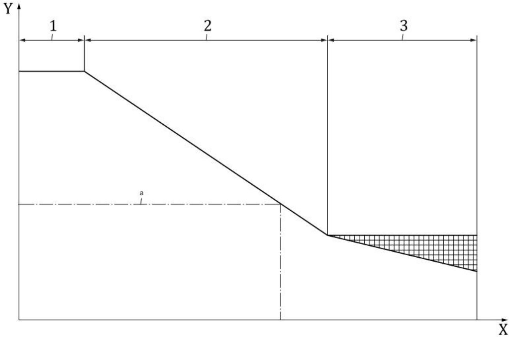

Key  
X number of load cycles, $N_{\mathrm{L}}$ (log)  
Y permissible contact stress, $\sigma_{\mathrm{HP}}$ (log)  
1 static  
2 limited life  
3 long life  

a Example: permissible contact stress, $\sigma_{HP}$ for a given number of load cycles.

Figure 1 — Graphic determination of the permissible contact stress for a limited life — Method B

#### 5.4.4.3 Determination by calculation

Calculate $\sigma_{HP ref}$ for reference and $\sigma_{HP stat}$ for static strength in accordance with 5.4.3 and, using these results, determine $\sigma_{HP}$ in accordance with Method B for limited life and the number of load cycles, $N_{L}$ in the range as follows.

a) St, V, GGG(perl., bain.), GTS(perl.), Eh, IF, if limited pitting according to Clause 4 is permissible:

— For the limited life stress range, $6 \times 10^{5} < N_{L} \leq 10^{7}$ in accordance with Figure 6:

$$
\sigma_ {\mathrm{HP}} = \sigma_ {\mathrm{HPref}} \cdot Z _ {\mathrm{N}} = \sigma_ {\mathrm{HPref}} \cdot \left(\frac {3 \times 10 ^ {8}}{N _ {\mathrm{L}}}\right) ^ {\exp}\tag{7}
$$

where

$$
\exp = 0,3705 \cdot \log \frac {\sigma_ {\mathrm{HPstat}}}{\sigma_ {\mathrm{HPref}}}\tag{8}
$$

— For the limited life stress range, $10^{7} < N_{L} \leq 10^{9}$ in accordance with Figure 6:

$$
\sigma_ {\mathrm{HP}} = \sigma_ {\mathrm{HPref}} \cdot Z _ {\mathrm{N}} = \sigma_ {\mathrm{HPref}} \cdot \left(\frac {10 ^ {9}}{N _ {\mathrm{L}}}\right) ^ {\exp}\tag{9}
$$

where

$$
\exp = 0,2791 \cdot \log \frac {\sigma_ {\mathrm{HPstat}}}{\sigma_ {\mathrm{HPref}}}\tag{10}
$$

b) St, V, GGG(perl., bain.), GTS(perl.), Eh, IF, when no pitting according to Clause 4 is permissible:

— For the limited life stress range, $10^{5} < N_{L} \leq 5 \times 10^{7}$ in accordance with Figure 6:

$$
\sigma_ {\mathrm{HP}} = \sigma_ {\mathrm{HPref}} \cdot Z _ {\mathrm{N}} = \sigma_ {\mathrm{HPref}} \cdot \left(\frac {5 \times 10 ^ {7}}{N _ {\mathrm{L}}}\right) ^ {\exp}\tag{11}
$$

where exp is as in Formula (8).

c) GG, GGG(ferr.), NT(nitr.), NV(nitr.)

— For the limited life stress range, $10^{5} < N_{L} \leq 2 \times 10^{6}$ in accordance with Figure 6:

$$
\sigma_ {\mathrm{HP}} = \sigma_ {\mathrm{HPref}} \cdot Z _ {\mathrm{N}} = \sigma_ {\mathrm{HPref}} \cdot \left(\frac {2 \times 10 ^ {6}}{N _ {\mathrm{L}}}\right) ^ {\exp}\tag{12}
$$

where

$$
\exp = 0,7686 \cdot \log \frac {\sigma_ {\mathrm{HPstat}}}{\sigma_ {\mathrm{HPref}}}\tag{13}
$$

d) NV(nitrocar.)

— For the limited life stress range, $10^{5} < N_{L} \leq 2 \times 10^{6}$ in accordance with Figure 6:

$$
\sigma_ {\mathrm{HP}} = \sigma_ {\mathrm{HPref}} \cdot Z _ {\mathrm{N}} = \sigma_ {\mathrm{HPref}} \cdot \left(\frac {2 \times 10 ^ {6}}{N _ {\mathrm{L}}}\right) ^ {\exp}\tag{14}
$$

where

$$
\exp = 0,7686 \cdot \log \frac {\sigma_ {\mathrm{HPstat}}}{\sigma_ {\mathrm{HPref}}}\tag{15}
$$

Corresponding calculations may be determined for the range of long life.

# 6 Zone factor, $Z_{H}$ , and contact factors, $Z_{B}$ and $Z_{D}$

## 6.1 General

These factors account for the influence of the tooth flank curvature on the contact stress.

## 6.2 Zone factor, $Z_{H}$

### 6.2.1 General

The zone factor, $Z_{H}$ , accounts for the influence on Hertzian pressure of the tooth flank curvature at the pitch point and transforms the tangential load at the reference cylinder to normal load at the pitch cylinder.

### 6.2.2 Graphical values

$Z_{\mathrm{H}}$ can be taken from Figure 2 as a function of $(x_{1} + x_{2}) / (z_{1} + z_{2})$ and $\beta$ for external and internal gears having normal pressure angles $\alpha_{\mathrm{n}} = 20^{\circ}$ , $22,5^{\circ}$ or $25^{\circ}$ .

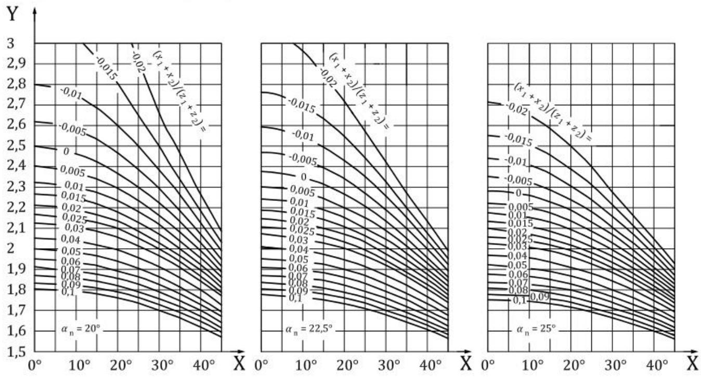

Key  
X helix angle at reference circle, $\beta$ (°)  
Y zone factor, $Z_{\mathrm{H}}$  

Figure 2 — Zone factor, $Z_{H}$

### 6.2.3 Determination by calculation

The zone factor is calculated by:

$$
Z _ {\mathrm{H}} = \sqrt {\frac {2 \cos \beta_ {b} \cdot \cos \alpha_ {\mathrm{wt}}}{\cos^ {2} \alpha_ {t} \cdot \sin \alpha_ {\mathrm{wt}}}}\tag{16}
$$

## 6.3 Contact factors, $Z_{B}$ and $Z_{D}$ , for $\varepsilon_{\alpha} \leq 2$

For spur gear the contact factors, $Z_{\mathrm{B}}$ and $Z_{\mathrm{D}}$ , are used to transform the contact stress at the pitch point to the contact stress at the inner point $B$ of the single pair tooth contact of the pinion or at the inner point $D$ of the single pair tooth contact of the wheel if $Z_{\mathrm{B}} > 1$ or $Z_{\mathrm{D}} > 1$ . See Figure 3 and 5.1.

For helical gears the contact factors, $Z_{B}$ and $Z_{D}$ , convert the contact stress at the pitch point to the contact stress of the relevant contact point if the pitch point is not determinant.

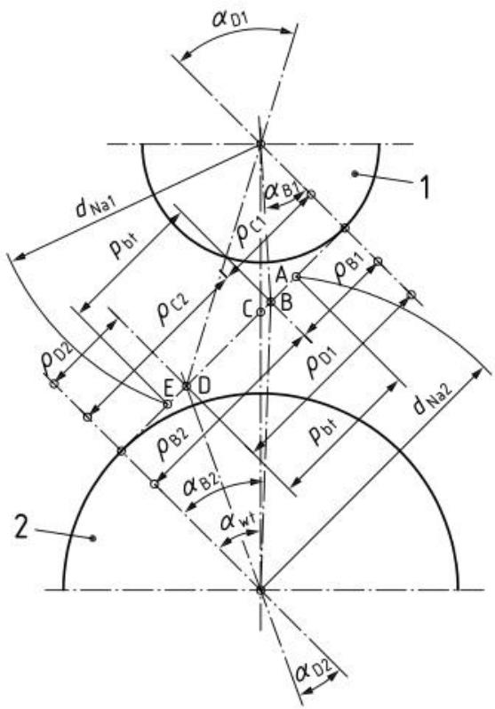

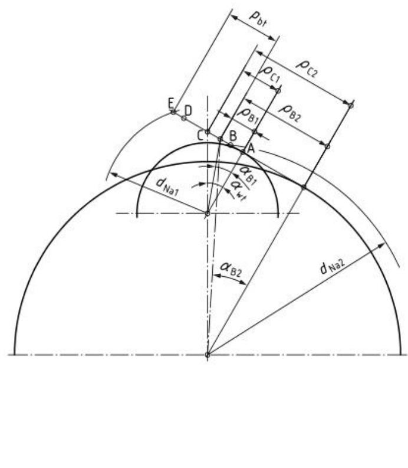  
a) External gearing  
b) Internal gearing

Key  
1 pinion  
2 wheel  

Figure 3 — Radii of curvature at pitch point C and single pair tooth contact point B of the pinion and D of the wheel for the determination of the pinion contact factor, $Z_{B}$ , in accordance with Formula (17) and of the wheel contact factor, $Z_{D}$ , in accordance with Formula (18) (only for external spur gears)

In general, $Z_{\mathrm{D}}$ should only be determined for gears when $u < 1,5$ . When $u > 1,5$ , $M_2$ is usually less than 1,0 in which case $Z_{\mathrm{D}}$ is made equal to 1,0 in Formula (17).

For internal gears, $Z_{D}$ shall be taken as equal to 1,0.

The determination by calculation is as follows:

$$
M _ {1} = \sqrt {\frac {\rho_ {\mathrm{C} 1} \cdot \rho_ {\mathrm{C} 2}}{\rho_ {\mathrm{B} 1} \cdot \rho_ {\mathrm{B} 2}}} = \frac {\tan \alpha_ {\mathrm{wt}}}{\sqrt {\left(\sqrt {\frac {d _ {\mathrm{Na} 1} ^ {2}}{d _ {\mathrm{b} 1} ^ {2}} - 1} - \frac {2 \pi}{z _ {1}}\right) \left(\sqrt {\frac {d _ {\mathrm{Na} 2} ^ {2}}{d _ {\mathrm{b} 2} ^ {2}} - 1} - (\varepsilon_ {\alpha} - 1) \frac {2 \pi}{z _ {2}}\right)}}\tag{17}
$$

$$
M _ {2} = \sqrt {\frac {\rho_ {\mathrm{C} 1} \cdot \rho_ {\mathrm{C} 2}}{\rho_ {\mathrm{D} 1} \cdot \rho_ {\mathrm{D} 2}}} = \frac {\tan \alpha_ {\mathrm{wt}}}{\sqrt {\left(\sqrt {\frac {d _ {\mathrm{Na} 2} ^ {2}}{d _ {\mathrm{b} 2} ^ {2}} - 1} - \frac {2 \pi}{z _ {2}}\right) \left(\sqrt {\frac {d _ {\mathrm{Na} 1} ^ {2}}{d _ {\mathrm{b} 1} ^ {2}} - 1} - (\varepsilon_ {\alpha} - 1) \frac {2 \pi}{z _ {1}}\right)}}\tag{18}
$$

Formula (17) and (18) are not valid, if undercut shortens the path of contact. See 8.3.1 for the calculation of the transverse contact ratio, $\varepsilon_{\alpha}$ .

a) Spur gears with $\varepsilon_{\alpha} > 1$ :

$$
\text { if } M _ {1} \leq 1 \text { then } Z _ {\mathrm{B}} = 1; \quad \text { if } M _ {2} \leq 1 \text { then } Z _ {\mathrm{D}} = 1;
$$

if $M_{1} > 1$ then $Z_{B} = M_{1}$ ; if $M_{2} > 1$ then $Z_{D} = M_{2}$ .

b) Helical gears with $\varepsilon_{\alpha} > 1$ and $\varepsilon_{\beta} \geq 1$ :

$$
Z _ {\mathrm{B}} = Z _ {\mathrm{D}} = \sqrt {f _ {\mathrm{ZCa}}}\tag{19}
$$

with $f_{ZCa}$ according to Table 3.

Table 3 — Factor ${f}_{\mathrm{{ZCa}}}$

| Helical gear sets with suitable profile and longitudinal modifications based on the 3D load distribution program, and with the maximum contact stress near mid-height and essentially uniform stress distribution | $f_{ZCa} = 1,0$ |
| --- | --- |
| Helical gear sets with suitable flank modifications acc. to manufacturers experience | $f_{ZCa} = 1,07$ |
| Helical gear sets without flank modifications | $f_{ZCa} = 1,2$ |

The factor $f_{ZCa}$ is valid for the matched pinion and wheel. Consequently, the contact stresses at the beginning as well as at the end of the path of contact shall be considered.

c) Helical gears with $\varepsilon_{\alpha} > 1$ and $\varepsilon_{\beta} < 1$ :

$Z_{B}$ and $Z_{D}$ are determined by linear interpolation between the values for spur and helical gearing with $\varepsilon_{\beta} \geq 1$ :

$$
\text {   If   } M _ {1} \leq 1 \text {   then   } Z _ {\mathrm{B}} = 1 + \varepsilon_ {\beta} \cdot \left(\sqrt {f _ {\mathrm{ZCa}}} - 1\right)\tag{20}
$$

$$
\mathrm{If} M _ {1} > 1 \mathrm{then} Z _ {\mathrm{B}} = M _ {1} + \varepsilon_ {\beta} \cdot \left(\sqrt {f _ {\mathrm{ZCa}}} - M _ {1}\right)\tag{21}
$$

$$
\text {   If   } M _ {2} \leq 1 \text {   then   } Z _ {\mathrm{D}} = 1 + \varepsilon_ {\beta} \cdot \left(\sqrt {f _ {\mathrm{ZCa}}} - 1\right)\tag{22}
$$

$$
\text {   If   } M _ {2} > 1 \text {   then   } Z _ {\mathrm{D}} = M _ {2} + \varepsilon_ {\beta} \cdot \left(\sqrt {f _ {\mathrm{ZCa}}} - M _ {2}\right)\tag{23}
$$

If $Z_{B}$ or $Z_{D}$ are made equal to 1,0, the contact stresses calculated using Formula (4) or (5) are the values for the contact stress at the pitch cylinder.

d) Helical gears with $\varepsilon_{\alpha} \leq 1$ and with $\varepsilon_{\gamma} > 1$ : not covered by the ISO 6336 series, a careful analysis of the decisive contact stress along the path of contact is necessary.

Methods a), b) and c) apply to the calculation of the contact stress when the pitch point lies in the path of contact. If the pitch point C is determinant and lies outside the path of contact, then $Z_{B}$ and/or $Z_{D}$ are determined for contact at the adjacent tip circle. For helical gearing, when $\varepsilon_{\beta}$ is less than 1,0, $Z_{B}$ and $Z_{D}$ are determined by linear interpolation between the values (determined at the pitch point or at the adjacent tip circle as appropriate) for spur gears and those helical gears with $\varepsilon_{\beta} \geq 1$ .

## 6.4 Contact factors, $Z_{\mathrm{B}}$ and $Z_{\mathrm{D}}$ , for $\varepsilon_{\alpha} > 2$

In the case of meshing gear pairs of high precision with $2 < \varepsilon_{\alpha} < 2.5$ , the entire tangential load in any transverse plane is supported by two pairs, or three pairs, of teeth in continued succession. For such gears, the calculation of the contact stress is based on the inner point of two pair tooth contact of the pinion.

# 7 Elasticity factor, $Z_{E}$

The elasticity factor, $Z_{E}$ , takes into account the influences of the material properties E (modulus of elasticity) and $\nu$ (Poisson's ratio) on the contact stress.

$$
Z _ {\mathrm{E}} = \sqrt {\frac {1}{\pi \cdot \left(\frac {1 - \nu_{1} ^ {2}}{E _ {1}} + \frac {1 - \nu_{2} ^ {2}}{E _ {2}}\right)}}\tag{24}
$$

When $E_{1}=E_{2}=E$ and $\nu_1=\nu_2=\nu$ :

$$
Z _ {\mathrm{E}} = \sqrt {\frac {E}{2 \pi \cdot (1 - \nu^{2})}}\tag{25}
$$

For steel and aluminium $\nu=0,3$ and therefore:

$$
Z _ {\mathrm{E}} = \sqrt {0,175 \cdot E}\tag{26}
$$

For mating gears in material having different moduli of elasticity, $E_{1}$ and $E_{2}$ , the equivalent modulus

$$
E = \frac {2 E _ {1} E _ {2}}{E _ {1} + E _ {2}}\tag{27}
$$

may be used.

For some material combinations $Z_{E}$ can be taken from Table 4.

Table 4 — Elasticity factor, ${Z}_{\mathrm{E}}$ ,for some material combinations

<table>
<tr><td colspan="3">Wheel 1</td><td colspan="3">Wheel 2</td><td rowspan="2"> <math data-tex="Z_{E}" display="inline" xmlns="http://www.w3.org/1998/Math/MathML"><semantics><msub><mi>Z</mi><mi>E</mi></msub></semantics></math>  <math data-tex="(N/mm^{2})^{0.5}" display="inline" xmlns="http://www.w3.org/1998/Math/MathML"><semantics><mrow><mo stretchy="false" form="prefix">(</mo><mi>N</mi><mi>/</mi><mi>m</mi><msup><mi>m</mi><mn>2</mn></msup><msup><mo stretchy="false" form="postfix">)</mo><mn>0.5</mn></msup></mrow></semantics></math> </td></tr>
<tr><td>Material</td><td>Modulus of elasticity,  <math data-tex="E" display="inline" xmlns="http://www.w3.org/1998/Math/MathML"><semantics><mi>E</mi></semantics></math>  <math data-tex="N/mm^{2}" display="inline" xmlns="http://www.w3.org/1998/Math/MathML"><semantics><mrow><mi>N</mi><mi>/</mi><mi>m</mi><msup><mi>m</mi><mn>2</mn></msup></mrow></semantics></math> </td><td>Poisson&#x27;s ratio,  <math data-tex="\nu" display="inline" xmlns="http://www.w3.org/1998/Math/MathML"><semantics><mi>ν</mi></semantics></math> </td><td>Material</td><td>Modulus of elasticity,  <math data-tex="E" display="inline" xmlns="http://www.w3.org/1998/Math/MathML"><semantics><mi>E</mi></semantics></math>  <math data-tex="N/mm^{2}" display="inline" xmlns="http://www.w3.org/1998/Math/MathML"><semantics><mrow><mi>N</mi><mi>/</mi><mi>m</mi><msup><mi>m</mi><mn>2</mn></msup></mrow></semantics></math> </td><td>Poisson&#x27;s ratio,  <math data-tex="\nu" display="inline" xmlns="http://www.w3.org/1998/Math/MathML"><semantics><mi>ν</mi></semantics></math> </td></tr>
<tr><td rowspan="4">St, V, Eh, IF, NT, NV</td><td rowspan="4">206 000</td><td rowspan="10">0,3</td><td>St, V, Eh, IF, NT, NV</td><td>206 000</td><td rowspan="10">0,3</td><td>189,8</td></tr>
<tr><td>St(cast)</td><td>202 000</td><td>188,9</td></tr>
<tr><td>GGG, GTS</td><td>173 000</td><td>181,4</td></tr>
<tr><td>GG</td><td>126 000 to 118 000</td><td>165,4 to 162,0</td></tr>
<tr><td rowspan="3">St(cast)</td><td rowspan="3">202 000</td><td>St(cast)</td><td>202 000</td><td>188,0</td></tr>
<tr><td>GGG, GTS</td><td>173 000</td><td>180,5</td></tr>
<tr><td>GG</td><td>118 000</td><td>161,4</td></tr>
<tr><td rowspan="2">GGG, GTS</td><td rowspan="2">173 000</td><td>GGG, GTS</td><td>173 000</td><td>173,9</td></tr>
<tr><td>GG</td><td>118 000</td><td>156,6</td></tr>
<tr><td>GG</td><td>126 000 to 118 000</td><td>GG</td><td>118 000</td><td>146,0 to 143,7</td></tr>
</table>

# 8 Contact ratio factor, $Z_{\varepsilon}$

## 8.1 General

The contact ratio factor, $Z_{\varepsilon}$ , accounts for the influence of the transverse contact and overlap ratios on the surface load capacity of cylindrical gears. Calculation of the contact stress is based on a virtual facewidth, $b_{vir}$ , instead of the actual facewidth, b:

$$
\frac {b _ {\mathrm{vir}}}{b} = \frac {1}{Z _ {\varepsilon} ^ {2}}\tag{28}
$$

The average length of the line of contact calculated on a simplified basis is used as the appropriate value for helical gearing with $\varepsilon_{\beta} > 1$ .

## 8.2 Determination of contact ratio factor, $Z_{\varepsilon}$

### 8.2.1 Graphical values

$Z_{\varepsilon}$ for known contact and overlap ratio factors may be read from Figure 4.

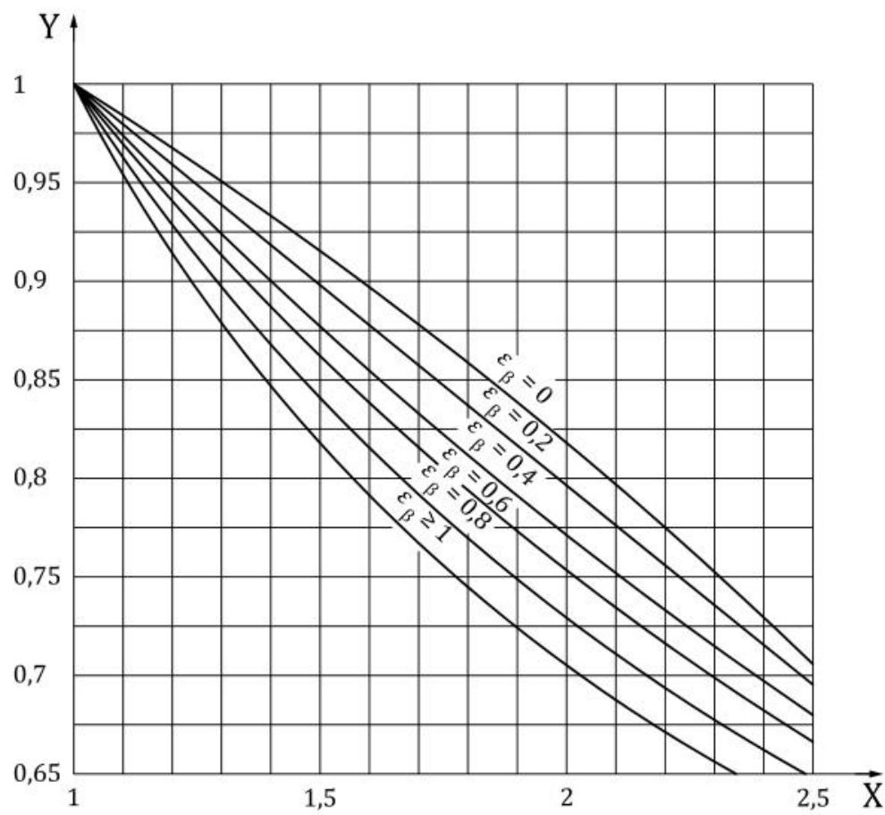  
Key  
X transverse contact ratio, $\varepsilon_{\alpha}$  
Y contact ratio factor, $Z_{\varepsilon}$  

Figure 4 — Contact ratio factor, $Z_{\varepsilon}$

### 8.2.2 Determination by calculation

a) Spur gears:

$$
Z _ {\varepsilon} = \sqrt {\frac {4 - \varepsilon_ {\alpha}}{3}}\tag{29}
$$

The conservative value of $Z_{\varepsilon} = 1,0$ may be chosen for spur gears having a contact ratio less than 2,0.

b) Helical gears:

$$
Z _ {\varepsilon} = \sqrt {\frac {4 - \varepsilon_ {\alpha}}{3} \left(1 - \varepsilon_ {\beta}\right) + \frac {\varepsilon_ {\beta}}{\varepsilon_ {\alpha}}} \quad \mathrm{for} \varepsilon_ {\beta} <   1\tag{30}
$$

$$
Z _ {\varepsilon} = \sqrt {\frac {1}{\varepsilon_ {\alpha}}} \quad \mathrm{for} \varepsilon_ {\beta} \geq 1\tag{31}
$$

## 8.3 Calculation of transverse contact ratio, $\varepsilon_{\alpha}$ , and overlap ratio, $\varepsilon_{\beta}$

### 8.3.1 Transverse contact ratio, $\varepsilon_{\alpha}$

The calculation is based on the roll angle, $\xi$ , and the angular pitch, $\tau$ , both expressed in radians in the following formulae.

$$
\varepsilon_ {\alpha} = \frac {\xi_ {\mathrm{Nfw1}} + \xi_ {\mathrm{Naw1}}}{\tau_ {1}} = \frac {\xi_ {\mathrm{Nfw2}} + \xi_ {\mathrm{Naw2}}}{\tau_ {2}}\tag{32}
$$

where $\xi_{Nfw1,2}$ are the roll angles from the active root diameter, $d_{Nf1,2}$ , to the working pitch point, taken as the least value of

— limited by the base diameters:

$$
\xi_ {\mathrm{Nfw1,2}} = \tan \alpha_ {\mathrm{wt}}\tag{33}
$$

— limited by the active root diameter:

$$
\xi_ {\mathrm{Nfw1}} = \tan \alpha_ {\mathrm{wt}} - \tan \arccos \frac {d _ {\mathrm{b1}}}{d _ {\mathrm{Nf1}}}\tag{34}
$$

$$
\xi_ {\mathrm{Nfw2}} = \tan \alpha_ {\mathrm{wt}} - \tan \arccos \frac {d _ {\mathrm{b2}}}{d _ {\mathrm{Nf2}}}\tag{35}
$$

— limited by the active tip diameters of the wheel/pinion (start of the active profile):

$$
\xi_ {\mathrm{Naw1}} = \left(\tan \arccos \frac {d _ {\mathrm{b2}}}{d _ {\mathrm{Na2}}} - \tan \alpha_ {\mathrm{wt}}\right) \cdot \frac {z _ {2}}{z _ {1}}\tag{36}
$$

$$
\xi_ {\mathrm{Naw2}} = \left(\tan \arccos \frac {d _ {\mathrm{b} 1}}{d _ {\mathrm{Na} 1}} - \tan \alpha_ {\mathrm{wt}}\right) \cdot \frac {z _ {1}}{z _ {2}}\tag{37}
$$

$\xi_{Naw1,2}$ are the roll angles from the working pitch point to the active tip diameter:

$$
\xi_ {\mathrm{Naw1}} = \xi_ {\mathrm{Nfw2}} \frac {z _ {2}}{z _ {1}}, \xi_ {\mathrm{Naw2}} = \xi_ {\mathrm{Nfw1}} \frac {z _ {1}}{z _ {2}}\tag{38}
$$

$\tau_{1,2}$ is the pinion/wheel angular pitch:

$$
\tau_ {1} = \frac {2 \pi}{z _ {1}}, \tau_ {2} = \frac {2 \pi}{z _ {2}}\tag{39}
$$

Formulae (33) to (39) do not take into account undercut.

### 8.3.2 Overlap ratio, $\varepsilon_{\beta}$

This is calculated by

$$
\varepsilon_ {\beta} = \frac {b \sin \beta}{\pi m _ {n}}\tag{40}
$$

For double helical gears, $b_{B}$ is to be used instead of b.

# 9 Helix angle factor, $Z_{\beta}$

Independent of the influence of the helix angle on the length of path of contact, the helix angle factor, $Z_{\beta}$ , accounts for the influence of the helix angle on surface load capacity, allowing for such variables as the distribution of load along the lines of contact.

$Z_{\beta}$ is dependent only on the helix angle, $\beta$ . For most purposes, the following empirical relationship is in sufficiently good agreement with experimental and service experience, but that agreement is only achieved when high accuracy and optimum tooth flank modifications are employed:

$$
Z _ {\beta} = \sqrt {\frac {1}{\cos \beta}}\tag{41}
$$

where $\beta$ is the reference helix angle.

$Z_{\beta}$ can also be read from Figure 5.

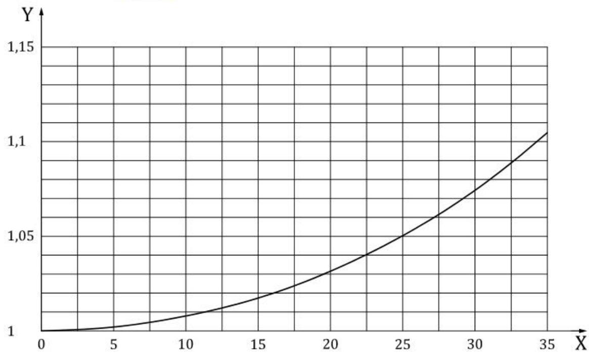  
Key  
X helix angle at reference circle, $\beta$ (°)  
Y helix angle factor, $Z_{\beta}$  

Figure 5 — Helix angle factor, $Z_{\beta}$

# 10 Strength for contact stress

## 10.1 General

See 5.4 for general information on the determination of limit values for permissible contact stress.

## 10.2 Allowable stress numbers (contact), $\sigma_{\mathrm{Hlim}}$ : Method B

Refer to 5.4.2.3 for details relevant to the following. For a demonstration of the use of $\sigma_{\mathrm{Hlim}}$ , see Formula (6). The value $\sigma_{\mathrm{Hlim}}$ for a given material is considered as the highest value of the contact stress, calculated in accordance with this document, which the material will endure for at least $2 \times 10^{6}$ to $5 \times 10^{7}$ load cycles (see Figure 6 for the start).

ISO 6336-5 provides information on commonly used gear materials, methods of heat treatment and the influence of gear quality on values for allowable stress numbers, $\sigma_{H\lim}$ , derived from test results of standard reference test gears.

Also see ISO 6336-5 for requirements concerning material and heat treatment for qualities ML, MQ and ME. Material quality MQ is generally selected unless otherwise agreed.

## 10.3 Allowable stress number values: Method $\mathbf{B}_{\mathrm{R}}$

See 5.4.2.4 for detailed information. The allowable stress number values may be determined by means of roller tests or can be taken from the literature.

# 11 Life factor, $Z_{NT}$ (for flanks)

## 11.1 General

The life factor, $Z_{NT}$ , accounts for the higher contact stress, including static stress, which may be tolerable for a limited life (number of load cycles), as compared with the value at the point of the allowable stress number or “knee” on the curves of Figure 6, where $Z_{NT} = 1,0$ . $Z_{NT}$ applies for standard reference use.

The principal influences are

a) material and heat treatment (see ISO 6336-5),

b) number of load cycles (service life) $N_{L}$ ,

c) lubrication regime,

d) failure criteria,

e) smoothness of operation required,

f) pitchline velocity,

g) cleanness of gear material,

h) material ductility and fracture toughness, and

i) residual stress.

For the purposes of this document, the number of load cycles, $N_{L}$ , is defined as the number of mesh contacts, under load, of the gear tooth being analysed.

## 11.2 Life factor, $Z_{\mathrm{NT}}$ : Method A

The S-N curve or damage curve derived from examples of the actual gear pair is determinant for load capacity at a limited service life and is thus also determinant for the materials of both mating gears, the heat treatment, the relevant diameter, module, surface roughness of tooth flanks, pitch line velocity and the lubricant used. Since the S-N curve or damage curve is directly valid for the conditions mentioned, the influences represented by the factors $Z_{R}$ , $Z_{v}$ , $Z_{L}$ , $Z_{W}$ , and $Z_{X}$ are included in the curve and should therefore be assigned the value 1,0 in the calculation formula.

## 11.3 Life factor, $Z_{\mathrm{NT}}$ : Method B

The permissible stress at limited service life or the safety factor in the limited life stress range is determined using life factor, $Z_{NT}$ , for the standard reference test gear (see 5.4).

$Z_{NT}$ for static and reference stresses may be taken from Figure 6 or Table 5.

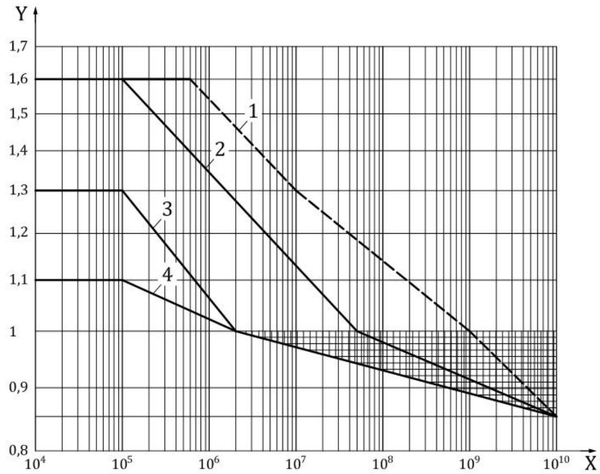  
X number of load cycles, $N_{L}$  
Y life factor, $Z_{NT}$  
1 St, V, GGG (perl., bai.), GTS (perl.), Eh, IF, when limited pitting according to Clause 4 is permitted  
2 St, V, GGG (perl., bai.), GTS (perl.), Eh, IF, when no pitting according to Clause 4 is permissible  
3 GG, GGG (ferr.), NT (nitr.), NV (nitr.)  
4 NV (nitrocar.)

Figure 6 — Life factor, $Z_{NT}$ , for standard reference test gears  
Table 5 — Life factor, ${Z}_{\mathrm{{NT}}}$

<table>
<tr><td>Material</td><td>Number of load cycles</td><td>Life factor,  <math data-tex="Z_{NT}" display="inline" xmlns="http://www.w3.org/1998/Math/MathML"><semantics><msub><mi>Z</mi><mrow><mi>N</mi><mi>T</mi></mrow></msub></semantics></math> </td></tr>
<tr><td rowspan="4">St, V, GGG (perl., bai.), GTS (perl.), Eh, IF; only when limited pitting according to Clause 4 is permissible</td><td> <math data-tex="N_{L} \leq 6 \times 10^{5}" display="inline" xmlns="http://www.w3.org/1998/Math/MathML"><semantics><mrow><msub><mi>N</mi><mi>L</mi></msub><mo>≤</mo><mn>6</mn><mo>×</mo><msup><mn>10</mn><mn>5</mn></msup></mrow></semantics></math> , static</td><td>1,6</td></tr>
<tr><td> <math data-tex="N_{L}=10^{7}" display="inline" xmlns="http://www.w3.org/1998/Math/MathML"><semantics><mrow><msub><mi>N</mi><mi>L</mi></msub><mo>=</mo><msup><mn>10</mn><mn>7</mn></msup></mrow></semantics></math> </td><td>1,3</td></tr>
<tr><td> <math data-tex="N_{L}=10^{9}" display="inline" xmlns="http://www.w3.org/1998/Math/MathML"><semantics><mrow><msub><mi>N</mi><mi>L</mi></msub><mo>=</mo><msup><mn>10</mn><mn>9</mn></msup></mrow></semantics></math> </td><td>1,0</td></tr>
<tr><td> <math data-tex="N_{L}=10^{10}" display="inline" xmlns="http://www.w3.org/1998/Math/MathML"><semantics><mrow><msub><mi>N</mi><mi>L</mi></msub><mo>=</mo><msup><mn>10</mn><mn>10</mn></msup></mrow></semantics></math> </td><td>0,85 up to 1,0a </td></tr>
<tr><td rowspan="3">St, V, GGG (perl., bai.), GTS (perl.), Eh, IF</td><td> <math data-tex="N_{L} \leq 10^{5}" display="inline" xmlns="http://www.w3.org/1998/Math/MathML"><semantics><mrow><msub><mi>N</mi><mi>L</mi></msub><mo>≤</mo><msup><mn>10</mn><mn>5</mn></msup></mrow></semantics></math> , static</td><td>1,6</td></tr>
<tr><td> <math data-tex="N_{L}=5 \times 10^{7}" display="inline" xmlns="http://www.w3.org/1998/Math/MathML"><semantics><mrow><msub><mi>N</mi><mi>L</mi></msub><mo>=</mo><mn>5</mn><mo>×</mo><msup><mn>10</mn><mn>7</mn></msup></mrow></semantics></math> </td><td>1,0</td></tr>
<tr><td> <math data-tex="N_{L}=10^{10}" display="inline" xmlns="http://www.w3.org/1998/Math/MathML"><semantics><mrow><msub><mi>N</mi><mi>L</mi></msub><mo>=</mo><msup><mn>10</mn><mn>10</mn></msup></mrow></semantics></math> </td><td>0,85 up to 1,0a </td></tr>
<tr><td rowspan="3">GG, GGG (ferr.), NT (nitr.), NV (nitr.)</td><td> <math data-tex="N_{L} \leq 10^{5}" display="inline" xmlns="http://www.w3.org/1998/Math/MathML"><semantics><mrow><msub><mi>N</mi><mi>L</mi></msub><mo>≤</mo><msup><mn>10</mn><mn>5</mn></msup></mrow></semantics></math> , static</td><td>1,3</td></tr>
<tr><td> <math data-tex="N_{L}=2 \times 10^{6}" display="inline" xmlns="http://www.w3.org/1998/Math/MathML"><semantics><mrow><msub><mi>N</mi><mi>L</mi></msub><mo>=</mo><mn>2</mn><mo>×</mo><msup><mn>10</mn><mn>6</mn></msup></mrow></semantics></math> </td><td>1,0</td></tr>
<tr><td> <math data-tex="N_{L}=10^{10}" display="inline" xmlns="http://www.w3.org/1998/Math/MathML"><semantics><mrow><msub><mi>N</mi><mi>L</mi></msub><mo>=</mo><msup><mn>10</mn><mn>10</mn></msup></mrow></semantics></math> </td><td>0,85 up to 1,0a </td></tr>
<tr><td colspan="3">a The lower value of  <math data-tex="Z_{NT}" display="inline" xmlns="http://www.w3.org/1998/Math/MathML"><semantics><msub><mi>Z</mi><mrow><mi>N</mi><mi>T</mi></mrow></msub></semantics></math>  may be used for critical service. Values between 0,85 and 1,0 may be used for general purpose gearing. With optimum lubrication, material, manufacturing and experience 1,0 may be used.</td></tr>
<tr><td rowspan="3">NV (nitrocar.)</td><td> <math data-tex="N_L\leq 10^5" display="inline" xmlns="http://www.w3.org/1998/Math/MathML"><semantics><mrow><msub><mi>N</mi><mi>L</mi></msub><mo>≤</mo><msup><mn>10</mn><mn>5</mn></msup></mrow></semantics></math> , static</td><td>1,1</td></tr>
<tr><td> <math data-tex="N_L=2\times 10^6" display="inline" xmlns="http://www.w3.org/1998/Math/MathML"><semantics><mrow><msub><mi>N</mi><mi>L</mi></msub><mo>=</mo><mn>2</mn><mo>×</mo><msup><mn>10</mn><mn>6</mn></msup></mrow></semantics></math> </td><td>1,0</td></tr>
<tr><td> <math data-tex="N_L=10^{10}" display="inline" xmlns="http://www.w3.org/1998/Math/MathML"><semantics><mrow><msub><mi>N</mi><mi>L</mi></msub><mo>=</mo><msup><mn>10</mn><mn>10</mn></msup></mrow></semantics></math> </td><td>0,85 up to 1,0a </td></tr>
<tr><td colspan="3">aThe lower value of  <math data-tex="Z_{NT}" display="inline" xmlns="http://www.w3.org/1998/Math/MathML"><semantics><msub><mi>Z</mi><mrow><mi>N</mi><mi>T</mi></mrow></msub></semantics></math>  may be used for critical service. Values between 0,85 and 1,0 may be used for general purpose gearing. With optimum lubrication, material, manufacturing and experience 1,0 may be used.</td></tr>
</table>

# 12 Influence of lubricant film, factors $Z_{\mathrm{L}}$ , $Z_{\mathrm{v}}$ and $Z_{\mathrm{R}}$

## 12.1 General

The lubricant film between the tooth flanks influences surface durability. The following have a significant influence:

a) viscosity of the lubricant in the mesh;

b) sum of the instantaneous velocities of the two tooth surfaces;

c) loading;

d) radius of the relative curvature;

e) relationship between the combined values of the surface roughnesses of the tooth flanks and the minimum thickness of the lubricant film.

According to EHD (elasto-hydrodynamic theory concerning the characteristics of lubricant films in zones of elastic sliding/rolling contact), a) to d) above influence the film dimensions and pressures.

Furthermore, the nature of the lubricant (mineral oil, synthetic oil), its origin, its age, etc. will also have an effect on surface durability.

NOTE Information and recommendations concerning the choice of lubricant type and viscosity can be found in other publications (References [4], [6], [8] and [9]).

## 12.2 Influence of lubricant film: Method A

By Method A the influence of the lubricant film on surface durability is determined on the basis of reliable service experience or tests on geared transmissions having comparable dimensions, materials, lubricants, and operating conditions. The provisions of ISO 6336-1:2019, 4.1.16, are relevant.

## 12.3 Influence of lubricant film, factors $Z_{\mathrm{L}}, Z_{\mathrm{v}}$ and $Z_{\mathrm{R}}$ : Method B

### 12.3.1 General

The information provided is based on tests using standard reference test gears. The shaded fields in Figures 7 to 9 show the tendency of the three factors which are included in the calculation procedure according to Method B:

— $Z_{L}$ for the influence of the nominal lubricant viscosity (as a characteristic value of the influence of the lubricant) on the effect of the lubricant film;

— $Z_{v}$ for the influence of the circumferential velocity at the pitch line on the effect of the lubricant film;

— $Z_{R}$ for the influence of surface roughness of the flanks after running-in (as a manufacturing process) on the effect of the lubricant film.

The considerable scatter (width of the hatched field) indicates that there are influences other than those mentioned above, also involved in the lubricant film, which are not included in the calculation procedure.

These omissions were taken into consideration when plotting the curves in Figures 7 to 9. Clearly, they cannot be considered as representing physical laws. They are, of course, empirical.

The influence factors are presented as independent of one another; but in reality, they cannot be completely separated. For this reason, test results which were obtained by varying a single variable, while others were held constant, were adjusted to take into account field experiences with gears of different sizes and operating conditions. Thus, some of the recorded values do not correlate directly with test results. In general, through-hardened gears are more sensitive than case-hardened gears to the influences of viscosity, pitch line velocity and surface roughness. This is reflected in the empirical curves drawn in the scatter bands in Figures 7 to 9 inclusive. When a gear pair consists of one which is of hard and one which is of soft material, the factors $Z_{\mathrm{L}}$ , $Z_{\mathrm{v}}$ , and $Z_{\mathrm{R}}$ shall be determined for the softer of the materials. See ISO 6336-5 for $\sigma_{\mathrm{Hlim}}$ values of common gear materials.

The influence of the lubricant film is only fully effective at the long life stress level. The influence is low at higher limited-life stress levels (see Clause 11 and 5.4).

The lubricant factor, $Z_{L}$ , was derived from tests using mineral oil (with and without EP additives). By comparison, when testing certain synthetic lubricants in combination with case hardened test gears, values of $Z_{L}$ up to 1,1 times higher and with through-hardened test gears up to 1,4 times higher were observed.

These values should be verified in each individual case (where possible, curves similar to those provided for mineral oils should be prepared for synthetic oils).

### 12.3.2 Factors $Z_{L}$ , $Z_{v}$ and $Z_{R}$ for reference stress

#### 12.3.2.1 Lubricant factor, $Z_{L}$

##### 12.3.2.1.1 General

The factor $Z_{\mathrm{L}}$ for mineral oils (with or without extreme pressure, EP, additives) can be determined as a function of nominal kinematic viscosity at 40 °C (or 50 °C) and the value $\sigma_{\mathrm{Hlim}}$ of the softer of the materials of the mating gear pair, by following the directions in 12.3.2.1.3 a) and b). The values for $\nu_{40}$ apply for the kinematic viscosity index VI = 95 and kinematic viscosities from 10 cSt to 500 cSt at 40 °C (consider footnote a in Figure 7 and Table 6); for higher kinematic viscosities, use the value obtained at 500 cSt at 40 °C or 300 cSt at 50 °C to determine the value of $Z_{\mathrm{L}}$ .

##### 12.3.2.1.2 Graphical values

$Z_{L}$ can be read from Figure 7 as a function of the nominal kinematic viscosity of the lubricant at $40\ ^{\circ}C$ (or $50\ ^{\circ}C$ ) and the $\sigma_{H\lim}$ value.

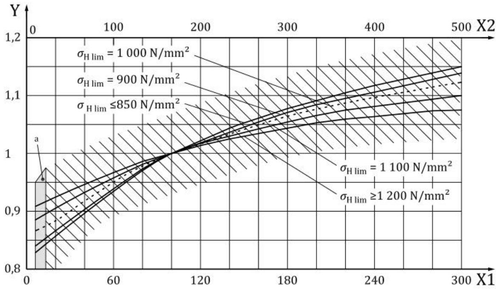

X1 nominal kinematic viscosity at 50 °C, $\nu_{50}$ mm $^{2}$ /s

X2 nominal kinematic viscosity at 40 °C, $\nu_{40}$ mm $^{2}$ /s

Y lubricant factor, $Z_{L}$

a These values have not been validated by test results. If theses values are used for calculation, the results should be confirmed by experience.

Figure 7 — Lubricant factor, $Z_{L}$

##### 12.3.2.1.3 Determination by calculation

a) $Z_{L}$ can be calculated using Formulae (42) to (46) which are consistent with the curves in Figure 7:

$$
Z_{\mathrm{L}}=C_{\mathrm{ZL}}+\frac{4\cdot(1,0-C_{\mathrm{ZL}})}{\left(1,2+\frac{80}{\nu_{50}}\right)^2}=C_{\mathrm{ZL}}+\frac{4\cdot(1,0-C_{\mathrm{ZL}})}{\left(1,2+\frac{134}{\nu_{40}}\right)^2}\tag{42}
$$

In the range $850\ \mathrm{N/mm^2}\leq\sigma_{\mathrm{Hlim}}\leq1200\ \mathrm{N/mm^2}$

$$
C_{\mathrm{ZL}}=\frac{\sigma_{\mathrm{Hlim}}}{437,5}+0,6357\tag{43}
$$

In the range $\sigma_{\mathrm{Hlim}}<850\ \mathrm{N/mm^2}$

$$
C_{\mathrm{ZL}}=0,83\tag{44}
$$

In the range $\sigma_{\mathrm{Hlim}}>1200\ \mathrm{N/mm^2}$

$$
C_{\mathrm{ZL}}=0,91\tag{45}
$$

> Editorial note (not part of ISO text): The denominator 437,5 in Formula (43) is reproduced as printed in the source PDF; it has not been silently corrected.

b) Alternatively, $Z_{\mathrm{L}}$ can be calculated from Formula (46):

$$
Z _ {\mathrm{L}} = C _ {\mathrm{ZL}} + 4 \cdot (1,0 - C _ {\mathrm{ZL}}) \nu_{\mathrm{f}}\tag{46}
$$

where $\nu_f=1/(1,2+80/\nu_{50})^{2}$ using viscosity parameters from Table 6.

Table 6 — Viscosity parameters

<table>
<tr><td colspan="2">ISO viscosity class (grade)</td><td>VG 10a</td><td>VG 15a</td><td>VG 22</td><td>VG 32</td><td>VG 46</td><td>VG 68</td><td>VG 100</td><td>VG 150</td><td>VG 220</td><td>VG 320</td></tr>
<tr><td rowspan="2">Nominal viscosity mm2/s</td><td><math data-tex="\nu_{40}" display="inline" xmlns="http://www.w3.org/1998/Math/MathML"><semantics><msub><mi>ν</mi><mn>40</mn></msub></semantics></math></td><td>10</td><td>15</td><td>22</td><td>32</td><td>46</td><td>68</td><td>100</td><td>150</td><td>220</td><td>320</td></tr>
<tr><td><math data-tex="\nu_{50}" display="inline" xmlns="http://www.w3.org/1998/Math/MathML"><semantics><msub><mi>ν</mi><mn>50</mn></msub></semantics></math></td><td>7,5</td><td>10,6</td><td>15</td><td>21</td><td>30</td><td>43</td><td>61</td><td>89</td><td>125</td><td>180</td></tr>
<tr><td>Viscosity parameter</td><td><math data-tex="\nu_f" display="inline" xmlns="http://www.w3.org/1998/Math/MathML"><semantics><msub><mi>ν</mi><mi>f</mi></msub></semantics></math></td><td>0,0068</td><td>0,0131</td><td>0,023</td><td>0,040</td><td>0,067</td><td>0,107</td><td>0,158</td><td>0,227</td><td>0,295</td><td>0,370</td></tr>
<tr><td colspan="12">a These values have not been validated by test results. If these values are used for calculation, the results should be confirmed by experience.</td></tr>
</table>

#### 12.3.2.2 Velocity factor, $Z_{v}$

##### 12.3.2.2.1 General

The velocity factor, $Z_{v}$ , can, as a function of circumferential velocity at the pitch line and the allowable stress number, $\sigma_{H\lim}$ , of the softer of the materials of the mating gear pair, be determined in accordance with 12.3.2.2.2 or 12.3.2.2.3.

##### 12.3.2.2.2 Graphical values

$Z_{v}$ can be taken from Figure 8 as a function of the circumferential velocity at the pitch line and the $\sigma_{H\lim}$ value.

##### 12.3.2.2.3 Determination by calculation

$Z_{v}$ can be calculated using Formulae (47) and (48). They reproduce the curves in Figure 8.

$$
Z _ {\mathrm{v}} = C _ {\mathrm{Zv}} + \frac {2 \cdot (1,0 - C _ {\mathrm{Zv}})}{\sqrt {0,8 + \frac {32}{v_{\mathrm{w}}}}}\tag{47}
$$

where

$$
C _ {\mathrm{Zv}} = C _ {\mathrm{ZL}} + 0,02\tag{48}
$$

[see Formulae (43) to (45) for values of $C_{ZL}$ ].

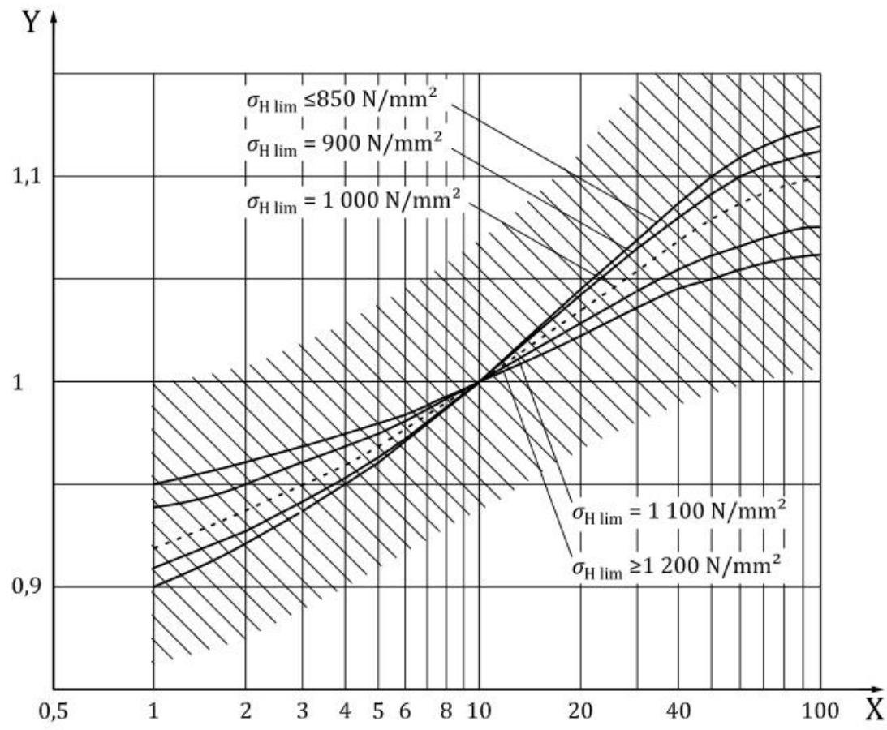  
X circumferential velocity at the pitch line, $v_{w}$ , m/s  
Y velocity factor, $Z_{v}$

Figure 8 — Velocity factor, $Z_{v}$

#### 12.3.2.3 Roughness factor, $Z_{R}$

##### 12.3.2.3.1 General

The roughness factor, $Z_{R}$ , can be determined in accordance with the following, as a function of the surface condition (roughness) of the tooth flanks, the dimensions (radius of the relative curvature, $\rho_{red}$ )[^1] , and the $\sigma_{H\lim}$ value for the softer material of the mating gear pair.

$Z_{R}$ can be read from curves or calculated as a function of the “mean relative roughness” (relative to the radius of the relative curvature at the pitch point $\rho_{red} = 10$ mm).

Mean peak-to-valley roughness of the gear pair:

$$
R z = \frac {R z _ {1} + R z _ {2}}{2}\tag{49}
$$

The peak-to-valley roughness determined for the pinion, $Rz_{1}$ , and for the wheel, $Rz_{2}$ , are mean values for the peak-to-valley roughness Rz measured on several tooth flanks[^2].

[^1]: $\rho_{\mathrm{red}}$ is defined here as the radius of the relative curvature at the pitch point. This also applies for internal gear pairs. For pinion-rack contact, $\rho_{\mathrm{red}}=\rho_1$.

[^2]: If roughness stated is an Ra value (= CLA value) (= AA value), the following approximation may be used for conversion: $Ra=\mathrm{CLA}=\mathrm{AA}\cong Rz/6$.

The mean roughness $Rz_{1}$ (pinion flank) and $Rz_{2}$ (wheel flank) shall be determined for their surface condition after manufacture, including any running-in treatment, planned as a manufacturing, commissioning or in-service process, when it is safe to assume that it will take place.

Mean relative peak-to-valley roughness for the gear pair:

$$
R z _ {10} = R z \cdot \sqrt [ 3 ]{\frac {10}{\rho_ {\mathrm{red}}}}\tag{50}
$$

Radius of the relative curvature:

$$
\rho_ {\mathrm{red}} = \frac {\rho_ {1} \cdot \rho_ {2}}{\rho_ {1} + \rho_ {2}}\tag{51}
$$

where

$$
\rho_ {1,2} = 0,5 d _ {\mathrm{b} 1,2} \cdot \tan \alpha_ {\mathrm{wt}}\tag{52}
$$

For external gearing, $d_{b}$ has a positive sign; for internal gearing, $d_{b}$ has a negative sign.

##### 12.3.2.3.2 Graphical values

$Z_{R}$ can be read from Figure 9 as a function of the mean relative peak-to-valley roughness and the $\sigma_{H\lim}$ value.

##### 12.3.2.3.3 Determination by calculation

$Z_{\mathrm{R}}$ can be calculated using the following formulae which are consistent with the curves in Figure 9.

$$
Z _ {\mathrm{R}} = \left(\frac {3}{R z _ {10}}\right) ^ {C _ {\mathrm{ZR}}}\tag{53}
$$

In the range 850 N/mm $^{2}$ ≤ σ $_{H\lim}$ ≤ 1 200 N/mm $^{2}$ :

$$
C _ {\mathrm{ZR}}\;0,32 - 0,0002 \sigma_ {\mathrm{Hlim}}\tag{54}
$$

For $\sigma_{\mathrm{Hlim}} < 850\mathrm{N / mm^2}$ :

$$
C _ {\mathrm{ZR}}\;0,15\tag{55}
$$

For $\sigma_{\mathrm{Hlim}} > 1200\mathrm{N / mm^2}$ :

$$
C _ {\mathrm{ZR}} = 0,08\tag{56}
$$

> Editorial note (not part of ISO text): Formulae (54) and (55) are printed without an equals sign in the source PDF. Their original printing is retained.

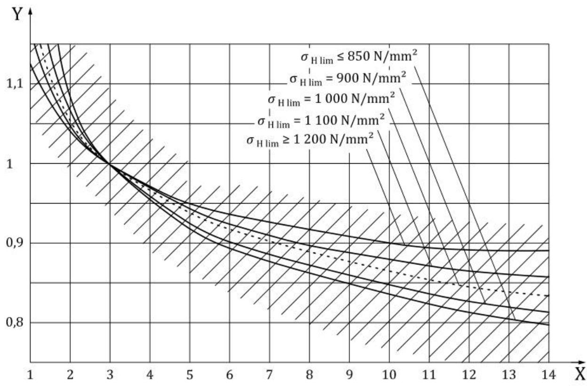  
X mean relative peak-to-valley roughness, $Rz_{10}$ , $\mu$ m  
Y roughness factor, $Z_{\mathrm{R}}$  
Figure 9 — Roughness factor, $Z_{R}$

### 12.3.3 Factors $Z_{L}$ , $Z_{v}$ and $Z_{R}$ for static stress

The relationships in Formula (57) are valid for the static stress ranges (characterized by the upper horizontal branches of S-N curves)

$$
Z _ {\mathrm{L}} = Z _ {\mathrm{v}} = Z _ {\mathrm{R}} = 1,0\tag{57}
$$

# 13 Work hardening factor, $Z_{\mathrm{W}}$

## 13.1 General

The work hardening factor, $Z_{\mathrm{W}}$ , takes account of the increase in the surface durability due to meshing a steel wheel (structural steel, through-hardened steel) with a hardened or substantially harder pinion with smooth tooth flanks.

The increase in the surface durability of the soft wheel depends not only on any work hardening of this wheel, but also on other influences such as polishing (lubricant), alloying element and internal stresses in the soft material, surface roughness of the hard pinion, contact stress and hardening processes.

## 13.2 Work hardening factor, $Z_{\mathrm{W}}$ : Method A

The increase in load-bearing capacity as a result of the influences listed above is to be determined in accordance with the reliable operating experience or tests on geared transmissions of comparable dimensions, materials, lubricants and operating conditions. The provisions given in ISO 6336-1:2019, 4.1.16, are relevant.

## 13.3 Work hardening factor, $Z_{\mathrm{W}}$ : Method B

### 13.3.1 Surface-hardened steel pinion with through-hardened steel gear

#### 13.3.1.1 General

The data provided are based on tests of different materials, using standard reference test gears, as well as production gearing field experience.

Although the curves in Figure 10 were carefully chosen, they cannot be interpreted as a physical law for the reasons mentioned above. They are, like Formula (58), empirical.

The equivalent roughness, $Rz_{H}$ , is determined as

$$
R z _ {\mathrm{H}} = \frac {R z _ {1} \cdot \left(10 / \rho_ {\mathrm{red}}\right) ^ {0,33} \cdot \left(R z _ {1} / R z _ {2}\right) ^ {0,66}}{\left(\nu_{40} \cdot v _ {\mathrm{w}} / 1500\right) ^ {0,33}}\tag{58}
$$

$$
\mathrm{if} R z _ {\mathrm{H}} > 16 \text { then } R z _ {\mathrm{H}} = 16 \mu \mathrm{m}
$$

if $Rz_{\mathrm{H}} < 3$ then $Rz_{\mathrm{H}} = 3\mu \mathrm{m}$

where

$Rz_{1}$ is the surface roughness of the harder pinion, in micrometres ( $\mu$ m) before running-in;

$Rz_{2}$ is the surface roughness of the softer wheel, in micrometres ( $\mu$ m) before running-in;

$\rho_{red}$ is radius of relative curvature at pitch point, in millimetres (mm), see Formula (51);

$\nu_{40}$ is the nominal kinematic viscosity at $40\ ^{\circ}C$ , in square millimetres per second ( $mm^{2}/s$ );

$v_{w}$ is the circumferential velocity at the pitch line, in metres per second (m/s).

The value of $Z_{W}$ is different for static, limited life and reference stress (stress ranges, see Figure 6).

Especially for rough pinion surfaces, values of $Z_{W} < 1$ may be evaluated. As in this range effects of wear can limit the surface durability, $Z_{W}$ is fixed at $Z_{W} = 1$ . An additional analysis concerning wear is recommended to be carried out in this case. Wear of the surface is not covered by the ISO 6336 series.

#### 13.3.1.2 $Z_{\mathrm{W}}$ for reference and long life stress, graphed values

$Z_{W}$ for reference and long life stress can be taken from Figure 10 for the conditions listed in 12.2 as a function of the flank hardness of the softer wheel.

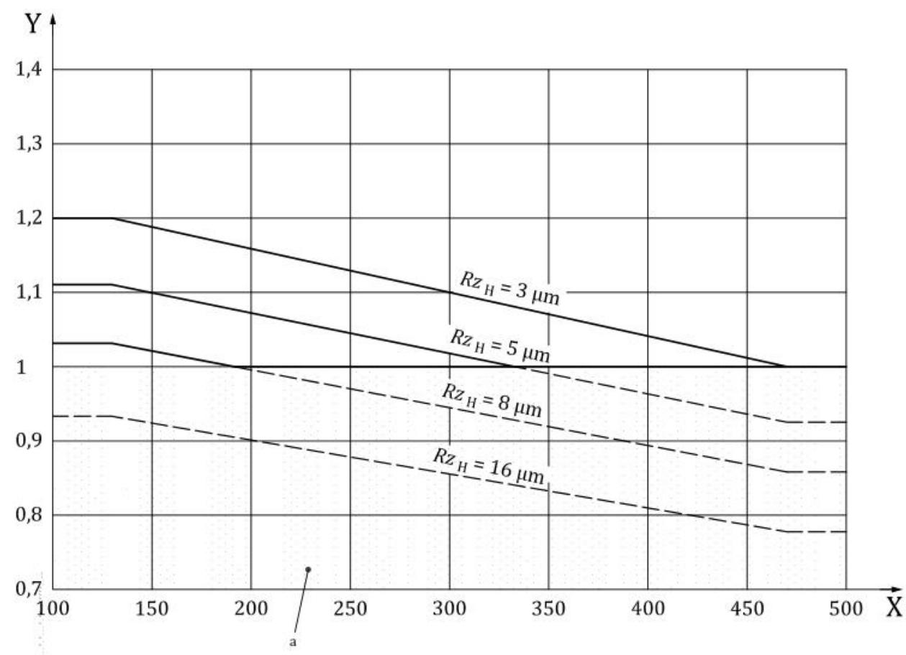  
X tooth flank hardness of softer wheel, HB  
Y work hardening factor, $Z_{\mathrm{W}}$  
a Shaded area: $Z_{W} = 1$ . Effects of wear (see 13.3.1.1).

Figure 10 — Work hardening factor, $Z_{\mathrm{W}}$ , for through-hardened gear/case-hardened pinion, reference stress

#### 13.3.1.3 $Z_{\mathrm{W}}$ for reference and long life stress, determination by calculation

For $130 \leq \mathrm{HB} \leq 470$ , $Z_{\mathrm{W}}$ for reference and long life stress is calculated as

$$
Z _ {\mathrm{W}} = \left(1,2 - \frac {\mathrm{HB} - 130}{1700}\right) \cdot \left(\frac {3}{R z _ {\mathrm{H}}}\right) ^ {0,15}\tag{59}
$$

where

HB is the Brinell hardness of the tooth flanks of the softer gear of the pair;

$Rz_{H}$ is the equivalent roughness according to Formula (58).

For HB $< 130$ :

$$
Z _ {\mathrm{W}} = 1,2 \left(\frac {3}{R z _ {\mathrm{H}}}\right) ^ {0,15}\tag{60}
$$

For HB > 470:

$$
Z _ {\mathrm{W}} = \left(\frac {3}{R z _ {\mathrm{H}}}\right) ^ {0,15}\tag{61}
$$

The calculated values for $Z_{W}$ are consistent with the curves in Figure 10.

#### 13.3.1.4 $Z_{\mathrm{W}}$ for static stress

For $130 \leq \mathrm{HB} \leq 470$ , $Z_{\mathrm{W}}$ for the static stress range is calculated as

$$
Z _ {\mathrm{W}} = 1,05 - \frac {\mathrm{HB} - 130}{6800}\tag{62}
$$

For HB $< 130$ :

$$
Z _ {\mathrm{W}} = 1,05\tag{63}
$$

For HB > 470:

$$
Z _ {\mathrm{W}} = 1\tag{64}
$$

### 13.3.2 Through-hardened steel pinion with through-hardened steel gear

#### 13.3.2.1 General

When the pinion is substantially harder than the gear the work hardening effect increases the load capacity of the gear flanks. $Z_{\mathrm{W}}$ applies to the gear only, not to the pinion.

The value of $Z_{W}$ is different for static, limited life, and reference stress (stress ranges, see Figure 6).

#### 13.3.2.2 $Z_{\mathrm{W}}$ for reference and long life stress, graphed values

Values of $Z_{\mathrm{W}}$ for long life stress may be taken from Figure 11.

#### 13.3.2.3 $Z_{\mathrm{W}}$ for reference and long life stress, determination by calculation

For $1,2 \leq \mathrm{HB}_{1} / \mathrm{HB}_{2} \leq 1,7$ , $Z_{\mathrm{W}}$ for long life stress is determined as

$$
Z _ {W} = 1,0 + A \cdot (u - 1,0)\tag{65}
$$

where

$$
A = 0,00898 \cdot \mathrm{HB} _ {1} / \mathrm{HB} _ {2} - 0,00829\tag{66}
$$

$HB_{1}$ is the Brinell hardness number of the pinion;

$HB_{2}$ is the Brinell hardness number of the gear;

u is the gear ratio; if u > 20 use u = 20.

For $\mathrm{HB}_1/\mathrm{HB}_2<1,2$:

$$
Z_{\mathrm{W}}=1,0\tag{67}
$$
  
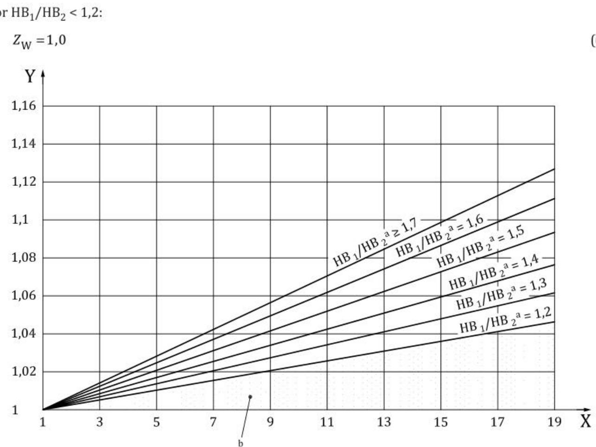

Key  
X gear ratio, $u$  
Y work hardening factor, $Z_{\mathrm{W}}$  
a Calculated hardness ratio.  
b For $\mathrm{HB}_1/\mathrm{HB}_2<1,2$, use $Z_{\mathrm{W}}=1,0$.  

Figure 11 — Work hardening factor, $Z_{\mathrm{W}}$ , for through-hardened gear and pinion

For $\mathrm{HB}_1 / \mathrm{HB}_2 > 1,7$ :

$$
Z _ {\mathrm{W}} = 1,0 + 0,00698 \cdot (u - 1,0)\tag{68}
$$

The calculated values for $Z_{W}$ are consistent with the curves in Figure 11.

#### 13.3.2.4 $Z_{\mathrm{W}}$ for static stress

For the static stress range, $Z_{W} = 1,0$ .

### 13.3.3 Surface-hardened steel pinion with ductile iron gear

#### 13.3.3.1 General

When the pinion is surface hardened significantly harder than the ductile iron gear the work hardening effect increases the load capacity of the gear flanks. $Z_{\mathrm{W}}$ applies to the gear only, not to the pinion.

The value of $Z_{W}$ is different for static, limited life and reference stress (stress ranges, see Figure 6).

#### 13.3.3.2 $Z_{\mathrm{W}}$ for reference and long life stress, graphed values

Values of $Z_{\mathrm{W}}$ for long life stress may be taken from Figure 12.

#### 13.3.3.3 $Z_{\mathrm{W}}$ for reference and long life stress, determination by calculation

For $162 \leq \mathrm{HB} \leq 344$ , $\mathbf{Z}_{\mathrm{W}}$ for long life stress is determined as

$$
Z _ {\mathrm{W}} = 1,2 - \frac {1,87 \cdot \mathrm{HB} - 303,6}{1700}\tag{69}
$$

For HB $< 162$ :

$$
Z _ {\mathrm{W}} = 1,2\tag{70}
$$

For HB > 344:

$$
Z _ {\mathrm{W}} = 1,0\tag{71}
$$

where HB is the Brinell hardness number of the gear.

#### 13.3.3.4 $Z_{\mathrm{W}}$ for static stress

For the static stress range, $Z_{W} = 1,0$ .

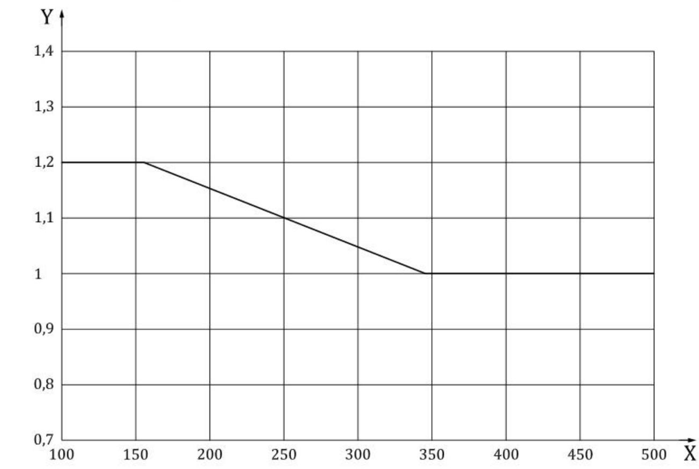  
X tooth flank hardness of softer wheel, HB  
Y work hardening factor, $Z_{W}$

Figure 12 — Work hardening factor, $Z_{\mathrm{W}}$ , for ductile cast iron gear/surface-hardened pinion, long life stress

# 14 Size factor, $Z_{X}$

By means of $Z_{X}$ , account is taken of statistical evidence indicating that the stress levels at which fatigue damage occurs decrease with an increase of the component size (larger number of weak points in structure), as a consequence of the influence on subsurface defects of the smaller stress gradients which occur (theoretical stress analysis) and the influence of size on material quality (effect on the forging process, variations in the structure, etc.). Important influence parameters are

a) material quality (furnace charge, cleanliness, forging),

b) heat treatment, depth of hardening, distribution of hardening,

c) radius of the flank curvature,

d) module, in the case of surface hardening, depth of the hardened layer relative to the size of the teeth (core supporting-effect).

In this document, $Z_{X}$ is taken to be 1,0.

# Bibliography

[1] ISO 54:1996, Cylindrical gears for general engineering and for heavy engineering — Modules

[2] ISO 701:1998, International gear notation — Symbols for geometrical data

[3] ISO 1328-1:2013, Cylindrical gears — ISO system of flank tolerance classification — Part 1: Definitions and allowable values of deviations relevant to flanks of gear teeth

[4] ISO 3448:1992, Industrial liquid lubricants — ISO viscosity classification

[5] ANSI/AGMA 2101-D04, Fundamental Rating Factors and Calculation Methods for Involute Spur and Helical Gear Teeth (Metric edition of ANSI/AGMA 2001-D04)

[6] ANSI/AGMA 9005-F16, Industrial Gear Lubrication

[7] DIN 3990, Tragfähigkeitsberechnung von Stirnrädern

[8] DIN 51509-1:1976, Auswahl von Schmiestoffen für Zahnradgetriebe; Schmieröle

[9] SAE J306:2017, Automotive Gear Lubricant Viscosity Classification

[10] TGL 10545:1963, Tragfähigkeitsberechnung von außenverzahnten Stirnrädern

[11] JOACHIM F.-J. Untersuchungen zur Grübchenbildung an vergüteten und normalisierten Zahnrädern (Einfluß von Werkstoffpaarung, Oberflächen- und Eigenspannungszustand). Doctoral dissertation, Technische Universität München, 1984

[12] NIEMANN G., WINTER H. Maschinenelemente, Band 2, Getriebe. Springer, Berlin 1983

[13] OSTER P. Beanspruchung der Zahnflanken unter Bedingungen der Elastohydrodynamik. Doctoral dissertation, Technische Universität München, 1982

[14] SIMON M. Messung von elasto-hydrodynamischen Parametern und ihre Auswirkung auf die Grübchentragfähigkeit vergüteter Scheiben und Zahnräder. Doctoral dissertation, Technische Universität München, 1984

ICS 21.200

Price based on 37 pages

© ISO 2019 — All rights reserved
