ISO 6336-3:2019(E)

INTERNATIONAL STANDARD

Third edition 2019-11

Corrected version 2020-11

Calculation of load capacity of spur and helical gears —

Part 3: Calculation of tooth bending strength

Calcul de la capacité de charge des engrenages cylindriques à dentures droite et hélicoïdale —

Partie 3: Calcul de la tenue en fatigue à la flexion en pied de dent

COPYRIGHT PROTECTED DOCUMENT

© ISO 2019

All rights reserved. Unless otherwise specified, or required in the context of its implementation, no part of this publication may be reproduced or utilized otherwise in any form or by any means, electronic or mechanical, including photocopying, or posting on the internet or an intranet, without prior written permission. Permission can be requested from either ISO at the address below or ISO's member body in the country of the requester.

ISO copyright office

CP 401 • Ch. de Blandonnet 8

CH-1214 Vernier, Geneva

Phone: +41 22 749 01 11

Email: copyright@iso.org

Website: www.iso.org

Published in Switzerland

# Contents

Foreword v  
Introduction vi  
1 Scope 1  
2 Normative references 1  
3 Terms, definitions, symbols and abbreviated terms 2  
3.1 Terms and definitions 2  
3.2 Symbols and abbreviated terms 2  
4 Tooth breakage and safety factors 7  
5 Basic formulae 7  
5.1 General 7  
5.2 Safety factor for bending strength (safety against tooth breakage), $S_{\mathrm{F}}$ 8  
5.3 Tooth root stress, $\sigma_{\mathrm{F}}$ 8  
5.3.1 General 8  
5.3.2 Method A 8  
5.3.3 Method B 8  
5.4 Permissible bending stress, $\sigma_{\mathrm{FP}}$ 10  
5.4.1 General 10  
5.4.2 Methods for determination of permissible bending stress, $\sigma_{\mathrm{FP}}$ — Principles, assumptions and application 10  
5.4.3 Permissible bending stress, $\sigma_{\mathrm{FP}}$ : Method B 11  
5.4.4 Permissible bending stress, $\sigma_{\mathrm{FP}}$ , for limited and long life: Method B 12  
6 Form factor, $Y_{\mathrm{F}}$ 14  
6.1 General 14  
6.2 Calculation of the form factor, $Y_{\mathrm{F}}$ : Method B 15  
6.2.1 General 15  
6.2.2 Parameters of virtual gears 17  
6.2.3 Tooth root normal chord, $s_{\mathrm{Fn}}$ , radius of root fillet, $\rho_{\mathrm{F}}$ , bending moment arm, $h_{\mathrm{Fe}}$ for external gears generated with a hob 18  
6.2.4 Tooth root normal chord, $s_{\mathrm{Fn}}$ , radius of root fillet, $\rho_{\mathrm{F}}$ , bending moment arm, $h_{\mathrm{Fe}}$ for external gears generated with a shaper cutter [^2] 19  
6.2.5 Tooth root normal chord, $s_{\mathrm{Fn}}$ , radius of root fillet, $\rho_{\mathrm{F}}$ , bending moment arm, $h_{\mathrm{Fe}}$ for internal gears generated with a shaper cutter [^2] 24  
7 Stress correction factor, $Y_{\mathrm{S}}$ 24  
7.1 Basic uses 24  
7.2 Stress correction factor, $Y_{\mathrm{S}}$ : Method B 24  
7.3 Stress correction factor for gears with notches in fillets 25  
7.4 Stress correction factor, $Y_{\mathrm{ST}}$ , relevant to the dimensions of the standard reference test gears 25  
8 Helix angle factor, $Y_{\beta}$ 26  
8.1 General 26  
8.2 Graphical value 26  
8.3 Determination by calculation 26  
9 Rim thickness factor, $Y_{\mathrm{B}}$ 27  
9.1 General 27  
9.2 Graphical values 27  
9.3 Determination by calculation 27  
9.3.1 External gears 27  
9.3.2 Internal gears 28  
10 Deep tooth factor, $Y_{\mathrm{DT}}$ 28  
10.1 General 28

10.2 Graphical values 28  
10.3 Determination by calculation 29

11 Reference stress for bending 29  
11.1 General 29  
11.2 Reference stress for Method A 29  
11.3 Reference stress, with values $\sigma_{\mathrm{Flim}}$ and $\sigma_{\mathrm{FE}}$ for Method B 29

12 Life factor, $Y_{\mathrm{NT}}$ 29  
12.1 General 29  
12.2 Life factor, $Y_{\mathrm{NT}}$ : Method A 30  
12.3 Life factor, $Y_{\mathrm{NT}}$ : Method B 30  
12.3.1 General 30  
12.3.2 Graphical values 30  
12.3.3 Determination by calculation 31

13 Notch sensitivity factor, $Y_{\delta \mathrm{T}}$ , and relative notch sensitivity factor, $Y_{\delta \mathrm{relT}}$ 32  
13.1 Basic uses 32  
13.2 Determination of the notch sensitivity factors 32  
13.2.1 General 32  
13.2.2 Method A 32  
13.2.3 Method B 32  
13.3 Relative notch sensitivity factor, $Y_{\delta \mathrm{relT}}$ : Method B 32  
13.3.1 Graphical values 32  
13.3.2 Determination by calculation 33

14 Surface factors, $Y_{\mathrm{R}}, Y_{\mathrm{RT}}$ , and relative surface factor, $Y_{\mathrm{RrelT}}$ 38  
14.1 Influence of surface condition 38  
14.2 Determination of surface factors and relative surface factors 39  
14.2.1 General 39  
14.2.2 Method A 39  
14.2.3 Method B 39  
14.3 Relative surface factor, $Y_{\mathrm{RrelT}}$ : Method B 39  
14.3.1 Graphical values 39  
14.3.2 Determination by calculation 40

15 Size factor, $Y_{X}$ 41  
15.1 General 41  
15.2 Size factor, $Y_{X}$ : Method A 41  
15.3 Size factor, $Y_{X}$ : Method B 41  
15.3.1 General 41  
15.3.2 Graphical values for reference stress and static stress 41  
15.3.3 Determination by calculation 42

Annex A (normative) Permissible bending stress, $\sigma_{\mathrm{FP}}$ , obtained from notched, flat or plain polished test pieces 44

Annex B (informative) Guide values for mean stress influence factor, $Y_{M}$ 52

Annex C (informative) Derivations of determinant normal tooth load of spur gears 54

Bibliography 55

# Foreword

ISO (the International Organization for Standardization) is a worldwide federation of national standards bodies (ISO member bodies). The work of preparing International Standards is normally carried out through ISO technical committees. Each member body interested in a subject for which a technical committee has been established has the right to be represented on that committee. International organizations, governmental and non-governmental, in liaison with ISO, also take part in the work. ISO collaborates closely with the International Electrotechnical Commission (IEC) on all matters of electrotechnical standardization.

The procedures used to develop this document and those intended for its further maintenance are described in the ISO/IEC Directives, Part 1. In particular, the different approval criteria needed for the different types of ISO documents should be noted. This document was drafted in accordance with the editorial rules of the ISO/IEC Directives, Part 2 (see www.iso.org/directives).

Attention is drawn to the possibility that some of the elements of this document may be the subject of patent rights. ISO shall not be held responsible for identifying any or all such patent rights. Details of any patent rights identified during the development of the document will be in the Introduction and/or on the ISO list of patent declarations received (see www.iso.org/patents).

Any trade name used in this document is information given for the convenience of users and does not constitute an endorsement.

For an explanation of the voluntary nature of standards, the meaning of ISO specific terms and expressions related to conformity assessment, as well as information about ISO's adherence to the World Trade Organization (WTO) principles in the Technical Barriers to Trade (TBT) see www.iso.org/iso/foreword.html.

This document was prepared by Technical Committee ISO/TC 60, Gears, Subcommittee SC 2, Gear capacity calculation.

This third edition cancels and replaces the second edition (ISO 6336-3:2006), which has been technically revised. It also incorporates the Technical Corrigendum ISO 6336-3:2006/Cor.1:2008.

The main changes compared to the previous edition are as follows:

— modification of the $Y_{\beta}$ factor in Clause 8 "Helix angle factor, $Y_{\beta}$ ";

— modification of the $Y_{F}$ factor in 6.2 “Calculation of the form factor, $Y_{F}$ : Method B”;

— integration of 6.2.4 "Tooth root normal chord, $s_{\mathrm{Fn}}$ , radius of root fillet, $\rho_{\mathrm{F}}$ , bending moment arm, $h_{\mathrm{Fe}}$ , for external gears generated with a shaper cutter";

— integration of 6.2.5 "Tooth root normal chord, $s_{\mathrm{Fn}}$ , radius of root fillet, $\rho_{\mathrm{F}}$ , bending moment arm, $h_{\mathrm{Fe}}$ , for internal gears generated with a shaper cutter";

— integration of a new Annex C.

A list of all parts in the ISO 6336 series can be found on the ISO website.

Any feedback or questions on this document should be directed to the user's national standards body. A complete listing of these bodies can be found at www.iso.org/members.html.

This corrected version of ISO 6336-3:2019 incorporates the following corrections:

— the indication of the $90^{\circ}$ angle in the middle of Figure 5 b) has been corrected.

# Introduction

ISO 6336 (all parts) consists of International Standards, Technical Specifications (TS) and Technical Reports (TR) under the general title Calculation of load capacity of spur and helical gears (see Table 1).

— International Standards contain calculation methods that are based on widely accepted practices and have been validated.

— Technical Specifications (TS) contain calculation methods that are still subject to further development.

— Technical Reports (TR) contain data that is informative, such as example calculations.

The procedures specified in parts 1 to 19 of the ISO 6336 series cover fatigue analyses for gear rating. The procedures described in parts 20 to 29 of the ISO 6336 series are predominantly related to the tribological behavior of the lubricated flank surface contact. Parts 30 to 39 of the ISO 6336 series include example calculations. The ISO 6336 series allows the addition of new parts under appropriate numbers to reflect knowledge gained in the future.

Requesting standardized calculations according to the ISO 6336 series without referring to specific parts requires the use of only those parts that are currently designated as International Standards (see Table 1 for listing). When requesting further calculations, the relevant part or parts of the ISO 6336 series need to be specified. Use of a Technical Specification as acceptance criteria for a specific design need to be agreed in advance between the manufacturer and the purchaser.

Table 1 — Parts of the ISO 6336 series (status as of DATE OF PUBLICATION)

| Calculation of load capacity of spur and helical gears | International Standard | Technical Specification | Technical Report |
| --- | --- | --- | --- |
| Part 1: Basic principles, introduction and general influence factors | X |  |  |
| Part 2: Calculation of surface durability (pitting) | X |  |  |
| Part 3: Calculation of tooth bending strength | X |  |  |
| Part 4: Calculation of tooth flank fracture load capacity |  | X |  |
| Part 5: Strength and quality of materials | X |  |  |
| Part 6: Calculation of service life under variable load | X |  |  |
| Part 20: Calculation of scuffing load capacity (also applicable to bevel and hypoid gears) — Flash temperature method (replaces: ISO/TR 13989-1) |  | X |  |
| Part 21: Calculation of scuffing load capacity (also applicable to bevel and hypoid gears) — Integral temperature method (replaces: ISO/TR 13989-2) |  | X |  |
| Part 22: Calculation of micropitting load capacity (replaces: ISO/TR 15144-1) |  | X |  |
| Part 30: Calculation examples for the application of ISO 6336 parts 1, 2, 3, 5 |  |  | X |
| Part 31: Calculation examples of micropitting load capacity (replaces: ISO/TR 15144-2) |  |  | X |

The maximum tensile stress at the tooth root, which may not exceed the permissible bending stress for the material, is the basis for rating the bending strength of gear teeth. The stress occurs in the “tension fillets” of the working tooth flanks. If load-induced cracks are formed, the first of these often appears in the fillets where the compressive stress is generated, i.e. in the “compression fillets”, which are those of the non-working flanks. When the tooth loading is unidirectional and the teeth are of conventional shape, these cracks seldom propagate to failure. Crack propagation ending in failure is most likely to stem from cracks initiated in tension fillets.

The endurable tooth loading of teeth subjected to a reversal of loading during each revolution, such as “idler gears”, is less than the endurable unidirectional loading. The full range of stress in such circumstances is more than twice the tensile stress occurring in the root fillets of the loaded flanks. This is taken into consideration when determining permissible stresses (see ISO 6336-5).

When gear rims are thin and tooth spaces adjacent to the root surface narrow (conditions which can particularly apply to some internal gears), initial cracks commonly occur in the compression fillet. Since, in such circumstances, gear rims themselves can suffer fatigue breakage, special studies are necessary. See Clause 1.

Several methods for calculating the critical tooth root stress and evaluating some of the relevant factors have been approved. See ISO 6336-1.

Calculation of load capacity of spur and helical gears —

Part 3:

Calculation of tooth bending strength

IMPORTANT — The user of this document is cautioned that when the method specified is used for large helix angles ( $\beta > 30^{\circ}$ ) and large normal pressure angles ( $\alpha_{n} > 25^{\circ}$ ), the calculated results should be confirmed by experience as by Method A.

# 1 Scope

This document specifies the fundamental formulae for use in tooth bending stress calculations for involute external or internal spur and helical gears with a rim thickness $s_{R} > 0.5 h_{t}$ for external gears and $s_{R} > 1.75 m_{n}$ for internal gears. In service, internal gears can experience failure modes other than tooth bending fatigue, i.e. fractures starting at the root diameter and progressing radially outward. This document does not provide adequate safety against failure modes other than tooth bending fatigue. All load influences on the tooth root stress are included in so far as they are the result of loads transmitted by the gears and in so far as they can be evaluated quantitatively.

This document includes procedures based on testing and theoretical studies such as those of Hirt $^{[11]}$ , Strasser $^{[14]}$ and Brossmann $^{[10]}$ . The results are in good agreement with other methods (References [5], [6], [7] and [12]). The given formulae are valid for spur and helical gears with tooth profiles in accordance with the basic rack standardized in ISO 53. They can also be used for teeth conjugate to other basic racks if the virtual contact ratio $\varepsilon_{\alpha n}$ is less than 2,5.

The load capacity determined on the basis of permissible bending stress is termed “tooth bending strength”. The results are in good agreement with other methods for the range, as indicated in the scope of ISO 6336-1.

If this scope does not apply, refer to ISO 6336-1:2019, Clause 4.

# 2 Normative references

The following documents are referred to in the text in such a way that some or all of their content constitutes requirements of this document. For dated references, only the edition cited applies. For undated references, the latest edition of the referenced document (including any amendments) applies.

ISO 53:1998, Cylindrical gears for general and heavy engineering — Standard basic rack tooth profile

ISO 1122-1:1998, Vocabulary of gear terms — Part 1: Definitions related to geometry

ISO 4287:1997, Geometrical Product Specifications (GPS) — Surface texture: Profile method — Terms, definitions and surface texture parameters

ISO 4287:1997/Cor 1:1998, Geometrical Product Specifications (GPS) — Surface texture: Profile method — Terms, definitions and surface texture parameters — TECHNICAL CORRIGENDUM 1

ISO 4287:1997/Cor 2:2005, Geometrical Product Specifications (GPS) — Surface texture: Profile method — Terms, definitions and surface texture parameters — TECHNICAL CORRIGENDUM 2

ISO 4287:1997/Amd 1:2009, Geometrical Product Specifications (GPS) — Surface texture: Profile method — Terms, definitions and surface texture parameters — AMENDMENT 1: Peak count number

ISO 4288:1996, Geometrical Product Specifications (GPS) — Surface texture: Profile method — Rules and procedures for the assessment of surface texture

ISO 6336-1, Calculation of load capacity of spur and helical gears — Part 1: Basic principles, introduction and general influence factors

ISO 6336-5, Calculation of load capacity of spur and helical gears — Part 5: Strength and quality of materials

# 3 Terms, definitions, symbols and abbreviated terms

## 3.1 Terms and definitions

For the purposes of this document, the terms and definitions given in ISO 1122-1:1998 and ISO 6336-1 apply.

ISO and IEC maintain terminological databases for use in standardisation at the following addresses:

— ISO Online browsing platform: available at https://www.iso.org/obp

— IEC Electropedia: available at http://electropedia.org/

## 3.2 Symbols and abbreviated terms

For the purposes of this document, the symbols and abbreviated terms given in ISO 1122-1:1998, ISO 6336-1 and Table 2 apply.

Table 2 — Abbreviated terms and symbols used in this document

<table>
<tr><td colspan="3">Abbreviated terms</td></tr>
<tr><td>Term</td><td colspan="2">Description</td></tr>
<tr><td>Eh</td><td colspan="2">material designation for case-hardened wrought steel</td></tr>
<tr><td>GG</td><td colspan="2">material designation for grey cast iron</td></tr>
<tr><td>GGG</td><td colspan="2">material designation for nodular cast iron (perlitic, bainitic, ferritic structure)</td></tr>
<tr><td>GTS</td><td colspan="2">material designation for black malleable cast iron (perlitic structure)</td></tr>
<tr><td>IF</td><td colspan="2">material designation for flame or induction hardened wrought special steel</td></tr>
<tr><td>M</td><td colspan="2">point</td></tr>
<tr><td>NT</td><td colspan="2">material designation for nitrided wrought steel, nitriding steel</td></tr>
<tr><td>NV</td><td colspan="2">material designation for through-hardened wrought steel, nitrided, nitrocarburized</td></tr>
<tr><td>St</td><td colspan="2">material designation for normalized base steel ( <math data-tex="\sigma_B &lt; 800 \text{ N/mm}^2" display="inline" xmlns="http://www.w3.org/1998/Math/MathML"><semantics><mrow><msub><mi>σ</mi><mi>B</mi></msub><mo>&lt;</mo><mn>800</mn><msup><mrow><mspace width="0.333em"></mspace><mtext mathvariant="normal"> N/mm</mtext></mrow><mn>2</mn></msup></mrow></semantics></math> )</td></tr>
<tr><td>V</td><td colspan="2">material designation for through-hardened wrought special steel, alloy or carbon ( <math data-tex="\sigma_B \geq 800 \text{ N/mm}^2" display="inline" xmlns="http://www.w3.org/1998/Math/MathML"><semantics><mrow><msub><mi>σ</mi><mi>B</mi></msub><mo>≥</mo><mn>800</mn><msup><mrow><mspace width="0.333em"></mspace><mtext mathvariant="normal"> N/mm</mtext></mrow><mn>2</mn></msup></mrow></semantics></math> )</td></tr>
<tr><td>X</td><td colspan="2">x-coordinate</td></tr>
<tr><td>Y</td><td colspan="2">y-coordinate</td></tr>
<tr><td colspan="3">a For external gears <math data-tex="a" display="inline" xmlns="http://www.w3.org/1998/Math/MathML"><semantics><mi>a</mi></semantics></math>, <math data-tex="d" display="inline" xmlns="http://www.w3.org/1998/Math/MathML"><semantics><mi>d</mi></semantics></math>, <math data-tex="d_a" display="inline" xmlns="http://www.w3.org/1998/Math/MathML"><semantics><msub><mi>d</mi><mi>a</mi></msub></semantics></math>, <math data-tex="z_1" display="inline" xmlns="http://www.w3.org/1998/Math/MathML"><semantics><msub><mi>z</mi><mn>1</mn></msub></semantics></math> and <math data-tex="z_2" display="inline" xmlns="http://www.w3.org/1998/Math/MathML"><semantics><msub><mi>z</mi><mn>2</mn></msub></semantics></math> are positive; for internal gearing, <math data-tex="a" display="inline" xmlns="http://www.w3.org/1998/Math/MathML"><semantics><mi>a</mi></semantics></math>, <math data-tex="d" display="inline" xmlns="http://www.w3.org/1998/Math/MathML"><semantics><mi>d</mi></semantics></math>, <math data-tex="d_a" display="inline" xmlns="http://www.w3.org/1998/Math/MathML"><semantics><msub><mi>d</mi><mi>a</mi></msub></semantics></math> and <math data-tex="z_2" display="inline" xmlns="http://www.w3.org/1998/Math/MathML"><semantics><msub><mi>z</mi><mn>2</mn></msub></semantics></math> have a negative sign, <math data-tex="z_1" display="inline" xmlns="http://www.w3.org/1998/Math/MathML"><semantics><msub><mi>z</mi><mn>1</mn></msub></semantics></math> has a positive sign. All calculated diameters have a negative sign for internal gearing.</td></tr>
</table>
Table 2 (continued)
<table>
<tr><td colspan="3">Symbols</td></tr>
<tr><td>Symbol</td><td>Description</td><td>Unit</td></tr>
<tr><td> <math data-tex="a_0" display="inline" xmlns="http://www.w3.org/1998/Math/MathML"><semantics><msub><mi>a</mi><mn>0</mn></msub></semantics></math> </td><td>manufacturing centre distance</td><td>mm</td></tr>
<tr><td>b</td><td>face width</td><td>mm</td></tr>
<tr><td> <math data-tex="b_B" display="inline" xmlns="http://www.w3.org/1998/Math/MathML"><semantics><msub><mi>b</mi><mi>B</mi></msub></semantics></math> </td><td>face width of one helix on a double helical gear</td><td>mm</td></tr>
<tr><td>d</td><td>diameter (without subscript, reference diametera)</td><td>mm</td></tr>
<tr><td> <math data-tex="d_a" display="inline" xmlns="http://www.w3.org/1998/Math/MathML"><semantics><msub><mi>d</mi><mi>a</mi></msub></semantics></math> </td><td>tip diametera</td><td>mm</td></tr>
<tr><td> <math data-tex="d_{an}" display="inline" xmlns="http://www.w3.org/1998/Math/MathML"><semantics><msub><mi>d</mi><mrow><mi>a</mi><mi>n</mi></mrow></msub></semantics></math> </td><td>tip diameter of virtual gear</td><td>mm</td></tr>
<tr><td> <math data-tex="d_b" display="inline" xmlns="http://www.w3.org/1998/Math/MathML"><semantics><msub><mi>d</mi><mi>b</mi></msub></semantics></math> </td><td>base diameter</td><td>mm</td></tr>
<tr><td> <math data-tex="d_{bn}" display="inline" xmlns="http://www.w3.org/1998/Math/MathML"><semantics><msub><mi>d</mi><mrow><mi>b</mi><mi>n</mi></mrow></msub></semantics></math> </td><td>base diameter of virtual gear</td><td>mm</td></tr>
<tr><td> <math data-tex="d_{b0}" display="inline" xmlns="http://www.w3.org/1998/Math/MathML"><semantics><msub><mi>d</mi><mrow><mi>b</mi><mn>0</mn></mrow></msub></semantics></math> </td><td>base diameter of the tool</td><td>mm</td></tr>
<tr><td> <math data-tex="d_{en}" display="inline" xmlns="http://www.w3.org/1998/Math/MathML"><semantics><msub><mi>d</mi><mrow><mi>e</mi><mi>n</mi></mrow></msub></semantics></math> </td><td>outer single contact diameter of virtual gears</td><td>mm</td></tr>
<tr><td> <math data-tex="d_n" display="inline" xmlns="http://www.w3.org/1998/Math/MathML"><semantics><msub><mi>d</mi><mi>n</mi></msub></semantics></math> </td><td>reference diameter of virtual spur gear</td><td>mm</td></tr>
<tr><td> <math data-tex="d_{Na}" display="inline" xmlns="http://www.w3.org/1998/Math/MathML"><semantics><msub><mi>d</mi><mrow><mi>N</mi><mi>a</mi></mrow></msub></semantics></math> </td><td>active tip diameter</td><td>mm</td></tr>
<tr><td> <math data-tex="d_w" display="inline" xmlns="http://www.w3.org/1998/Math/MathML"><semantics><msub><mi>d</mi><mi>w</mi></msub></semantics></math> </td><td>pitch diameter</td><td>mm</td></tr>
<tr><td> <math data-tex="d_0" display="inline" xmlns="http://www.w3.org/1998/Math/MathML"><semantics><msub><mi>d</mi><mn>0</mn></msub></semantics></math> </td><td>reference diameter of the tool</td><td>mm</td></tr>
<tr><td>E</td><td>auxiliary value</td><td>mm</td></tr>
<tr><td> <math data-tex="F_b" display="inline" xmlns="http://www.w3.org/1998/Math/MathML"><semantics><msub><mi>F</mi><mi>b</mi></msub></semantics></math> </td><td>(nominal) load (normal to the line of contact or transverse to the plane of action)</td><td>N</td></tr>
<tr><td> <math data-tex="F_{bn}" display="inline" xmlns="http://www.w3.org/1998/Math/MathML"><semantics><msub><mi>F</mi><mrow><mi>b</mi><mi>n</mi></mrow></msub></semantics></math> </td><td>(nominal) load, normal to the line of contact</td><td>N</td></tr>
<tr><td> <math data-tex="F_{bt}" display="inline" xmlns="http://www.w3.org/1998/Math/MathML"><semantics><msub><mi>F</mi><mrow><mi>b</mi><mi>t</mi></mrow></msub></semantics></math> </td><td>(nominal) transverse load in the plane of action (base tangent plane)</td><td>N</td></tr>
<tr><td> <math data-tex="F_{Rhigh}" display="inline" xmlns="http://www.w3.org/1998/Math/MathML"><semantics><msub><mi>F</mi><mrow><mi>R</mi><mi>h</mi><mi>i</mi><mi>g</mi><mi>h</mi></mrow></msub></semantics></math> </td><td>load per unit facewidth of the higher loaded flank</td><td>N/mm</td></tr>
<tr><td> <math data-tex="F_{Rlow}" display="inline" xmlns="http://www.w3.org/1998/Math/MathML"><semantics><msub><mi>F</mi><mrow><mi>R</mi><mi>l</mi><mi>o</mi><mi>w</mi></mrow></msub></semantics></math> </td><td>load per unit facewidth of lower loaded flank</td><td>N/mm</td></tr>
<tr><td> <math data-tex="F_t" display="inline" xmlns="http://www.w3.org/1998/Math/MathML"><semantics><msub><mi>F</mi><mi>t</mi></msub></semantics></math> </td><td>(nominal) transverse tangential load at reference cylinder per mesh</td><td>N</td></tr>
<tr><td> <math data-tex="F_w" display="inline" xmlns="http://www.w3.org/1998/Math/MathML"><semantics><msub><mi>F</mi><mi>w</mi></msub></semantics></math> </td><td>(nominal) tangential load at the pitch cylinder</td><td>N</td></tr>
<tr><td> <math data-tex="f_\varepsilon" display="inline" xmlns="http://www.w3.org/1998/Math/MathML"><semantics><msub><mi>f</mi><mi>ε</mi></msub></semantics></math> </td><td>load distribution influence factor</td><td>—</td></tr>
<tr><td>G</td><td>auxiliary value</td><td>—</td></tr>
<tr><td>H</td><td>auxiliary value</td><td>—</td></tr>
<tr><td> <math data-tex="h_{aP}" display="inline" xmlns="http://www.w3.org/1998/Math/MathML"><semantics><msub><mi>h</mi><mrow><mi>a</mi><mi>P</mi></mrow></msub></semantics></math> </td><td>addendum of basic rack of cylindrical gears</td><td>mm</td></tr>
<tr><td> <math data-tex="h_{aP0}" display="inline" xmlns="http://www.w3.org/1998/Math/MathML"><semantics><msub><mi>h</mi><mrow><mi>a</mi><mi>P</mi><mn>0</mn></mrow></msub></semantics></math> </td><td>addendum of tool</td><td>mm</td></tr>
<tr><td> <math data-tex="h_{Fe}" display="inline" xmlns="http://www.w3.org/1998/Math/MathML"><semantics><msub><mi>h</mi><mrow><mi>F</mi><mi>e</mi></mrow></msub></semantics></math> </td><td>bending moment arm for tooth root stress relevant to load application at the outer point of single pair tooth contact</td><td>mm</td></tr>
<tr><td> <math data-tex="h_{fP}" display="inline" xmlns="http://www.w3.org/1998/Math/MathML"><semantics><msub><mi>h</mi><mrow><mi>f</mi><mi>P</mi></mrow></msub></semantics></math> </td><td>dedendum of basic rack of cylindrical gears (ISO 53:1998 shall apply)</td><td>mm</td></tr>
<tr><td> <math data-tex="h_t" display="inline" xmlns="http://www.w3.org/1998/Math/MathML"><semantics><msub><mi>h</mi><mi>t</mi></msub></semantics></math> </td><td>tooth height</td><td>mm</td></tr>
<tr><td>K</td><td>distance of point M to the point of contact of the pitch circles</td><td>mm</td></tr>
<tr><td colspan="3">a For external gears <math data-tex="a" display="inline" xmlns="http://www.w3.org/1998/Math/MathML"><semantics><mi>a</mi></semantics></math>, <math data-tex="d" display="inline" xmlns="http://www.w3.org/1998/Math/MathML"><semantics><mi>d</mi></semantics></math>, <math data-tex="d_a" display="inline" xmlns="http://www.w3.org/1998/Math/MathML"><semantics><msub><mi>d</mi><mi>a</mi></msub></semantics></math>, <math data-tex="z_1" display="inline" xmlns="http://www.w3.org/1998/Math/MathML"><semantics><msub><mi>z</mi><mn>1</mn></msub></semantics></math> and <math data-tex="z_2" display="inline" xmlns="http://www.w3.org/1998/Math/MathML"><semantics><msub><mi>z</mi><mn>2</mn></msub></semantics></math> are positive; for internal gearing, <math data-tex="a" display="inline" xmlns="http://www.w3.org/1998/Math/MathML"><semantics><mi>a</mi></semantics></math>, <math data-tex="d" display="inline" xmlns="http://www.w3.org/1998/Math/MathML"><semantics><mi>d</mi></semantics></math>, <math data-tex="d_a" display="inline" xmlns="http://www.w3.org/1998/Math/MathML"><semantics><msub><mi>d</mi><mi>a</mi></msub></semantics></math> and <math data-tex="z_2" display="inline" xmlns="http://www.w3.org/1998/Math/MathML"><semantics><msub><mi>z</mi><mn>2</mn></msub></semantics></math> have a negative sign, <math data-tex="z_1" display="inline" xmlns="http://www.w3.org/1998/Math/MathML"><semantics><msub><mi>z</mi><mn>1</mn></msub></semantics></math> has a positive sign. All calculated diameters have a negative sign for internal gearing.</td></tr>
</table>
Table 2 (continued)
<table>
<tr><th>Symbol</th><th>Description</th><th>Unit</th></tr>
<tr><td> <math data-tex="K_{\text{A}}" display="inline" xmlns="http://www.w3.org/1998/Math/MathML"><semantics><msub><mi>K</mi><mtext mathvariant="normal">A</mtext></msub></semantics></math> </td><td>application factor</td><td>—</td></tr>
<tr><td> <math data-tex="K_{\text{F}\alpha}" display="inline" xmlns="http://www.w3.org/1998/Math/MathML"><semantics><msub><mi>K</mi><mrow><mtext mathvariant="normal">F</mtext><mi>α</mi></mrow></msub></semantics></math> </td><td>transverse load factor (root stress)</td><td>—</td></tr>
<tr><td> <math data-tex="K_{\text{F}\beta}" display="inline" xmlns="http://www.w3.org/1998/Math/MathML"><semantics><msub><mi>K</mi><mrow><mtext mathvariant="normal">F</mtext><mi>β</mi></mrow></msub></semantics></math> </td><td>face load factor (root stress)</td><td>—</td></tr>
<tr><td> <math data-tex="K_{\text{v}}" display="inline" xmlns="http://www.w3.org/1998/Math/MathML"><semantics><msub><mi>K</mi><mtext mathvariant="normal">v</mtext></msub></semantics></math> </td><td>dynamic factor</td><td>—</td></tr>
<tr><td> <math data-tex="K_{\gamma}" display="inline" xmlns="http://www.w3.org/1998/Math/MathML"><semantics><msub><mi>K</mi><mi>γ</mi></msub></semantics></math> </td><td>mesh load factor</td><td>—</td></tr>
<tr><td>L</td><td>auxiliary value</td><td>—</td></tr>
<tr><td>M</td><td>mean stress ratio</td><td></td></tr>
<tr><td> <math data-tex="m_{\text{n}}" display="inline" xmlns="http://www.w3.org/1998/Math/MathML"><semantics><msub><mi>m</mi><mtext mathvariant="normal">n</mtext></msub></semantics></math> </td><td>normal module</td><td>mm</td></tr>
<tr><td> <math data-tex="N_{\text{L}}" display="inline" xmlns="http://www.w3.org/1998/Math/MathML"><semantics><msub><mi>N</mi><mtext mathvariant="normal">L</mtext></msub></semantics></math> </td><td>number of load cycles</td><td>—</td></tr>
<tr><td> <math data-tex="p_{\text{bn}}" display="inline" xmlns="http://www.w3.org/1998/Math/MathML"><semantics><msub><mi>p</mi><mtext mathvariant="normal">bn</mtext></msub></semantics></math> </td><td>normal base pitch</td><td>mm</td></tr>
<tr><td>pr</td><td>protuberance of the tool</td><td>mm</td></tr>
<tr><td>q</td><td>material allowance for finish machining per flank</td><td>mm</td></tr>
<tr><td> <math data-tex="q_{\text{s}}" display="inline" xmlns="http://www.w3.org/1998/Math/MathML"><semantics><msub><mi>q</mi><mtext mathvariant="normal">s</mtext></msub></semantics></math> </td><td>notch parameter,  <math data-tex="q_{\text{s}} = s_{\text{Fn}}/2\rho_{\text{F}}" display="inline" xmlns="http://www.w3.org/1998/Math/MathML"><semantics><mrow><msub><mi>q</mi><mtext mathvariant="normal">s</mtext></msub><mo>=</mo><msub><mi>s</mi><mtext mathvariant="normal">Fn</mtext></msub><mi>/</mi><mn>2</mn><msub><mi>ρ</mi><mtext mathvariant="normal">F</mtext></msub></mrow></semantics></math> </td><td>—</td></tr>
<tr><td> <math data-tex="q_{\text{sk}}" display="inline" xmlns="http://www.w3.org/1998/Math/MathML"><semantics><msub><mi>q</mi><mtext mathvariant="normal">sk</mtext></msub></semantics></math> </td><td>notch parameter of the notched test piece</td><td>—</td></tr>
<tr><td> <math data-tex="q_{\text{sT}}" display="inline" xmlns="http://www.w3.org/1998/Math/MathML"><semantics><msub><mi>q</mi><mtext mathvariant="normal">sT</mtext></msub></semantics></math> </td><td>notch parameter of the standard reference test gear</td><td>—</td></tr>
<tr><td>R</td><td>stress ratio</td><td>—</td></tr>
<tr><td> <math data-tex="Rz" display="inline" xmlns="http://www.w3.org/1998/Math/MathML"><semantics><mrow><mi>R</mi><mi>z</mi></mrow></semantics></math> </td><td>mean peak-to-valley roughness (ISO 4287:1997 including ISO 4287:1997/Cor 1:1998, ISO 4287:1997/Cor 2:2005, ISO 4287:1997/Amd 1:2009 and ISO 4288:1996 shall apply)</td><td>μm</td></tr>
<tr><td> <math data-tex="Rz_{\text{k}}" display="inline" xmlns="http://www.w3.org/1998/Math/MathML"><semantics><mrow><mi>R</mi><msub><mi>z</mi><mtext mathvariant="normal">k</mtext></msub></mrow></semantics></math> </td><td>mean peak-to-valley roughness of the notched, rough test piece</td><td>μm</td></tr>
<tr><td> <math data-tex="Rz_{\text{T}}" display="inline" xmlns="http://www.w3.org/1998/Math/MathML"><semantics><mrow><mi>R</mi><msub><mi>z</mi><mtext mathvariant="normal">T</mtext></msub></mrow></semantics></math> </td><td>mean peak-to-valley roughness in the fillet of standard reference gears (see ISO/TR 10064-4)</td><td>μm</td></tr>
<tr><td>r</td><td>radius</td><td>mm</td></tr>
<tr><td> <math data-tex="r_{\text{a0}}" display="inline" xmlns="http://www.w3.org/1998/Math/MathML"><semantics><msub><mi>r</mi><mtext mathvariant="normal">a0</mtext></msub></semantics></math> </td><td>tip radius of tool</td><td>mm</td></tr>
<tr><td> <math data-tex="r_{\text{b0}}" display="inline" xmlns="http://www.w3.org/1998/Math/MathML"><semantics><msub><mi>r</mi><mtext mathvariant="normal">b0</mtext></msub></semantics></math> </td><td>base radius of the tool</td><td>mm</td></tr>
<tr><td> <math data-tex="r_{\text{M}}" display="inline" xmlns="http://www.w3.org/1998/Math/MathML"><semantics><msub><mi>r</mi><mtext mathvariant="normal">M</mtext></msub></semantics></math> </td><td>radius for the centre of the tool tip radius</td><td>mm</td></tr>
<tr><td> <math data-tex="r_{\text{w}}" display="inline" xmlns="http://www.w3.org/1998/Math/MathML"><semantics><msub><mi>r</mi><mtext mathvariant="normal">w</mtext></msub></semantics></math> </td><td>manufacturing pitch circle radius</td><td>mm</td></tr>
<tr><td> <math data-tex="r_{\text{w0}}" display="inline" xmlns="http://www.w3.org/1998/Math/MathML"><semantics><msub><mi>r</mi><mtext mathvariant="normal">w0</mtext></msub></semantics></math> </td><td>manufacturing pitch circle radius of tool</td><td>mm</td></tr>
<tr><td>S</td><td>safety factor</td><td>—</td></tr>
<tr><td> <math data-tex="S_{\text{F}}" display="inline" xmlns="http://www.w3.org/1998/Math/MathML"><semantics><msub><mi>S</mi><mtext mathvariant="normal">F</mtext></msub></semantics></math> </td><td>safety factor for tooth breakage</td><td>—</td></tr>
<tr><td> <math data-tex="S_{\text{Fmin}}" display="inline" xmlns="http://www.w3.org/1998/Math/MathML"><semantics><msub><mi>S</mi><mtext mathvariant="normal">Fmin</mtext></msub></semantics></math> </td><td>minimum required safety factor for tooth root stress</td><td>—</td></tr>
<tr><td> <math data-tex="s_{\text{Fn}}" display="inline" xmlns="http://www.w3.org/1998/Math/MathML"><semantics><msub><mi>s</mi><mtext mathvariant="normal">Fn</mtext></msub></semantics></math> </td><td>tooth root chord at the critical section</td><td>mm</td></tr>
<tr><td> <math data-tex="s_{\text{pr}}" display="inline" xmlns="http://www.w3.org/1998/Math/MathML"><semantics><msub><mi>s</mi><mtext mathvariant="normal">pr</mtext></msub></semantics></math> </td><td>residual fillet undercut,  <math data-tex="s_{\text{pr}} = pr - q" display="inline" xmlns="http://www.w3.org/1998/Math/MathML"><semantics><mrow><msub><mi>s</mi><mtext mathvariant="normal">pr</mtext></msub><mo>=</mo><mi>p</mi><mi>r</mi><mo>−</mo><mi>q</mi></mrow></semantics></math> </td><td>mm</td></tr>
<tr><td> <math data-tex="s_{\text{R}}" display="inline" xmlns="http://www.w3.org/1998/Math/MathML"><semantics><msub><mi>s</mi><mtext mathvariant="normal">R</mtext></msub></semantics></math> </td><td>rim thickness</td><td>mm</td></tr>
<tr><td colspan="3">a For external gears <math data-tex="a" display="inline" xmlns="http://www.w3.org/1998/Math/MathML"><semantics><mi>a</mi></semantics></math>, <math data-tex="d" display="inline" xmlns="http://www.w3.org/1998/Math/MathML"><semantics><mi>d</mi></semantics></math>, <math data-tex="d_a" display="inline" xmlns="http://www.w3.org/1998/Math/MathML"><semantics><msub><mi>d</mi><mi>a</mi></msub></semantics></math>, <math data-tex="z_1" display="inline" xmlns="http://www.w3.org/1998/Math/MathML"><semantics><msub><mi>z</mi><mn>1</mn></msub></semantics></math> and <math data-tex="z_2" display="inline" xmlns="http://www.w3.org/1998/Math/MathML"><semantics><msub><mi>z</mi><mn>2</mn></msub></semantics></math> are positive; for internal gearing, <math data-tex="a" display="inline" xmlns="http://www.w3.org/1998/Math/MathML"><semantics><mi>a</mi></semantics></math>, <math data-tex="d" display="inline" xmlns="http://www.w3.org/1998/Math/MathML"><semantics><mi>d</mi></semantics></math>, <math data-tex="d_a" display="inline" xmlns="http://www.w3.org/1998/Math/MathML"><semantics><msub><mi>d</mi><mi>a</mi></msub></semantics></math> and <math data-tex="z_2" display="inline" xmlns="http://www.w3.org/1998/Math/MathML"><semantics><msub><mi>z</mi><mn>2</mn></msub></semantics></math> have a negative sign, <math data-tex="z_1" display="inline" xmlns="http://www.w3.org/1998/Math/MathML"><semantics><msub><mi>z</mi><mn>1</mn></msub></semantics></math> has a positive sign. All calculated diameters have a negative sign for internal gearing.</td></tr>
</table>
Table 2 (continued)
<table>
<tr><th>Symbol</th><th>Description</th><th>Unit</th></tr>
<tr><td>T</td><td>auxiliary value</td><td>—</td></tr>
<tr><td> <math data-tex="t_g" display="inline" xmlns="http://www.w3.org/1998/Math/MathML"><semantics><msub><mi>t</mi><mi>g</mi></msub></semantics></math> </td><td>maximum depth of grinding notch</td><td>mm</td></tr>
<tr><td> <math data-tex="u_0" display="inline" xmlns="http://www.w3.org/1998/Math/MathML"><semantics><msub><mi>u</mi><mn>0</mn></msub></semantics></math> </td><td>manufacturing tooth ratio</td><td>—</td></tr>
<tr><td> <math data-tex="X_M" display="inline" xmlns="http://www.w3.org/1998/Math/MathML"><semantics><msub><mi>X</mi><mi>M</mi></msub></semantics></math> </td><td>x-coordinate of point M</td><td>mm</td></tr>
<tr><td>x</td><td>profile shift coefficient</td><td>—</td></tr>
<tr><td> <math data-tex="x_{E\ min}" display="inline" xmlns="http://www.w3.org/1998/Math/MathML"><semantics><msub><mi>x</mi><mrow><mi>E</mi><mspace width="0.222em"></mspace><mi>m</mi><mi>i</mi><mi>n</mi></mrow></msub></semantics></math> </td><td>smallest generating profile shift</td><td>—</td></tr>
<tr><td> <math data-tex="x_0" display="inline" xmlns="http://www.w3.org/1998/Math/MathML"><semantics><msub><mi>x</mi><mn>0</mn></msub></semantics></math> </td><td>profile shift coefficient of the tool</td><td>—</td></tr>
<tr><td> <math data-tex="Y_B" display="inline" xmlns="http://www.w3.org/1998/Math/MathML"><semantics><msub><mi>Y</mi><mi>B</mi></msub></semantics></math> </td><td>rim thickness factor, which adjusts the calculated tooth root stress for thin rimmed gears</td><td>—</td></tr>
<tr><td> <math data-tex="Y_{DT}" display="inline" xmlns="http://www.w3.org/1998/Math/MathML"><semantics><msub><mi>Y</mi><mrow><mi>D</mi><mi>T</mi></mrow></msub></semantics></math> </td><td>deep tooth factor</td><td>—</td></tr>
<tr><td> <math data-tex="Y_F" display="inline" xmlns="http://www.w3.org/1998/Math/MathML"><semantics><msub><mi>Y</mi><mi>F</mi></msub></semantics></math> </td><td>tooth form factor, for the influence on nominal tooth root stress with load applied at the outer point of single pair tooth contact</td><td>—</td></tr>
<tr><td> <math data-tex="Y_M" display="inline" xmlns="http://www.w3.org/1998/Math/MathML"><semantics><msub><mi>Y</mi><mi>M</mi></msub></semantics></math> </td><td>mean stress influence factor (see Annex B)</td><td>—</td></tr>
<tr><td> <math data-tex="Y_M" display="inline" xmlns="http://www.w3.org/1998/Math/MathML"><semantics><msub><mi>Y</mi><mi>M</mi></msub></semantics></math> </td><td>y-coordinate of point M</td><td>mm</td></tr>
<tr><td> <math data-tex="Y_{Nk}" display="inline" xmlns="http://www.w3.org/1998/Math/MathML"><semantics><msub><mi>Y</mi><mrow><mi>N</mi><mi>k</mi></mrow></msub></semantics></math> </td><td>life factor for tooth root stress, relevant to the notched test piece</td><td>—</td></tr>
<tr><td> <math data-tex="Y_{Np}" display="inline" xmlns="http://www.w3.org/1998/Math/MathML"><semantics><msub><mi>Y</mi><mrow><mi>N</mi><mi>p</mi></mrow></msub></semantics></math> </td><td>life factor for tooth root stress, relevant to the plain polished test piece</td><td>—</td></tr>
<tr><td> <math data-tex="Y_{NT}" display="inline" xmlns="http://www.w3.org/1998/Math/MathML"><semantics><msub><mi>Y</mi><mrow><mi>N</mi><mi>T</mi></mrow></msub></semantics></math> </td><td>life factor for tooth root stress for reference test conditions</td><td>—</td></tr>
<tr><td> <math data-tex="Y_R" display="inline" xmlns="http://www.w3.org/1998/Math/MathML"><semantics><msub><mi>Y</mi><mi>R</mi></msub></semantics></math> </td><td>tooth root surface factor (relevant to the plain polished test piece)</td><td>—</td></tr>
<tr><td> <math data-tex="Y_{Rk}" display="inline" xmlns="http://www.w3.org/1998/Math/MathML"><semantics><msub><mi>Y</mi><mrow><mi>R</mi><mi>k</mi></mrow></msub></semantics></math> </td><td>surface factor</td><td>—</td></tr>
<tr><td> <math data-tex="Y_{R0}" display="inline" xmlns="http://www.w3.org/1998/Math/MathML"><semantics><msub><mi>Y</mi><mrow><mi>R</mi><mn>0</mn></mrow></msub></semantics></math> </td><td>surface factor of the plain, polished test piece</td><td>—</td></tr>
<tr><td> <math data-tex="Y_{R\ rel k}" display="inline" xmlns="http://www.w3.org/1998/Math/MathML"><semantics><msub><mi>Y</mi><mrow><mi>R</mi><mspace width="0.222em"></mspace><mi>r</mi><mi>e</mi><mi>l</mi><mi>k</mi></mrow></msub></semantics></math> </td><td>relative roughness factor, the quotient of the gear tooth root surface factor of interest divided by the notch test piece factor,  <math data-tex="Y_{R\ rel k}=Y_R/Y_{Rk}" display="inline" xmlns="http://www.w3.org/1998/Math/MathML"><semantics><mrow><msub><mi>Y</mi><mrow><mi>R</mi><mspace width="0.222em"></mspace><mi>r</mi><mi>e</mi><mi>l</mi><mi>k</mi></mrow></msub><mo>=</mo><msub><mi>Y</mi><mi>R</mi></msub><mi>/</mi><msub><mi>Y</mi><mrow><mi>R</mi><mi>k</mi></mrow></msub></mrow></semantics></math> </td><td>—</td></tr>
<tr><td> <math data-tex="Y_{R\ rel T}" display="inline" xmlns="http://www.w3.org/1998/Math/MathML"><semantics><msub><mi>Y</mi><mrow><mi>R</mi><mspace width="0.222em"></mspace><mi>r</mi><mi>e</mi><mi>l</mi><mi>T</mi></mrow></msub></semantics></math> </td><td>relative surface factor, the quotient of the gear tooth root surface factor of interest divided by the tooth root surface factor of the reference test gear,  <math data-tex="Y_{R\ rel T}=Y_R/Y_{RT}" display="inline" xmlns="http://www.w3.org/1998/Math/MathML"><semantics><mrow><msub><mi>Y</mi><mrow><mi>R</mi><mspace width="0.222em"></mspace><mi>r</mi><mi>e</mi><mi>l</mi><mi>T</mi></mrow></msub><mo>=</mo><msub><mi>Y</mi><mi>R</mi></msub><mi>/</mi><msub><mi>Y</mi><mrow><mi>R</mi><mi>T</mi></mrow></msub></mrow></semantics></math> </td><td>—</td></tr>
<tr><td> <math data-tex="Y_{RT}" display="inline" xmlns="http://www.w3.org/1998/Math/MathML"><semantics><msub><mi>Y</mi><mrow><mi>R</mi><mi>T</mi></mrow></msub></semantics></math> </td><td>tooth root surface factor of the reference test gears</td><td>—</td></tr>
<tr><td> <math data-tex="Y_S" display="inline" xmlns="http://www.w3.org/1998/Math/MathML"><semantics><msub><mi>Y</mi><mi>S</mi></msub></semantics></math> </td><td>stress correction factor, for the conversion of the nominal tooth root stress, determined for application of load at the outer point of single pair tooth contact, to the local tooth root stress</td><td>—</td></tr>
<tr><td> <math data-tex="Y_{Sg}" display="inline" xmlns="http://www.w3.org/1998/Math/MathML"><semantics><msub><mi>Y</mi><mrow><mi>S</mi><mi>g</mi></mrow></msub></semantics></math> </td><td>stress correction factor, relevant to the notched piece</td><td>—</td></tr>
<tr><td> <math data-tex="Y_{Sk}" display="inline" xmlns="http://www.w3.org/1998/Math/MathML"><semantics><msub><mi>Y</mi><mrow><mi>S</mi><mi>k</mi></mrow></msub></semantics></math> </td><td>stress correction factor, relevant to the notched test piece</td><td>—</td></tr>
<tr><td> <math data-tex="Y_{ST}" display="inline" xmlns="http://www.w3.org/1998/Math/MathML"><semantics><msub><mi>Y</mi><mrow><mi>S</mi><mi>T</mi></mrow></msub></semantics></math> </td><td>stress correction factor, relevant to the dimensions of the reference test gears</td><td>—</td></tr>
<tr><td> <math data-tex="Y_X" display="inline" xmlns="http://www.w3.org/1998/Math/MathML"><semantics><msub><mi>Y</mi><mi>X</mi></msub></semantics></math> </td><td>size factor (tooth root)</td><td>—</td></tr>
<tr><td> <math data-tex="Y_\beta" display="inline" xmlns="http://www.w3.org/1998/Math/MathML"><semantics><msub><mi>Y</mi><mi>β</mi></msub></semantics></math> </td><td>helix angle factor (tooth root)</td><td>—</td></tr>
<tr><td> <math data-tex="Y_\delta" display="inline" xmlns="http://www.w3.org/1998/Math/MathML"><semantics><msub><mi>Y</mi><mi>δ</mi></msub></semantics></math> </td><td>notch sensitivity factor of the actual gear (relative to a polished test piece)</td><td>—</td></tr>
<tr><td colspan="3">a For external gears <math data-tex="a" display="inline" xmlns="http://www.w3.org/1998/Math/MathML"><semantics><mi>a</mi></semantics></math>, <math data-tex="d" display="inline" xmlns="http://www.w3.org/1998/Math/MathML"><semantics><mi>d</mi></semantics></math>, <math data-tex="d_a" display="inline" xmlns="http://www.w3.org/1998/Math/MathML"><semantics><msub><mi>d</mi><mi>a</mi></msub></semantics></math>, <math data-tex="z_1" display="inline" xmlns="http://www.w3.org/1998/Math/MathML"><semantics><msub><mi>z</mi><mn>1</mn></msub></semantics></math> and <math data-tex="z_2" display="inline" xmlns="http://www.w3.org/1998/Math/MathML"><semantics><msub><mi>z</mi><mn>2</mn></msub></semantics></math> are positive; for internal gearing, <math data-tex="a" display="inline" xmlns="http://www.w3.org/1998/Math/MathML"><semantics><mi>a</mi></semantics></math>, <math data-tex="d" display="inline" xmlns="http://www.w3.org/1998/Math/MathML"><semantics><mi>d</mi></semantics></math>, <math data-tex="d_a" display="inline" xmlns="http://www.w3.org/1998/Math/MathML"><semantics><msub><mi>d</mi><mi>a</mi></msub></semantics></math> and <math data-tex="z_2" display="inline" xmlns="http://www.w3.org/1998/Math/MathML"><semantics><msub><mi>z</mi><mn>2</mn></msub></semantics></math> have a negative sign, <math data-tex="z_1" display="inline" xmlns="http://www.w3.org/1998/Math/MathML"><semantics><msub><mi>z</mi><mn>1</mn></msub></semantics></math> has a positive sign. All calculated diameters have a negative sign for internal gearing.</td></tr>
</table>
Table 2 (continued)
<table>
<tr><th>Symbol</th><th>Description</th><th>Unit</th></tr>
<tr><td> <math data-tex="Y_{\delta k}" display="inline" xmlns="http://www.w3.org/1998/Math/MathML"><semantics><msub><mi>Y</mi><mrow><mi>δ</mi><mi>k</mi></mrow></msub></semantics></math> </td><td>notch sensitivity factor of a notched test piece, relative to a smooth polished test piece</td><td>—</td></tr>
<tr><td> <math data-tex="Y_{\delta T}" display="inline" xmlns="http://www.w3.org/1998/Math/MathML"><semantics><msub><mi>Y</mi><mrow><mi>δ</mi><mi>T</mi></mrow></msub></semantics></math> </td><td>notch sensitivity factor of the standard reference test gear, relative to the smooth polished test piece</td><td>—</td></tr>
<tr><td> <math data-tex="Y_{\delta relT}" display="inline" xmlns="http://www.w3.org/1998/Math/MathML"><semantics><msub><mi>Y</mi><mrow><mi>δ</mi><mi>r</mi><mi>e</mi><mi>l</mi><mi>T</mi></mrow></msub></semantics></math> </td><td>relative notch sensitivity factor, the quotient of the gear notch sensitivity factor of interest divided by the notch sensitivity factor of the standard reference test gear, <math data-tex="Y_{\delta relT} = Y_{\delta} / Y_{\delta T}" display="inline" xmlns="http://www.w3.org/1998/Math/MathML"><semantics><mrow><msub><mi>Y</mi><mrow><mi>δ</mi><mi>r</mi><mi>e</mi><mi>l</mi><mi>T</mi></mrow></msub><mo>=</mo><msub><mi>Y</mi><mi>δ</mi></msub><mi>/</mi><msub><mi>Y</mi><mrow><mi>δ</mi><mi>T</mi></mrow></msub></mrow></semantics></math> </td><td>—</td></tr>
<tr><td>y</td><td>auxiliary value</td><td>° or rad</td></tr>
<tr><td> <math data-tex="y&#x27;" display="inline" xmlns="http://www.w3.org/1998/Math/MathML"><semantics><msup><mi>y</mi><mo>′</mo></msup></semantics></math> </td><td>auxiliary value</td><td>—</td></tr>
<tr><td>z</td><td>number of teetha</td><td>—</td></tr>
<tr><td> <math data-tex="z_n" display="inline" xmlns="http://www.w3.org/1998/Math/MathML"><semantics><msub><mi>z</mi><mi>n</mi></msub></semantics></math> </td><td>virtual number of teeth of a helical gear</td><td>—</td></tr>
<tr><td> <math data-tex="z_0" display="inline" xmlns="http://www.w3.org/1998/Math/MathML"><semantics><msub><mi>z</mi><mn>0</mn></msub></semantics></math> </td><td>number of teeth of the tool</td><td>—</td></tr>
<tr><td> <math data-tex="z_{0v}" display="inline" xmlns="http://www.w3.org/1998/Math/MathML"><semantics><msub><mi>z</mi><mrow><mn>0</mn><mi>v</mi></mrow></msub></semantics></math> </td><td>equivalent number of teeth of the tool</td><td>—</td></tr>
<tr><td> <math data-tex="\alpha_{en}" display="inline" xmlns="http://www.w3.org/1998/Math/MathML"><semantics><msub><mi>α</mi><mrow><mi>e</mi><mi>n</mi></mrow></msub></semantics></math> </td><td>profile angle at the outer point of a single pair tooth contact of virtual spur gears</td><td>°</td></tr>
<tr><td> <math data-tex="\alpha_{Fen}" display="inline" xmlns="http://www.w3.org/1998/Math/MathML"><semantics><msub><mi>α</mi><mrow><mi>F</mi><mi>e</mi><mi>n</mi></mrow></msub></semantics></math> </td><td>load direction angle, relevant to direction of application of load at the outer point of single pair tooth contact of virtual spur gears</td><td>°</td></tr>
<tr><td> <math data-tex="\alpha_M" display="inline" xmlns="http://www.w3.org/1998/Math/MathML"><semantics><msub><mi>α</mi><mi>M</mi></msub></semantics></math> </td><td>transverse pressure angle for the radius at the point M</td><td>°</td></tr>
<tr><td> <math data-tex="\alpha_n" display="inline" xmlns="http://www.w3.org/1998/Math/MathML"><semantics><msub><mi>α</mi><mi>n</mi></msub></semantics></math> </td><td>normal pressure angle</td><td>°</td></tr>
<tr><td> <math data-tex="\alpha_w" display="inline" xmlns="http://www.w3.org/1998/Math/MathML"><semantics><msub><mi>α</mi><mi>w</mi></msub></semantics></math> </td><td>working pressure angle</td><td>°</td></tr>
<tr><td> <math data-tex="\alpha_{w0}" display="inline" xmlns="http://www.w3.org/1998/Math/MathML"><semantics><msub><mi>α</mi><mrow><mi>w</mi><mn>0</mn></mrow></msub></semantics></math> </td><td>operating pressure angle of the manufacturing pairing</td><td>°</td></tr>
<tr><td> <math data-tex="\alpha_x" display="inline" xmlns="http://www.w3.org/1998/Math/MathML"><semantics><msub><mi>α</mi><mi>x</mi></msub></semantics></math> </td><td>transverse pressure angle of basic rack profile</td><td>°</td></tr>
<tr><td> <math data-tex="\beta_b" display="inline" xmlns="http://www.w3.org/1998/Math/MathML"><semantics><msub><mi>β</mi><mi>b</mi></msub></semantics></math> </td><td>base helix angle</td><td>°</td></tr>
<tr><td>γ</td><td>auxiliary angle</td><td>°</td></tr>
<tr><td> <math data-tex="\gamma_e" display="inline" xmlns="http://www.w3.org/1998/Math/MathML"><semantics><msub><mi>γ</mi><mi>e</mi></msub></semantics></math> </td><td>auxiliary angle at the virtual gear</td><td>° or rad</td></tr>
<tr><td> <math data-tex="\Delta\alpha" display="inline" xmlns="http://www.w3.org/1998/Math/MathML"><semantics><mrow><mi mathvariant="normal">Δ</mi><mi>α</mi></mrow></semantics></math> </td><td>half angle of thickness at point M</td><td>°</td></tr>
<tr><td> <math data-tex="\Delta h" display="inline" xmlns="http://www.w3.org/1998/Math/MathML"><semantics><mrow><mi mathvariant="normal">Δ</mi><mi>h</mi></mrow></semantics></math> </td><td>auxiliary value</td><td>mm</td></tr>
<tr><td> <math data-tex="\Delta h&#x27;" display="inline" xmlns="http://www.w3.org/1998/Math/MathML"><semantics><mrow><mi mathvariant="normal">Δ</mi><msup><mi>h</mi><mo>′</mo></msup></mrow></semantics></math> </td><td>auxiliary value</td><td>mm</td></tr>
<tr><td>δ</td><td>auxiliary value</td><td>°</td></tr>
<tr><td>ε</td><td>contact ratio</td><td>—</td></tr>
<tr><td> <math data-tex="ε_\alpha" display="inline" xmlns="http://www.w3.org/1998/Math/MathML"><semantics><msub><mi>ε</mi><mi>α</mi></msub></semantics></math> </td><td>transverse contact ratio</td><td>—</td></tr>
<tr><td> <math data-tex="\varepsilon_{\alpha n}" display="inline" xmlns="http://www.w3.org/1998/Math/MathML"><semantics><msub><mi>ε</mi><mrow><mi>α</mi><mi>n</mi></mrow></msub></semantics></math> </td><td>virtual contact ratio of the virtual spur gear</td><td>—</td></tr>
<tr><td> <math data-tex="ε_\beta" display="inline" xmlns="http://www.w3.org/1998/Math/MathML"><semantics><msub><mi>ε</mi><mi>β</mi></msub></semantics></math> </td><td>overlap ratio</td><td>—</td></tr>
<tr><td>θ</td><td>tangential angle</td><td>° or rad</td></tr>
<tr><td>λ</td><td>auxiliary value</td><td>—</td></tr>
<tr><td>ξ</td><td>auxiliary value</td><td>—</td></tr>
<tr><td colspan="3">a For external gears  <math data-tex="a, d, d_a, z_1" display="inline" xmlns="http://www.w3.org/1998/Math/MathML"><semantics><mrow><mi>a</mi><mo>,</mo><mi>d</mi><mo>,</mo><msub><mi>d</mi><mi>a</mi></msub><mo>,</mo><msub><mi>z</mi><mn>1</mn></msub></mrow></semantics></math>  and  <math data-tex="z_2" display="inline" xmlns="http://www.w3.org/1998/Math/MathML"><semantics><msub><mi>z</mi><mn>2</mn></msub></semantics></math>  are positive; for internal gearing,  <math data-tex="a, d, d_a" display="inline" xmlns="http://www.w3.org/1998/Math/MathML"><semantics><mrow><mi>a</mi><mo>,</mo><mi>d</mi><mo>,</mo><msub><mi>d</mi><mi>a</mi></msub></mrow></semantics></math>  and  <math data-tex="z_2" display="inline" xmlns="http://www.w3.org/1998/Math/MathML"><semantics><msub><mi>z</mi><mn>2</mn></msub></semantics></math>  have a negative sign,  <math data-tex="z_1" display="inline" xmlns="http://www.w3.org/1998/Math/MathML"><semantics><msub><mi>z</mi><mn>1</mn></msub></semantics></math>  has a positive sign. All calculated diameters have a negative sign for internal gearing.</td></tr>
</table>
Table 2 (continued)
<table>
<tr><th>Symbol</th><th>Description</th><th>Unit</th></tr>
<tr><td> <math data-tex="\rho_{a0}" display="inline" xmlns="http://www.w3.org/1998/Math/MathML"><semantics><msub><mi>ρ</mi><mrow><mi>a</mi><mn>0</mn></mrow></msub></semantics></math> </td><td>tool tip corner rounding</td><td>mm</td></tr>
<tr><td> <math data-tex="\rho_F" display="inline" xmlns="http://www.w3.org/1998/Math/MathML"><semantics><msub><mi>ρ</mi><mi>F</mi></msub></semantics></math> </td><td>tooth root radius at the critical section</td><td>mm</td></tr>
<tr><td> <math data-tex="\rho_{fP}" display="inline" xmlns="http://www.w3.org/1998/Math/MathML"><semantics><msub><mi>ρ</mi><mrow><mi>f</mi><mi>P</mi></mrow></msub></semantics></math> </td><td>tooth root fillet radius of the basic rack for cylindrical gears</td><td>mm</td></tr>
<tr><td> <math data-tex="\rho_g" display="inline" xmlns="http://www.w3.org/1998/Math/MathML"><semantics><msub><mi>ρ</mi><mi>g</mi></msub></semantics></math> </td><td>radius of grinding notch</td><td>mm</td></tr>
<tr><td> <math data-tex="\rho&#x27;" display="inline" xmlns="http://www.w3.org/1998/Math/MathML"><semantics><msup><mi>ρ</mi><mo>′</mo></msup></semantics></math> </td><td>slip layer thickness</td><td>mm</td></tr>
<tr><td>σ</td><td>normal stress</td><td>N/mm2</td></tr>
<tr><td> <math data-tex="\sigma_B" display="inline" xmlns="http://www.w3.org/1998/Math/MathML"><semantics><msub><mi>σ</mi><mi>B</mi></msub></semantics></math> </td><td>tensile strength</td><td>N/mm2</td></tr>
<tr><td> <math data-tex="\sigma_F" display="inline" xmlns="http://www.w3.org/1998/Math/MathML"><semantics><msub><mi>σ</mi><mi>F</mi></msub></semantics></math> </td><td>tooth root stress</td><td>N/mm2</td></tr>
<tr><td> <math data-tex="\sigma_{FE}" display="inline" xmlns="http://www.w3.org/1998/Math/MathML"><semantics><msub><mi>σ</mi><mrow><mi>F</mi><mi>E</mi></mrow></msub></semantics></math> </td><td>allowable stress number (bending),  <math data-tex="\sigma_{FE} = \sigma_{F\lim} Y_{ST}" display="inline" xmlns="http://www.w3.org/1998/Math/MathML"><semantics><mrow><msub><mi>σ</mi><mrow><mi>F</mi><mi>E</mi></mrow></msub><mo>=</mo><msub><mi>σ</mi><mrow><mi>F</mi><mi mathvariant="normal">lim</mi></mrow></msub><msub><mi>Y</mi><mrow><mi>S</mi><mi>T</mi></mrow></msub></mrow></semantics></math> </td><td>N/mm2</td></tr>
<tr><td> <math data-tex="\sigma_{FG}" display="inline" xmlns="http://www.w3.org/1998/Math/MathML"><semantics><msub><mi>σ</mi><mrow><mi>F</mi><mi>G</mi></mrow></msub></semantics></math> </td><td>tooth root stress limit</td><td>N/mm2</td></tr>
<tr><td> <math data-tex="\sigma_{F\lim}" display="inline" xmlns="http://www.w3.org/1998/Math/MathML"><semantics><msub><mi>σ</mi><mrow><mi>F</mi><mi mathvariant="normal">lim</mi></mrow></msub></semantics></math> </td><td>nominal stress number (bending)</td><td>N/mm2</td></tr>
<tr><td> <math data-tex="\sigma_{FP}" display="inline" xmlns="http://www.w3.org/1998/Math/MathML"><semantics><msub><mi>σ</mi><mrow><mi>F</mi><mi>P</mi></mrow></msub></semantics></math> </td><td>permissible bending stress</td><td>N/mm2</td></tr>
<tr><td> <math data-tex="\sigma_{FP\text{ stat}}" display="inline" xmlns="http://www.w3.org/1998/Math/MathML"><semantics><msub><mi>σ</mi><mrow><mi>F</mi><mi>P</mi><mrow><mspace width="0.333em"></mspace><mtext mathvariant="normal"> stat</mtext></mrow></mrow></msub></semantics></math> </td><td>permissible bending stress for the static stress</td><td>N/mm2</td></tr>
<tr><td> <math data-tex="\sigma_{FP\text{ ref}}" display="inline" xmlns="http://www.w3.org/1998/Math/MathML"><semantics><msub><mi>σ</mi><mrow><mi>F</mi><mi>P</mi><mrow><mspace width="0.333em"></mspace><mtext mathvariant="normal"> ref</mtext></mrow></mrow></msub></semantics></math> </td><td>permissible bending stress for the reference stress</td><td>N/mm2</td></tr>
<tr><td> <math data-tex="\sigma_{F0}" display="inline" xmlns="http://www.w3.org/1998/Math/MathML"><semantics><msub><mi>σ</mi><mrow><mi>F</mi><mn>0</mn></mrow></msub></semantics></math> </td><td>nominal tooth root stress</td><td>N/mm2</td></tr>
<tr><td> <math data-tex="\sigma_{k\lim}" display="inline" xmlns="http://www.w3.org/1998/Math/MathML"><semantics><msub><mi>σ</mi><mrow><mi>k</mi><mi mathvariant="normal">lim</mi></mrow></msub></semantics></math> </td><td>nominal notched-bar stress number (bending)</td><td>N/mm2</td></tr>
<tr><td> <math data-tex="\sigma_{p\lim}" display="inline" xmlns="http://www.w3.org/1998/Math/MathML"><semantics><msub><mi>σ</mi><mrow><mi>p</mi><mi mathvariant="normal">lim</mi></mrow></msub></semantics></math> </td><td>nominal plain-bar stress number (bending)</td><td>N/mm2</td></tr>
<tr><td> <math data-tex="\sigma_S" display="inline" xmlns="http://www.w3.org/1998/Math/MathML"><semantics><msub><mi>σ</mi><mi>S</mi></msub></semantics></math> </td><td>yield stress</td><td>N/mm2</td></tr>
<tr><td> <math data-tex="\sigma_{0,2}" display="inline" xmlns="http://www.w3.org/1998/Math/MathML"><semantics><msub><mi>σ</mi><mrow><mn>0</mn><mo>,</mo><mn>2</mn></mrow></msub></semantics></math> </td><td>proof stress (0,2 % permanent set)</td><td>N/mm2</td></tr>
<tr><td> <math data-tex="\chi^*" display="inline" xmlns="http://www.w3.org/1998/Math/MathML"><semantics><msup><mi>χ</mi><mo>*</mo></msup></semantics></math> </td><td>relative stress gradient in the root of a notch</td><td>mm−1</td></tr>
<tr><td> <math data-tex="\chi^{*}_{K}" display="inline" xmlns="http://www.w3.org/1998/Math/MathML"><semantics><msubsup><mi>χ</mi><mi>K</mi><mo>*</mo></msubsup></semantics></math> </td><td>relative stress gradient in the notch root of the test piece</td><td>mm−1</td></tr>
<tr><td> <math data-tex="\chi^{*}_{p}" display="inline" xmlns="http://www.w3.org/1998/Math/MathML"><semantics><msubsup><mi>χ</mi><mi>p</mi><mo>*</mo></msubsup></semantics></math> </td><td>relative stress gradient in a smooth polished test piece</td><td>mm−1</td></tr>
<tr><td> <math data-tex="\chi^{*}_{T}" display="inline" xmlns="http://www.w3.org/1998/Math/MathML"><semantics><msubsup><mi>χ</mi><mi>T</mi><mo>*</mo></msubsup></semantics></math> </td><td>relative stress gradient of the standard reference test gear</td><td>mm−1</td></tr>
<tr><td>ψ</td><td>auxiliary angle</td><td>° or rad</td></tr>
<tr><td> <math data-tex="\omega_0" display="inline" xmlns="http://www.w3.org/1998/Math/MathML"><semantics><msub><mi>ω</mi><mn>0</mn></msub></semantics></math> </td><td>auxiliary angle</td><td>°</td></tr>
<tr><td colspan="3">a For external gears <math data-tex="a" display="inline" xmlns="http://www.w3.org/1998/Math/MathML"><semantics><mi>a</mi></semantics></math>, <math data-tex="d" display="inline" xmlns="http://www.w3.org/1998/Math/MathML"><semantics><mi>d</mi></semantics></math>, <math data-tex="d_a" display="inline" xmlns="http://www.w3.org/1998/Math/MathML"><semantics><msub><mi>d</mi><mi>a</mi></msub></semantics></math>, <math data-tex="z_1" display="inline" xmlns="http://www.w3.org/1998/Math/MathML"><semantics><msub><mi>z</mi><mn>1</mn></msub></semantics></math> and <math data-tex="z_2" display="inline" xmlns="http://www.w3.org/1998/Math/MathML"><semantics><msub><mi>z</mi><mn>2</mn></msub></semantics></math> are positive; for internal gearing, <math data-tex="a" display="inline" xmlns="http://www.w3.org/1998/Math/MathML"><semantics><mi>a</mi></semantics></math>, <math data-tex="d" display="inline" xmlns="http://www.w3.org/1998/Math/MathML"><semantics><mi>d</mi></semantics></math>, <math data-tex="d_a" display="inline" xmlns="http://www.w3.org/1998/Math/MathML"><semantics><msub><mi>d</mi><mi>a</mi></msub></semantics></math> and <math data-tex="z_2" display="inline" xmlns="http://www.w3.org/1998/Math/MathML"><semantics><msub><mi>z</mi><mn>2</mn></msub></semantics></math> have a negative sign, <math data-tex="z_1" display="inline" xmlns="http://www.w3.org/1998/Math/MathML"><semantics><msub><mi>z</mi><mn>1</mn></msub></semantics></math> has a positive sign. All calculated diameters have a negative sign for internal gearing.</td></tr>
</table>

# 4 Tooth breakage and safety factors

Tooth breakage usually ends the service life of a transmission. Sometimes, the destruction of all gears in a transmission can be a consequence of the breakage of one tooth. In some instances, the transmission path between input and output shafts is broken. As a consequence, the chosen value of the safety factor $S_{F}$ against tooth breakage should be larger than the safety factor against pitting.

General comments on the choice of the minimum safety factor can be found in ISO 6336-1:2019, 4.1.11. It is recommended that the manufacturer and the customer agree on the value of the minimum safety factor.

This document does not apply at stress levels above those permissible for $10^{3}$ cycles, since stresses in this range may exceed the elastic limit of the gear tooth.

# 5 Basic formulae

## 5.1 General

The actual tooth root stress $\sigma_{F}$ and the permissible (tooth root) bending stress $\sigma_{FP}$ shall be calculated separately for the pinion and the wheel; $\sigma_{F}$ shall be less than $\sigma_{FP}$ .

## 5.2 Safety factor for bending strength (safety against tooth breakage), $S_{F}$

Calculate $S_{F}$ separately for the pinion and the wheel:

$$
S _ {\mathrm{F} 1} = \frac {\sigma_ {\mathrm{FG} 1}}{\sigma_ {\mathrm{F} 1}} \geq S _ {\mathrm{Fmin}}\tag{1}
$$

$$
S _ {\mathrm{F2}} = \frac {\sigma_ {\mathrm{FG2}}}{\sigma_ {\mathrm{F2}}} \geq S _ {\mathrm{Fmin}}\tag{2}
$$

$\sigma_{F1}$ and $\sigma_{F2}$ are derived from Formulae (3) and (4). The values of $\sigma_{FG}$ for reference stress and static stress are calculated in accordance with 5.4.3.2 and 5.4.3.3, using Formula (5). For a limited life, $\sigma_{FG}$ is determined in accordance with 5.4.4.

The values of the tooth root stress limit $\sigma_{FG}$ , of the permissible stress $\sigma_{FP}$ and of the tooth root stress $\sigma_{F}$ may each be determined by different methods. The method used for each value shall be stated in the calculation report.

NOTE Safety factors in accordance with this clause are relevant to the transmissible torque.

See ISO 6336-1:2019, 4.1.11 for comments on numerical values for the minimum safety factor and the risk of damage.

## 5.3 Tooth root stress, $\sigma_{F}$

### 5.3.1 General

Tooth root stress $\sigma_{\mathrm{F}}$ is the maximum tensile stress at the surface in the root fillet.

### 5.3.2 Method A

In principle, the maximum tensile stress can be determined by any appropriate method (finite element analysis, integral formulae, conformal mapping procedures or experimentally by strain measurement, etc.). In order to determine the maximum tooth root stress, the effects of load distribution over two or more engaging teeth and changes of stress with changes of meshing phase shall be taken into consideration.

Method A is only used in special cases and, because of the great effort involved, is only justifiable in such cases.

### 5.3.3 Method B

According to this document, the local tooth root stress is determined as the product of the nominal tooth root stress and a stress correction factor[^1] .

This method involves the assumption that the determinant tooth root stress occurs with the application of load at the outer point of the single pair tooth contact of spur gears or of the virtual spur gears of helical gears. However, in the latter case, the “transverse load” shall be replaced by the “normal load”, applied over the facewidth of the actual gear of interest.

For gears having virtual contact ratios in the range $2 \leq \varepsilon_{\alpha n} < 2,5$ , it is assumed that the determinant stress occurs with the application of load at the inner point of the triple pair tooth contact. In ISO 6336 (all parts), this assumption is taken into consideration by the deep tooth factor, $Y_{DT}$ . In the case of helical gears, the factor, $Y_{\beta}$ , accounts for deviations from these assumptions.

Method B is suitable for general calculations and is also appropriate for computer programming and for the analysis of pulsator tests (with a given point of the application of loading).

$$
\sigma_ {\mathrm{F}} = \sigma_ {\mathrm{F0}} \cdot K _ {\mathrm{A}} \cdot K _ {\gamma} \cdot K _ {\mathrm{v}} \cdot K _ {\mathrm{F} \beta} \cdot K _ {\mathrm{F} \alpha}\tag{3}
$$

where

$\sigma_{F0}$ is the nominal tooth root stress, which is the maximum local principal stress produced at the tooth root when an error-free gear pair is loaded by the static nominal torque and without any pre-stress such as shrink fitting, i.e. stress ratio R = 0 [see Formula (4)];

$\sigma_{FP}$ is the permissible bending stress (see 5.4);

$K_{A}$ is the application factor (ISO 6336-1 shall apply), which takes into account load increments due to externally influenced variations of the input or output torque;

$K_{\gamma}$ is the mesh load factor (ISO 6336-1 shall apply), which takes into account the uneven distribution of the total tangential load between meshes for multiple paths;

$K_{v}$ is the dynamic factor (ISO 6336-1 shall apply), which takes into account load increments due to internal dynamic effects;

$K_{F\beta}$ is the face load factor for tooth root stress (ISO 6336-1 shall apply), which takes into account uneven distribution of load over the facewidth due to mesh-misalignment caused by inaccuracies in manufacture, elastic deformations, etc.;

$K_{F\alpha}$ is the transverse load factor for tooth root stress (ISO 6336-1 shall apply), which takes into account uneven load distribution in the transverse direction, resulting, for example, from pitch deviations.

NOTE See ISO 6336-1:2019, 4.1.18, for the sequence in which factors $K_{\mathrm{A}}$ , $K_{\mathrm{v}}$ , $K_{\mathrm{F}\beta}$ and $K_{\mathrm{F}\alpha}$ are calculated.

$$
\sigma_ {\mathrm{F0}} = \frac {F _ {\mathrm{t}}}{b \cdot m _ {\mathrm{n}}} \cdot Y _ {\mathrm{F}} \cdot Y _ {\mathrm{S}} \cdot Y _ {\beta} \cdot Y _ {\mathrm{B}} \cdot Y _ {\mathrm{DT}}\tag{4}
$$

where

$F_{t}$ is the nominal tangential load, the transverse load tangential to the reference cylinder (ISO 6336-1 shall apply);

NOTE In all cases, even when $\varepsilon_{\alpha n} > 2$ , it is necessary to substitute the relevant total tangential load as $F_{t}$ . Reasons for the choice of load application at the reference cylinder are given in Annex C. See ISO 6336-1:2019, 4.2, for definition of $F_{t}$ and comments on particular characteristics of double helical gears.

b is the facewidth (for double helical gears $b = 2 \, b_{B}$ );

NOTE The value b, of mating gears, is the facewidth at the root circle, ignoring any intentional transverse chamfers or tooth-end rounding. If the facewidths of the pinion and the wheel are not equal, it can be assumed that the load bearing width of the wider facewidth is equal to the smaller facewidth plus a maximum of $1 \times$ module at each end.

$m_{n}$ is the normal module;

$Y_{F}$ is the form factor (see Clause 6), which takes into account the influence on the nominal tooth root stress of the tooth form with load applied at the outer point of the single pair tooth contact;

$Y_{S}$ is the stress correction factor (see Clause 7), which takes into account the influence on the nominal tooth root stress, determined for the application of load at the outer point of the single pair tooth contact, to the local tooth root stress, and thus, by means of which, are taken into account;

i) the stress amplifying effect of the change of section at the tooth root, and

ii) the fact that evaluation of the true stress system at the tooth root critical section is more complex than the simple system evaluation presented;

$Y_{\beta}$ is the helix angle factor (see Clause 8), which compensates for the fact that the bending moment intensity at the tooth root of helical gears is, as a consequence of the oblique lines of contact, less than the corresponding values for the virtual spur gears used as bases for calculation;

$Y_{B}$ is the rim thickness factor (see Clause 9), which adjusts the calculated tooth root stress for thin rimmed gears;

$Y_{DT}$ is the deep tooth factor (see Clause 10), which adjusts the calculated tooth root stress for high precision gears with a contact ratio in the range $2 \leq \varepsilon_{\alpha n} < 2,5$ .

## 5.4 Permissible bending stress, $\sigma_{FP}$

### 5.4.1 General

The limit value of tooth root stresses (see Clause 11) should preferably be derived from material tests using gears as test pieces, since in this way the effects of test piece geometry, such as the effect of the fillet at the tooth roots, are included in the results. The calculation methods provided constitute empirical means for comparing stresses in gears of different dimensions with experimental results. The closer test gears and test conditions resemble the service gears and service conditions, the lesser will be the influence of inaccuracies in the formulation of the calculation expressions.

If the permissible bending stress, $\sigma_{FP}$ , is obtained from notched, flat, or plain polished test pieces, Annex A shall apply.

### 5.4.2 Methods for determination of permissible bending stress, $\sigma_{FP}$ — Principles, assumptions and application

#### 5.4.2.1 General

Several procedures for the determination of the permissible bending stress $\sigma_{FP}$ are acceptable. The method adopted shall be validated by carrying out careful comparative studies of well-documented service histories of a number of gears.

#### 5.4.2.2 Method A

By this method, the values for $\sigma_{FP}$ or for the tooth root stress limit, $\sigma_{FG}$ , are obtained using Formulae (3) and (4) from the S-N curve or damage curve derived from results of testing facsimiles of the actual gear pair, under the appropriate service conditions.

The cost required for this method is, in general, only justifiable for the development of new products, failure of which would have serious consequences (e.g. for manned space flights).

Similarly, in line with this method, the allowable stress values may be derived from consideration of dimensions, service conditions and performance of carefully monitored reference gears.

#### 5.4.2.3 Method B

Damage curves characterized by the nominal stress number (bending), $\sigma_{F\lim}$ , and the factor $Y_{NT}$ have been determined for a number of common gear materials and heat treatments from results of gear load or pulsator testing of standard reference test gears. Material values so determined are converted to suit the dimensions of the gears of interest, using the relative influence factors for notch sensitivity, $Y_{\delta relT}$ , for surface roughness, $Y_{RrelT}$ , and for size, $Y_{X}$ .

Method B is recommended for the calculation of reasonably accurate gear ratings whenever bending strength values are available from gear tests, from special tests or, if the material is similar, from ISO 6336-5.

### 5.4.3 Permissible bending stress, $\sigma_{FP}$ : Method B

#### 5.4.3.1 General

Subject to the reservations given in 5.4.3.2 and 5.4.3.3, Formula (5) is to be used for this calculation:

$$
\sigma_ {\mathrm{FP}} = \frac {\sigma_ {\mathrm{Flim}} \cdot Y _ {\mathrm{ST}} \cdot Y _ {\mathrm{NT}}}{S _ {\mathrm{Fmin}}} \cdot Y _ {\delta \text {relT}} \cdot Y _ {\mathrm{RrelT}} \cdot Y _ {\mathrm{X}} = \frac {\sigma_ {\mathrm{FE}} \cdot Y _ {\mathrm{NT}}}{S _ {\mathrm{Fmin}}} \cdot Y _ {\delta \text {relT}} \cdot Y _ {\mathrm{RrelT}} \cdot Y _ {\mathrm{X}} = \frac {\sigma_ {\mathrm{FG}}}{S _ {\mathrm{Fmin}}}\tag{5}
$$

where

$\sigma_{F\lim}$ is the nominal stress number (bending) from reference test gears (ISO 6336-5 shall apply), which is the bending stress limit value relevant to the influences of the material, the heat treatment and the surface roughness of the test gear root fillets;

$\sigma_{FE}$ is the allowable stress number for bending, which is the basic bending strength of the un-notched test piece, under the assumption that the material condition (including heat treatment) is fully elastic;

$$
\sigma_ {\mathrm{FE}} = (\sigma_ {\mathrm{Flim}} Y _ {\mathrm{ST}});
$$

$Y_{ST}$ is the stress correction factor, relevant to the dimensions of the reference test gears (see 7.4);

$Y_{NT}$ is the life factor for tooth root stress, relevant to the dimensions of the reference test gear (see Clause 12), which takes into account the higher load capacity for a limited number of load cycles;

$\sigma_{FG}$ is the tooth root stress limit;

$$
\sigma_ {\mathrm{FG}} = (\sigma_ {\mathrm{FP}} S _ {\mathrm{Fmin}});
$$

$S_{F\ min}$ is the minimum required safety factor for tooth root stress (see Clause 4 and 5.2);

$Y_{\delta \text{ rel T}}$ is the relative notch sensitivity factor, which is the quotient of the gear notch sensitivity factor of interest divided by the notch sensitivity factor of the standard reference test gear (see Clause 13) and which enables the influence of the notch sensitivity of the material to be taken into account;

$Y_{R\ rel\ T}$ is the relative surface factor, which is the quotient of the surface roughness factor of tooth root fillets of the gear of interest divided by the tooth root fillet factor of the reference test gear (see Clause 14) and which enables the relevant surface roughness of tooth root fillet influences to be taken into account;

$Y_{X}$ is the size factor relevant to tooth root strength (see Clause 15), which is used to take into account the influence of tooth dimensions on the tooth bending strength.

#### 5.4.3.2 Permissible bending stress (reference)

The permissible bending stress (reference), $\sigma_{FP ref}$ , is derived from Formula (5), with $Y_{NT} = 1$ and influence factors $\sigma_{F lim}$ , $Y_{ST}$ , $Y_{\delta rel T}$ , $Y_{R rel T}$ , $Y_{X}$ and $S_{F min}$ calculated in accordance with the specified Method B.

#### 5.4.3.3 Permissible bending stress (static)

The permissible bending stress (static), $\sigma_{FP stat}$ , is determined in accordance with Formula (5), with factors $\sigma_{Flim}$ , $Y_{NT}$ , $Y_{ST}$ , $Y_{\delta rel T}$ , $Y_{R rel T}$ , $Y_{X}$ and $S_{Fmin}$ calculated in accordance with the specified Method B (for the static stress).

### 5.4.4 Permissible bending stress, $\sigma_{FP}$ , for limited and long life: Method B

#### 5.4.4.1 General

$\sigma_{FP}$ for a given number of load cycles, $N_{L}$ , is determined by means of graphical or calculated linear interpolation along the S-N curve on a log-log scale, between the value obtained for the reference stress in accordance with 5.4.3.2 and the value obtained for the static stress in accordance with 5.4.3.3. Also see Clause 12.

#### 5.4.4.2 Graphical values

Calculate $\sigma_{FP ref}$ for the reference stress and $\sigma_{FP stat}$ for the static stress in accordance with 5.4.3 and plot the S-N curve corresponding to the life factor $Y_{NT}$ . See Figure 1 for the principle. $\sigma_{FP}$ for the relevant number of load cycles $N_{L}$ can be read from this graph.

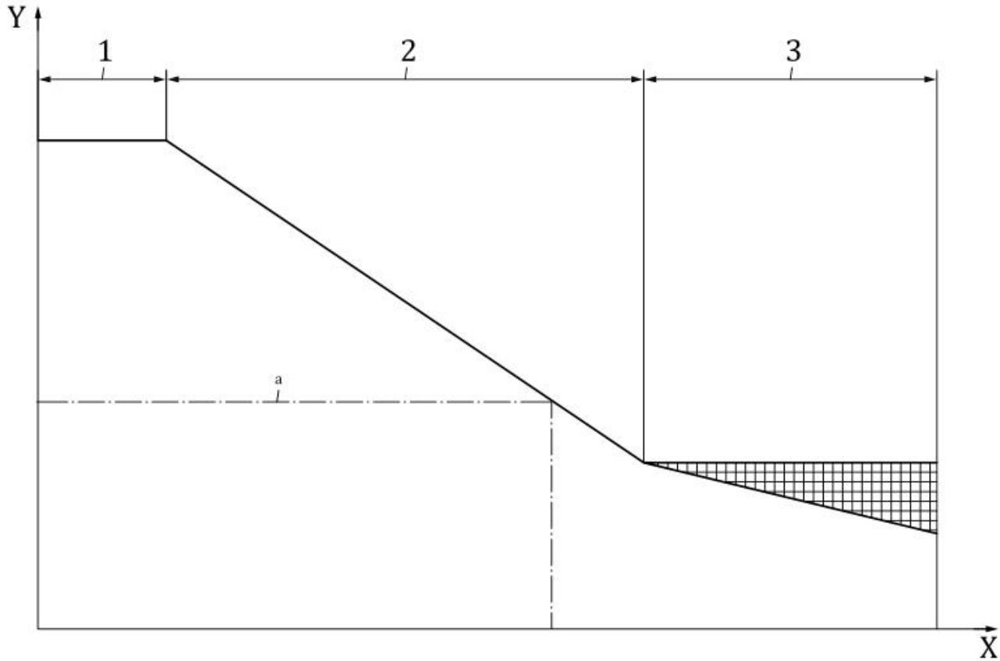

Key  
X number of load cycles,  $N_{L}$  (log)  
Y permissible bending stress,  $\sigma_{FP}$  (log)  
1 static  
2 limited life  
3 long life  
a Example: Permissible bending stress,  $\sigma_{FP}$ , for a given number of load cycles.  

Figure 1 — Graphical determination of permissible bending stress for a limited life, in accordance with Method B

#### 5.4.4.3 Determination by calculation

Calculate $\sigma_{FP ref}$ for the reference stress and $\sigma_{FP stat}$ for the static stress in accordance with 5.4.3 and, using these results, determine $\sigma_{FP}$ for the relevant number of load cycles $N_{L}$ in the limited life range, as follows.

$$
\sigma_ {\mathrm{FP}} = \sigma_ {\mathrm{FPref}} \cdot Y _ {\mathrm{N}} = \sigma_ {\mathrm{FPref}} \cdot \left(\frac {3 \cdot 10 ^ {6}}{N _ {\mathrm{L}}}\right) ^ {\exp}\tag{6}
$$

a) For St, V, GGG (perl., bai.) or GTS (perl.), the limited life range as shown in Figure 11, $10^{4} < N_{\mathrm{L}} \leq 3 \times 10^{6}$ :

$$
\exp = 0,4037 \cdot \log \frac {\sigma_ {\mathrm{FPstat}}}{\sigma_ {\mathrm{FPref}}}\tag{7}
$$

b) For IF, Eh, NT (nitr.), NV (nitr.), NV (nitrocar.), GGG (ferr.) or GG, the limited life range as shown in Figure 11, $10^{3} < N_{\mathrm{L}} \leq 3 \times 10^{6}$ :

$$
\exp = 0,2876 \cdot \log \frac {\sigma_ {\mathrm{FPstat}}}{\sigma_ {\mathrm{FPref}}}\tag{8}
$$

Corresponding calculations may be determined for the range of long life.

# 6 Form factor, $Y_{F}$

## 6.1 General

$Y_{F}$ is the factor by which the influence of tooth form on the nominal tooth root stress is taken into account. Annex C explains the derivation of the factor $Y_{F}$ . See 5.3.2 for principles, assumptions and details of use. $Y_{F}$ is relevant to the application of load at the outer point of the single pair tooth contact (Method B).

The chord between the points at which the $30^{\circ}$ tangents contact the root fillets for external gears, or at which the $60^{\circ}$ tangents contact the root fillets for internal gears, defines the section to be used as the basis for calculation (see Figures 3 to 4).

The tooth form factor is sensitive to the tooth thickness. When the manufactured geometry is measured, it should be used. If not, then, based on the tooth thickness tolerance, the smallest generating profile shift, $x_{E\ min}$ , should be taken into account in the stress calculation.

Because of material allowances for finishing processes such as profile grinding, it is usually the case that the depth setting of the roughing tool, relative to the gear axis, includes the amount of nominal profile shift, $x \cdot m_{n}$ , plus a tolerance designed to ensure that the finishing allowance will be greater instead of less than the requisite minimum. Because of this, calculated values of tooth root stresses usually tend on the side of safety.

The formulae in this document apply to all basic rack profiles (see Figure 2) with and without undercut, but with the following restrictions:

a) the contact point of the $30^{\circ}$ ( $60^{\circ}$ ) tangent shall lie on the tooth root fillet generated by the root fillet of the basic rack;

b) the basic rack profile of the gear shall have a root fillet with $\rho_{fP} > 0$ ;

c) the teeth shall be generated using tools such as hobs, rack type shaper cutters or pinion type shaper cutters;

d) since calculated ratings refer to finished tooth forms, profile grinding and similar allowances, including tooth thickness allowances, can be neglected, and in practice it can be assumed that the dimensions of the basic rack of the tool are the same as those of the counterpart basic rack of the gear;

e) for internal gears only the shaper cutter data is used.

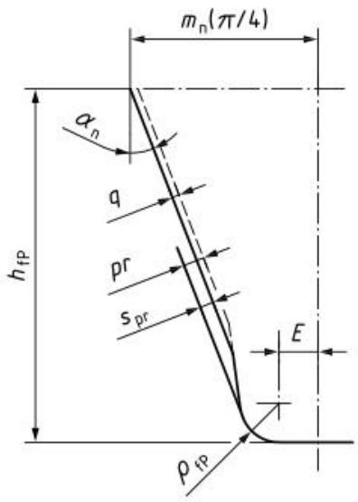  
a) With undercut

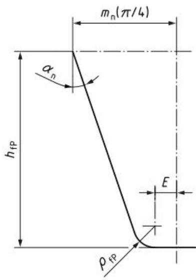  
b) Without undercut  
Figure 2 — Dimensions and basic rack profile of the teeth (finished profile)

The above comments apply to straight spur and helical gears. The value $Y_{F}$ is determined for the virtual spur gears of helical gears; the virtual number of teeth $z_{n}$ can be determined using Formula (16) $Y_{F}$ is determined separately for the pinion and the wheel.

## 6.2 Calculation of the form factor, $Y_{F}$ : Method B

### 6.2.1 General

The determination of the normal chordal dimension, $s_{Fn}$ , of the tooth root critical section and the bending moment arm, $h_{Fe}$ , relevant to the load application at the outer point of the single pair gear tooth contact for Method B is shown in Figures 3 and 4.

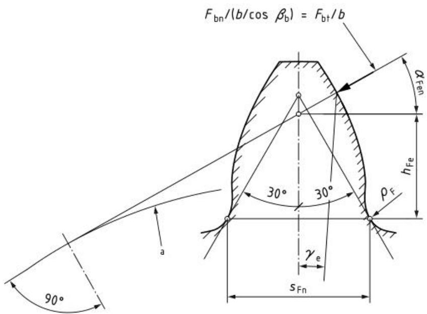  
a Base circle.

Figure 3 — Determination of normal chordal dimensions of the tooth root critical section for Method B (external gears)  
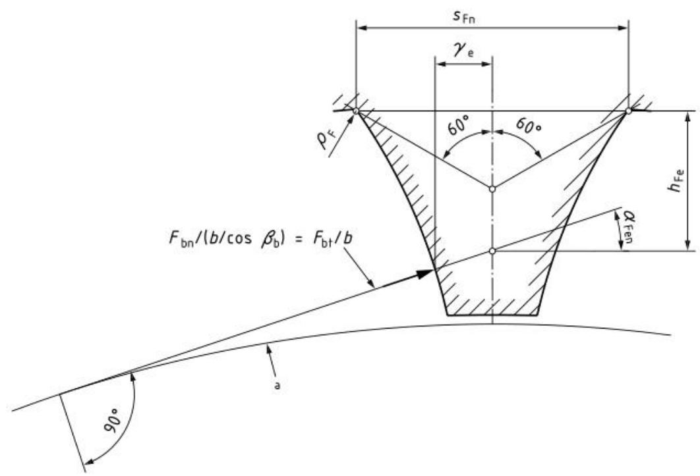  
a Base circle.

Figure 4 — Determination of normal chordal dimensions of the tooth root critical section for Method B (internal gears)

The following formula uses the symbols illustrated in Figures 3 and 4:

$$
Y _ {\mathrm{F}} = \frac {\frac {6 \cdot h _ {\mathrm{Fe}}}{m _ {\mathrm{n}}} \cdot \cos \alpha_ {\mathrm{Fen}}}{\left(\frac {s _ {\mathrm{Fn}}}{m _ {\mathrm{n}}}\right) ^ {2} \cdot \cos \alpha_ {\mathrm{n}}} \cdot f _ {\varepsilon}\tag{9}
$$

In order to evaluate precise values, $s_{Fn}$ and $\alpha_{Fe n}$ , of $h_{Fe}$ it is first necessary to derive a value of $\theta$ which is reasonably accurate, usually after five iterations of Formula (29). Determination of $Y_{F}$ by graphical means is not recommended.

The factor $f_{\varepsilon}$ considers the influence of load distribution between the teeth in the mesh. It provides more accurate results for gears with contact ratios $\varepsilon_{\alpha n} \geq 2,0$ . Contact ratios of $\varepsilon_{\alpha n} \geq 2,0$ are calculated for gears with high helix angles, high contact ratios, $\varepsilon_{\alpha}$ or both.

For spur gears with contact ratios $\varepsilon_{\alpha n} \leq 2,0$ the factor $f_{\varepsilon}$ is equal to one according Formula (10). For helical gears with overlap ratio $\varepsilon_{\beta} \geq 1$ the factor is calculated according to Formula (14). Formulae (12) and (13) provide a smooth function for $f_{\varepsilon}$ between Formulae (10) and (14).

> 编者校核注（非标准正文）：ISO3-001；原文第17页正文在 εαn=2 时给出 fε=1，而式(10)、(11)的分段给出 0.7。边界取值需由权威说明核实。

If $\varepsilon_{\beta} = 0$ and $\varepsilon_{\alpha n} < 2$ then

$$
f _ {\varepsilon} = 1\tag{10}
$$

If $\varepsilon_{\beta} = 0$ and $\varepsilon_{\alpha n}\geq 2$ then

$$
f _ {\varepsilon} = 0,7\tag{11}
$$

If $0 < \varepsilon_{\beta} < 1$ and $\varepsilon_{\alpha n} < 2$ then

$$
f _ {\varepsilon} = \left(1 - \varepsilon_ {\beta} + \frac {\varepsilon_ {\beta}}{\varepsilon_ {\alpha n}}\right) ^ {0,5}\tag{12}
$$

If $0 < \varepsilon_{\beta} < 1$ and $\varepsilon_{\alpha n} \geq 2$ then

$$
f _ {\varepsilon} = \left(\frac {1 - \varepsilon_ {\beta}}{2} + \frac {\varepsilon_ {\beta}}{\varepsilon_ {\alpha \mathrm{n}}}\right) ^ {0,5}\tag{13}
$$

If $\varepsilon_{\beta} \geq 1$ then

$$
f _ {\varepsilon} = \varepsilon_ {\alpha \mathrm{n}} ^ {- 0,5}\tag{14}
$$

### 6.2.2 Parameters of virtual gears

The parameters of virtual gears are as follows.

$$
\beta_ {b} = \arccos \sqrt {1 - (\sin \beta \cdot \cos \alpha_ {\mathrm{n}}) ^ {2}} = \arcsin (\sin \beta \cdot \cos \alpha_ {\mathrm{n}})\tag{15}
$$

$$
z _ {\mathrm{n}} = \frac {z}{\cos^ {2} \beta_ {\mathrm{b}} \cdot \cos \beta}\tag{16}
$$

$$
\varepsilon_ {\alpha \mathrm{n}} = \frac {\varepsilon_ {\alpha}}{\cos^ {2} \beta_ {\mathrm{b}}}\tag{17}
$$

$$
d _ {\mathrm{n}} = \frac {d}{\cos^ {2} \beta_ {\mathrm{b}}} = m _ {\mathrm{n}} \cdot z _ {\mathrm{n}}\tag{18}
$$

$$
p _ {\mathrm{bn}} = \pi \cdot m _ {\mathrm{n}} \cdot \cos \alpha_ {\mathrm{n}}\tag{19}
$$

$$
d _ {\mathrm{bn}} = d _ {\mathrm{n}} \cdot \cos \alpha_ {\mathrm{n}}\tag{20}
$$

$$
d _ {\mathrm{an}} = d _ {\mathrm{n}} + d _ {\mathrm{Na}} - d\tag{21}
$$

$$
d _ {\mathrm{en}} = 2 \cdot \frac {z}{| z |} \sqrt {\left[ \sqrt {\left(\frac {d _ {\mathrm{an}}}{2}\right) ^ {2} - \left(\frac {d _ {\mathrm{bn}}}{2}\right) ^ {2}} - \frac {\pi \cdot d \cdot \cos \beta \cdot \cos \alpha_ {\mathrm{n}}}{| z |} \cdot (\varepsilon_ {\alpha \mathrm{n}} - 1) \right] ^ {2} + \left(\frac {d _ {\mathrm{bn}}}{2}\right) ^ {2}}\tag{22}
$$

The number of teeth, z, is positive for external gears and negative for internal gears.

$$
\alpha_ {\mathrm{en}} = \arccos \left(\frac {d _ {\mathrm{bn}}}{d _ {\mathrm{en}}}\right)\tag{23}
$$

$$
\gamma_ {\mathrm{e}} = \frac {0,5 \cdot \pi + 2 \cdot x \cdot \tan \alpha_ {\mathrm{n}}}{z _ {\mathrm{n}}} + \operatorname{inv} \alpha_ {\mathrm{n}} - \operatorname{inv} \alpha_ {\mathrm{en}}\tag{24}
$$

$$
\alpha_ {\mathrm{Fen}} = \alpha_ {\mathrm{en}} - \gamma_ {\mathrm{e}} = \tan \alpha_ {\mathrm{en}} - \operatorname{inv} \alpha_ {\mathrm{n}} - \frac {0,5 \cdot \pi + 2 \cdot x \cdot \tan \alpha_ {\mathrm{n}}}{z _ {\mathrm{n}}}\tag{25}
$$

### 6.2.3 Tooth root normal chord, $s_{Fn}$ , radius of root fillet, $\rho_{F}$ , bending moment arm, $h_{Fe}$ for external gears generated with a hob [^2]

First, determine the auxiliary values for Formula (9):

$$
E = \frac {\pi}{4} m _ {\mathrm{n}} - h _ {\mathrm{fP}} \cdot \tan \alpha_ {\mathrm{n}} + \frac {s _ {\mathrm{pr}}}{\cos \alpha_ {\mathrm{n}}} - (1 - \sin \alpha_ {\mathrm{n}}) \cdot \frac {\rho_ {\mathrm{fP}}}{\cos \alpha_ {\mathrm{n}}}\tag{26}
$$

with

$$
s _ {\mathrm{pr}} = p r - q (\text { see   Figure   2 });
$$

$s_{pr} = 0$ when gears are not undercut;

$$
G = \frac {\rho_ {\mathrm{fP}}}{m _ {\mathrm{n}}} - \frac {h _ {\mathrm{fP}}}{m _ {\mathrm{n}}} + x\tag{27}
$$

$$
H = \frac {2}{z _ {\mathrm{n}}} \cdot \left(\frac {\pi}{2} - \frac {E}{m _ {\mathrm{n}}}\right) - T\tag{28}
$$

with

$T = \pi/3$ for external gears;

$$
\theta = \frac {2 G}{z _ {n}} \cdot \tan \theta - H\tag{29}
$$

The value $\theta = \pi/6$ for external gears may be used as a seed value in the iteration of the transcendental Formula (29). Generally, the function converges after five iterations.

a) Tooth root normal chord, $s_{Fn}$

$$
\frac {s _ {F n}}{m _ {n}} = z _ {n} \cdot \sin \left(\frac {\pi}{3} - \theta\right) + \sqrt {3} \cdot \left(\frac {G}{\cos \theta} - \frac {\rho_ {\mathrm{fP}}}{m _ {n}}\right)\tag{30}
$$

b) Radius of the root fillet, $\rho_{F}$ (see Figures 3 and 4)

$$
\frac {\rho_ {\mathrm{F}}}{m _ {\mathrm{n}}} = \frac {\rho_ {\mathrm{fP}}}{m _ {\mathrm{n}}} + \frac {2 \cdot G ^ {2}}{\cos \theta \cdot \left(z _ {\mathrm{n}} \cdot \cos^ {2} \theta - 2 \cdot G\right)}\tag{31}
$$

c) Bending moment arm, $h_{Fe}$

$$
\frac {h _ {\mathrm{Fe}}}{m _ {\mathrm{n}}} = \frac {1}{2} \left[ \left(\cos \gamma_ {\mathrm{e}} - \sin \gamma_ {\mathrm{e}} \cdot \tan \alpha_ {\mathrm{Fen}}\right) \cdot \frac {d _ {\mathrm{en}}}{m _ {\mathrm{n}}} - z _ {\mathrm{n}} \cdot \cos \left(\frac {\pi}{3} - \theta\right) - \left(\frac {G}{\cos \theta} - \frac {\rho_ {\mathrm{fP}}}{m _ {\mathrm{n}}}\right) \right]\tag{32}
$$

### 6.2.4 Tooth root normal chord, $s_{Fn}$ , radius of root fillet, $\rho_{F}$ , bending moment arm, $h_{Fe}$ for external gears generated with a shaper cutter [^2]

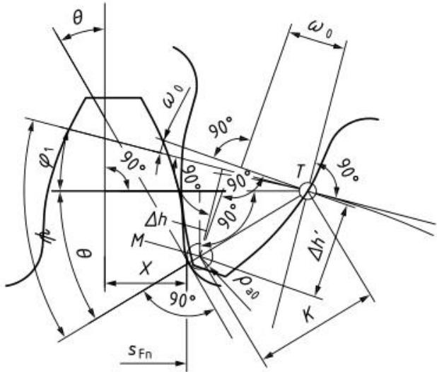  
a) Shaper cutter

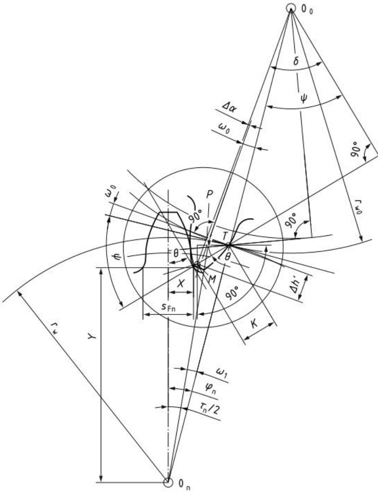  
b) Gear blank

Figure 5 — The shaper cutter and the gear blank in a specific meshing position

In the following, formulae for the calculation of the tooth root geometry at a transverse cross section for the equivalent spur gear are given[9].

Geometrical quantities which shall be known (Figure 5) are:

$z_{0}$ number of teeth of the tool;

θ tangential angle (30° for external gear, 60° for internal gear);

$x_{0}$ profile shift coefficient of the tool;

$\rho_{a0}$ tool tip corner rounding (normal plane);

$s_{pr}$ residual fillet undercut (normal plane).

Initial geometrical quantities to be calculated are:

— equivalent numbers of teeth, $z_{0v}$

$$
z _ {0 \mathrm{v}} = \frac {z _ {0}}{\cos \beta \cdot \cos^ {2} \beta_ {\mathrm{b}}}\tag{33}
$$

— operating pressure angle, $\alpha_{w0}$ , of the manufacturing pairing (in general, two iteration steps are necessary)

$$
\xi = 2 \cdot \frac {x _ {0} + x}{z _ {0 \mathrm{v}} + z _ {\mathrm{n}}} \tan \alpha_ {\mathrm{n}} + \operatorname{inv} \alpha_ {n}\tag{34}
$$

Initial value:

$$
\alpha_ {\mathrm{w0}} = \sqrt [ 3 ]{3 \xi}\tag{35}
$$

Iteration:

$$
\alpha_ {\mathrm{w} 0} := \alpha_ {\mathrm{w} 0} + \frac {\xi - \operatorname{inv} \alpha_ {\mathrm{w} 0}}{\tan^ {2} \alpha_ {\mathrm{w} 0}}\tag{36}
$$

— manufacturing centre distance, $a_{0}$

$$
a _ {0} = m _ {\mathrm{n}} \frac {z _ {0 \mathrm{v}} + z _ {\mathrm{n}}}{2} \cdot \frac {\cos \alpha_ {\mathrm{n}}}{\cos \alpha_ {\mathrm{w0}}}\tag{37}
$$

— manufacturing tooth ratio, $u_{0}$

$$
u _ {0} = \frac {z _ {0 \mathrm{v}}}{z _ {\mathrm{n}}}\tag{38}
$$

— manufacturing pitch circle radii of the gear, $r_{w}$ , and the tool, $r_{w0}$

$$
r _ {\mathrm{w}} = \frac {a _ {0}}{1 + u _ {0}}; r _ {\mathrm{w} 0} = r _ {\mathrm{w}} \cdot u _ {0}\tag{39}
$$

— base-circle radius of the tool, $r_{b0}$

$$
r _ {\mathrm{b0}} = 0,5 \cdot m _ {\mathrm{n}} \cdot z _ {0 \mathrm{v}} \cdot \cos \alpha_ {\mathrm{n}}\tag{40}
$$

Geometrical quantities on the shaper cutter (Figure 6) are:

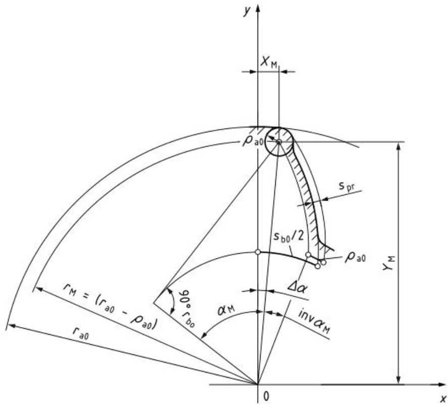  
Figure 6 — Quantities at the shaper cutter

— radius, $r_{M}$ , for the centre of the tool tip fillet radius

$$
r _ {\mathrm{M}} = r _ {\mathrm{a0}} - \rho_ {\mathrm{a0}}\tag{41}
$$

$$
r _ {\mathrm{M}} = m _ {\mathrm{n}} \left(\frac {z _ {0 \mathrm{v}}}{2} + \frac {h _ {\mathrm{aP0}}}{m _ {\mathrm{n}}} + x _ {0} - \frac {\rho_ {\mathrm{a0}}}{m _ {\mathrm{n}}}\right)\tag{42}
$$

— transverse pressure angle, $\alpha_{M}$ , for the radius, $r_{M}$

$$
\alpha_ {\mathrm{M}} = \arccos \left(\frac {r _ {\mathrm{b0}}}{r _ {\mathrm{M}}}\right)\tag{43}
$$

— half angle of thickness, $\Delta\alpha$ , at point M

$$
\Delta \alpha = \frac {0,5 \cdot \pi + 2 x _ {0} \cdot \tan \alpha_ {n}}{z _ {0 v}} - \frac {\rho_ {a 0} - s _ {\mathrm{pr}}}{r _ {b 0}} + \mathrm{inv} \alpha_ {n} - \mathrm{inv} \alpha_ {M}\tag{44}
$$

— coordinates of the point M

$$
X _ {\mathrm{M}} = r _ {\mathrm{M}} \cdot \sin (\Delta \alpha); Y _ {\mathrm{M}} = r _ {\mathrm{M}} \cdot \cos (\Delta \alpha)\tag{45}
$$

Determination of the auxiliary angle, $\psi$ , through iteration using Formulae (48) to (51) (in general, two iterations steps are sufficient):

$$
\psi_ {0} = \frac {\pi}{z _ {n}} + \theta\tag{46}
$$

Initial value:

$$
\psi = \psi_ {0}\tag{47}
$$

$$
\lambda = \frac {r _ {w 0}}{r _ {\mathrm{M}}} \cdot \cos \psi\tag{48}
$$

$$
y = \psi - \arccos (\lambda) + \Delta \alpha + \frac {\psi - \psi_ {0}}{u _ {0}}\tag{49}
$$

$$
y ^ {\prime} = 1 + \frac {1}{u _ {0}} - \frac {r _ {w 0}}{r _ {\mathrm{M}}} \cdot \frac {\sin (\psi)}{\sqrt {1 - \lambda^ {2}}}\tag{50}
$$

$$
\psi := \psi - \frac {y}{y ^ {\prime}}\tag{51}
$$

end of the successive iteration at $\left|\frac{y}{y'}\right|<10^{-6}$ .

Distance K of the point M to the point of contact of the pitch circles:

$$
\omega_ {0} = \delta - \psi - \Delta \alpha\tag{52}
$$

$$
\delta = \arccos \left(\frac {r _ {\mathrm{w} 0}}{r _ {\mathrm{M}}} \cdot \cos \psi\right)\tag{53}
$$

$$
\Delta h ^ {\prime} = Y _ {\mathrm{M}} - r _ {\mathrm{w0}} \cdot \cos \omega_ {0}\tag{54}
$$

$$
\Delta h = \frac {\Delta h ^ {\prime} \cdot \sin \psi}{\sin (\psi + \omega_ {0})}\tag{55}
$$

$$
K = \frac {\Delta h}{\sin \psi}\tag{56}
$$

Characteristic quantities for the root geometry:

— coordinates of the tangent point

$$
X = r _ {w} \cdot \sin (\psi - \theta) - (K + \rho_ {a 0}) \cdot \cos \theta\tag{57}
$$

$$
Y = r _ {w} \cdot \cos (\psi - \theta) - (K + \rho_ {a 0}) \cdot \sin \theta\tag{58}
$$

— tooth root thickness $s_{Fn}$

$$
s _ {F n} = 2 \cdot X\tag{59}
$$

— tooth root fillet radius $\rho_{F}$

$$
\rho_ {F} = \frac {K ^ {2}}{\frac {r _ {\mathrm{w0}} \cdot r _ {\mathrm{w}}}{r _ {\mathrm{w0}} + r _ {\mathrm{w}}} \cdot \sin \psi + K} + \rho_ {a 0}\tag{60}
$$

Bending moment arm, $h_{Fe}$ :

$$
h _ {F e} = \left(\cos \gamma_ {e} - \sin \gamma_ {e} \cdot \tan \alpha_ {F e n}\right) \cdot \frac {d _ {e n}}{2} - Y\tag{61}
$$

### 6.2.5 Tooth root normal chord, $s_{Fn}$ , radius of root fillet, $\rho_{F}$ , bending moment arm, $h_{Fe}$ for internal gears generated with a shaper cutter [^2]

The calculation of the tooth root geometry follows Formulae (33) to (61) for virtual spur gears at a transverse cross section[9]. Use negative sign convention for all diameters of the gear, the manufacturing centre distance, $a_0$ and the tangential angle, $\theta$ (60° for internal gear).

# 7 Stress correction factor, $Y_{S}$

## 7.1 Basic uses

The stress correction factor, $Y_{S}$ , is used to convert the nominal tooth root stress to the local tooth root stress and, by means of this factor, the following are taken into account:

a) the stress amplifying the effect of the section change at the fillet radius at the tooth root[^3] ;

b) that evaluation of the true stress system at the tooth root critical section is more complex than the simple system evaluation presented, with evidence indicating that the intensity of the local stress at the tooth root consists of two components, one of which is directly influenced by the value of the bending moment and the other increasing with closer proximity to the critical section of the determinant position of the load application.

$Y_{S}$ is the factor for the load application at the outer point of the single pair tooth contact (Method B). See 5.3 for the principles, assumptions and application of Method B.

The formulae in this clause are based on the data derived from the geometry of external spur gears with $20^{\circ}$ pressure angle, by means of measurement and calculations using finite element and integral formula methods. The formulae can also be used to obtain approximate values for internal gears and for gears having other pressure angles.

The present instructions refer to spur and helical gears. See Clause 6 for explanatory comments and information on the calculation of the virtual numbers of teeth relevant to helical gears.

## 7.2 Stress correction factor, $Y_{S}$ : Method B

The calculation of the stress correction factor, $Y_{S}$ , is made in accordance with Formula (62), which is valid in the range: $1 \leq q_{s} < 8$ ; symbols are as illustrated in Figures 3 and 4.

$$
Y _ {\mathrm{S}} = (1,2 + 0,13 \cdot L) \cdot q _ {\mathrm{s}} ^ {\left[ \frac {1}{1,21 + \frac {2,3}{L}} \right]}\tag{62}
$$

where

$$
L = \frac {s _ {\mathrm{Fn}}}{h _ {\mathrm{Fe}}}\tag{63}
$$

with

$s_{Fn}$ from Formula (30) for external gears generated with a hob, Formula (59) for external and internal gears generated with a shaper cutter;

$h_{Fe}$ from Formula (32) for external gears generated with a hob, Formula (61) for external and internal gears generated with a shaper cutter;

$$
q _ {s} = \frac {s _ {\mathrm{Fn}}}{2 \rho_ {\mathrm{F}}}\tag{64}
$$

with $\rho_{F}$ from Formula (31) for external gears generated with a hob, Formula (60) for external and internal gears generated with a shaper cutter.

Determination of $Y_{S}$ by graphical methods is not appropriate.

## 7.3 Stress correction factor for gears with notches in fillets

A notch such as a grinding notch in the fillet of a gear near the critical section usually engenders a degree of stress concentration exceeding that of the fillet; thus, the stress correction factor is correspondingly greater. A fair estimate of $Y_{Sg}$ , obtainable from Formula (65), can be substituted for $Y_{S}$ , see Figure 7, if the notch is near the critical section. See also Reference [13].

$$
Y _ {\mathrm{Sg}} = \frac {1,3 \cdot Y _ {\mathrm{S}}}{1,3 - 0,6 \cdot \sqrt {\frac {t _ {\mathrm{g}}}{\rho_ {\mathrm{g}}}}}\tag{65}
$$

$$
\text { valid   for } \sqrt {\frac {t _ {g}}{\rho_ {g}}} <   2,0
$$

The effect of the grinding notch is less than that implied in Formula (65) when the notch is above the contact point of the $30^{\circ}$ tangent (external gears) or $60^{\circ}$ tangent (internal gears).

$Y_{\mathrm{Sg}}$ also takes into consideration the reduction in the tooth root thickness.

Deep notches in the fillets of surface hardened steel gears severely reduce the bending strength of their teeth.

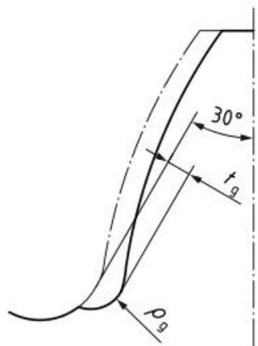  
Figure 7 — Notch dimensions if the notch is near the critical section

## 7.4 Stress correction factor, $Y_{ST}$ , relevant to the dimensions of the standard reference test gears

The tooth root stress limit values for materials, according to ISO 6336-5, were derived from results of tests of standard reference test gears for which either $Y_{ST} = 2.0$ or for which test results were recalculated to this value. See also Reference [13].

# 8 Helix angle factor, $Y_{\beta}$

## 8.1 General

The tooth root stress of a virtual spur gear, calculated as a preliminary value, is converted by means of the helix factor, $Y_{\beta}$ , to that of the corresponding helical gear. By this means, the oblique orientation of the lines of the mesh contact is taken into account (less tooth root stress).

## 8.2 Graphical value

$Y_{\beta}$ may be read from Figure 8 as a function of the helix angle, $\beta$ and the overlap ratio, $\varepsilon_{\beta}$ .

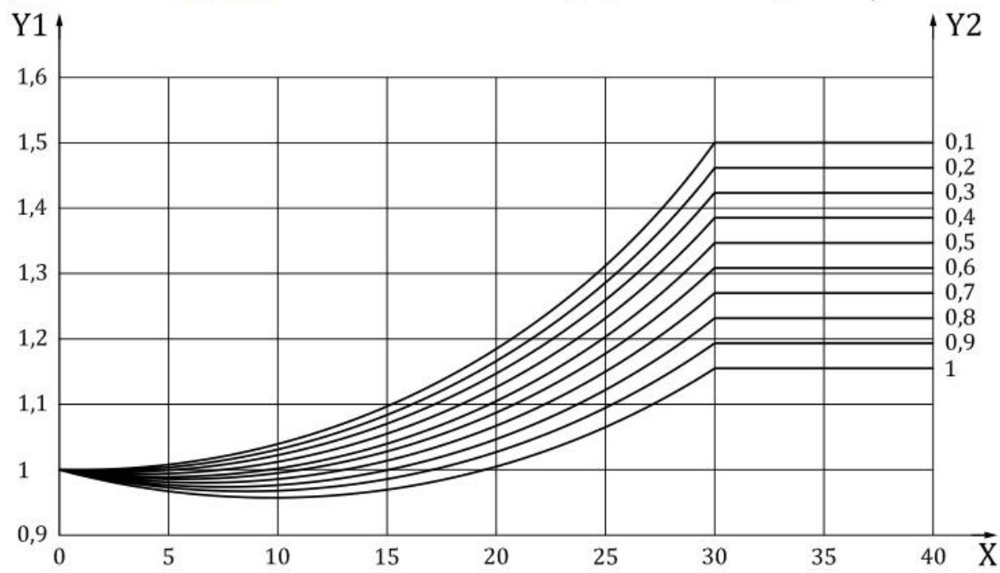

Key  
X reference helix angle, $\beta$, degrees  
Y1 helix factor, $Y_{\beta}$  
Y2 overlap ratio, $\varepsilon_{\beta}$  

Figure 8 — Helix factor, $Y_{\beta}$

Helix factors $Y_{\beta}$ for $\beta > 25^{\circ}$ shall be confirmed by experience.

## 8.3 Determination by calculation

The factor $Y_{\beta}$ can be calculated using Formula (66) which is consistent with the curves illustrated in Figure 8.

$$
Y _ {\beta} = \left(1 - \varepsilon_ {\beta} \cdot \frac {\beta}{120 ^ {\circ}}\right) \cdot \frac {1}{\cos^ {3} \beta}\tag{66}
$$

where $\beta$ is the reference helix angle, in degrees and

$$
\varepsilon_ {\beta} > 0\tag{67}
$$

The value 1,0 is substituted for $\varepsilon_{\beta}$ when $\varepsilon_{\beta} > 1,0$ , and $30^{\circ}$ is substituted for $\beta$ when $\beta > 30^{\circ}$ .

# 9 Rim thickness factor, $Y_{B}$

## 9.1 General

Where the rim thickness is not sufficient to provide full support for the tooth root, the location of bending fatigue failure may be through the gear rim, rather than at the root fillet. The rim thickness factor, $Y_{B}$ , is a simplified factor used to de-rate thin rimmed gears when detailed calculations of stresses in both tension and compression or experience are not available. For critically loaded applications this method should be replaced by a more comprehensive analysis.

## 9.2 Graphical values

$Y_{\mathrm{B}}$ can be taken from Figure 9 as a function of the backup ratio $s_{\mathrm{R}} / h_{\mathrm{t}}$ for external gears and as a function of the rim thickness $s_{\mathrm{R}} / m_{\mathrm{n}}$ for internal gears.

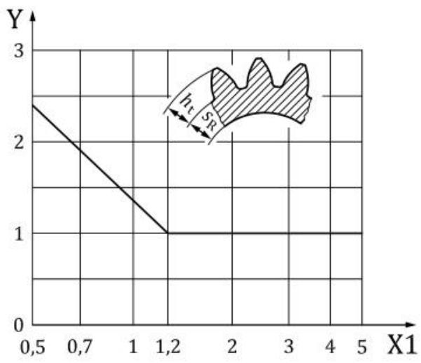

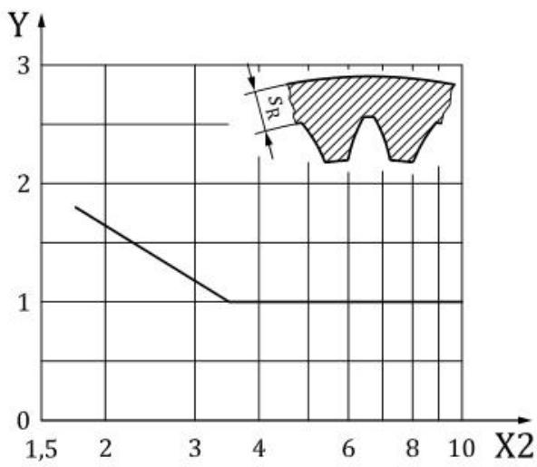

Key  
X1 backup ratio, $s_{\mathrm{R}}/h_{\mathrm{t}}$  
X2 rim thickness, $s_{\mathrm{R}}/m_{\mathrm{n}}$  
Y rim thickness factor, $Y_{\mathrm{B}}$  

Figure 9 — Rim thickness factor, $Y_{B}$

## 9.3 Determination by calculation

### 9.3.1 External gears

$Y_{B}$ can be calculated using Formulae (68) to (69). These are consistent with the curve in Figure 9.

a) If $s_{R}/h_{t} \geq 1,2$ , then

$$
Y _ {B} = 1,0\tag{68}
$$

b) If $s_{\mathrm{R}} / h_{\mathrm{t}} > 0,5$ and $s_{\mathrm{R}} / h_{\mathrm{t}} < 1,2$ , then

$$
Y _ {B} = 1,6 \cdot \ln \left(2,242 \cdot \frac {h _ {t}}{s _ {R}}\right)\tag{69}
$$

c) The case $s_{R}/h_{t} \leq 0,5$ shall be avoided.

### 9.3.2 Internal gears

$Y_{B}$ can be calculated using Formulae (70) to (71). These are consistent with the curve in Figure 9.

a) If $s_{\mathrm{R}} / m_{\mathrm{n}} \geq 3,5$ , then

$$
Y _ {B} = 1,0\tag{70}
$$

b) If $s_{R}/m_{n} > 1,75$ and $s_{R}/m_{n} < 3,5$ , then

$$
Y _ {B} = 1,15 \cdot \ln \left(8,324 \cdot \frac {m _ {n}}{s _ {R}}\right)\tag{71}
$$

c) The case $s_{R}/m_{n} \leq 1,75$ shall be avoided.

# 10 Deep tooth factor, $Y_{DT}$

## 10.1 General

For gears of high precision (ISO Tolerance Class ≤ 4) with contact ratios in the range of $2 \leq \varepsilon_{\alpha n} < 2,5$ and with applied actual profile modification to obtain a trapezoidal load distribution along the path of contact, the nominal tooth root stress, $\sigma_{F0}$ , is adjusted by the deep tooth factor, $Y_{DT}$ . If ISO Tolerance Class of the pinion and the wheel is different, the worse one shall be used for both partners.

## 10.2 Graphical values

$Y_{DT}$ may be read from Figure 10 as a function of the contact ratio, $\varepsilon_{\alpha n}$ .

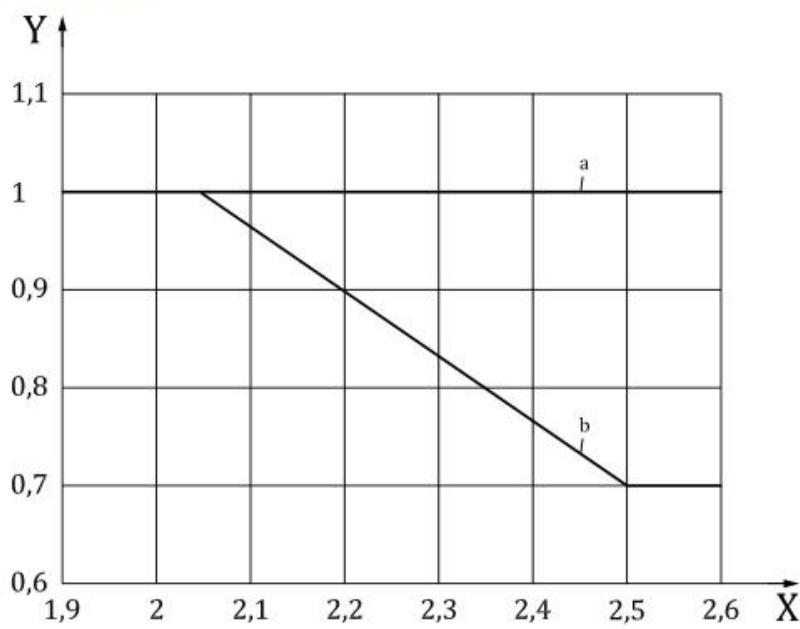

X virtual contact ratio, $\varepsilon_{\alpha n}$

Y deep tooth factor, $Y_{DT}$

a ISO Tolerance Class > 4.

b ISO Tolerance Class ≤ 4.

Figure 10 — Deep tooth factor, $Y_{DT}$

## 10.3 Determination by calculation

$Y_{DT}$ can be calculated using Formulae (72) to (74). These are consistent with the curves in Figure 10.

a) If $\varepsilon_{\alpha n} \leq 2,05$ or if $\varepsilon_{\alpha n} > 2,05$ and the ISO Tolerance Class $>4$ , then

$$
Y _ {\mathrm{DT}} = 1,0\tag{72}
$$

b) If $2,05 < \varepsilon_{\alpha n} \leq 2,5$ and the ISO Tolerance Class $\leq 4$ , then

$$
Y _ {\mathrm{DT}} = - 0,666 \cdot \varepsilon_ {\alpha n} + 2,366\tag{73}
$$

c) If $\varepsilon_{\alpha n} > 2,5$ and the ISO Tolerance Class $\leq 4$ , then

$$
Y _ {\mathrm{DT}} = 0,7\tag{74}
$$

# 11 Reference stress for bending

## 11.1 General

See 5.4 for general information on the determination of limit values for the tooth root stress.

## 11.2 Reference stress for Method A

Method A is consistent with the determination of the tooth root stress reference stress according to 5.4.2.2.

## 11.3 Reference stress, with values $\sigma_{\mathrm{Flim}}$ and $\sigma_{\mathrm{FE}}$ for Method B

See 5.4.2.3 and 5.4.3 for information. See Formula (5) for definitions of $\sigma_{\mathrm{Flim}}$ and $\sigma_{\mathrm{FE}}$ .

NOTE ISO 6336-5 provides information, derived from the results of testing standard reference test gears, on values of $\sigma_{\mathrm{Flim}}$ and $\sigma_{\mathrm{FE}}$ for the more popular gear materials, heat treatment processes and the influence of the material quality on those values. ISO 6336-5 also includes requirements for quality grades ML, MQ and ME concerning material and heat treatment. Material quality grade MQ is usually chosen for gears unless otherwise agreed upon.

# 12 Life factor, $Y_{NT}$

## 12.1 General

The life factor, $Y_{NT}$ , accounts for the higher tooth root stress, which may be tolerable for a limited life (number of load cycles), as compared with the allowable stress at $3 \times 10^{6}$ cycles. $Y_{NT}$ applies for standard reference use.

The principal influence factors are:

a) material and heat treatment (see ISO 6336-5),

b) number of load cycles (service life), $N_{L}$ ,

b) failure criteria,

c) smoothness of operation required,

d) cleanness of gear material,

e) material ductility and fracture toughness, and

f) residual stress.

> Editorial note (not part of ISO text): The repeated list label b) in 12.1 is reproduced as printed.

For the purposes of this document, the number of load cycles, $N_{L}$ , is defined as the number of mesh contacts, under load, of the gear tooth being analysed. The allowable stress numbers are established for $3 \times 10^{6}$ tooth load cycles at 99 % reliability.

A $Y_{NT}$ value of unity may be used, where justified by experience, beyond $3 \times 10^{6}$ cycles. However, the use of optimum material quality and manufacturing, with selection of an appropriate safety factor, is recommended.

## 12.2 Life factor, $Y_{NT}$ : Method A

The S-N curve or damage curve derived from facsimiles of the actual gear is determinant for the establishment of the limited life. $Y_{NT}$ can be derived from the S-N curve, which is directly valid for the conditions mentioned, the influences represented by the factors $Y_{\delta rel T}$ , $Y_{R rel T}$ , and $Y_{X}$ are included in the curve.

## 12.3 Life factor, $Y_{\mathrm{NT}}$ : Method B

### 12.3.1 General

For this method, life factor, $Y_{NT}$ , of the standard reference test gear is used as an aid in the evaluation of the permissible stress for a limited life or reliability (see 5.4).

### 12.3.2 Graphical values

$Y_{NT}$ may be read from Figure 11 for the static stress and reference stress as a function of material and heat treatment. Values from a large number of tests are presented as typical damage or crack initiation curves for surface-hardened and nitride-hardened steels, or curves of yield stress for structural and through-hardened steels.

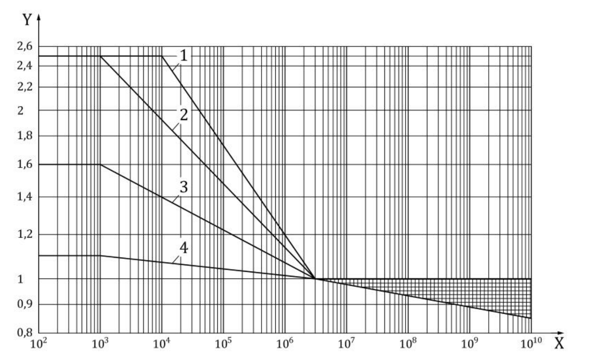

Key  
X number of load cycles, $N_{\mathrm{L}}$  
Y life factor, $Y_{\mathrm{NT}}$  
1 GTS (perl.), St, V, GGG (perl. bai.)  
2 Eh, IF (root)  
3 NT, NV (nitr.), GGG (ferr.), GG  
4 NV (nitrocar.)  

Figure 11 — Life factor, $Y_{NT}$ , for reference test gears

### 12.3.3 Determination by calculation

The data of $Y_{\mathrm{NT}}$ for static stress and reference stress can be taken from Table 3.

Life factor, $Y_{NT}$ , for limited-life stress is determined by means of interpolation on a log-log scale between the values for reference and static stress limits as defined in 5.4.3. Evaluation of $Y_{NT}$ is according to 5.4.4.

Table 3 — Life factor, $Y_{\mathrm{NT}}$

<table>
<tr><td>Material</td><td>Number of load cycles,  <math data-tex="N_{\text{L}}" display="inline" xmlns="http://www.w3.org/1998/Math/MathML"><semantics><msub><mi>N</mi><mtext mathvariant="normal">L</mtext></msub></semantics></math> </td><td>Life factor,  <math data-tex="Y_{\text{NT}}" display="inline" xmlns="http://www.w3.org/1998/Math/MathML"><semantics><msub><mi>Y</mi><mtext mathvariant="normal">NT</mtext></msub></semantics></math> </td></tr>
<tr><td rowspan="3">St, V, GGG (perl. bai.), GTS (perl.),</td><td> <math data-tex="N_{\text{L}} \leq 10^{4}" display="inline" xmlns="http://www.w3.org/1998/Math/MathML"><semantics><mrow><msub><mi>N</mi><mtext mathvariant="normal">L</mtext></msub><mo>≤</mo><msup><mn>10</mn><mn>4</mn></msup></mrow></semantics></math> , static</td><td>2,5</td></tr>
<tr><td> <math data-tex="N_{\text{L}} = 3 \times 10^{6}" display="inline" xmlns="http://www.w3.org/1998/Math/MathML"><semantics><mrow><msub><mi>N</mi><mtext mathvariant="normal">L</mtext></msub><mo>=</mo><mn>3</mn><mo>×</mo><msup><mn>10</mn><mn>6</mn></msup></mrow></semantics></math> </td><td>1,0</td></tr>
<tr><td> <math data-tex="N_{\text{L}} = 10^{10}" display="inline" xmlns="http://www.w3.org/1998/Math/MathML"><semantics><mrow><msub><mi>N</mi><mtext mathvariant="normal">L</mtext></msub><mo>=</mo><msup><mn>10</mn><mn>10</mn></msup></mrow></semantics></math> </td><td>0,85 up to 1,0a</td></tr>
<tr><td rowspan="3">Eh, IF (root)</td><td> <math data-tex="N_{\text{L}} \leq 10^{3}" display="inline" xmlns="http://www.w3.org/1998/Math/MathML"><semantics><mrow><msub><mi>N</mi><mtext mathvariant="normal">L</mtext></msub><mo>≤</mo><msup><mn>10</mn><mn>3</mn></msup></mrow></semantics></math> , static</td><td>2,5</td></tr>
<tr><td> <math data-tex="N_{\text{L}} = 3 \times 10^{6}" display="inline" xmlns="http://www.w3.org/1998/Math/MathML"><semantics><mrow><msub><mi>N</mi><mtext mathvariant="normal">L</mtext></msub><mo>=</mo><mn>3</mn><mo>×</mo><msup><mn>10</mn><mn>6</mn></msup></mrow></semantics></math> </td><td>1,0</td></tr>
<tr><td> <math data-tex="N_{\text{L}} = 10^{10}" display="inline" xmlns="http://www.w3.org/1998/Math/MathML"><semantics><mrow><msub><mi>N</mi><mtext mathvariant="normal">L</mtext></msub><mo>=</mo><msup><mn>10</mn><mn>10</mn></msup></mrow></semantics></math> </td><td>0,85 up to 1,0a</td></tr>
<tr><td colspan="3">a The lower value of  <math data-tex="Y_{\text{NT}}" display="inline" xmlns="http://www.w3.org/1998/Math/MathML"><semantics><msub><mi>Y</mi><mtext mathvariant="normal">NT</mtext></msub></semantics></math>  may be used for critical service, where tooth root breakage shall be minimal. Values between 0,85 and 1,0 may be used for general purpose gearing. With optimum lubrication, material, manufacturing and experience 1,0 may be used.</td></tr>
<tr><td>Material</td><td>Number of load cycles,  <math data-tex="N_{L}" display="inline" xmlns="http://www.w3.org/1998/Math/MathML"><semantics><msub><mi>N</mi><mi>L</mi></msub></semantics></math> </td><td>Life factor,  <math data-tex="Y_{NT}" display="inline" xmlns="http://www.w3.org/1998/Math/MathML"><semantics><msub><mi>Y</mi><mrow><mi>N</mi><mi>T</mi></mrow></msub></semantics></math> </td></tr>
<tr><td rowspan="3">GG, GGG (ferr.), NT, NV (nitr.)</td><td> <math data-tex="N_{L} \leq 10^{3}" display="inline" xmlns="http://www.w3.org/1998/Math/MathML"><semantics><mrow><msub><mi>N</mi><mi>L</mi></msub><mo>≤</mo><msup><mn>10</mn><mn>3</mn></msup></mrow></semantics></math> , static</td><td>1,6</td></tr>
<tr><td> <math data-tex="N_{L}=3\times 10^{6}" display="inline" xmlns="http://www.w3.org/1998/Math/MathML"><semantics><mrow><msub><mi>N</mi><mi>L</mi></msub><mo>=</mo><mn>3</mn><mo>×</mo><msup><mn>10</mn><mn>6</mn></msup></mrow></semantics></math> </td><td>1,0</td></tr>
<tr><td> <math data-tex="N_{L}=10^{10}" display="inline" xmlns="http://www.w3.org/1998/Math/MathML"><semantics><mrow><msub><mi>N</mi><mi>L</mi></msub><mo>=</mo><msup><mn>10</mn><mn>10</mn></msup></mrow></semantics></math> </td><td>0,85 up to 1,0a </td></tr>
<tr><td rowspan="3">NV (nitrocar.)</td><td> <math data-tex="N_{L} \leq 10^{3}" display="inline" xmlns="http://www.w3.org/1998/Math/MathML"><semantics><mrow><msub><mi>N</mi><mi>L</mi></msub><mo>≤</mo><msup><mn>10</mn><mn>3</mn></msup></mrow></semantics></math> , static</td><td>1,1</td></tr>
<tr><td> <math data-tex="N_{L}=3\times 10^{6}" display="inline" xmlns="http://www.w3.org/1998/Math/MathML"><semantics><mrow><msub><mi>N</mi><mi>L</mi></msub><mo>=</mo><mn>3</mn><mo>×</mo><msup><mn>10</mn><mn>6</mn></msup></mrow></semantics></math> </td><td>1,0</td></tr>
<tr><td> <math data-tex="N_{L}=10^{10}" display="inline" xmlns="http://www.w3.org/1998/Math/MathML"><semantics><mrow><msub><mi>N</mi><mi>L</mi></msub><mo>=</mo><msup><mn>10</mn><mn>10</mn></msup></mrow></semantics></math> </td><td>0,85 up to 1,0a </td></tr>
<tr><td colspan="3"> <math data-tex="^{a}" display="inline" xmlns="http://www.w3.org/1998/Math/MathML"><semantics><msup><mi></mi><mi>a</mi></msup></semantics></math>  The lower value of  <math data-tex="Y_{NT}" display="inline" xmlns="http://www.w3.org/1998/Math/MathML"><semantics><msub><mi>Y</mi><mrow><mi>N</mi><mi>T</mi></mrow></msub></semantics></math>  may be used for critical service, where tooth root breakage shall be minimal. Values between 0,85 and 1,0 may be used for general purpose gearing. With optimum lubrication, material, manufacturing and experience 1,0 may be used.</td></tr>
</table>

# 13 Notch sensitivity factor, $Y_{\delta T}$ , and relative notch sensitivity factor, $Y_{\delta rel T}$

## 13.1 Basic uses

The extent to which the calculated tooth root stress deemed to have caused fatigue or overload breakage exceeds the relevant material stress limit is indicated by the dynamic or the static sensitivity factor, $Y_{\delta}$ . It characterizes the notch sensitivity of the material, and its values depend on the material and the stress gradient. Its values for dynamic stresses are different from its value for static stresses. This applies to $Y_{\delta T}$ in relation to breakage of a standard reference test gear tooth. It applies also to the relative sensitivity factors which relate the sensitivity of a gear of interest to that of a standard reference test gear ( $Y_{\delta rel T}$ ).

## 13.2 Determination of the notch sensitivity factors

### 13.2.1 General

Comments on these factors given in 5.4 apply in principle.

### 13.2.2 Method A

The tooth root stress limits are determined by testing facsimiles of the gear of interest (or closely similar test gears), in which case the relative notch sensitivity factor is equal to 1,0. However, a careful analysis — by means of which the relative notch sensitivity factor for the relevant material and relevant tooth form will be established — has yet to be undertaken.

### 13.2.3 Method B

When the reference and static stress limit values are derived with Method B using reference test gears with notch parameters $q_{sT} = 2,5$ , the factor $Y_{\delta rel T}$ relevant to the reference and static stress limits of any gear seldom deviates much from 1,0. This is because the value $q_{sT} = 2,5$ is in the mid-range of common gear designs. The reference value $Y_{\delta rel T} = 1,0$ for the standard reference test gear coincides with the stress correction factor $Y_{S} = 2,0$ (see Figures 13 and 15).

## 13.3 Relative notch sensitivity factor, $Y_{\delta \mathrm{relT}}$ : Method B

### 13.3.1 Graphical values

#### 13.3.1.1 $Y_{\delta rel T}$ for reference stress

$Y_{\delta \text{ rel T}}$ can be read from Figure 12 as a function of $q_s$ and the material. The curves in this graph for each of the materials were derived from Figure 14 by subtracting from the absolute value $Y_\delta$ , appropriate to each value of $q_s$ , the value of $Y_{\delta \text{T}}$ for that material corresponding to the notch parameter $q_s = 2,5$ (the notch parameter of the standard reference test gear). For any gear of interest, $q_{s}$ can be calculated using Formula (64).

#### 13.3.1.2 $Y_{\delta rel T}$ for static stress

$Y_{\delta \text{ rel T}}$ may be taken from Figure 13 as a function of the stress correction factor $Y_{S}$ and the material. The curves in this graph for each of the materials were derived from Figure 15 by subtracting from the absolute value $Y_{\delta}$ appropriate to each value of $Y_{S}$ , the value of $Y_{\delta T}$ for that material corresponding to $Y_{ST} = 2,0$ (the stress correction factor of the standard reference test gear). For any gear of interest, $Y_{S}$ can be calculated using Formula (62).

### 13.3.2 Determination by calculation

#### 13.3.2.1 $Y_{\delta rel T}$ for reference stress

$Y_{\delta \text{ rel T}}$ can be calculated using Formula (75). This is consistent with the curves in Figure 12.

$$
Y _ {\delta \text {rel T}} = \frac {Y _ {\delta}}{Y _ {\delta \mathrm{T}}} = \frac {1 + \sqrt {\rho^ {\prime} \cdot \chi^ {*}}}{1 + \sqrt {\rho^ {\prime} \cdot \chi_ {\mathrm{T}} ^ {*}}}\tag{75}
$$

The slip-layer thickness, $\rho'$ , can be taken from Table 4 as a function of the material.

The relative stress gradient can be calculated using Formula (76)[^4] :

$$
\chi^ {*} = \chi_ {\mathrm{P}} ^ {*} \cdot (1 + 2 q _ {\mathrm{s}})\tag{76}
$$

with

$$
\chi_ {\mathrm{P}} ^ {*} = \frac {1}{5}\tag{77}
$$

The value of $\chi^{*}_{T}$ for the standard reference test gear is obtained similarly by substituting $q_{sT}=2,5$ for $q_{s}$ in Formula (76).

Table 4 — Values for slip layer thickness $\rho'$

<table>
<tr><td>Item</td><td>Material</td><td> <math data-tex="\rho&#x27; [mm]^a" display="inline" xmlns="http://www.w3.org/1998/Math/MathML"><semantics><mrow><msup><mi>ρ</mi><mo>′</mo></msup><mo stretchy="false" form="prefix">[</mo><mi>m</mi><mi>m</mi><msup><mo stretchy="false" form="postfix">]</mo><mi>a</mi></msup></mrow></semantics></math> </td></tr>
<tr><td>1</td><td>GG  <math data-tex="\sigma_B = 150 N/mm^2" display="inline" xmlns="http://www.w3.org/1998/Math/MathML"><semantics><mrow><msub><mi>σ</mi><mi>B</mi></msub><mo>=</mo><mn>150</mn><mi>N</mi><mi>/</mi><mi>m</mi><msup><mi>m</mi><mn>2</mn></msup></mrow></semantics></math> </td><td>0,312 4</td></tr>
<tr><td>2</td><td>GG, GGG (ferr.);  <math data-tex="\sigma_B = 300 N/mm^2" display="inline" xmlns="http://www.w3.org/1998/Math/MathML"><semantics><mrow><msub><mi>σ</mi><mi>B</mi></msub><mo>=</mo><mn>300</mn><mi>N</mi><mi>/</mi><mi>m</mi><msup><mi>m</mi><mn>2</mn></msup></mrow></semantics></math> </td><td>0,309 5</td></tr>
<tr><td>3</td><td>NT, NV; for all hardness</td><td>0,100 5</td></tr>
<tr><td>4</td><td>St;  <math data-tex="\sigma_S = 300 N/mm^2" display="inline" xmlns="http://www.w3.org/1998/Math/MathML"><semantics><mrow><msub><mi>σ</mi><mi>S</mi></msub><mo>=</mo><mn>300</mn><mi>N</mi><mi>/</mi><mi>m</mi><msup><mi>m</mi><mn>2</mn></msup></mrow></semantics></math> </td><td>0,083 3</td></tr>
<tr><td>5</td><td>St;  <math data-tex="\sigma_S = 400 N/mm^2" display="inline" xmlns="http://www.w3.org/1998/Math/MathML"><semantics><mrow><msub><mi>σ</mi><mi>S</mi></msub><mo>=</mo><mn>400</mn><mi>N</mi><mi>/</mi><mi>m</mi><msup><mi>m</mi><mn>2</mn></msup></mrow></semantics></math> </td><td>0,044 5</td></tr>
<tr><td>6</td><td>V, GTS, GGG (perl. bai.);  <math data-tex="\sigma_S = 500 N/mm^2" display="inline" xmlns="http://www.w3.org/1998/Math/MathML"><semantics><mrow><msub><mi>σ</mi><mi>S</mi></msub><mo>=</mo><mn>500</mn><mi>N</mi><mi>/</mi><mi>m</mi><msup><mi>m</mi><mn>2</mn></msup></mrow></semantics></math> </td><td>0,028 1</td></tr>
<tr><td>7</td><td>V, GTS, GGG (perl. bai.);  <math data-tex="\sigma_S = 600 N/mm^2" display="inline" xmlns="http://www.w3.org/1998/Math/MathML"><semantics><mrow><msub><mi>σ</mi><mi>S</mi></msub><mo>=</mo><mn>600</mn><mi>N</mi><mi>/</mi><mi>m</mi><msup><mi>m</mi><mn>2</mn></msup></mrow></semantics></math> </td><td>0,019 4</td></tr>
<tr><td>8</td><td>V, GTS, GGG (perl. bai.);  <math data-tex="\sigma_{0,2} = 800 N/mm^2" display="inline" xmlns="http://www.w3.org/1998/Math/MathML"><semantics><mrow><msub><mi>σ</mi><mrow><mn>0</mn><mo>,</mo><mn>2</mn></mrow></msub><mo>=</mo><mn>800</mn><mi>N</mi><mi>/</mi><mi>m</mi><msup><mi>m</mi><mn>2</mn></msup></mrow></semantics></math> </td><td>0,006 4</td></tr>
<tr><td>9</td><td>V, GTS, GGG (perl. bai.);  <math data-tex="\sigma_{0,2} = 1000 N/mm^2" display="inline" xmlns="http://www.w3.org/1998/Math/MathML"><semantics><mrow><msub><mi>σ</mi><mrow><mn>0</mn><mo>,</mo><mn>2</mn></mrow></msub><mo>=</mo><mn>1000</mn><mi>N</mi><mi>/</mi><mi>m</mi><msup><mi>m</mi><mn>2</mn></msup></mrow></semantics></math> </td><td>0,001 4</td></tr>
<tr><td>10</td><td>Eh, IF (root); for all hardness</td><td>0,003 0</td></tr>
<tr><td colspan="3">a For the same category of material the given values of  <math data-tex="\rho&#x27;" display="inline" xmlns="http://www.w3.org/1998/Math/MathML"><semantics><msup><mi>ρ</mi><mo>′</mo></msup></semantics></math>  can be interpolated for other values of  <math data-tex="\sigma_B" display="inline" xmlns="http://www.w3.org/1998/Math/MathML"><semantics><msub><mi>σ</mi><mi>B</mi></msub></semantics></math> ,  <math data-tex="\sigma_S" display="inline" xmlns="http://www.w3.org/1998/Math/MathML"><semantics><msub><mi>σ</mi><mi>S</mi></msub></semantics></math>  or  <math data-tex="\sigma_{0,2}" display="inline" xmlns="http://www.w3.org/1998/Math/MathML"><semantics><msub><mi>σ</mi><mrow><mn>0</mn><mo>,</mo><mn>2</mn></mrow></msub></semantics></math> .</td></tr>
</table>

#### 13.3.2.2 $Y_{\delta rel T}$ for static stress

$Y_{\delta \text{ rel T}}$ can be calculated using Formulae (78) to (83). These are consistent with the curves in Figure 13.
a) For St with well-defined yield point:

$$
Y _ {\delta \text {relT}} = \frac {1 + 0,93 \cdot \left(Y _ {\mathrm{S}} - 1\right) \cdot \sqrt [ 4 ]{\frac {200}{\sigma_ {\mathrm{S}}}}}{1 + 0,93 \cdot \sqrt [ 4 ]{\frac {200}{\sigma_ {\mathrm{S}}}}}\tag{78}
$$

b) For St with steadily increasing elongation curve and 0,2 % proof stress, V and GGG (perl., bai.):

$$
Y _ {\delta \text {relT}} = \frac {1 + 0,82 \cdot (Y _ {S} - 1) \cdot \sqrt [ 4 ]{\frac {300}{\sigma_ {0,2}}}}{1 + 0,82 \cdot \sqrt [ 4 ]{\frac {300}{\sigma_ {0,2}}}}\tag{79}
$$

These values are only valid if the local stresses do not reach the yield point.

c) For Eh and IF(root) with stress up to crack initiation:

$$
Y _ {\delta \mathrm{relT}} = 0,44 \cdot Y _ {\mathrm{S}} + 0,12\tag{80}
$$

d) For NT and NV with stress up to crack initiation:

$$
Y _ {\delta \mathrm{relT}} = 0,20 \cdot Y _ {S} + 0,60\tag{81}
$$

e) For GTS with stress up to crack initiation:

$$
Y _ {\delta \mathrm{relT}} = 0,075 \cdot Y _ {S} + 0,85\tag{82}
$$

f) For GG and GGG (ferr.) with stress up to fracture limit:

$$
Y _ {\delta \mathrm{relT}} = 1,0\tag{83}
$$

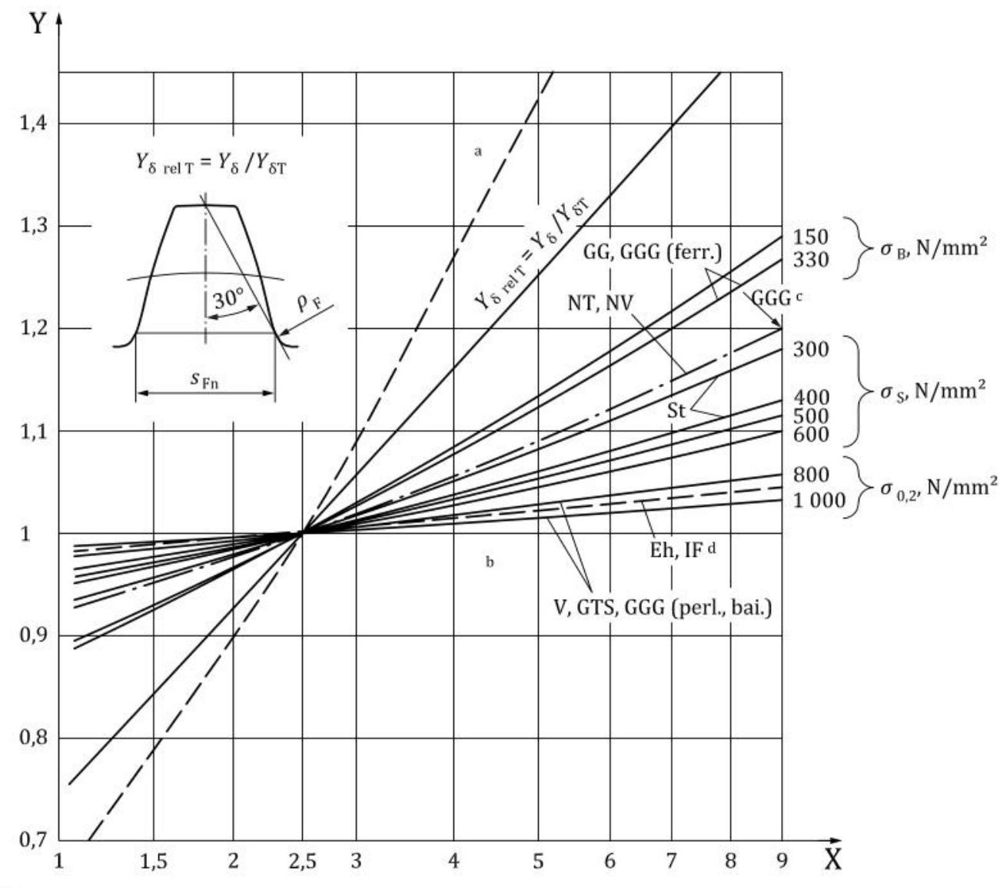

Key  
X notch parameter, $q_{\mathrm{s}}=s_{\mathrm{Fn}}/(2\rho_{\mathrm{F}})$  
Y relative notch sensitivity factor, $Y_{\delta\mathrm{relT}}$, for reference stress  
a Fully insensitive to notches.  
b Fully sensitive to notches.  
c With increasingly pearlitic structure.  
d (root).  

NOTE 1 Values of $\sigma$ are expressed in newton per square millimetre (N/mm $^{2}$ ).

NOTE 2 This figure is based on the bending flat bar complying with VDI 2226 $^{[8]}$ .

Figure 12 — Relative notch sensitivity factor, $Y_{\delta rel T}$ , for reference stress

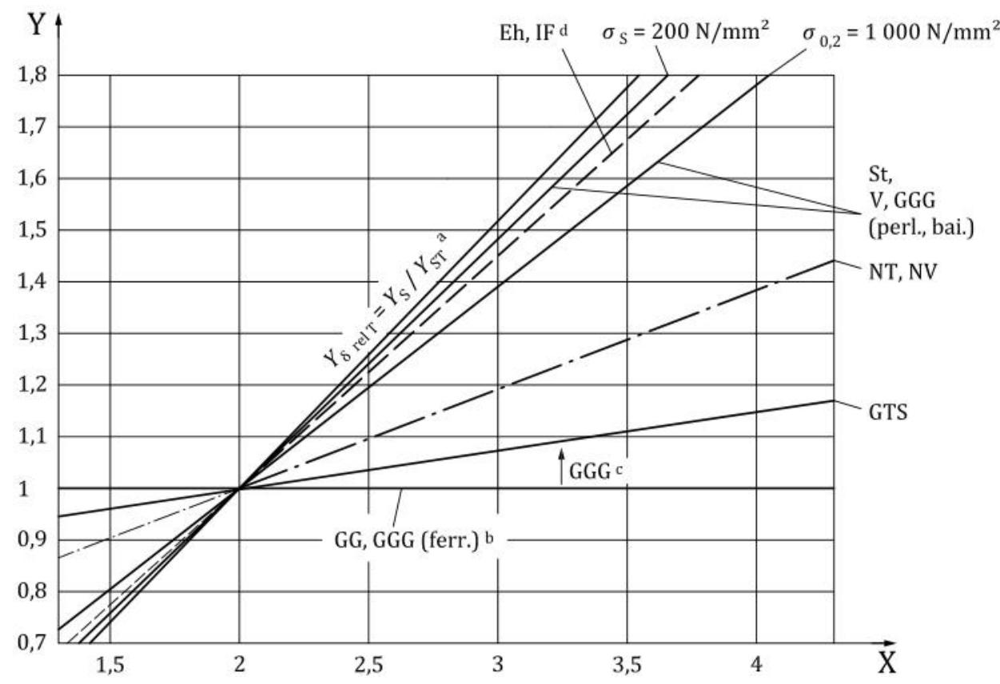

Key  
X stress correction factor, $Y_{\mathrm{S}}$  
Y relative notch sensitivity factor, $Y_{\delta\mathrm{relT}}$, for static stress  
a Fully insensitive to notches.  
b Fully sensitive to notches.  
c With increasingly pearlitic structure.  
d (root).  

NOTE This figure is based on the bending flat bar complying with VDI 2226 $^{[8]}$ .

Figure 13 — Relative notch sensitivity factor, $Y_{\delta rel T}$ , for static stress

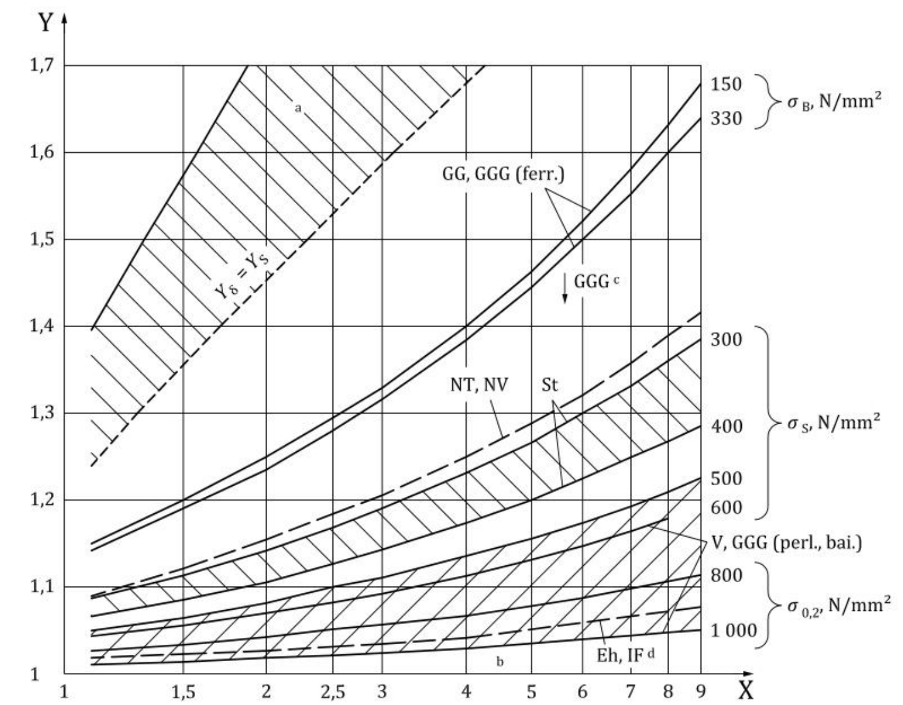

Key  
X notch parameter, $q_{\mathrm{s}}$  
Y notch sensitivity factor, $Y_{\delta}$, for reference stress  
a Fully insensitive to notches.  
b Fully sensitive to notches.  
c With increasingly pearlitic structure.  
d (root).  

NOTE This figure is based on the bending flat bar complying with VDI 2226[8].  
Figure 14 — Notch sensitivity factor, $Y_{\delta}$ , for reference stress

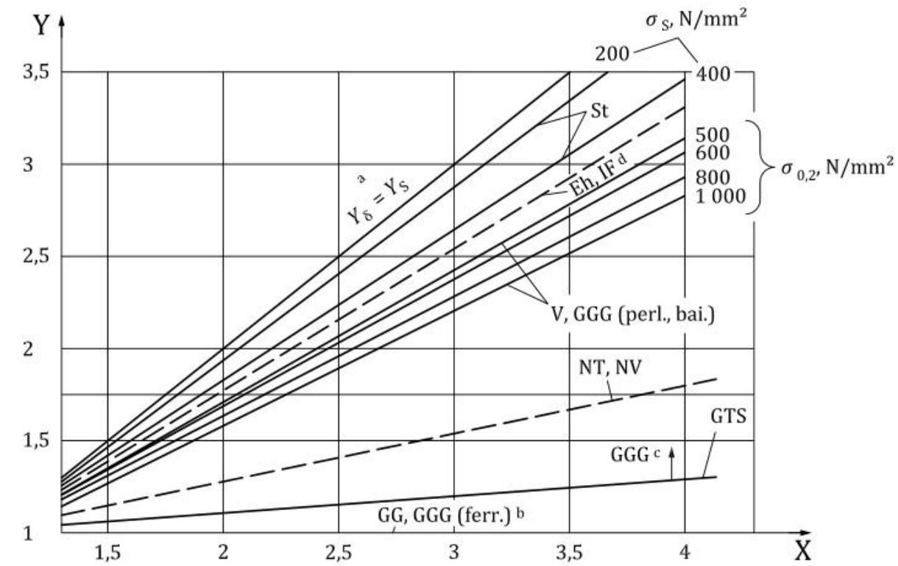

Key  
X stress correction factor, $Y_{\mathrm{S}}$  
Y notch sensitivity factor, $Y_{\delta}$, for static stress  
a Fully insensitive to notches.  
b Fully sensitive to notches.  
c With increasingly pearlitic structure.  
d (root).  

NOTE This figure is based on the bending flat bar complying with VDI 2226 $^{[8]}$ .

Figure 15 — Notch sensitivity factor, $Y_{\delta}$ , for static stress

# 14 Surface factors, $Y_{R}$ , $Y_{RT}$ , and relative surface factor, $Y_{R rel T}$

## 14.1 Influence of surface condition

The surface factor, $Y_{R}$ , accounts for the influence on the tooth root stress of the surface condition in the tooth roots. This is dependent on the material and the surface roughness in the tooth root fillets (see NOTE below). $Y_{R}$ for the static stress is different from $Y_{R}$ for dynamic stresses. This is also true for $Y_{RT}$ , the surface factor of the standard reference test gear. These factors are compared to that of a plain, polished test piece. Relative surface factors represent the relationship of the surface factor of a gear of interest to that of the standard reference test gear ( $Y_{R rel T}$ ).

NOTE The influence of the surface condition on the tooth root bending strength does not depend solely on the surface roughness in the tooth root fillets, but also on the size and shape (the problem of "notches within a notch"). This subject has not to date been sufficiently well studied for it to be taken into account in this document. The method applied here is only valid when scratches or similar defects deeper than $2 \times Rz$ are not present ( $2 \times Rz$ is a preliminary estimated value).

Besides surface texture, other influences on tooth bending strength are known, and include residual compressive stresses (shot peening), grain boundary oxidation and chemical effects. When fillets are shot-peened and/or are perfectly shaped, a value slightly greater than that obtained from the graph should be substituted for $Y_{R\ rel\ T}$ . When grain boundary oxidation or chemical effects are present, a smaller value than that indicated by the graph should be substituted for $Y_{R\ rel\ T}$ .

## 14.2 Determination of surface factors and relative surface factors

### 14.2.1 General

The comments in 5.4 apply in principle for the determination of these factors.

### 14.2.2 Method A

In Method A the tooth root stress limit is determined by testing the gear of interest or testing closely similar test gears. By this approach, the relative surface factor is equal, or approximately equal, to 1,0. In order to determine the material surface factor relative to that of the gear tested, a careful analysis shall be undertaken.

### 14.2.3 Method B

The material strength values provided are derived in accordance with Method B, from results of tests of standard reference test gears of which $Rz_{T} = 10 \mu m$ . In general, the value $Y_{R rel T}$ relevant to the reference stress of any gear of interest differs little from 1,0, since $Rz_{T} = 10 \mu m$ is a common mean value. $Y_{R rel T}$ for static stress may also be made equal to 1,0.

## 14.3 Relative surface factor, $Y_{R rel T}$ : Method B

### 14.3.1 Graphical values

$Y_{\mathrm{RrelT}}$ can be taken from Figure 16 as a function of the material and $Rz$ , the peak-to-valley roughness in the tooth root fillets of the gear of interest. This graph is derived from Figure A.1.

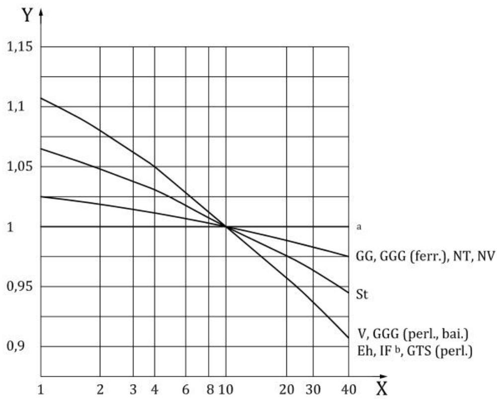

Key  
X roughness, Rz, μm  
Y relative surface factor, $Y_{R\ rel\ T}$  
a For static stress and all materials.  
b (root).  

NOTE This figure is derived from Figure A.1.

Figure 16 — Relative surface factor, $Y_{R rel T}$

### 14.3.2 Determination by calculation

#### 14.3.2.1 $Y_{R rel T}$ for reference stress

$Y_{RrelT}$ can be calculated using Formulae (84) to (90). These are consistent with the curves in Figure 16.

a) Reference stress in the range $Rz < 1\mu \mathrm{m}$

— for V, GGG (perl., bai.), Eh, IF (root), and GTS (perl.):

$$
Y_{\mathrm{RrelT}}=1,12\tag{84}
$$

— for St:

$$
Y_{\mathrm{RrelT}}=1,07\tag{85}
$$

— for GG, GGG (ferr.) and NT, NV:

$$
Y_{\mathrm{RrelT}}=1,025\tag{86}
$$

b) Reference stress in the range $1 \mu m \leq Rz \leq 40 \mu m$

$$
- \text {   for   V,   GGG   (perl.,   bai.),   Eh,   IF   (root),   and   GTS   (perl.):   }
$$

$$
Y _ {\mathrm{RrelT}} = 1,674 - 0,529 \cdot (R z + 1) ^ {0,1}\tag{87}
$$

$$
- \quad \text { for   St: }
$$

$$
Y _ {\mathrm{RrelT}} = 5,306 - 4,203 \cdot (R z + 1) ^ {0,01}\tag{88}
$$

$$
- \text {   for   GG,   GGG   (ferr.)   and   NT,   NV:   }
$$

$$
Y _ {\mathrm{RrelT}} = 4,299 - 3,259 \cdot (R z + 1) ^ {0,005}\tag{89}
$$

#### 14.3.2.2 $Y_{R rel T}$ for static stress

$$
Y _ {\mathrm{RrelT}} = 1,0\tag{90}
$$

# 15 Size factor, $Y_{X}$

## 15.1 General

The size factor, $Y_{X}$ , is used to take into consideration the influence of gear tooth size on the probable distribution of weak points in the structure of the material, on the stress gradients, which, in accordance with the strength of materials theory, decrease with increasing dimensions, on the quality of the material as determined by the extent and effectiveness of forging, on the presence of defects, etc.

The following have significant influence:

a) material, its cleanliness, chemistry, and forging process;

b) heat-treatment, depth and uniformity of hardening;

c) module, in the case of surface-hardening: case depth in relation to tooth size (core support effect).

Size factor $Y_{X}$ shall be determined separately for the pinion and the wheel.

## 15.2 Size factor, $Y_{\mathrm{X}}$ : Method A

The value of the size factor $Y_{X}$ shall be based on reliable experience or testing under the relevant operating conditions of a range of different sizes of gears in each material of interest, appropriately heat-treated. The provisions given in ISO 6336-1:2019, 4.1.16 are relevant.

## 15.3 Size factor, $Y_{X}$ : Method B

### 15.3.1 General

The values provided are based on the results of testing gears and bending strength test pieces of different sizes, due regard being paid to the current standards and practices of established heat-treatment practitioners.

### 15.3.2 Graphical values for reference stress and static stress

The value of $Y_{\mathrm{X}}$ may be taken from Figure 17 as a function of the module, material and heat-treatment.

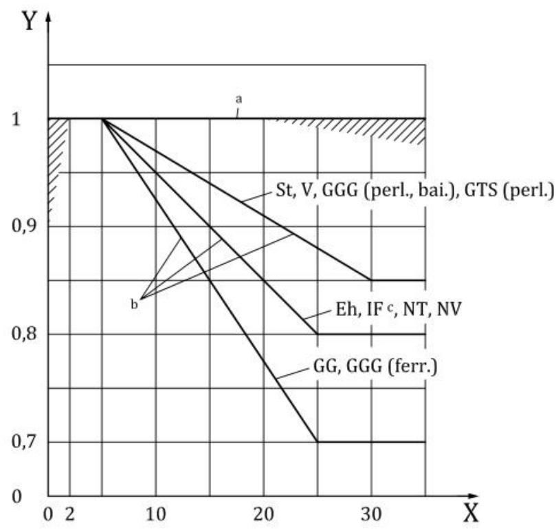  
Key  
X normal module, $m_{n}$ , mm  
Y size factor, $Y_{X}$  
a Static stress (all materials).  
b Reference stress.  
c (root).  

NOTE The shaded area is in the range of scatter for the static stress.

Figure 17 — Size factor, $Y_{X}$ , for tooth bending strength

### 15.3.3 Determination by calculation

#### 15.3.3.1 Size factor, $Y_{X}$ , for reference stress

$Y_{X}$ may be calculated using the formulae in Table 5, which are consistent with the curves given in Figure 17.

Table 5 — Size factor (root), $Y_{X}$

<table>
<tr><td colspan="2">Material</td><td>Normal module,  <math data-tex="m_{n}" display="inline" xmlns="http://www.w3.org/1998/Math/MathML"><semantics><msub><mi>m</mi><mi>n</mi></msub></semantics></math> </td><td>Size factor,  <math data-tex="Y_{X}" display="inline" xmlns="http://www.w3.org/1998/Math/MathML"><semantics><msub><mi>Y</mi><mi>X</mi></msub></semantics></math> </td></tr>
<tr><td rowspan="3">St, V, GGG (perl., bai.), GTS (perl.),</td><td rowspan="9">For <math data-tex="3\times10^6" display="inline" xmlns="http://www.w3.org/1998/Math/MathML"><semantics><mrow><mn>3</mn><mo>×</mo><msup><mn>10</mn><mn>6</mn></msup></mrow></semantics></math> cycles</td><td> <math data-tex="m_{n} \leq 5" display="inline" xmlns="http://www.w3.org/1998/Math/MathML"><semantics><mrow><msub><mi>m</mi><mi>n</mi></msub><mo>≤</mo><mn>5</mn></mrow></semantics></math> </td><td> <math data-tex="Y_{X}=1,0" display="inline" xmlns="http://www.w3.org/1998/Math/MathML"><semantics><mrow><msub><mi>Y</mi><mi>X</mi></msub><mo>=</mo><mn>1</mn><mo>,</mo><mn>0</mn></mrow></semantics></math> </td></tr>
<tr><td>5 &lt;  <math data-tex="m_{n}" display="inline" xmlns="http://www.w3.org/1998/Math/MathML"><semantics><msub><mi>m</mi><mi>n</mi></msub></semantics></math> &lt;30</td><td> <math data-tex="Y_{X}=1,03-0,006 m_{n}" display="inline" xmlns="http://www.w3.org/1998/Math/MathML"><semantics><mrow><msub><mi>Y</mi><mi>X</mi></msub><mo>=</mo><mn>1</mn><mo>,</mo><mn>03</mn><mo>−</mo><mn>0</mn><mo>,</mo><mn>006</mn><msub><mi>m</mi><mi>n</mi></msub></mrow></semantics></math> </td></tr>
<tr><td>30 ≤  <math data-tex="m_{n}" display="inline" xmlns="http://www.w3.org/1998/Math/MathML"><semantics><msub><mi>m</mi><mi>n</mi></msub></semantics></math> </td><td> <math data-tex="Y_{X}=0,85" display="inline" xmlns="http://www.w3.org/1998/Math/MathML"><semantics><mrow><msub><mi>Y</mi><mi>X</mi></msub><mo>=</mo><mn>0</mn><mo>,</mo><mn>85</mn></mrow></semantics></math> </td></tr>
<tr><td rowspan="3">Eh, IF (root), NT, NV</td><td> <math data-tex="m_{n} \leq 5" display="inline" xmlns="http://www.w3.org/1998/Math/MathML"><semantics><mrow><msub><mi>m</mi><mi>n</mi></msub><mo>≤</mo><mn>5</mn></mrow></semantics></math> </td><td> <math data-tex="Y_{X}=1,0" display="inline" xmlns="http://www.w3.org/1998/Math/MathML"><semantics><mrow><msub><mi>Y</mi><mi>X</mi></msub><mo>=</mo><mn>1</mn><mo>,</mo><mn>0</mn></mrow></semantics></math> </td></tr>
<tr><td>5 &lt;  <math data-tex="m_{n}" display="inline" xmlns="http://www.w3.org/1998/Math/MathML"><semantics><msub><mi>m</mi><mi>n</mi></msub></semantics></math> &lt;25</td><td> <math data-tex="Y_{X}=1,05-0,01 m_{n}" display="inline" xmlns="http://www.w3.org/1998/Math/MathML"><semantics><mrow><msub><mi>Y</mi><mi>X</mi></msub><mo>=</mo><mn>1</mn><mo>,</mo><mn>05</mn><mo>−</mo><mn>0</mn><mo>,</mo><mn>01</mn><msub><mi>m</mi><mi>n</mi></msub></mrow></semantics></math> </td></tr>
<tr><td>25 ≤  <math data-tex="m_{n}" display="inline" xmlns="http://www.w3.org/1998/Math/MathML"><semantics><msub><mi>m</mi><mi>n</mi></msub></semantics></math> </td><td> <math data-tex="Y_{X}=0,8" display="inline" xmlns="http://www.w3.org/1998/Math/MathML"><semantics><mrow><msub><mi>Y</mi><mi>X</mi></msub><mo>=</mo><mn>0</mn><mo>,</mo><mn>8</mn></mrow></semantics></math> </td></tr>
<tr><td rowspan="3">GG, GGG (ferr.)</td><td> <math data-tex="m_{n} \leq 5" display="inline" xmlns="http://www.w3.org/1998/Math/MathML"><semantics><mrow><msub><mi>m</mi><mi>n</mi></msub><mo>≤</mo><mn>5</mn></mrow></semantics></math> </td><td> <math data-tex="Y_{X}=1,0" display="inline" xmlns="http://www.w3.org/1998/Math/MathML"><semantics><mrow><msub><mi>Y</mi><mi>X</mi></msub><mo>=</mo><mn>1</mn><mo>,</mo><mn>0</mn></mrow></semantics></math> </td></tr>
<tr><td>5 &lt;  <math data-tex="m_{n}" display="inline" xmlns="http://www.w3.org/1998/Math/MathML"><semantics><msub><mi>m</mi><mi>n</mi></msub></semantics></math> &lt;25</td><td> <math data-tex="Y_{X}=1,075-0,015 m_{n}" display="inline" xmlns="http://www.w3.org/1998/Math/MathML"><semantics><mrow><msub><mi>Y</mi><mi>X</mi></msub><mo>=</mo><mn>1</mn><mo>,</mo><mn>075</mn><mo>−</mo><mn>0</mn><mo>,</mo><mn>015</mn><msub><mi>m</mi><mi>n</mi></msub></mrow></semantics></math> </td></tr>
<tr><td>25 ≤  <math data-tex="m_{n}" display="inline" xmlns="http://www.w3.org/1998/Math/MathML"><semantics><msub><mi>m</mi><mi>n</mi></msub></semantics></math> </td><td> <math data-tex="Y_{X}=0,7" display="inline" xmlns="http://www.w3.org/1998/Math/MathML"><semantics><mrow><msub><mi>Y</mi><mi>X</mi></msub><mo>=</mo><mn>0</mn><mo>,</mo><mn>7</mn></mrow></semantics></math> </td></tr>
<tr><td colspan="2">All materials for static stress</td><td>—</td><td> <math data-tex="Y_{X}=1,0" display="inline" xmlns="http://www.w3.org/1998/Math/MathML"><semantics><mrow><msub><mi>Y</mi><mi>X</mi></msub><mo>=</mo><mn>1</mn><mo>,</mo><mn>0</mn></mrow></semantics></math> </td></tr>
</table>

#### 15.3.3.2 Size factor, $Y_{X}$ , for static stress

$$
Y _ {X} = 1,0
$$

#### 15.3.3.3 Size factor, $Y_{X}$ , for a limited life

$Y_{X}$ is obtained by means of linear interpolation between the values for the reference stress and the static stress as determined according to 15.3.3.1 and 15.3.3.2 This formulation is already included in the determination of the permissible stress for a limited life according to 5.4.4. Consequently, if the calculation of the permissible stress for a limited life is done according to 5.4.4, additional interpolation of $Y_{X}$ does not apply.

# Annex A (normative) — Permissible bending stress, $\sigma_{FP}$, obtained from notched, flat or plain polished test pieces

## A.1 Methods for determining permissible bending stress, $\sigma_{FP}$ — Principles, assumptions and application

### A.1.1 Method $\mathbf{B}_{\mathrm{k}}$

The permissible bending stress is to be derived from the bending stress number $\sigma_{k\lim}$ and the life factor $Y_{Nk}$ results, usually presented as S-N or damage curves, of the pulsator fatigue testing of notched, flat test pieces. As in the case for Method B, the test data shall be transformed to suit the gears of interest, using the influence factors appropriate to both the method and the test piece: $Y_{\delta rel k}$ for notch sensitivity, $Y_{R rel k}$ for surface roughness and size factor $Y_{X}$ in accordance with Method B.

This method can be applied when values obtained from test gears are not available and is particularly suitable for evaluating, relative to one another, the tooth root strength values for different materials.

### A.1.2 Method $\mathrm{B_p}$

The permissible bending stresses are to be derived from the bending stress number $\sigma_{p\lim}$ and the life factor $Y_{Np}$ results, usually presented as S-N or damage curves, of the pulsator fatigue testing of plain, polished test pieces. As in the case for Method B, the test data shall be transformed to suit the gears of interest, using the (absolute) influence factors appropriate to the method and the test piece: $Y_{\delta}$ for notch sensitivity, $Y_{R}$ for surface roughness and the size factor $Y_{X}$ in accordance with Method B.

This method can be applied when values obtained from either gears or notched test pieces are not available, and is particularly suitable for evaluating, relative to one another, the tooth root strength values for different materials.

## A.2 Permissible bending stress, $\sigma_{FP}$ : Method $B_{k}$

### A.2.1 $\sigma_{FP}$ for static stress and reference stress

Using these methods, the permissible bending stress is calculated on the basis of the strength of a notched test piece from Formula (A.1):

$$
\sigma_ {\mathrm{FP}} = \frac {\sigma_ {\mathrm{k} \lim} \cdot Y _ {\mathrm{Sk}} \cdot Y _ {\mathrm{Nk}}}{S _ {\mathrm{F} \min}} \cdot Y _ {\delta \text {rel K}} \cdot Y _ {\mathrm{R} \text {rel k}} \cdot Y _ {\mathrm{X}} = \frac {\sigma_ {\mathrm{FG}}}{S _ {\mathrm{F} \min}}\tag{A.1}
$$

where

$\sigma_{k\lim}$ is the nominal notched-bar stress number (bending), which is the bending stress limit value of the notched-bar test piece relevant to its material, heat treatment and surface condition in relation to its dimensions (see recommendation below);

$Y_{Sk}$ is the stress correction factor, relevant to the notched test piece;

$Y_{Nk}$ is the life factor for tooth root stress, relevant to the notched test piece, which is used to take into account the higher load bearing capacity for a limited number of load cycles;

$Y_{\delta relk}$ is the relative notch sensitivity factor, which is the quotient of the notch sensitivity factor of the gear of interest divided by the notched test piece factor (see A.6), and which enables the influence of the notch sensitivity of the material to be taken into account;

$Y_{Rrelk}$ is the relative roughness factor, which is the quotient of the tooth root fillet roughness factor of the gear of interest divided by the notched test piece factor (see A.7), and which enables the relevant surface roughness of tooth root fillet influences to be taken into account.

For $\sigma_{k\lim}$ , differences between the properties of the heat-treated materials, application of stresses and sections of test piece and gear of interest due to conditions of manufacture should be taken into consideration.

Other relevant symbols are defined in 5.4.3.

The values of the factors related to the notched test piece ( $\sigma_{k\lim}$ , $Y_{Sk}$ and $Y_{Nk}$ ) shall be determined by tests or to be taken from literature (see A.5). Evaluations of $\sigma_{k\lim}$ and all corresponding influence factors shall be based on values of static stress and reference stress appropriate to the notched test piece.

The influence factors shall be determined in accordance with 5.4.3.

### A.2.2 $\sigma_{\mathrm{FP}}$ for a limited life

The value of $\sigma_{FP}$ shall be determined in accordance with 5.4.4.

## A.3 Permissible bending stress, $\sigma_{FP}$ : Method $B_{p}$

For these methods the permissible bending stress is calculated on the basis of the strength of a plain, polished test piece from Formula (A.2):

$$
\sigma_ {\mathrm{FP}} = \frac {\sigma_ {\mathrm{Plim}} \cdot Y _ {\mathrm{Np}}}{S _ {\mathrm{Fmin}}} \cdot Y _ {\delta} \cdot Y _ {\mathrm{R}} \cdot Y _ {\mathrm{X}} = \frac {\sigma_ {\mathrm{FG}}}{S _ {\mathrm{Fmin}}}\tag{A.2}
$$

> Editorial note (not part of the ISO text): The first term in Formula (A.2) uses an uppercase $P$ in $\sigma_{P\mathrm{lim}}$, while the definition on the following page uses a lowercase $p$. Both are reproduced as printed.

where

$\sigma_{p\lim}$ is the nominal plain-bar stress number (bending), which is the bending stress limit value of the plain-bar test piece relevant to its material and heat treatment in relation to its dimensions (see recommendations, below);

$Y_{Np}$ is the life factor for the tooth root stress, relevant to the plain, polished test piece which is used in order to take into account the higher load capacity for a limited number of cycles;

$Y_{\delta}$ is the notch sensitivity factor of the gear of interest, as related to a plain, polished test piece, which enables the influence of the notch sensitivity of the material to be taken into account;

$Y_{R}$ is the surface factor of the gear of interest, as related to the plain, polished test piece, which enables relevant surface roughness influences to be taken into account.

For $\sigma_{k\lim}$ , differences between the properties of the heat-treated materials of the test piece and gear of interest due to conditions of manufacture should be taken into consideration.

Other relevant terms and symbols are defined in 5.4.3.

Evaluations of $\sigma_{p\lim}$ and $Y_{Np}$ for plain test pieces shall be based on tests or obtained from the literature (see A.5). Evaluations of $\sigma_{p\lim}$ and all corresponding influence factors shall be based on values of the static stress and the reference stress.

The influence factors shall be determined in accordance with 5.4.3 and 5.4.4.

## A.4 Safety factor for bending strength (safety against tooth breakage), $S_{F}$

### A.4.1 Method $\mathbf{B}_{\mathrm{k}}$

This procedure follows the methods described in 5.2, with $\sigma_{\mathrm{FG}}$ calculated in accordance with A.2.

### A.4.2 Method $\mathrm{B_p}$

This procedure follows the methods according to 5.2, with $\sigma_{\mathrm{FG}}$ calculated in accordance with A.3.

## A.5 Reference stress for bending, with values $\sigma_{k\lim}$ and $\sigma_{p\lim}$ for Methods $B_{k}$ and $B_{p}$

Refer to A.1.1 and A.1.2 for information on these values. The bending stress numbers $\sigma_{k\lim}$ and $\sigma_{p\lim}$ are derived from the results of pulsator bending tests of notched or plain test pieces, or else can be found in the literature.

## A.6 Notch sensitivity factor, $Y_{\delta k}$ and relative notch sensitivity Factor $Y_{\delta rel k}$

### A.6.1 Basic uses

The comments made in 13.1 apply to $Y_{\delta k}$ in relation to the breakage of a notched test piece. Those comments also apply to the relative sensitivity factors which relate the sensitivity of a gear of interest to that of a notched test piece ( $Y_{\delta rel k}$ ).

### A.6.2 Determination of the notch sensitivity factors

#### A.6.2.1 Method $B_{k}$

Since, by Method $B_{k}$ , material strength values are derived from notched test-piece tests, the more closely the value $q_{sk}$ of the notched test-piece approaches that of the gear of interest, the more closely the value of $Y_{\delta rel k}$ approaches 1,0.

#### A.6.2.2 Method $\mathrm{B_p}$

Since, by Method $B_{p}$ , material strength values are derived from the tests of plain, polished test-pieces, it is necessary that in this method the absolute notch sensitivity factor $Y_{\delta}$ be used.

### A.6.3 Relative notch sensitivity factor, $Y_{\delta rel k}$ : Method $B_{k}$

#### A.6.3.1 Graphical values

##### A.6.3.1.1 $Y_{\delta relk}$ for reference stress

$Y_{\delta}$ for the gear of interest and $Y_{\delta \mathrm{k}}$ for the notched test-piece are taken from Figure 14 as a function of $q_{\mathrm{s}}$ (the gear), $q_{\mathrm{sk}}$ (the test-piece) and for the appropriate material. These values are substituted in Formula (A.3) to obtain $Y_{\delta \mathrm{relk}}$ :

$$
Y _ {\delta \mathrm{relk}} = \frac {Y _ {\delta}}{Y _ {\delta \mathrm{k}}}\tag{A.3}
$$

##### A.6.3.1.2 $Y_{\delta rel k}$ for static stress

$Y_{\delta}$ for the gear of interest and $Y_{\delta k}$ for the notched test-piece are taken from Figure 15 as a function of $Y_{S}$ (gear), $Y_{Sk}$ (test-piece) and for the appropriate material. The values are to be substituted in Formula (A.3) to determine $Y_{\delta rel k}$ for the static stress. Values of $Y_{Sk}$ , the stress correction factor for the notched test-piece (corresponding to the form factor of the notch), can be obtained from the literature.

#### A.6.3.2 Determination by calculation

##### A.6.3.2.1 $Y_{\delta relk}$ for reference stress

$Y_{\delta rel k}$ can be calculated using Formula (A.4) and numerical values given Table 4:

$$
Y _ {\delta \text {rel k}} = \frac {Y _ {\delta}}{Y _ {\delta \mathrm{k}}} = \frac {1 + \sqrt {\rho^ {\prime} \cdot \chi^ {*}}}{1 + \sqrt {\rho^ {\prime} \cdot \chi_ {\mathrm{k}} ^ {*}}}\tag{A.4}
$$

Where $\chi^{*}_{k}$ , the relevant stress gradient in the notch root of the test-piece, is determined by substituting the test-piece value $q_{sk}$ in Formula (76) for $q_{s}$ .

##### A.6.3.2.2 $Y_{\delta relk}$ for static stress

$Y_{\delta}$ can be calculated in accordance with A.6.4.2.2; $Y_{\delta k}$ can be calculated using Formulae (A.5) to (A.9), which are consistent with the curves in Figure 15. Substitution of the two values in Formula (A.4) gives $Y_{\delta rel k}$ .

a) For St with well-defined yield point:

$$
Y _ {\delta \mathrm{k}} = 1 + 0,93 \cdot \left(Y _ {\mathrm{Sk}} - 1\right) \cdot \sqrt [ 4 ]{\frac {200}{\sigma_ {\mathrm{S}}}}\tag{A.5}
$$

b) For St with steadily increasing elongation curve and 0,2 % proof stress, V and GGG (perl., bai.):

$$
Y _ {\delta \mathrm{k}} = 1 + 0,82 \cdot \left(Y _ {\mathrm{Sk}} - 1\right) \cdot \sqrt [ 4 ]{\frac {300}{\sigma_ {0,2}}}\tag{A.6}
$$

c) For Eh and IF(root) with stress up to crack initiation:

$$
Y _ {\delta \mathrm{k}} = 0,77 \cdot Y _ {\mathrm{Sk}} + 0,22\tag{A.7}
$$

d) For NT and NV with stress up to crack initiation:

$$
Y _ {\delta \mathrm{k}} = 0,27 \cdot Y _ {\mathrm{Sk}} + 0,72\tag{A.8}
$$

e) For GG and GGG (ferr.) with stress up to fracture limit:

$$
Y _ {\delta \mathrm{k}} = 1,0\tag{A.9}
$$

### A.6.4 Determination of notch sensitivity factor, $Y_{\delta}$ Method $B_{p}$

#### A.6.4.1 Graphical values

##### A.6.4.1.1 $Y_{\delta}$ for reference stress

$Y_{\delta}$ can be taken from Figure 14 and the material, all relevant to the gear of interest.

##### A.6.4.1.2 $Y_{\delta}$ for static stress

$Y_{\delta}$ can be taken from Figure 15 as a function of $Y_{S}$ , the stress correction factor, and the material of the gear of interest.

#### A.6.4.2 Determination by calculation

##### A.6.4.2.1 $Y_{\delta}$ for reference stress

$Y_{\delta}$ may be calculated using Formula (A.10) and the numerical values given in Table 4:

$$
Y _ {\delta} = \frac {1 + \sqrt {\rho^ {\prime} \cdot \chi^ {*}}}{1 + \sqrt {\rho^ {\prime} \cdot \chi_ {\mathrm{p}} ^ {*}}}\tag{A.10}
$$

##### A.6.4.2.2 $Y_{\delta}$ for static stress

The maximum possible value of the static notch sensitivity factor is equal to that of the stress correction factor, $Y_{S}$ . Such a value would imply that the material is in a fully plastic state:

a) For St with well-defined yield point:

$$
Y _ {\delta} = 1 + 0,93 \cdot \left(Y _ {S} - 1\right) \cdot \sqrt [ 4 ]{\frac {200}{\sigma_ {S}}}\tag{A.11}
$$

b) For St with steadily increasing elongation curve and 0,2 % proof stress, V and GGG (perl., bai.):

$$
Y _ {\delta} = 1 + 0,82 \cdot \left(Y _ {S} - 1\right) \cdot \sqrt [ 4 ]{\frac {300}{\sigma_ {0,2}}}\tag{A.12}
$$

c) For Eh and IF (root) with stress up to crack initiation:

$$
Y _ {\delta} = 0,77 \cdot Y _ {S} + 0,22\tag{A.13}
$$

d) For NT and NV with stress up to crack initiation:

$$
Y _ {\delta} = 0,27 \cdot Y _ {S} + 0,72\tag{A.14}
$$

e) For GG and GGG (ferr.) with stress up to fracture limit:

$$
Y _ {\delta} = 1,0\tag{A.15}
$$

## A.7 Surface factor, $Y_{Rk}$ , and relative surface factor, $Y_{R rel k}$

### A.7.1 General

The surface factor, $Y_{Rk}$ , accounts for the influence on tooth root stress of the surface condition in the tooth roots. This is dependent on the material and the surface roughness in the tooth root fillets (see NOTE in 14.1). $Y_{Rk}$ , the surface factor relevant to a rough notched test-piece for the static stress is different from $Y_{Rk}$ for the dynamic stress. These factors are compared to that of a plain, polished test piece. Relative surface factors represent the relationship of the surface factor of a gear of interest to that of a rough notched test-piece ( $Y_{R rel k}$ ).

### A.7.2 Determination of surface factor and relative surface factor

#### A.7.2.1 Method $\mathbf{B}_{\mathrm{k}}$

Since by Method $B_{k}$ , material strength values are derived from notched, rough, test piece tests, the more closely the values $Rz_{k}$ and $q_{sk}$ of the notched test-piece approach those of the gear of interest, the more closely the value of $Y_{R rel k}$ approaches 1,0.

#### A.7.2.2 Method $\mathrm{B_p}$

In Method $B_{p}$ , material strength values are determined by testing plain polished test pieces, in which case it is necessary that the absolute surface factor $Y_{R}$ be used in calculations. As roughness in a root fillet constitutes “notches within a notch”, the influence of $Y_{R}$ is somewhat reduced (see NOTE in 14.1):

$$
Y _ {\mathrm{R}} = Y _ {\mathrm{R0}} + \left(1 - Y _ {\mathrm{R0}}\right) \cdot \left(\frac {Y _ {\mathrm{S}} - 1}{Y _ {\mathrm{S}}}\right) ^ {2}\tag{A.16}
$$

where $Y_{R0}$ is the surface factor of the plain, polished test-piece.

An approximate average value can be obtained when $Y_{S}$ is made equal to 2,0. Figure A.1 has been plotted using this value.

### A.7.3 Relative surface factor, $Y_{R rel k}$ : Method $B_{k}$

#### A.7.3.1 Graphical values

Obtain from Figure A.1, $Y_{\mathrm{R}}$ for the gear of interest and $Y_{\mathrm{Rk}}$ for the notched test piece, as a function of

a) the peak-to-valley roughnesses, $Rz$ , of the gear tooth root or $Rz_{k}$ of the test piece notch-root, and

b) the material of interest.

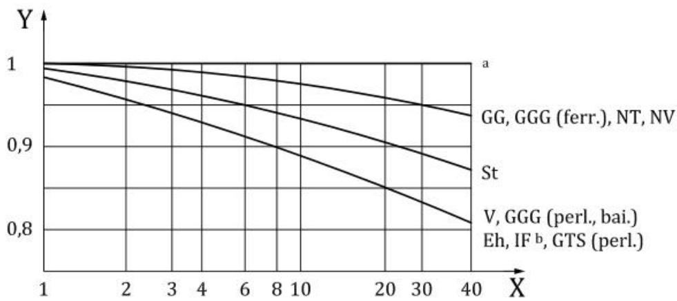

Key  
X roughness $Rz, Rz_{k}, \mu m$  
Y surface factor, $Y_{R}, Y_{Rk}$  
a For static stress and all materials.  
b (root).  

Figure A.1 — Surface factor, $Y_{R}$ and $Y_{Rk}$ (related to the smooth polished test piece)

These values are to be substituted in Formula (A.17).

$$
Y _ {\mathrm{Rrelk}} = \frac {Y _ {\mathrm{R}}}{Y _ {\mathrm{Rk}}}\tag{A.17}
$$

#### A.7.3.2 Determination by calculation

##### A.7.3.2.1 General

Obtain $Y_{R}$ following the directions in A.7.4.2.3 and obtain $Y_{Rk}$ using Formulae (A.18) to (A.21), which are consistent with the curves in Figure A.1. Introduce these values in Formula (A.17).

##### A.7.3.2.2 $Y_{\mathrm{Rrelk}}$ for static stress (in general) and reference stress in range $Rz_{\mathrm{k}} < 1\mu \mathrm{m}$

> 编者校核注（非标准正文）：ISO3-002；原文第50页相邻分段未明确包括 Rzk=1 或 40 μm，端点适用性需由权威说明核实。

$$
Y _ {\mathrm{Rk}} = 1,0\tag{A.18}
$$

##### A.7.3.2.3 $Y_{\mathrm{Rrelk}}$ for reference stress in the range $1\mu \mathrm{m} < Rz_{\mathrm{k}} < 40~{\mu\mathrm{m}}$

a) For V, GGG (perl., bai.), Eh, IF (root) and GTS (perl.):

$$
Y _ {\mathrm{Rk}} = 1,490 - 0,471 \cdot \left(R z _ {\mathrm{k}} + 1\right) ^ {0,1}\tag{A.19}
$$

b) For St:

$$
Y _ {\mathrm{Rk}} = 4,924 - 3,90 \cdot \left(R z _ {\mathrm{k}} + 1\right) ^ {0,01}\tag{A.20}
$$

c) For GG, GGG (ferr.) and NT, NV:

$$
Y _ {\mathrm{Rk}} = 4,161 - 3,155 \cdot \left(R z _ {\mathrm{k}} + 1\right) ^ {0,005}\tag{A.21}
$$

### A.7.4 Surface factor, $Y_{R}$ : Method $B_{p}$

#### A.7.4.1 Graphical values

$Y_{R}$ for reference stress and static stress can be taken from Figure A.1 as a function of Rz, the peak-to-valley roughness in the tooth root fillets of the gear of interest and of the material. The derivation of $Y_{R}$ for a limited life follows, in principle, the procedure given in A.7.4.2.

#### A.7.4.2 Determination by calculation

##### A.7.4.2.1 General

$Y_{R}$ can be calculated using Formulae (A.22) to (A.25), which are consistent with the curves in Figure A.1.

##### A.7.4.2.2 $Y_{R}$ for static stress (in general) and reference stress in range $Rz < 1 \mu m$

$$
Y _ {\mathrm{R}} = 1,0\tag{A.22}
$$

##### A.7.4.2.3 $Y_{R}$ for reference stress in range 1 $\mu$ m ≤ Rz ≤ 40 $\mu$ m

a) For V, GGG (perl., bai.), Eh, IF (root) and GTS (perl.):

$$
Y _ {\mathrm{R}} = 1,490 - 0,471 \cdot (R z + 1) ^ {0,1}\tag{A.23}
$$

b) For St:

$$
Y _ {\mathrm{R}} = 4,924 - 3,90 \cdot (R z + 1) ^ {0,01}\tag{A.24}
$$

c) For GG, GGG (ferr.) and NT, NV:

$$
Y _ {\mathrm{R}} = 4,161 - 3,155 \cdot (R z + 1) ^ {0,005}\tag{A.25}
$$

# Annex B (informative) — Guide values for mean stress influence factor, $Y_{M}$

## B.1 General

NOTE This annex does not conform with ISO 6336-5, in which the influence of reverse loading is covered by a factor 0,7.

The mean stress influence factor, $Y_{M}$ , takes into account the influence of working stress conditions other than pure pulsations, e.g. load reversings, idler gears or idler and planetary gears.

$Y_{M}$ is defined as the ratio between the endurance (or static) strength with a stress ratio $R \neq 0$ , and the endurance (or static) strength with R = 0 to be included in Formula (5).

$Y_{M}$ applies only to a calculation method which assesses the positive (tensile) stresses and which is therefore suitable for comparison between the calculated (positive) working stress $\sigma_{F}$ and the permissible stress $\sigma_{FP}$ multiplied with $Y_{M}$ . The following method may be used within a stress ratio $1>R>0$.

> Editorial note (not part of ISO text): The interval $1>R>0$ in B.1 and $R=1$ in B.3 are reproduced as printed, although B.2 also gives a negative stress ratio. No sign has been silently changed.

## B.2 Idler and planetary gears

The mean stress influence factor, $Y_{M}$ , can be calculated as follows:

$$
Y _ {M} = \frac {1}{1 - R \cdot \frac {1 - M}{1 + M}}\tag{B.1}
$$

where

R is the stress ratio;

M considers the mean stress influence on the endurance (or static) strength amplitudes, and is defined as the reduction of the endurance strength amplitude for a certain increase of the mean stress divided by that increase of the mean stress (the values listed in Table B.1 may be used for M, see explanation below).

To simplify, for designs with the same load applied both on forward- and back-flank, R may be assumed to equal -1,2. For designs with considerably different loads on the forward- and back-flank, R may be assumed to be as follows:

$$
R = - 1,2 \cdot \frac {F _ {\mathrm{Rlow}}}{F _ {\mathrm{Rhigh}}}\tag{B.2}
$$

where

$F_{Rhigh}$ is the load per unit facewidth of the higher loaded flank

$F_{Rlow}$ is the load per unit facewidth of the lower loaded flank

The listed values for M for the endurance limit are independent of the fillet shape, except for case hardening. In principle, there is a dependency of the static notch sensitivity factor (and thereby indirectly $Y_{S}$ ), but wide variations usually only occur for case hardening, e.g. smooth semicircular versus grinding notches.

Table B.1 — Mean stress ratio, M

|  | Endurance limit | Static strength |
| --- | --- | --- |
| Case hardened | $0,8-0,15Y_{\mathrm{S}}$ | 0,7 |
| Case hardened and shot peened | 0,4 | 0,6 |
| Nitrided | 0,3 | 0,3 |
| Induction or flame hardened | 0,4 | 0,6 |
| Not surface hardened steels | 0,3 | 0,5 |
| Cast steels | 0,4 | 0,6 |

## B.3 Gears with periodical change of loading direction

For case hardened gears with full load applied periodically in both directions, the same formulae for $Y_{M}$ as for idler gears (with R = 1) may be used together with the values for M for the endurance limit. This simplified approach is valid when the number of changes of directions exceeds 100 and the total number of load cycles exceeds $3 \times 10^{6}$ .

# Annex C (informative) — Derivations of determinant normal tooth load of spur gears

The nominal bending stress $\sigma$ equals the bending moment divided by the section modulus of the gear at $s_{\mathrm{Fn}}$ . This is in accordance with the following formula, with symbols in accordance with Figures 3 and 4.

$$
\sigma = \frac {F _ {\mathrm{b}} \cdot \cos \alpha_ {\mathrm{Fen}}}{\frac {1}{6} \cdot (b \cdot s _ {\mathrm{Fn}} ^ {2})} \cdot h _ {\mathrm{Fe}}\tag{C.1}
$$

$$
F _ {\mathrm{b}} \cdot \frac {d _ {\mathrm{b}}}{2} = F _ {\mathrm{t}} \cdot \frac {d}{2} = F _ {\mathrm{w}} \cdot \frac {d _ {\mathrm{w}}}{2}\tag{C.2}
$$

where

$d_{b}$ is the base diameter;

d is the reference diameter;

$d_{w}$ is the pitch diameter;

$F_{t}$ is the nominal tangential load at the reference cylinder;

$F_{w}$ is the nominal tangential load at the pitch cylinder.

$$
F _ {b} = \frac {F _ {\mathrm{t}}}{\cos \alpha_ {\mathrm{t}}} = \frac {F _ {\mathrm{w}}}{\cos \alpha_ {\mathrm{wt}}}\tag{C.3}
$$

$$
\sigma = \left[ \frac {\frac {h _ {\mathrm{Fe}}}{m _ {\mathrm{n}}} \cdot \cos \alpha_ {\mathrm{Fen}}}{\frac {1}{6} \cdot \left(\frac {s _ {\mathrm{Fn}}}{m _ {\mathrm{n}}}\right) ^ {2} \cdot \cos \alpha_ {\mathrm{n}}} \right] \cdot \frac {F _ {\mathrm{t}}}{b \cdot m _ {\mathrm{n}}} = \frac {F _ {\mathrm{t}}}{b \cdot m _ {\mathrm{n}}} \cdot Y _ {\mathrm{F}}\tag{C.4}
$$

where

$\alpha_{n}$ is the normal pressure angle of the basic rack profile;

$\alpha_{t}$ is the transverse pressure angle of the basic rack profile;

$\alpha_{w}$ is the working pressure angle.

NOTE For spur gears $\alpha_{n} = \alpha_{t}$ .

When $\sigma$ is expressed as a function of $F_{\mathrm{t}}$ , a form factor, $Y_{\mathrm{F}}$ , can be derived from Formula (C.4).

# Bibliography

[1] ISO 54:1996, Cylindrical gears for general engineering and for heavy engineering — Modules

[2] ISO 701:1998, International gear notation — Symbols for geometrical data

[3] ISO 1328-1:2013, Cylindrical gears — ISO system of flank tolerance classification — Part 1: Definitions and allowable values of deviations relevant to flanks of gear teeth

[4] ISO/TR 10064-4, Code of inspection practice — Part 4: Recommendations relative to surface texture and tooth contact pattern checking

[5] ANSI/AGMA 2101-D04, Fundamental Rating Factors and Calculation Methods for Involute Spur and Helical Gear Teeth (Metric edition of ANSI/AGMA 2001-D04)

[6] DIN 3990 (all parts), Tragfähigkeitsberechnung von Stirnrädern

[7] TGL 10545:1963, Tragfähigkeitsberechnung von außenverzahnten Stirnrädern

[8] VDI 2226, Empfehlung für die Festigkeitsberechnung metallischer Bauteile. VDI-Verlag GmbH, Düsseldorf, 1965

[9] VDI 2737, Calculation of the load capacity of the tooth root in internal toothings with influence of the gear rim, 2016

[10] BROSSMANN U. Über den Einfluß der Zahnausrundung und des Schrägungswinkels auf Beanspruchung und Festigkeit schrägverzahnter Stirnräder, Doctoral dissertation, Technische Universität München, 1979

[11] HIRT M. Einfluß der Zahnfußausrundung auf Spannung und Festigkeit von Geradstirnrädern, Doctoral dissertation, Technische Universität München, 1976

[12] NIEMANN G., WINTER H. Maschinenelemente, Band 2 und 3, Getriebe. Springer, Berlin 2003

[13] PÜCHNER O., KAMENSKI A., Spannungskonzentration von Kerben im Kerbrand, Konstruktion, 24, 1972, pp. 127-134

[14] STRASSER H. Einflüsse von Verzahnungsgeometrie, Werkstoff und Wärmebehandlung auf die Zahnfußtragfähigkeit, Doctoral dissertation, Technische Universität München, 1984

[^1]: Stresses such as those caused by the shrink-fitting of gear rims, which are superimposed on stresses due to tooth loading, should be taken into consideration in the calculation of permissible tooth root stress $\sigma_{\mathrm{FP}}$.

[^2]: If the tip of the tooth has been rounded or chamfered, it is necessary to replace the tip diameter, $d_a$, in the calculation by $d_{\mathrm{Na}}$ the “effective tip diameter”.

[^3]: See 7.3 for the procedure to be followed when grinding notches are present in tooth fillets.

[^4]: Applies for module $m=5$ mm. The influence of size is covered by the factor $Y_{\mathrm{X}}$ (see Clause 15).

ICS 21.200

Price based on 55 pages

© ISO 2019 — All rights reserved
