INTERNATIONAL STANDARD ISO 6336-5:2016(E)

Third edition 2016-08-15

Calculation of load capacity of spur and helical gears —

Part 5: Strength and quality of materials

Calcul de la capacité de charge des engrenages cylindriques à dentures droite et hélicoïdale —

Partie 5: Résistance et qualité des matériaux

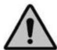

COPYRIGHT PROTECTED DOCUMENT

© ISO 2016, Published in Switzerland

All rights reserved. Unless otherwise specified, no part of this publication may be reproduced or utilized otherwise in any form or by any means, electronic or mechanical, including photocopying, or posting on the internet or an intranet, without prior written permission. Permission can be requested from either ISO at the address below or ISO's member body in the country of the requester.

ISO copyright office
Ch. de Blandonnet 8 • CP 401
CH-1214 Vernier, Geneva, Switzerland
Tel. +41 22 749 01 11
Fax +41 22 749 09 47
copyright@iso.org
www.iso.org

# Contents  
  
Foreword iv  
Introduction v  
1 Scope 1  
2 Normative references 1  
3 Terms, definitions and symbols 2  
4 Methods for the determination of allowable stress numbers 2  
4.1 General 2  
4.2 Method A 3  
4.3 Method B 3  
4.4 Method $B_{\mathrm{r}}$ 3  
4.5 Method $B_{\mathrm{k}}$ 3  
4.6 Method $B_{\mathrm{p}}$ 3  
5 Standard allowable stress numbers — Method B 3  
5.1 Application 3  
5.2 Allowable stress number (contact), $\sigma_{H\mathrm{lim}}$ 4  
5.3 Bending stress number values for $\sigma_{F\mathrm{lim}}$ and $\sigma_{\mathrm{FE}}$ 5  
5.3.1 Nominal stress numbers (bending), $\sigma_{F\mathrm{lim}}$ 5  
5.3.2 Allowable stress number (bending), $\sigma_{\mathrm{FE}}$ 5  
5.3.3 Reversed bending 5  
5.4 Graphs for $\sigma_{H\mathrm{lim}}$ and $\sigma_{F\mathrm{lim}}$ and $\sigma_{\mathrm{FE}}$ 6  
5.5 Calculation of $\sigma_{H\mathrm{lim}}$ and $\sigma_{F\mathrm{lim}}$ 6  
5.6 Hardening depth of surface hardened gears in finished condition 23  
5.6.1 General 23  
5.6.2 Case depth of carburized and hardened gears 23  
5.6.3 Nitriding hardening depth of nitrided gears 25  
6 Requirements for material quality and heat treatment 26  
6.1 General aspects 26  
6.2 Normalized low carbon or cast steel, plain carbon, unalloyed steels (see Figures 1 and 2) 27  
6.3 Black malleable cast iron [see Figures 3 a) and 4 a] 27  
6.4 Other materials [see Figures 3 b), 3 c), 4 b), 4 c), 5 to 16] 27  
6.5 Coupon 40  
6.6 Mechanical cleaning by shot blasting 41  
6.7 Shot peening 41  
6.7.1 General 41  
6.7.2 Strength enhancement 41  
6.7.3 Salvage 41  
Annex A (informative) Considerations of size of controlling section for through hardened gearing 43  
Annex B (informative) Core hardness coefficients 46  
Bibliography 47  
  
# Foreword

ISO (the International Organization for Standardization) is a worldwide federation of national standards bodies (ISO member bodies). The work of preparing International Standards is normally carried out through ISO technical committees. Each member body interested in a subject for which a technical committee has been established has the right to be represented on that committee. International organizations, governmental and non-governmental, in liaison with ISO, also take part in the work. ISO collaborates closely with the International Electrotechnical Commission (IEC) on all matters of electrotechnical standardization.

The procedures used to develop this document and those intended for its further maintenance are described in the ISO/IEC Directives, Part 1. In particular the different approval criteria needed for the different types of ISO documents should be noted. This document was drafted in accordance with the editorial rules of the ISO/IEC Directives, Part 2 (see www.iso.org/directives).

Attention is drawn to the possibility that some of the elements of this document may be the subject of patent rights. ISO shall not be held responsible for identifying any or all such patent rights. Details of any patent rights identified during the development of the document will be in the Introduction and/or on the ISO list of patent declarations received (see www.iso.org/patents).

Any trade name used in this document is information given for the convenience of users and does not constitute an endorsement.

For an explanation on the meaning of ISO specific terms and expressions related to conformity assessment, as well as information about ISO's adherence to the World Trade Organization (WTO) principles in the Technical Barriers to Trade (TBT) see the following URL: www.iso.org/iso/foreword.html.

The committee responsible for this document is ISO/TC 60, Gears, Subcommittee SC 2, Gear capacity calculation.

This third edition cancels and replaces the second edition (ISO 6336-5:2003), which has been technically revised to reflect current practices throughout the industry.

A list of all parts in the ISO 6336 series can be found on the ISO website.

# Introduction

This document, together with ISO 6336-1, ISO 6336-2, ISO 6336-3 and ISO 6336-6, provides the principles for a coherent system of procedures for the calculation of the load capacity of cylindrical involute gears with external or internal teeth. ISO 6336 is designed to facilitate the application of future knowledge and developments, as well as the exchange of information gained from experience.

Allowable stress numbers, as covered by this document, may vary widely. Such variation is attributable to defects and variations of chemical composition (charge), structure, the type and extent of hot working (e.g. bar stock, forging, reduction ratio), heat treatment, residual stress levels, etc.

Tables summarize the most important influencing variables and the requirements for the different materials and quality grades. The effects of these influences on surface durability and tooth bending strength are illustrated by graphs.

This document covers the most widely used ferrous gear materials and related heat treatment processes. Recommendations on the choice of specific materials, heat treatment processes or manufacturing processes are not included. Furthermore, no comments are made concerning the suitability or otherwise of any materials for specific manufacturing or heat treatment processes.

Calculation of load capacity of spur and helical gears —

Part 5:

Strength and quality of materials

# 1 Scope

This document describes contact and tooth-root stresses and gives numerical values for both limit stress numbers. It specifies requirements for material quality and heat treatment and comments on their influences on both limit stress numbers.

Values in accordance with this document are suitable for use with the calculation procedures provided in ISO 6336-2, ISO 6336-3 and ISO 6336-6 and in the application standards for industrial, high-speed and marine gears. They are applicable to the calculation procedures given in ISO 10300 for rating the load capacity of bevel gears. This document is applicable to all gearing, basic rack profiles, profile dimensions, design, etc., covered by those standards. The results are in good agreement with other methods for the range indicated in the scope of ISO 6336-1 and ISO 10300-1.

# 2 Normative references

The following documents are referred to in the text in such a way that some or all of their content constitutes requirements of this document. For dated references, only the edition cited applies. For undated references, the latest edition of the referenced document (including any amendments) applies.

ISO 53, Cylindrical gears for general and heavy engineering — Standard basic rack tooth profile

ISO 642, Steel — Hardenability test by end quenching (Jominy test)

ISO 643:2012, Steels — Micrographic determination of the apparent grain size

ISO 683-1, Heat-treatable steels, alloy steels and free-cutting steels — Part 1: Non-alloy steels for quenching and tempering

ISO 683-2, Heat-treatable steels, alloy steels and free-cutting steels — Part 2: Alloy steels for quenching and tempering

ISO 683-3, Heat-treatable steels, alloy steels and free-cutting steels — Part 3: Case-hardening steels

ISO 683-4, Heat-treatable steels, alloy steels and free-cutting steels — Part 4: Free-cutting steels

ISO 683-5, Heat-treatable steels, alloy steels and free-cutting steels — Part 5: Nitriding steels

ISO 1328-1, Cylindrical gears — ISO system of flank tolerance classification — Part 1: Definitions and allowable values of deviations relevant to flanks of gear teeth

ISO 2639, Steels — Determination and verification of the depth of carburized and hardened cases

ISO 3754, Steel — Determination of effective depth of hardening after flame or induction hardening

ISO 4948-2, Steels — Classification — Part 2: Classification of unalloyed and alloy steels according to main quality classes and main property or application characteristics

ISO 4967, Steel — Determination of content of non-metallic inclusions — Micrographic method using standard diagrams

ISO 6336-1, Calculation of load capacity of spur and helical gears — Part 1: Basic principles, introduction and general influence factors

ISO 6336-2, Calculation of load capacity of spur and helical gears — Part 2: Calculation of surface durability (pitting)

ISO 6336-3:2006, Calculation of load capacity of spur and helical gears — Part 3: Calculation of tooth bending strength

ISO 9443, Heat-treatable and alloy steels — Surface quality classes for hot-rolled round bars and wire rods — Technical delivery conditions

ISO 10474, Steel and steel products — Inspection documents

ISO 14104, Gears — Surface temper etch inspection after grinding, chemical method

ISO 18265, Metallic materials — Conversion of hardness values

EN 10204, Metallic products — Types of inspection documents

EN 10228-1, Non-destructive testing of steel forgings — Magnetic particle inspection

EN 10228-3, Non-destructive testing of steel forgings — Ultrasonic testing of ferritic or martensitic steel forgings

EN 10308, Non-destructive testing — Ultrasonic testing of steel bars

ASTM[^1] A388-01, Standard practice for ultrasonic examination of heavy steel forgings

ASTM A609-91, Standard practice for castings, carbon, low alloy and martensitic stainless steel, ultrasonic examination thereof

ASTM E428-00, Standard Practice for Fabrication and Control of Steel Reference Blocks Used in Ultrasonic Examination

ASTM E1444-01, Standard practice for magnetic particle examination

# 3 Terms, definitions and symbols

For the purposes of this document, the terms and definitions given in ISO 1122-1 and the symbols and units given in ISO 6336-1 apply.

ISO and IEC maintain terminological databases for use in standardization at the following addresses:

— IEC Electropedia: available at http://www.electropedia.org/

— ISO Online browsing platform: available at http://www.iso.org/obp

# 4 Methods for the determination of allowable stress numbers

## 4.1 General

Allowable stress numbers should be determined for each material and material condition, preferably by means of gear running tests. Test conditions and component dimensions should equate, as nearly as is practicable, to the operating conditions and dimensions of the gears to be rated.

When evaluating test results or data derived from field service, it is always necessary to ascertain whether or not specific influences on permissible stresses are already included with the evaluated data, e.g. in the case of surface durability, the effects of lubricants, surface roughness and gear geometry; in the case of tooth bending strength, the fillet radius, surface roughness and gear geometry. If a specific influence is included in the permissible stress derived from tests or from field service data, then the relevant influence factor should be set equal to 1,0 in the calculation procedure of ISO 6336-2 and ISO 6336-3.

## 4.2 Method A

The allowable stress numbers for contact and bending are derived from endurance tests of gears having dimensions closely similar to those of the gears to be rated, under test conditions which are closely similar to the intended operating conditions.

## 4.3 Method B

The allowable stress numbers for contact and bending were derived from endurance tests of reference test gears under reference test conditions. Tooth-root allowable stress numbers were also derived from pulsator tests. Practical experience should be taken into account. The standard allowable stress numbers specified in 5.2 and 5.3 are based on such tests and experience.

Three different classes, ME, MQ and ML, are given for the allowable stress numbers. The appropriate choice of class will depend, as described in Clause 6, on the type of production and quality control exercised.

## 4.4 Method $\mathbf{B}_{\mathrm{r}}$

Contact stress numbers derived from rolling contact fatigue testing have to be used with caution since they tend to overestimate allowable contact stress numbers for gear teeth.

## 4.5 Method $\mathbf{B}_{\mathbf{k}}$

Allowable stress numbers for bending are derived from the results of testing notched test pieces. Preferably, the ratio of the test piece notch radius to thickness should be similar to that of the fillet radius to the tooth-root chord in the critical section and the surface condition should be similar to that of the tooth root. When evaluating test data, it should be understood that test pieces are usually subjected to repeating bending stress, whereas in the case of a gear tooth, the fillets of the teeth are subjected to combined bending, shear and compressive stresses. Data on the various materials can be obtained from in-house testing, experience or from literature.

## 4.6 Method $\mathbf{B}_{\mathrm{p}}$

Allowable stress numbers for bending are derived from the results of testing un-notched test pieces. See 4.5 for comments on evaluation of test results. In order to take into account the effect of notch sensitivity, it is necessary that actual notch form and notch factors be included in calculations; thus, their results will be influenced by the extreme unreliability of these factors. Data on the various materials can be obtained from known test facilities or from literature.

# 5 Standard allowable stress numbers — Method B

## 5.1 Application

The allowable stress numbers shall be derived from Figures 1 to 16 or calculated by Formula 2 and Table 1.

The allowable stress numbers shown in Figures 1 to 16 are based on the assumption that material composition, heat treatment and inspection methods are appropriately chosen for the size of the gear.

If test values for specific materials are available, they can be used in replacement of the values in Figures 1 to 16.

The data furnished in this document are well substantiated by tests and practical experience.

The values are chosen for 1 % probability of damage. Statistical analysis enables adjustment of these values in order to correspond to other probabilities of damage but such adjustments need to be considered very carefully and may require additional specific tests or detailed documentation of the source of the information used to derive the confidence level of the failure probabilities.

When other probabilities of damage (reliability) are desired, the values of $\sigma_{H\lim}$ , $\sigma_{F\lim}$ and $\sigma_{FE}$ are adjusted by an appropriate “reliability factor.” When this adjustment is made, a subscript shall be added to indicate the relevant percentage (e.g. $\sigma_{H\lim10}$ for 10 % probability of damage). For statistical analysis of fatigue testing results, see also Reference [6].

The allowable stress numbers indicated in Figures 9 and 10 were derived for effective case depths of about $0,15m_{\mathrm{n}}$ to $0,2m_{\mathrm{n}}$ on finish-machined gears.

The extent to which the level of surface hardness influences the strength of contour-hardened, nitrided, carbo-nitrided and nitro-carburized gears cannot be reliably specified. Other surface-related factors of the material and heat treatment have a much more pronounced influence.

In some cases, the full hardness range is not covered. The ranges covered are indicated by the length of the lines in Figures 1 to 16.

For surface hardened steels (Figures 9 to 16), the HV scale was chosen as the reference axis. The HRC scale is included for comparison. To define the relationship between Vickers and Rockwell hardness numbers conversion tables, see ISO 18265.

## 5.2 Allowable stress number (contact), $\sigma_{H\mathrm{lim}}$

The allowable stress number, $\sigma_{H\ lim}$ , is derived from a contact pressure that may be sustained for a specified number of cycles without the occurrence of progressive pitting. For the beginning of the long-life area refer to the life factor $Z_{NT}$ for the different materials in ISO 6336-2 (for example case carburized, through hardened, and induction-hardened material $5 \times 10^{7}$ , stress cycles are considered to be the beginning for the long life area).

Values of $\sigma_{H\lim}$ indicated in Figures 1, 3, 5, 7, 9, 11, 13 and 15 are appropriate for the reference operating conditions and dimensions of the reference test gears, as follows:[^2]

— Centre distance

$$
a = 100 \mathrm{mm}
$$

— Helix angle

$$
\beta = 0 (Z _ {\beta} = 1)
$$

— Module

$$
m = 3 \mathrm{mm} \text { to } 5 \mathrm{mm} (Z _ {\mathrm{x}} = 1)
$$

— Mean peak-to-valley roughness of the tooth flanks

$$
Rz = 3 \mu \mathrm{m} (Z _ {\mathrm{R}} = 1)
$$

— Tangential velocity

$$
v = 10 \mathrm{m} / \mathrm{s} (Z _ {\mathrm{v}} = 1)
$$

— Lubricant viscosity

$$
\nu _ {50} = 100 \mathrm{mm} ^ {2} / \mathrm{s} (Z _ {\mathrm{L}} = 1)
$$

— Mating gears of the same material

$$
(Z _ {W} = 1)
$$

— Gearing accuracy grades

4 to 6 according to ISO 1328-1

— Face width

$b = 10 \mathrm{~mm}$ to $20 \mathrm{~mm}$

— Load influence factors

$$
K _ {\mathrm{A}} = K _ {\mathrm{v}} = K _ {\mathrm{H} \beta} = K _ {\mathrm{H} \alpha} = 1
$$

Test gears were deemed to have failed by pitting when the following conditions were met: when 2 % of the total working flank area of through hardened gears, or when 0,5 % of the total working flank area of surface hardened gears, or 4 % of the working flank area of a single tooth, is damaged by pitting. The percentages refer to test evaluations; they are not intended as limits for product gears.

## 5.3 Bending stress number values for $\sigma_{F\lim}$ and $\sigma_{FE}$

### 5.3.1 Nominal stress numbers (bending), $\sigma_{F\mathrm{lim}}$

The nominal stress number (bending), $\sigma_{F\ lim}$ , was determined by testing reference test gears (see ISO 6336-3). It is the bending stress limit value relevant to the influences of the material, the heat treatment and the surface roughness of the test gear root fillets.

### 5.3.2 Allowable stress number (bending), $\sigma_{FE}$

The allowable stress number for bending, $\sigma_{FE}$ (for the definition of $\sigma_{FE}$ , see ISO 6336-3), is the basic bending strength of the un-notched test piece, under the assumption that the material condition (including heat treatment) is fully elastic:

$$
\sigma_ {\mathrm{FE}} = \sigma_ {\mathrm{Flim}} \cdot Y _ {\mathrm{ST}} \tag{1}
$$

For the reference test gear, the stress correction factor $Y_{ST} = 2,0$ . For all materials covered in this document, $3 \times 10^{6}$ stress cycles are considered to be the beginning of the long-life strength range (see life factor $Y_{NT}$ in ISO 6336-3).

Values of $\sigma_{F\lim}$ and $\sigma_{FE}$ indicated in Figures 2, 4, 6, 8, 10, 12, 14 and 16 are appropriate for the reference operating conditions and dimensions of the reference test gears, as shown below (see 5.2):

— Helix angle

$$
\beta = 0 (Y _ {\beta} = 1)
$$

— Module

$$
m = 3 \mathrm{mm} \text { to } 5 \mathrm{mm} (Y _ {\mathrm{X}} = 1)
$$

— Stress correction factor

$$
Y _ {\mathrm{ST}} = 2,0
$$

— Notch parameter

$$
q _ {\mathrm{ST}} = 2,5 (Y _ {\delta \mathrm{rel-T}} = 1)
$$

— Mean peak-to-valley roughness of the tooth fillets

$$
Rz = 10 \mu \mathrm{m} (Y _ {\mathrm{Rrel-T}} = 1)
$$

— Gearing accuracy grades

4 to 7 according to ISO 1328-1

— Basic rack

according to ISO 53

— Face width

$b = 10 \mathrm{~mm}$ to $50 \mathrm{~mm}$

— Load factors

$$
K _ {\mathrm{A}} = K _ {\mathrm{v}} = K _ {\mathrm{F} \beta} = K _ {\mathrm{F} \alpha} = 1
$$

### 5.3.3 Reversed bending

The allowable stress numbers indicated in Figures 2, 4, 6, 8, 10, 12, 14 and 16 are appropriate for repeated, unidirectional, tooth loading. When reversals of full load occur, a reduced value of $\sigma_{\mathrm{FE}}$ is required. In the most severe case (e.g. an idler gear where full load reversal occurs each load cycle), the values $\sigma_{\mathrm{Flim}}$ and $\sigma_{\mathrm{FE}}$ should be reduced to 0,7 times the unidirectional value. If the number of load reversals is less frequent than this, a different factor, depending on the number of reversals expected during the gear lifetime, can be chosen. For guidance on this, see ISO 6336-3:2006, Annex B.

## 5.4 Graphs for $\sigma_{H\lim}$ and $\sigma_{F\lim}$ and $\sigma_{FE}$

Allowable stress numbers for hardness values which exceed the minimum and maximum hardness values in Figures 1 to 16 are subject to agreement between manufacturer and purchaser on the basis of previous experience.

## 5.5 Calculation of $\sigma_{H\lim}$ and $\sigma_{F\lim}$

The allowable stress numbers, $\sigma_{H\lim}$ , and the nominal stress numbers, $\sigma_{F\lim}$ , based on Figures 1 to 16, can be calculated by the following equation:

$$
\left. \begin{array}{l} \sigma_ {\mathrm{Hlim}} \\ \sigma_ {\mathrm{Flim}} \end{array} \right\} = A \cdot x + B \tag{2}
$$

where

x is the surface hardness HBW or HV on the finished functional surface;

A, B are constants (see Table 1).

The hardness ranges are restricted by the minimum and maximum hardness values given in Table 1. It shall be used together with Figures 1 to 16.

Table 1 — Calculation of $\sigma_{\mathrm{Hlim}}$ and $\sigma_{\mathrm{Flim}}$

| No. | Material | Stress | Type | Abbreviation | Fig. | Quality | A | B | Hardness | Min. hardness | Max. hardness |
| --- | --- | --- | --- | --- | --- | --- | --- | --- | --- | --- | --- |
| 1 | Normalized low carbon steels/cast steelsa | Contact | Wrought normalized low carbon steels | St | 1 a) | ML/MQ | 1,000 | 190 | HBW | 110 | 210 |
| 2 | Normalized low carbon steels/cast steelsa | Contact | Wrought normalized low carbon steels | St | 1 a) | ME | 1,520 | 250 | HBW | 110 | 210 |
| 3 | Normalized low carbon steels/cast steelsa | Contact | Cast steels | St (cast) | 1 b) | ML/MQ | 0,986 | 131 | HBW | 140 | 210 |
| 4 | Normalized low carbon steels/cast steelsa | Contact | Cast steels | St (cast) | 1 b) | ME | 1,143 | 237 | HBW | 140 | 210 |
| 5 | Normalized low carbon steels/cast steelsa | Bending | Wrought normalized low carbon steels | St | 2 a) | ML/MQ | 0,455 | 69 | HBW | 110 | 210 |
| 6 | Normalized low carbon steels/cast steelsa | Bending | Wrought normalized low carbon steels | St | 2 a) | ME | 0,386 | 147 | HBW | 110 | 210 |
| 7 | Normalized low carbon steels/cast steelsa | Bending | Cast steels | St (cast) | 2 b) | ML/MQ | 0,313 | 62 | HBW | 140 | 210 |
| 8 | Normalized low carbon steels/cast steelsa | Bending | Cast steels | St (cast) | 2 b) | ME | 0,254 | 137 | HBW | 140 | 210 |
| 9 | Cast iron materials | Contact | Black malleable cast iron | GTS (perl.) | 3 a) | ML/MQ | 1,371 | 143 | HBW | 135 | 250 |
| 10 | Cast iron materials | Contact | Black malleable cast iron | GTS (perl.) | 3 a) | ME | 1,333 | 267 | HBW | 175 | 250 |
| 11 | Cast iron materials | Contact | Nodular cast iron | GGG | 3 b) | ML/MQ | 1,434 | 211 | HBW | 175 | 300 |
| 12 | Cast iron materials | Contact | Nodular cast iron | GGG | 3 b) | ME | 1,500 | 250 | HBW | 200 | 300 |
| 13 | Cast iron materials | Contact | Grey cast iron | GG | 3 c) | ML/MQ | 1,033 | 132 | HBW | 150 | 240 |
| 14 | Cast iron materials | Contact | Grey cast iron | GG | 3 c) | ME | 1,465 | 122 | HBW | 175 | 275 |
| 15 | Cast iron materials | Bending | Black malleable cast iron | GTS (perl.) | 4 a) | ML/MQ | 0,345 | 77 | HBW | 135 | 250 |
| 16 | Cast iron materials | Bending | Black malleable cast iron | GTS (perl.) | 4 a) | ME | 0,403 | 128 | HBW | 175 | 250 |
| 17 | Cast iron materials | Bending | Nodular cast iron | GGG | 4 b) | ML/MQ | 0,350 | 119 | HBW | 175 | 300 |
| 18 | Cast iron materials | Bending | Nodular cast iron | GGG | 4 b) | ME | 0,380 | 134 | HBW | 200 | 300 |
| 19 | Cast iron materials | Bending | Grey cast iron | GG | 4 c) | ML/MQ | 0,256 | 8 | HBW | 150 | 240 |
| 20 | Cast iron materials | Bending | Grey cast iron | GG | 4 c) | ME | 0,200 | 53 | HBW | 175 | 275 |
| 21 | Through hardened wrought steelsb | Contact | Carbon steels | V | 5 | ML | 0,963 | 283 | HV | 135 | 210 |
| 22 | Through hardened wrought steelsb | Contact | Carbon steels | V | 5 | MQ | 0,925 | 360 | HV | 135 | 210 |
| 23 | Through hardened wrought steelsb | Contact | Carbon steels | V | 5 | ME | 0,838 | 432 | HV | 135 | 210 |
| 24 | Through hardened wrought steelsb | Contact | Alloy steels | V | 5 | ML | 1,313 | 188 | HV | 200 | 360 |
| 25 | Through hardened wrought steelsb | Contact | Alloy steels | V | 5 | MQ | 1,313 | 373 | HV | 200 | 360 |
| 26 | Through hardened wrought steelsb | Contact | Alloy steels | V | 5 | ME | 2,213 | 260 | HV | 200 | 390 |
| 27 | Through hardened wrought steelsb | Bending | Carbon steels | V | 6 | ML | 0,250 | 108 | HV | 115 | 215 |
| 28 | Through hardened wrought steelsb | Bending | Carbon steels | V | 6 | MQ | 0,240 | 163 | HV | 115 | 215 |
| 29 | Through hardened wrought steelsb | Bending | Carbon steels | V | 6 | ME | 0,283 | 202 | HV | 115 | 215 |
| 30 | Through hardened wrought steelsb | Bending | Alloy steels | V | 6 | ML | 0,423 | 104 | HV | 200 | 360 |
| 31 | Through hardened wrought steelsb | Bending | Alloy steels | V | 6 | MQ | 0,425 | 187 | HV | 200 | 360 |
| 32 | Through hardened wrought steelsb | Bending | Alloy steels | V | 6 | ME | 0,358 | 231 | HV | 200 | 390 |
| 33 | Through hardened cast steels | Contact | Carbon steels | V (cast) | 7 | ML/MQ | 0,831 | 300 | HV | 130 | 215 |
| 34 | Through hardened cast steels | Contact | Carbon steels | V (cast) | 7 | ME | 0,951 | 345 | HV | 130 | 215 |
| 35 | Through hardened cast steels | Contact | Alloy steels | V (cast) | 7 | ML/MQ | 1,276 | 298 | HV | 200 | 360 |
| 36 | Through hardened cast steels | Contact | Alloy steels | V (cast) | 7 | ME | 1,350 | 356 | HV | 200 | 360 |
| 37 | Through hardened cast steels | Bending | Carbon steels | V (cast) | 8 | ML/MQ | 0,224 | 117 | HV | 130 | 215 |
| 38 | Through hardened cast steels | Bending | Carbon steels | V (cast) | 8 | ME | 0,286 | 167 | HV | 130 | 215 |
| 39 | Through hardened cast steels | Bending | Alloy steels | V (cast) | 8 | ML/MQ | 0,364 | 161 | HV | 200 | 360 |
| 40 | Through hardened cast steels | Bending | Alloy steels | V (cast) | 8 | ME | 0,356 | 186 | HV | 200 | 360 |
| 41 | Case hardened wrought steelsc | Contact |  | Eh | 9 | ML | 0,000 | 1 300 | HV | 600 | 800 |
| 42 | Case hardened wrought steelsc | Contact |  | Eh | 9 | MQ | 0,000 | 1 500 | HV | 660 | 800 |
| 43 | Case hardened wrought steelsc | Contact |  | Eh | 9 | ME | 0,000 | 1 650 | HV | 660 | 800 |
| 44 | Case hardened wrought steelsc | Bending | Core hardness | Eh | 10 | ML | 0,000 | 312 | HV | 600 | 800 |
| 45 | Case hardened wrought steelsc | Bending | Core hardness: ≥25 HRC, lower | Eh | 10 | MQ | 0,000 | 425 | HV | 660 | 800 |
| 46 | Case hardened wrought steelsc | Bending | Core hardness: ≥25 HRC, upper | Eh | 10 | MQ | 0,000 | 461 | HV | 660 | 800 |
| 47 | Case hardened wrought steelsc | Bending | Core hardness: ≥30 HRC | Eh | 10 | MQ | 0,000 | 500 | HV | 660 | 800 |
| 48 | Case hardened wrought steelsc | Bending | Core hardness | Eh | 10 | ME | 0,000 | 525 | HV | 660 | 800 |
| 49 | Flame- or induction-hardened wrought and cast steels | Contact |  | IF | 11 | ML | 0,740 | 602 | HV | 485 | 615 |
| 50 | Flame- or induction-hardened wrought and cast steels | Contact |  | IF | 11 | MQ | 0,541 | 882 | HV | 500 | 615 |
| 51 | Flame- or induction-hardened wrought and cast steels | Contact |  | IF | 11 | ME | 0,505 | 1 013 | HV | 500 | 615 |
| 52 | Flame- or induction-hardened wrought and cast steels | Bending |  | IF | 12 | ML | 0,305 | 76 | HV | 485 | 615 |
| 53 | Flame- or induction-hardened wrought and cast steels | Bending |  | IF | 12 | MQ | 0,138 | 290 | HV | 500 | 570 |
| 54 | Flame- or induction-hardened wrought and cast steels | Bending |  | IF | 12 | MQ | 0,000 | 369 | HV | 570 | 615 |
| 55 | Flame- or induction-hardened wrought and cast steels | Bending |  | IF | 12 | ME | 0,271 | 237 | HV | 500 | 615 |
| 56 | Nitrided wrought steels/nitriding steelsd/through hardening steelsb nitride | Contact | Nitriding steels | NT (nitr.) | 13 a) | ML | 0,000 | 1 125 | HV | 650 | 900 |
| 57 | Nitrided wrought steels/nitriding steelsd/through hardening steelsb nitride | Contact | Nitriding steels | NT (nitr.) | 13 a) | MQ | 0,000 | 1 250 | HV | 650 | 900 |
| 58 | Nitrided wrought steels/nitriding steelsd/through hardening steelsb nitride | Contact | Nitriding steels | NT (nitr.) | 13 a) | ME | 0,000 | 1 450 | HV | 650 | 900 |
| 59 | Nitrided wrought steels/nitriding steelsd/through hardening steelsb nitride | Contact | Through hardening steels | NV (nitr.) | 13 b) | ML | 0,000 | 788 | HV | 450 | 650 |
| 60 | Nitrided wrought steels/nitriding steelsd/through hardening steelsb nitride | Contact | Through hardening steels | NV (nitr.) | 13 b) | MQ | 0,000 | 998 | HV | 450 | 650 |
| 61 | Nitrided wrought steels/nitriding steelsd/through hardening steelsb nitride | Contact | Through hardening steels | NV (nitr.) | 13 b) | ME | 0,000 | 1 217 | HV | 450 | 650 |
| 62 | Nitrided wrought steels/nitriding steelsd/through hardening steelsb nitride | Bending | Nitriding steels | NT (nitr.) | 14 a) | ML | 0,000 | 270 | HV | 650 | 900 |
| 63 | Nitrided wrought steels/nitriding steelsd/through hardening steelsb nitride | Bending | Nitriding steels | NT (nitr.) | 14 a) | MQ | 0,000 | 420 | HV | 650 | 900 |
| 64 | Nitrided wrought steels/nitriding steelsd/through hardening steelsb nitride | Bending | Nitriding steels | NT (nitr.) | 14 a) | ME | 0,000 | 468 | HV | 650 | 900 |
| 65 | Nitrided wrought steels/nitriding steelsd/through hardening steelsb nitride | Bending | Through hardening steels | NV (nitr.) | 14 b) | ML | 0,000 | 258 | HV | 450 | 650 |
| 66 | Nitrided wrought steels/nitriding steelsd/through hardening steelsb nitride | Bending | Through hardening steels | NV (nitr.) | 14 b) | MQ | 0,000 | 363 | HV | 450 | 650 |
| 67 | Nitrided wrought steels/nitriding steelsd/through hardening steelsb nitride | Bending | Through hardening steels | NV (nitr.) | 14 b) | ME | 0,000 | 432 | HV | 450 | 650 |
| 68 | Wrought steels nitro-carburizede | Contact | Through hardening steels | NV (nitro-car.) | 15 | ML | 0,000 | 650 | HV | 300 | 650 |
| 69 | Wrought steels nitro-carburizede | Contact | Through hardening steels | NV (nitro-car.) | 15 | MQ/ME | 1,167 | 425 | HV | 300 | 450 |
| 70 | Wrought steels nitro-carburizede | Contact | Through hardening steels | NV (nitro-car.) | 15 | MQ/ME | 0,000 | 950 | HV | 450 | 650 |
| 71 | Wrought steels nitro-carburizede | Bending | Through hardening steels | NV (nitro-car.) | 16 | ML | 0,000 | 224 | HV | 300 | 650 |
| 72 | Wrought steels nitro-carburizede | Bending | Through hardening steels | NV (nitro-car.) | 16 | MQ/ME | 0,653 | 94 | HV | 300 | 450 |
| 73 | Wrought steels nitro-carburizede | Bending | Through hardening steels | NV (nitro-car.) | 16 | MQ/ME | 0,000 | 388 | HV | 450 | 650 |

NOTE Table 1 shall be used together with footnotes from the corresponding Figures 1 to 16.

a In accordance with ISO 4948-2.  
b In accordance with ISO 683-1 and ISO 683-2.  
c In accordance with ISO 683-3.  
d In accordance with ISO 683-5.  
e In accordance with ISO 683-1, ISO 683-2, ISO 683-3 or ISO 683-5.

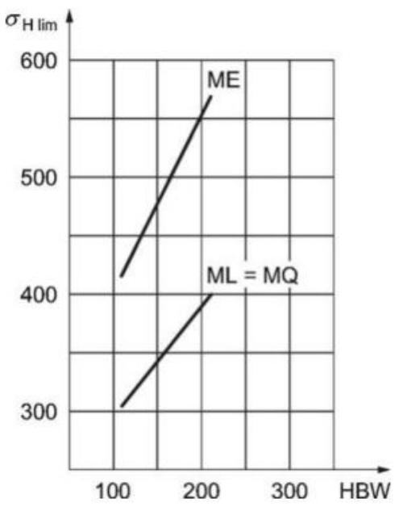  
a) Wrought normalized low carbon steels

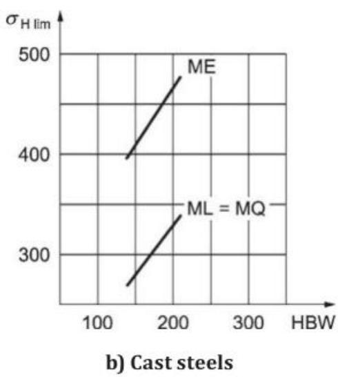  
b) Cast steels

Key  
$\sigma_{H\lim}$ allowable stress number (contact), N/mm $^{2}$ HBW surface hardness

Figure 1 — Allowable stress numbers (contact) for wrought normalized low carbon steels and cast steels (attention is drawn to the quality requirements of 6.2)  
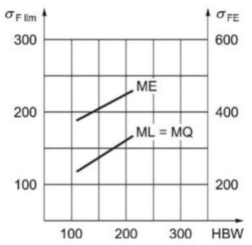  
a) Wrought normalized low carbon steels

Key  
$\sigma_{F\ lim}$ nominal stress number (bending), N/mm $^{2}$ $\sigma_{FE}$ allowable stress number (bending), N/mm $^{2}$ HBW surface hardness

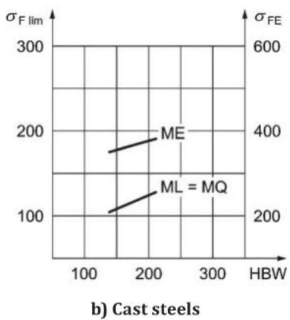  
b) Cast steels

Figure 2 — Nominal and allowable stress numbers (bending) for wrought normalized low carbon steels and cast steels (attention is drawn to the quality requirements of 6.2)

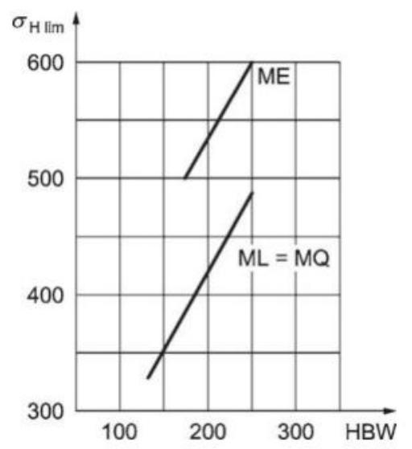  
a) Black malleable cast iron (see 6.3)

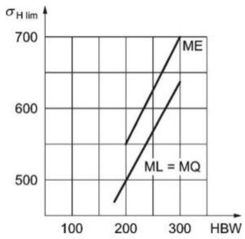  
b) Nodular cast iron (see Table 2)

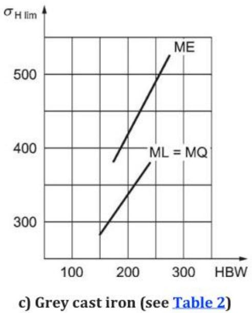  
c) Grey cast iron (see Table 2)

Key  
Key  
$\sigma_{H\lim}$ allowable stress number (contact), N/mm $^{2}$ HBW surface hardness

NOTE Brinell hardness < 180 HBW indicates the presence of a high proportion of ferrite in the structure. For gears, this condition is not recommended.

Figure 3 — Cast iron materials — Allowable stress numbers (contact) for cast iron materials (attention is drawn to the quality requirements of 6.3 and Table 2)

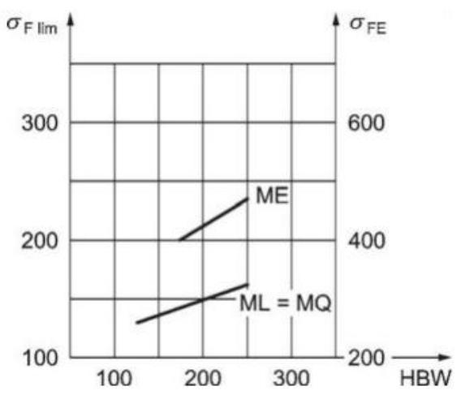  
a) Black malleable cast iron (see 6.3)

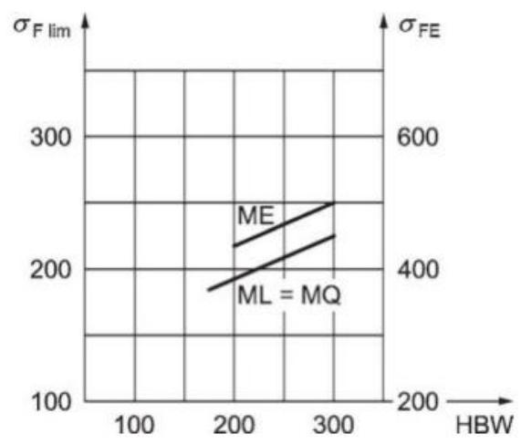  
b) Nodular cast iron (see Table 2)

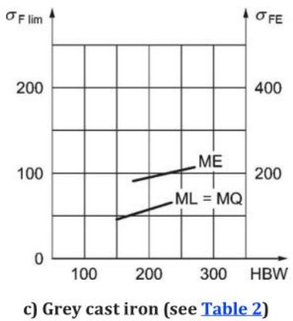  
c) Grey cast iron (see Table 2)

Key

$\sigma_{\mathrm{Flim}}$ nominal stress number (bending), $\mathrm{N / mm^2}$

$\sigma_{FE}$ allowable stress number (bending), N/mm $^{2}$

HBW surface hardness

NOTE Brinell hardness < 180 HBW indicates the presence of a high proportion of ferrite in the structure. For gears, this condition is not recommended.

Figure 4 — Cast iron materials — Nominal and allowable stress numbers (bending) for cast iron materials (attention is drawn to the quality requirements of 6.3 and Table 2)

NOTE 1 Nominal carbon content ≥ 0,20 %.  
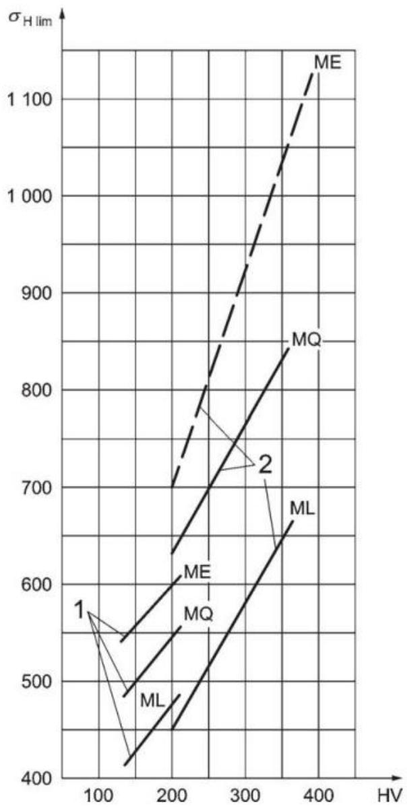  
Key  
$\sigma_{H\ lim}$ allowable stress number (contact), N/mm $^{2}$ HV surface hardness
1 carbon steels  
2 alloy steels

NOTE 2 The alloy steel MX line from the first edition of ISO 6336-5 was replaced (in 2003 edition) by the ME line.

NOTE 3 The use of the ME line stress numbers for alloy steels relies heavily on the experience of the manufacturer. This line is not supported by recently made (2011) standardized test. Results obtained without pitting stabilization.

Figure 5 — Allowable stress numbers (contact) for through hardened wrought steels (attention is drawn to the quality requirements of Table 3)

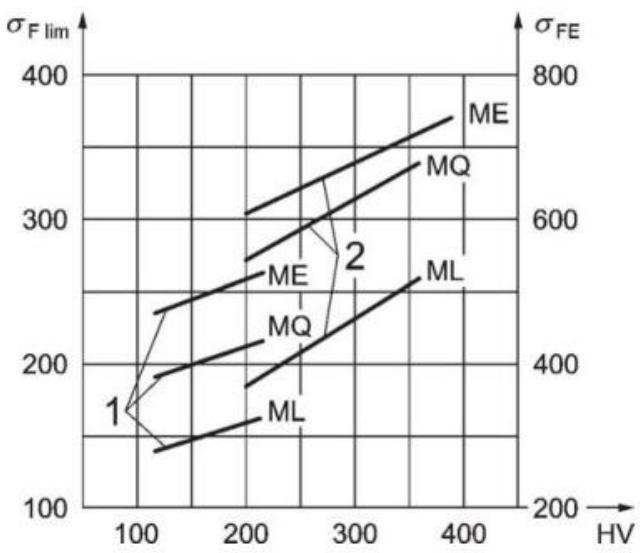  
Key  
$\sigma_{F\ lim}$ nominal stress number (bending), N/mm $^{2}$ $\sigma_{FE}$ allowable stress number (bending), N/mm $^{2}$ HV surface hardness
1 carbon steels  
2 alloy steels
NOTE Nominal carbon content ≥ 0,20 %.

Figure 6 — Nominal and allowable stress numbers (bending) for through hardened wrought steels (attention is drawn to the quality requirements of Table 3)

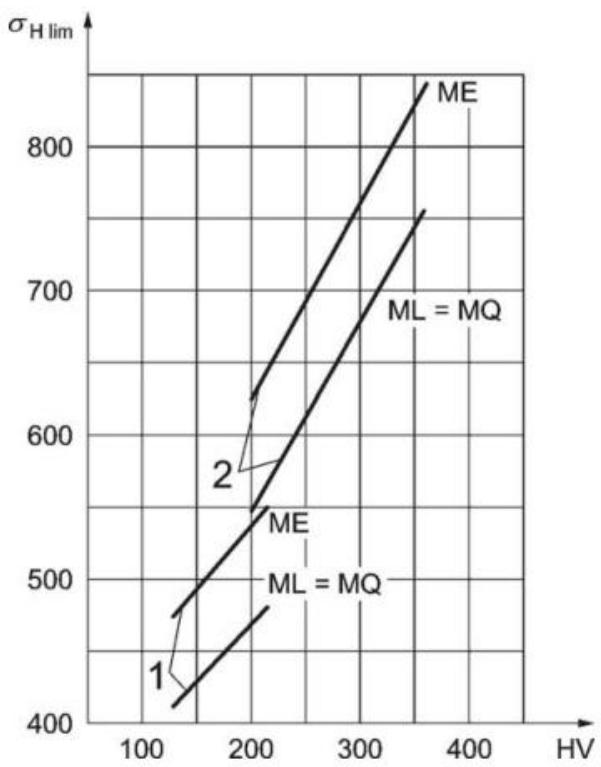  
Key  
$\sigma_{H\ lim}$ allowable stress number (contact), N/mm $^{2}$ HV surface hardness
1 carbon steels  
2 alloy steels

Figure 7 — Allowable stress numbers (contact) for through hardened cast steels (attention is drawn to the quality requirements of Table 4)

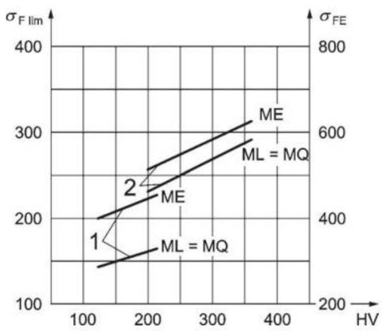  
Key  
$\sigma_{F\ lim}$ nominal stress number (bending), N/mm $^{2}$ $\sigma_{FE}$ allowable stress number (bending), N/mm $^{2}$ HV surface hardness
1 carbon steels  
2 alloy steels

Figure 8 — Nominal and allowable stress numbers (bending) for through hardened cast steels (attention is drawn to the quality requirements of Table 4)

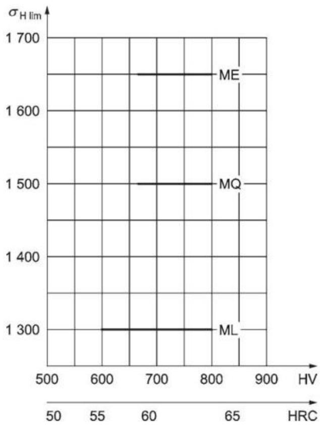  
Key  
$\sigma_{H\ lim}$ allowable stress number (contact), N/mm $^{2}$ HRC surface hardness  
HV surface hardness
NOTE Adequate case depth required (see 5.6.1).

Figure 9 — Allowable stress numbers (contact) for case hardened wrought steels (attention is drawn to the quality requirements of Table 5)

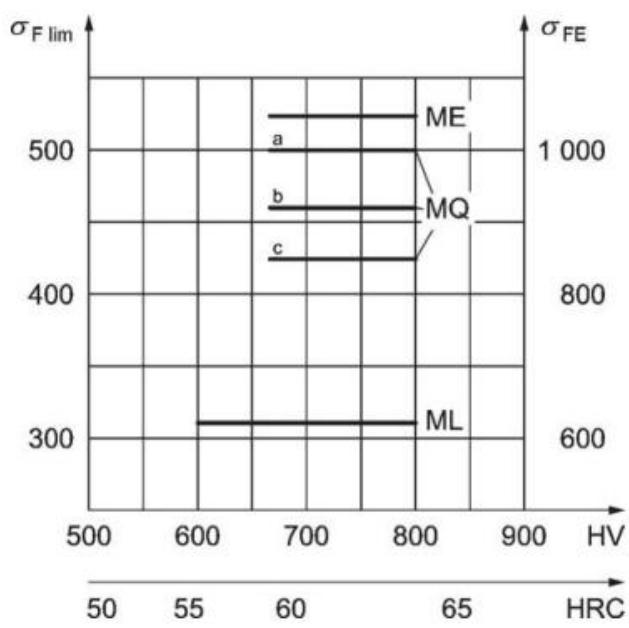  
$\sigma_{\mathrm{Flim}}$ nominal stress number (bending), $\mathrm{N / mm^2}$  
$\sigma_{FE}$ allowable stress number (bending), N/mm $^{2}$  
HRC surface hardness  
HV surface hardness  
a Core hardness $\geq 30$ HRC.  
b Core hardness $\geq$ 25 HRC Jominy hardenability at J = 12 mm $\geq$ 28 HRC.  
c Core hardness $\geq$ 25 HRC Jominy hardenability at J = 12 mm < 28 HRC.  
NOTE 1 Adequate case depth required (see 5.6.2).  
NOTE 2 See 6.6.

Figure 10 — Nominal and allowable stress numbers (bending) for case hardened wrought steels (attention is drawn to the quality requirements of Table 5)

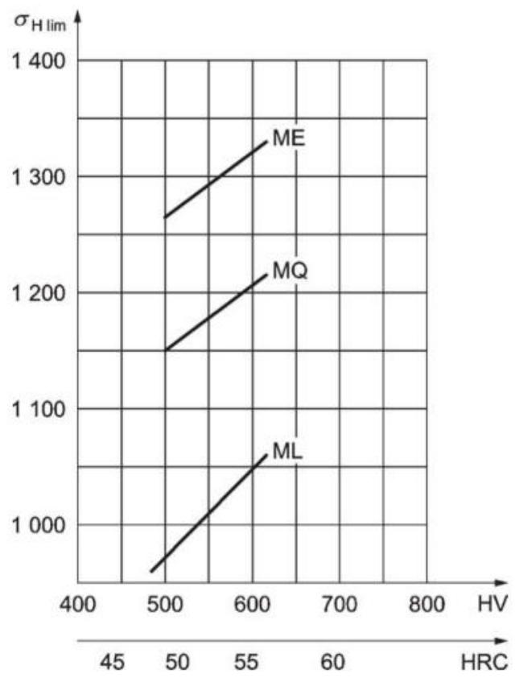  
Key  
$\sigma_{H\ lim}$ allowable stress number (contact), N/mm $^{2}$ HRC surface hardness  
HV surface hardness

NOTE Adequate surface hardening depth required. Case depth to be determined for each part by experience.

Figure 11 — Allowable stress numbers (contact) for flame- or induction-hardened wrought and cast steels (attention is drawn to the quality requirements of Table 6)

Key  
$\sigma_{F\ lim}$ nominal stress number (bending), N/mm $^{2}$ $\sigma_{FE}$ allowable stress number (bending), N/mm $^{2}$ HRC surface hardness  
HV surface hardness

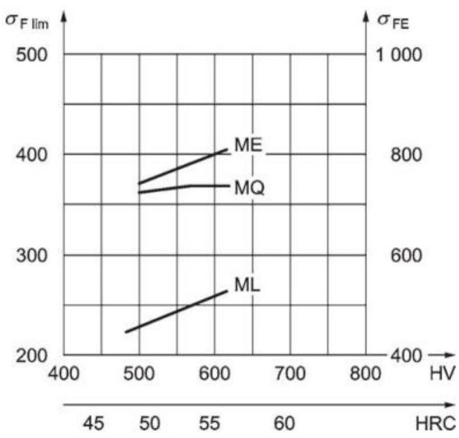  
NOTE Hardened fillets only. Values for unhardened fillets are not provided. Adequate surface hardening depth required.  
Figure 12 — Nominal and allowable stress numbers (bending) for flame- or induction-hardened wrought and cast steels (attention is drawn to the quality requirements of Table 6)

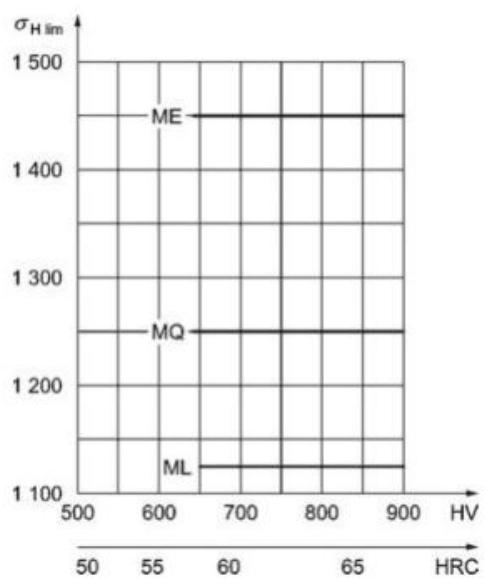  
a) Nitriding steels: hardened, tempered and gas nitrited

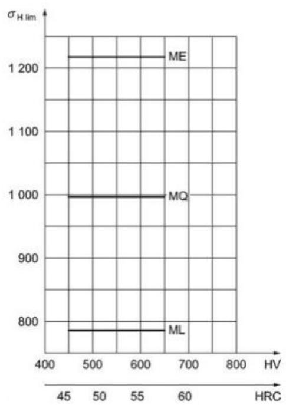  
b) Through hardening steels: hardened, tempered and gas nitrided

Key  
$\sigma_{H\mathrm{lim}}$ allowable stress number (contact), N/mm²  
HRC surface hardness  
HV surface hardness

NOTE Adequate nitriding hardening depth required (see 5.6.3).

Figure 13 — Allowable stress numbers (contact) for nitrided wrought steels/nitriding steels/through hardening steels nitrided (attention is drawn to the quality requirements of Table 7)

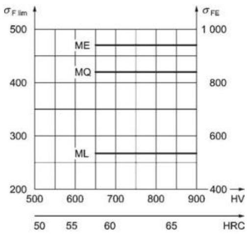

a) Nitriding steels: hardened, tempered and gas nitrided  
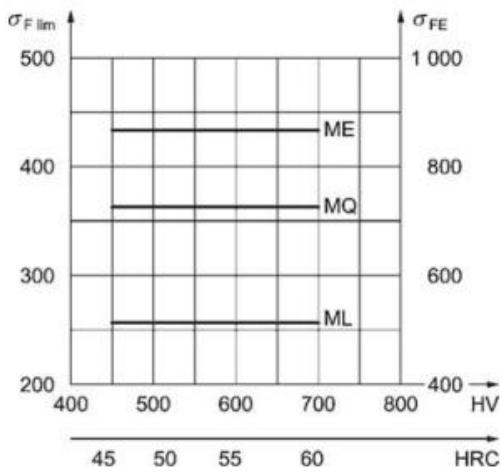  
b) Through hardening steels: hardened, tempered and gas nitrided

Key

$\sigma_{F\lim}$ nominal stress number (bending), N/mm $^{2}$

$\sigma_{FE}$ allowable stress number (bending), N/mm $^{2}$

HRC surface hardness

HV surface hardness

NOTE 1 Only applicable for Figure a): for flank hardness > 750 HV1, the allowable stress numbers can be reduced by embrittlement when the white layer thickness exceeds 10 $\mu$ m. Adequate nitriding hardening depth required, see 5.6.3.

NOTE 2 Only applicable for Figure a): aluminium containing nitriding steels Nitralloy N, Nitralloy 135 and similar are limited to grades ML and MQ. Tooth root stress numbers $\sigma_{\mathrm{F}}$ lim for these materials are limited to $250~\mathrm{N / mm^2}$ for ML and $340~\mathrm{N / mm^2}$ for MQ.

NOTE 3 Only applicable for Figure b): adequate nitriding hardening depth required, see 5.6.3.

Figure 14 — Nominal and allowable stress numbers (bending) for nitrided wrought steels/nitriding steels/through hardening steels nitrided (attention is drawn to the quality requirements of Table 7)

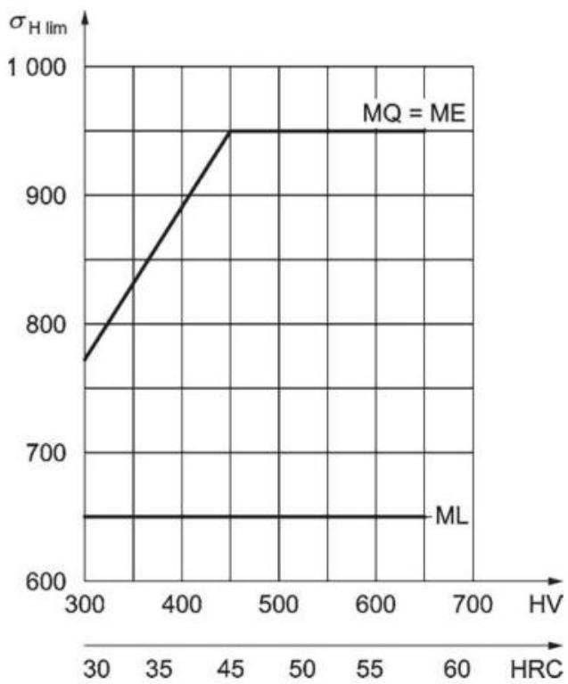  
$\sigma_{H\ lim}$ allowable stress number (contact), N/mm $^{2}$  
HRC surface hardness  
HV surface hardness  
NOTE Adequate nitriding hardening depth required (see 5.6.3).

Figure 15 — Allowable stress numbers (contact) for wrought steels nitrocarburized (attention is drawn to the quality requirements of Table 8)

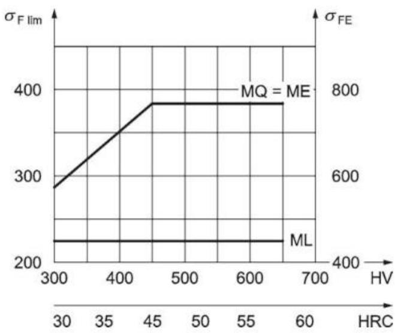

Key  
$\sigma_{F\ lim}$ nominal stress number (bending), N/mm $^{2}$ $\sigma_{FE}$ allowable stress number (bending), N/mm $^{2}$ HRC surface hardness  
HV surface hardness

NOTE Adequate nitriding hardening depth required, see 5.6.3.

Figure 16 — Nominal and allowable stress numbers (bending) for wrought steels nitrocarburized (attention is drawn to the quality requirements of Table 8)

## 5.6 Hardening depth of surface hardened gears in finished condition

### 5.6.1 General

Surface hardened gear teeth require adequate hardening depth to resist the stress condition in the loaded tooth. Minimum and maximum values of hardening depth shall be shown on the drawing. When specifying minimum hardening depth, note that the “optimum” values for bending and surface load capacity are calculated separately and are not necessarily the same. The specified maximum hardening depths should not be exceeded, because to do so would increase risk of embrittlement of the tooth tips and lower allowable stress numbers.[^3]

### 5.6.2 Case depth of carburized and hardened gears[^4]

a) Recommended values of case depth to achieve the specified strength values for pitting $(CHD_{H\ opt})$ are shown in Figure 17. $CHD_{H\ opt}$ is the optimum effective case depth relating to permissible contact stress for long life at the reference circle after tooth finishing:

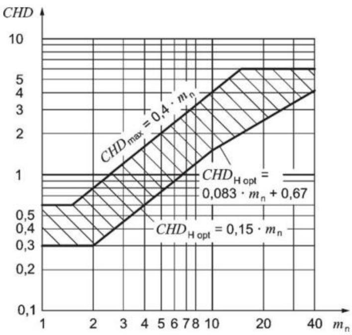  
Key
CHD case hardening depth, mm $m_{n}$ Normal module, mm

Figure 17 — Recommended values of optimum case depth $CHD_{H\ opt}$ regarding surface load capacity and maximum case depth $CHD_{max}$ regarding bending and surface load capacity

b) Recommended values of case depth to achieve the specified strength values regarding tooth root bending ( $CHD_{F\ opt}$ ): $CHD_{F\ opt}$ is the optimum effective case depth relating to permissible bending stress for long life at the root fillet on a normal to the $30^{\circ}$ tangent (external gears), $60^{\circ}$ tangent (internal gears) after tooth finishing:

$$
0,1 m _ {\mathrm{n}} \leq CHD _ {\mathrm{Fopt}} \leq 0,2 m _ {\mathrm{n}} \tag{3}
$$

c) Recommended values of case depth regarding case-crushing ( $CHD_{c}$ ): $CHD_{c}$ is the minimum effective case depth at the reference circle after tooth finishing based on the depth of maximum shear stress from contact load.

NOTE Regarding case-crushing, at present there is no standardized calculation method available.

A guide to avoid case crushing the $CHD_{c}$ is given by th following formula. Note that this equation has not been validated for contact stress numbers $\sigma_{H} > 1400 \, N/mm^{2}$ .

$$
CHD _ {\mathrm{c}} = \frac {\sigma_ {\mathrm{H}} \cdot d _ {\mathrm{w1}} \cdot \sin \alpha_ {\mathrm{wt}}}{U _ {\mathrm{H}} \cdot \cos \beta_ {\mathrm{b}}} \frac {z _ {2}}{z _ {1} + z _ {2}} \tag{4}
$$

with

$U_{H}=66\ 000\ N/mm^{2}$ for quality grades MQ/ME;

$U_{H}=44\ 000\ N/mm^{2}$ for quality grades ML.

d) Recommended limits of minimum and maximum effective case depth: $CHD_{min/max}$ is the effective case depth at the reference circle after tooth finishing (values also shown in Figure 17): $CHD_{min} \geq 0,3 \, mm$ and $CHD_{max} \leq 0,4 \cdot m_{n} (\leq 6 \, mm)$ .

### 5.6.3 Nitriding hardening depth of nitrided gears[^5]

a) Recommended values of effective nitriding hardening depth (NHD): See Figure 18.

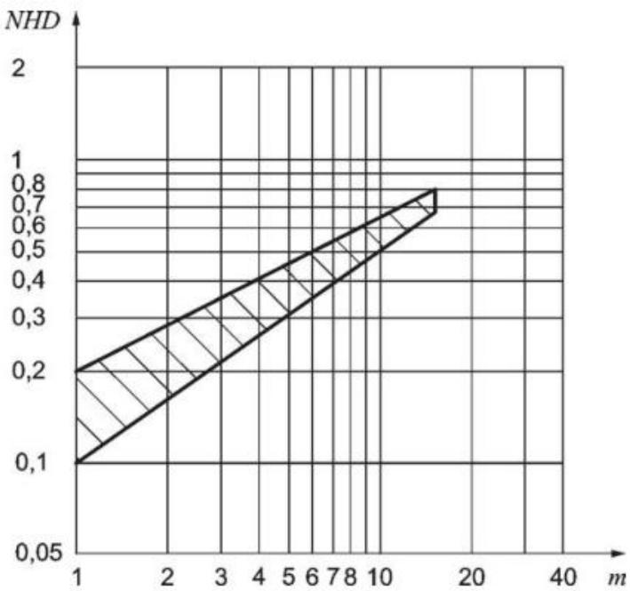

Key

NHD nitriding hardening depth, mm

m module, mm

NOTE Steel grade should be suitable for the recommended NHD which should not exceed a maximum value of 0,8 mm.

Figure 18 — Recommended values of nitriding hardening depth, NHD

b) Recommended values of nitriding hardening depth regarding case-crushing ( $NHD_{c}$ ): $NHD_{c}$ is the minimum effective nitriding hardening depth for nitrided gears, and is based on the depth of maximum shear stress from contact load. If the value of $NHD_{c}$ is less than the value for nitriding hardening depth NHD from Figure 18, then the minimum value from Figure 18 should be used.

NOTE Regarding case-crushing, at present, there is no standardized calculation method available.

$$
NHD _ {\mathrm{c}} = \frac {U _ {\mathrm{c}} \cdot \sigma_ {\mathrm{H}} \cdot d _ {\mathrm{w1}} \cdot \sin \alpha_ {\mathrm{wt}}}{1,14 \cdot 10 ^ {5} \cdot \cos \beta_ {\mathrm{b}}} \frac {z _ {2}}{z _ {1} + z _ {2}} \tag{5}
$$

where $U_{c}$ is the core hardness coefficient:

$$
U _ {\mathrm{C}} = a + b \cdot \sigma_ {\mathrm{H}} + c \cdot \sigma_ {\mathrm{H}} ^ {2} + d \cdot \sigma_ {\mathrm{H}} ^ {3},\tag{6}
$$

see Figure 19.

$\sigma_{H}$ contact stress, N/mm $^{2}$

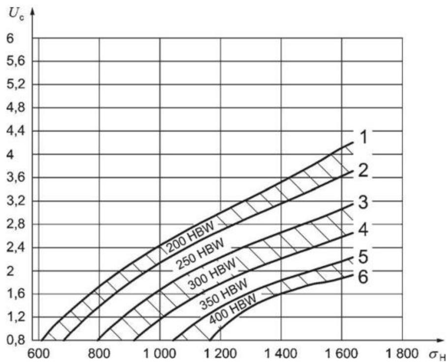

$U_{\mathrm{c}}$ core hardness coefficient

1 to 6 curve numbers, see Table B.1 for values of coefficients a, b, c and d

NOTE Use upper portion of core hardness band (which yields heavier case depths) for general design purpose and lower portion for high-quality material.

Figure 19 — Core hardness coefficient for nitrided gearing, $U_{c}$

# 6 Requirements for material quality and heat treatment

## 6.1 General aspects

The three material quality grades ML, MQ and ME stand in relationship to Figures 1 to 16, which means that they refer to the allowable stress numbers determined using Method B.[^6] See 4.3, 5.2 and 5.3.

— ML stands for modest demands on the material quality and on the material heat treatment process during gear manufacture.

— MQ stands for requirements that can be met by experienced manufacturers at moderate cost.

— ME represents requirements that must be realized when a high degree of operating reliability is required.

NOTE This document does not allow extrapolation of the allowable stress lines.

Frequently, special quality material such as Vacuum Induction Melted/Vacuum Arc Remelted (VIM/VAR) is used to achieve high reliability or load-bearing capability.

Gear wheels which are manufactured by fabricating rims to centers using conventional welding procedures should be stress relieved following the fabrication process.

The provisions given in 6.2 to 6.4 have been confirmed by practical experience and may be used as guidelines. All requirements for a material grade shall be met when the allowable stress numbers are to be applied.[^7] Where not specified in the tables, this can be accomplished by specifically certifying each requirement where necessary, or by establishing practices and procedures to obtain the requirements on a production basis. It is not the intent of this document that all requirements for quality grades are to be certified, but that practices and procedures are to be established for their compliance on a production basis. Intermediate values are not classified since the effect of deviations from the quality standards cannot be evaluated easily. These requirements refer to those portions of the gear material where the teeth will be located and at a distance below the finished tip diameter as defined in the applicable Tables 2 to 7. However, depending on their experience, manufacturers may adopt methods or values other than those listed here. The manufacturer and the customer should agree on the details, particularly for large gears. Also, the gear manufacturer and purchaser shall mutually agree on acceptance or corrections of non-confirming parts which do not fulfil all the requirements.

## 6.2 Normalized low carbon or cast steel, plain carbon, unalloyed steels (see Figures 1 and 2)

Since the composition of these is not specified and the melting method is often unknown, the MQ line was positioned at the lower limit (ML). Normalized low carbon steels are used only for lightly loaded gears and secondary applications. If high quality of steel production is achieved and when justified by experience, the levels of ME may be used.

## 6.3 Black malleable cast iron [see Figures 3 a) and 4 a)]

High quality can be achieved through controlled heat treatment. However, since it is ordinarily used for small, lightly loaded gears, the MQ line was positioned at the lower limit (ML) to be on the safe side. When justified by experience, the levels of ME may be used.

## 6.4 Other materials [see Figures 3 b), 3 c), 4 b), 4 c), 5 to 16]

Material quality and heat treatment for other materials shall be in accordance with Tables 2 to 8.

Table 2 — Cast iron materials (grey and nodular — spheroidal — graphite cast iron)

<table><tr><td rowspan="2">Item</td><td rowspan="2">Requirement</td><td colspan="2">Grey cast iron (see Figures 3 and 4)</td><td colspan="2">Nodular cast iron (see Figures 3 and 4)</td></tr><tr><td>ML MQ</td><td>ME</td><td>ML MQ</td><td>ME</td></tr><tr><td>1</td><td>Chemical analysis</td><td>Not verified</td><td>100 % verified Foundry certificate</td><td>Not verified</td><td>100 % verified Foundry certificate</td></tr><tr><td>2</td><td>Melting practice</td><td>No specification</td><td>Electric furnace or equivalent</td><td>No specification</td><td>Electric furnace or equivalent</td></tr><tr><td>3</td><td>Mechanical properties evaluation</td><td>Only HBW</td><td> <math display="inline" xmlns="http://www.w3.org/1998/Math/MathML"><semantics><msub><mi>R</mi><mtext mathvariant="normal">m</mtext></msub><annotation encoding="application/x-tex">R_{\text{m}}</annotation></semantics></math> Specific test report on a separate test piece from the same cast</td><td>Only HBW</td><td> <math display="inline" xmlns="http://www.w3.org/1998/Math/MathML"><semantics><mrow><msub><mi>σ</mi><mtext mathvariant="normal">s</mtext></msub><mo form="prefix" stretchy="false">(</mo><msub><mi>σ</mi><mrow><mn>0</mn><mo>,</mo><mn>2</mn></mrow></msub><mo form="postfix" stretchy="false">)</mo><msub><mi>σ</mi><mtext mathvariant="normal">b</mtext></msub><msub><mi>δ</mi><mtext mathvariant="normal">s</mtext></msub><mi>ψ</mi></mrow><annotation encoding="application/x-tex">\sigma_{\text{s}} (\sigma_{0,2}) \sigma_{\text{b}} \delta_{\text{s}} \psi</annotation></semantics></math> Specific test report per ISO 10474 of physical testing on a representative sample which is an integral part on each test piece, heat treated with the parts before being cut. Verification of HBW on gear teeth or as near as practicable.</td></tr><tr><td rowspan="2">4</td><td>Structure: graphite form</td><td>Specified but not verified</td><td>Limited</td><td>Not verified</td><td>Limited</td></tr><tr><td>Basic structurea</td><td>No specification (alloyed grey cast iron, maximum ferrite: 5 %)</td><td>Maximum ferrite: 5 %</td><td colspan="2">No specification</td></tr><tr><td>5</td><td>Tests for inner separations (cracks). Acceptability agreed between customer and supplier.</td><td>Not tested</td><td>Tested (pores, cracks, blow-holes), limited defects</td><td>Not tested</td><td>Tested (pores, cracks, blow-holes), limited defects</td></tr><tr><td>6</td><td>Stress relief</td><td>Not required</td><td>Recommended: 2 h at 500 °C to 530 °C. Alloyed, grey cast iron 2 h at 530 °C to 560 °C</td><td>Not required</td><td>Recommended: 2 h at 500 °C to 560 °C</td></tr><tr><td>7</td><td>Repair welding</td><td colspan="2">Not permitted near tooth region; elsewhere, permissible only with approved processes</td><td colspan="2">Not permitted near tooth region; elsewhere, permissible only with approved processes</td></tr><tr><td>8</td><td>Surface crack detection</td><td>Not tested</td><td>Visual inspection required, dye penetrant test by agreement between purchaser and manufacturer.</td><td>Not tested</td><td>Cracks not permitted. 100 % magnetic particle, fluorescent magnetic particle penetrant or dye penetrant inspection. Statistical sampling permitted for large production lots.</td></tr><tr><td colspan="6">a Can be checked on a representative sample from the same cast.</td></tr></table>

Table 3 — Through hardened wrought steels, not surface hardened (forged or rolled steels) (see Figures 5 and 6)

<table><tr><td>Item</td><td>Requirement</td><td>ML</td><td>MQ</td><td> MEa </td></tr><tr><td>1</td><td>Chemical  analysisa,b </td><td>Not verified</td><td colspan="2">Specific test report per ISO 10474 with 100 % traceability to the original cast</td></tr><tr><td>2</td><td>Mechanical properties after heat treatment</td><td>HBW</td><td>Recommended: HBW and either mechanical tests or hardenability test</td><td> <math display="inline" xmlns="http://www.w3.org/1998/Math/MathML"><semantics><mrow><msub><mi>σ</mi><mi>s</mi></msub><mo form="prefix" stretchy="false">(</mo><msub><mi>σ</mi><mrow><mn>0</mn><mo>,</mo><mn>2</mn></mrow></msub><mo form="postfix" stretchy="false">)</mo><msub><mi>σ</mi><mi>b</mi></msub><msub><mi>δ</mi><mi>s</mi></msub><mi>ψ</mi></mrow><annotation encoding="application/x-tex">σ_s(\sigma_{0,2})σ_bδ_sψ</annotation></semantics></math> Specific test report per ISO 10474 of physical testing on a representative sample from the same cast, heat treated with the parts, for forgings or rolled bars larger than 250 mm diameter and verification of surface hardness (HBW) for all parts. Controlling section examples are presented in Annex A.</td></tr><tr><td>3</td><td>Steelmaking</td><td>No specification</td><td colspan="2">The steel shall be deoxidized and refined in the ladle. Steel shall be vacuum degassed to achieve a hydrogen content of max. 2,5 ppm. The steel shall be protected from reoxidation during the teeming or casting. Adding calcium when melting the steel (maximum values see item 3.3) is permissible for castability and shall be documented.</td></tr><tr><td>3.1</td><td> Cleanlinessc </td><td>No specification</td><td colspan="2">Cleanliness in accordance with ISO 4967, procedure in accordance with Method A, inspected area approximately 200  <math display="inline" xmlns="http://www.w3.org/1998/Math/MathML"><semantics><mrow><mi>m</mi><msup><mi>m</mi><mn>2</mn></msup></mrow><annotation encoding="application/x-tex">mm^2</annotation></semantics></math>  and the following acceptance table. Other specifications, which ensure the equivalent cleanliness, are permitted. Test report in accordance with ISO 10474. The maximum content of sulfur for MQ, ME quality is 0,04 % S.<table><tr><th></th><th colspan="2">A</th><th colspan="2">B</th><th colspan="2">C</th><th colspan="2">D</th><th>DS</th></tr><tr><th></th><th>Fine</th><th>Thick</th><th>Fine</th><th>Thick</th><th>Fine</th><th>Thick</th><th>Fine</th><th>Thick</th><th></th></tr><tr><td>MQ</td><td>3,0</td><td>3,0</td><td>2,5</td><td>1,5</td><td>2,5</td><td>1,5</td><td>2,0</td><td>1,5</td><td></td></tr><tr><td>ME</td><td>2,5</td><td>1,5</td><td>2,0</td><td>1,0</td><td>0,5</td><td>0,5</td><td>1,0</td><td>1,0</td><td>2,0</td></tr></table></td></tr><tr><td>3.2</td><td>Oxygen content</td><td>No specification</td><td>Max. 25 ppm (= 25 μg/g)</td><td>Max. 25 ppm (= 25 μg/g)</td></tr><tr><td>3.3</td><td>Calcium total content</td><td>No specification</td><td>Max. 25 ppm</td><td>Max. 10 ppm</td></tr><tr><td>4</td><td>Grain size in accordance with ISO 643:2012, Table C1f</td><td>No specification</td><td colspan="2">Fine grain, with 90 % of the area having grain size 5 and finer, and no grain coarser than size 3. Test report in accordance with ISO 10474.</td></tr><tr><td>5</td><td colspan="4">Non-destructive testing</td></tr><tr><td>5.1</td><td>Ultrasonic  testc  in rough machined condition</td><td>No specification</td><td colspan="2">Required. Statistical samples permitted. Checked after forging. Specific test report in accordance with ISO 10474 recommended. Suggested for large diameter parts to detect flaws before the expense of tooth cutting. Inspection per ASTM A388, EN 10228-3 or EN 10308, using either the back reflection or reference block 8-0400, 3,2 mm flat bottom hole per ASTM E428 technique. A distance amplitude correction curve is not intended. Other UT specifications which ensure the same quality level are permitted. Inspection to the following limits: Indication levels as per EN 10228-3 quality class 4 and EN 10308:2001 quality class 4. A cut off value of 3 mm FBH is requested, with minimum 2,0 mm recording level sensitivity according to EN-standards mentioned here.</td></tr></table>

Table 3 (continued)

<table><tr><td>Item</td><td>Requirement</td><td>ML</td><td>MQ</td><td>MEa</td></tr><tr><td>5.2</td><td>Surface cracks detection (in finished condition, before any shot peening treatment)</td><td colspan="2">Cracks are not permitted. Ground gears should be inspected for surface cracks. Inspection by ASTM E1444 including fluorescent, magnetic particle or by ASTM E1417 for dye penetrant inspection.</td><td>Cracks are not permitted. Ground gears shall be inspected for surface cracks. Inspection by ASTM E1444, including fluorescent, magnetic particle or by ASTM E1417 for dye penetrant inspection. Preferred method of inspection is fluorescent, magnetic particle inspection.</td></tr><tr><td>6</td><td>Extent of forging reduction</td><td>No specification</td><td colspan="2">Area reduction ratiod: At least 3:1 for ingot cast and at least 5:1 for continuous cast. The minimum reduction ratio shall be achieved by hot working processes which ensure through-section working.</td></tr><tr><td>7</td><td>Microstructure</td><td>No specification</td><td>No specification. For material strengths greater than 800 N/mm2(240 HBW) the gear should be quenched and tempered.</td><td>Minimum temper temperature 480 °C. Root hardness shall meet drawing requirements. Microstructure in gear rim predominantly tempered martensite.e</td></tr><tr><td colspan="5">NOTE To use the values in Table 1, a hardness difference of 40 HV minimum is recommended between the pinion and the wheel.</td></tr><tr><td colspan="5">a The material quality grade MX, which existed in the first edition (1995) of this document, was replaced by the ME line in 2003.  b CAUTION: For cold service, below 0 °C: — consider low temperature charpy specification; — consider fracture appearance transition or nil ductility temperature specification; — consider using higher nickel alloy steels; — consider reduced carbon content to less than 0,4 % carbon; — consider using heating elements to increase lubricant temperature.  c The grade cleanliness and UT requirements apply only to those portions of the gear material where the teeth will be located at a distance below the finished tip diameter of at least two times the tooth depth. The gear manufacturer shall specify the inspection zone to the steel supplier or forge house.  d The area reduction is a total reduction irrespective of the method. Applies to forgings from ingot cast material. The reduction ratio can be less than 5:1 but not less than 3:1 when 1) the rolled bar is subject to further hot working, 2) the central portion of the billet is removed, and 3) the 5:1 minimum reduction ratio is physically unobtainable due to the final size of the gear.  e The microstructure of the gear section to a depth of 1,2 times the tooth height to consist primarily of tempered martensite with limited upper transformation products (proeutectoid ferrite, upper bainite and fine pearlite). No blocky ferrite, due to incomplete austenitization, is permitted. The maximum limit for upper transformation products is 10 % for gear controlling sections ≤250 mm, and 20 % for gear controlling sections &gt;250 mm.  f Grain size should be determined at the position most relevant to the anticipated failure mechanism of the part. Tests can be determined on a sample from the same cast with similar reduction ratio and heat treatment. Reference surface area is 3,0 mm2.</td></tr></table>

Table 4 — Through hardened cast steels, not surface hardened (see Figures 7 and 8)

<table><tr><td>Item</td><td>Requirement</td><td>ML-MQ</td><td>ME</td></tr><tr><td>1</td><td>Chemical analysis</td><td>Not verified</td><td>Specific test report in accordance with ISO 10474 with 100 % traceability to the original cast.</td></tr><tr><td>2</td><td>Mechanical properties after heat treatment</td><td>HBW</td><td> <math display="inline" xmlns="http://www.w3.org/1998/Math/MathML"><semantics><mrow><msub><mi>σ</mi><mi>s</mi></msub><mo form="prefix" stretchy="false">(</mo><msub><mi>σ</mi><mrow><mn>0</mn><mo>,</mo><mn>2</mn></mrow></msub><mo form="postfix" stretchy="false">)</mo><msub><mi>σ</mi><mi>B</mi></msub><msub><mi>δ</mi><mi>s</mi></msub><mi>ψ</mi><mi>H</mi><mi>B</mi><mi>W</mi></mrow><annotation encoding="application/x-tex">\sigma_s (\sigma_{0,2}) \sigma_B \delta_s \psi HBW</annotation></semantics></math> Specific test report in accordance with ISO 10474 with 100 % traceability to the original cast. Verification of HBW. Statistical inspection required.</td></tr><tr><td>3</td><td>Grain size in accordance with ISO 643a</td><td>No specification</td><td>Fine grain, with 90% of the area having grain size 5 and finer, and no grain coarser than size 3. Test report in accordance with ISO 10474.</td></tr><tr><td>4</td><td colspan="3">Non-destructive testing</td></tr><tr><td>4.1</td><td>Ultrasonic test (in rough machined condition) in accordance with ISO 9443</td><td>No specification</td><td>Check tooth and tooth root areas only. Specific test report in accordance with ISO 10474. Recommended but not required. Suggested for large diameter parts to detect flaws before the expense of tooth cutting. Acceptance criteria per ASTM A609 level 1 in Zone 1 (Outside diameter to 25 mm below roots) and level 2 in Zone 2 (remainder of rim) using 3,2 mm flat bottom hole; or approved equivalent using the back reflection technique.</td></tr><tr><td>4.2</td><td>Surface cracks detection (in finished condition but before any shot peening treatment)</td><td colspan="2">Cracks not permitted. 100 % inspection by ASTM E1444 including fluorescent, magnetic particle or dye penetrant inspection. Statistical sampling permitted for large production lots.</td></tr><tr><td>5</td><td>Repair welding</td><td>Allowed with approved procedure agreed upon by customer</td><td>Allowed only in rough condition if performed before heat treatment with approved procedure agreed upon by customer. Not allowed after tooth cutting.</td></tr><tr><td colspan="4">NOTE When the casting quality meets the quality criteria for wrought (forged or rolled) steels, wrought steel allowable stress numbers may be used in gear rating calculations for cast steel gears operating with wrought steel pinions. Suitability of using wrought steel allowable stress numbers for casting rating calculations shall be supported by test and operating experience. For castings, wrought steel cleanliness and forging reduction ratio criteria are excluded. Inclusion content and shape control are required to produce predominantly round manganese sulfide inclusions (Type I). No grain boundary (Type II) manganese sulfide inclusions permitted.</td></tr><tr><td colspan="4">a Grain size should be determined at the position most relevant to the anticipated failure mechanism of the part. Reference surface area is 3,0 mm2. Tests can be determined on a sample from the same cast with similar reduction ratio and heat treatment.</td></tr></table>

Table 5 — Case hardened wrought steels (forged or rolled steels) (see Figures 9 and 10)

<table><tr><td>Item</td><td>Requirement</td><td>ML</td><td>MQ</td><td>ME</td></tr><tr><td>1</td><td>Chemical analysisa</td><td>Not verified</td><td>Specific test report in accordance with ISO 10474 with 100 % traceability to the original cast.</td><td>Specific test report in accordance with ISO 10474 of testing on a representative sample from the same ingot or billet.</td></tr><tr><td>2</td><td>Hardenability by end quench test (see ISO 642)</td><td>Not verified</td><td>Specific test report in accordance with ISO 10474 with 100 % traceability to the original cast. Calculated hardenability values are permitted. The method of deriving the values shall be documented. Values obtained by tests shall prevail over calculated values.</td><td>Specific test report in accordance with ISO 10474 of testing on a representative sample from the same ingot or billet.</td></tr><tr><td>3</td><td>Steelmaking</td><td>No specification</td><td colspan="2">The steel shall be deoxidized and refined in the ladle. Steel shall be vacuum degassed to achieve a max. H2-content of 2,5 ppm. The steel shall be protected from reoxidation during the teeming or casting. Adding calcium when melting the steel (for maximum values, see item 3.3) is permissible for castability and shall be documented.</td></tr><tr><td>3.1</td><td>Cleanlinessb</td><td>No specification</td><td colspan="2">Cleanliness in accordance with ISO 4967, procedure in accordance with Method A, inspected area approximately 200 mm2 and the following acceptance table. Other specifications, which ensure the equivalent cleanliness, are permitted. Test report in accordance with ISO 10474. The maximum content of sulfur for MQ, ME quality is 0,04 % S.<table><tr><th></th><th colspan="2">A</th><th colspan="2">B</th><th colspan="2">C</th><th colspan="2">D</th><th>DS</th></tr><tr><th></th><th>Fine</th><th>Thick</th><th>Fine</th><th>Thick</th><th>Fine</th><th>Thick</th><th>Fine</th><th>Thick</th><th></th></tr><tr><td>MQ</td><td>3,0</td><td>3,0</td><td>2,5</td><td>1,5</td><td>2,5</td><td>1,5</td><td>2,0</td><td>1,5</td><td></td></tr><tr><td>ME</td><td>2,5</td><td>1,5</td><td>2,0</td><td>1,0</td><td>0,5</td><td>0,5</td><td>1,0</td><td>1,0</td><td>2,0</td></tr></table></td></tr><tr><td>3.2</td><td>Oxygen content</td><td>No specification</td><td>Max. 25 ppm (= 25 μg/g)</td><td>Max. 25 ppm (= 25 μg/g)</td></tr><tr><td>3.3</td><td>Calcium total content</td><td>No specification</td><td>Max. 25 ppm</td><td>Max. 10 ppm</td></tr><tr><td>4</td><td>Area reduction ratioc</td><td>No specification</td><td colspan="2">At least 3:1 for ingot cast and at least 5:1 for continuous cast. The minimum reduction ratio shall be achieved by hot working processes ensuring through-section working.</td></tr><tr><td>5</td><td>Grain size in accordance with ISO 643:2012, Table C.1 before heat treatmentk</td><td>No specification</td><td colspan="2">Fine grain, with 90 % of the area having grain size 5 and finer, and no grain coarser than size 3. Test report in accordance with ISO 10474 (see also item 10.6)</td></tr><tr><td>6</td><td colspan="4">Non-destructive testing before heat treatment</td></tr><tr><td>6.1</td><td>Ultrasonic test in rough machined condition</td><td>No specification</td><td colspan="2">Required. Statistical samples permitted. Inspection per ASTM A388, EN 10228-3 or EN 10308 using either the back reflection or reference block 8-0400; 3,2 mm flat bottom hole per ASTM E428 technique. A distance amplitude correction curve is not intended. Other UT specifications which ensure the same quality level are permitted. Inspection to the following limits: Indication levels as per EN 10228-3 quality class 4 and EN 10308:2001 quality class 4. A cut-off value of 3 mm FBH is required, with minimum 2,0 mm recording level sensitivity according to EN-standards mentioned here.</td></tr></table>

Table 5 (continued)

<table><tr><td>Item</td><td>Requirement</td><td>ML</td><td>MQ</td><td>ME</td></tr><tr><td>7</td><td colspan="4">Surface hardness</td></tr><tr><td>7.1</td><td>Surface hardness on a representative surface of workpiece d  (see Vickers-Rockwell hardness conversion table in ISO 18265)</td><td>600 HV or 55 HRC minimum. Statistical sample testing.</td><td>660 HV to 800 HV or 58 HRC to 64 HRC. Statistical sample testing.</td><td>660 HV to 800 HV or 58 HRC to 64 HRC. 100 % testing if heat treatment lot size ≤ 5, else statistical samples permitted. Test method as appropriate for the size of the part.</td></tr><tr><td>7.2</td><td>Surface hardness in root space, mid-face width, for modules ≥12 d .</td><td>No specification</td><td>Meets drawing specification. Statistical sampling or on representative test piece.</td><td>Meets drawing specification.100 % testing of every pinion and gear wheel or on representative test piece.</td></tr><tr><td>8</td><td>Core hardness at mid-face width on a normal to the 30° tangent at distance 5 × case depth but not less than 1 × module or measured on a representative test bar in accordance with 6.5.</td><td>21 HRC or more. Specified but not verified.</td><td>25 HRC or more, measured on a representative test bar per 6.5 b)or calculated based on knowledge of quench rate and hardenability curve.</td><td>30 HRC or more, measured on sample part or representative test bar in accordance with 6.5.</td></tr><tr><td>9</td><td>Case depth in finished condition in accordance with ISO 2639. Measured on representative test bar per 6.5 or measured at mid-face width and mid-height of the tooth.</td><td colspan="3">Case depth is defined as the distance from the surface to a point at which the hardness number is 550 HV or 52 HRC.Minimum and maximum limits shall be shown on the drawing. When specifying case depth, note that the “optimum” values for bending and surface load capacity are not the same. Recommended values of case depth are shown in 5.6 e .</td></tr><tr><td>10</td><td colspan="4">Inspection of the microstructure requirements can be made on a test bar according to 6.5 in a depth corresponding to the finished condition. This inspection is optional for MQ but required for ME. (Not required for ML.)</td></tr><tr><td>10.1</td><td>Limits on surface carbon content.</td><td>No specification</td><td colspan="2">Low nominal alloy steels with total alloy content ≤ 1,5 %: 0,65 % to 1,0 %.High nominal alloy steels with total alloy content &gt; 1,5 %: 0,60 % to 0,90 %.Recommended.</td></tr></table>

Table 5 (continued)

<table><tr><td>Item</td><td>Requirement</td><td>ML</td><td colspan="2">MQ</td><td colspan="2">ME</td></tr><tr><td>10.2</td><td>Surface structure: The desired structure has less than 10 % bainite determined by metallographic inspection</td><td>No specification</td><td colspan="2">Recommended. Martensite, essentially fine acicular, as shown by a representative test bar.</td><td colspan="2">Required. Martensite, fine acicular, as shown by a representative test bar.</td></tr><tr><td>10.3</td><td>Carbide precipitation</td><td>Semi-continuous carbide network permitted in accordance with Figure 20 a). On representative test bar.</td><td colspan="2">Discontinuous carbides permitted in accordance with Figure 20 b). Discontinuous carbides differ from semicontinuous carbide network in such a way that they do not delineate the grain structure. Maximum length of any carbide is 0,02 mm. (On representative test bar, if used.)</td><td colspan="2">Dispersed carbides permitted in accordance with Figure 20 c). Maximum size of any carbide is 0,01 mm. Inspection of representative test bar in accordance with 6.5.</td></tr><tr><td rowspan="2">10.4</td><td rowspan="2">Residual austenite. Determined by metallographic inspection.h</td><td rowspan="2">No specification</td><td colspan="2">Up to 30 % on inspection of companion heat treatment batch test piece.</td><td colspan="2">Up to 30 %, finely dispersed. Inspection of representative test bar in accordance with 6.5.</td></tr><tr><td colspan="4">If outside specification, salvage may be possible by controlled shot-peening in accordance with 6.7, or other appropriate procedures.</td></tr><tr><td rowspan="8">10.5</td><td rowspan="8">Intergranular oxidation (IGO), applicable to unground surface. Determined by metallographic inspection of unetched coupon, if used. Limits in micrometers shall be based on actual achieved case depth e. No IGO or non-martensitic product on ground surface visiblel</td><td rowspan="8">No specification</td><td>Case depth e mm</td><td>IGO μm</td><td>Case depth e mm</td><td>IGO μm</td></tr><tr><td>e&lt;0,75</td><td>17</td><td>e&lt;0,75</td><td>12</td></tr><tr><td>0,75≤e&lt;1,50</td><td>25</td><td>0,75≤e&lt;1,50</td><td>20</td></tr><tr><td>1,50≤e&lt;2,25</td><td>35</td><td>1,50≤e&lt;2,25</td><td>20</td></tr><tr><td>2,25≤e&lt;3,00</td><td>45</td><td>2,25≤e&lt;3,00</td><td>25</td></tr><tr><td>3,00≤e&lt;5,00</td><td>50</td><td>3,00≤e&lt;5,00</td><td>30</td></tr><tr><td>e≥5,00</td><td>60</td><td>e≥5,00</td><td>35</td></tr><tr><td colspan="4">If outside specification, salvage may be possible by controlled shot-peening in accordance with 6.7, or other appropriate procedures, with the agreement of the customer.</td></tr><tr><td>10.6</td><td>Grain size in final heat treated condition in accordance with ISO 643k</td><td>No specification</td><td colspan="2">Fine grain, with 90% of the area having grain size 5 and finer, and no grain coarser than size 3. Test report in accordance with ISO 10474 recommended.</td><td colspan="2">Fine grain, with 90% of the area having grain size 5 and finer, and no grain coarser than size 3. Test report in accordance with ISO 10474 required.</td></tr><tr><td>11</td><td>Core structure at the same location as item 8</td><td>No specification</td><td colspan="2">Martensite, acicular ferrite and bainite. No blocky ferrite (see item 8)</td><td colspan="2">Martensite, acicular ferrite and bainite. No blocky ferrite. Applies to representative test bar in accordance with 6.5</td></tr><tr><td>12</td><td>Surface  cracksi </td><td>Cracks not permissible. Statistical sample inspection by magnetic particle inspection, fluorescent magnetic particle penetrant or dye penetrant method.</td><td colspan="2">Cracks not permissible. 50 % inspection by ASTM E1444 or EN 10228-1 (magnetic particle inspection method). Statistical inspection depending on lot size permitted.</td><td colspan="2">Cracks not permissible. 100 % inspection by ASTM E1444 or EN 10228-1 (magnetic particle inspection method).</td></tr><tr><td rowspan="2">13</td><td rowspan="2">Grinding temper control using nital etch in accordance with ISO 14104j</td><td rowspan="2">Grade B temper permitted on 100 % of functional area (FB3), statistical inspection recommended but not required.</td><td colspan="2">Grade B temper permitted on 10 % of functional area (FB1), statistical inspection required.</td><td colspan="2">No temper permitted on functional area (FA), 100 % inspection by ISO 14104.</td></tr><tr><td colspan="4">If outside specification, salvage may be possible by controlled shot-peening as described in item 6.7. Refinishing may be required in order to achieve specific surface finish and geometry.</td></tr><tr><td colspan="7">NOTE See also 6.6 and 6.7. Requirements for carbonitrided steels are presently not given in the document. a  The material chosen is either that quoted in the relevant grade according to ISO 683-1, ISO 683-2, ISO 683-3, ISO 683-4 or ISO 683-5 (recommended) or an appropriate National or International Standard. b  The grade cleanliness requirements apply only to those portions of the gear material where the teeth will be located at a distance below the finished tip diameter of at least two times the tooth depth. On external gears, this portion of the gear blank normally will be less than 25 % of the radius of the gear blank. c  The total reduction ratio may be achieved as a result of a number of hot working operations. The reduction ratio can be less than 5:1 but not less than 3:1 when 1) the rolled bar is subject to further hot working, 2) the central portion of the billet or strand is removed, and 3) the 5:1 minimum reduction ratio is physically unobtainable due to the final size of the gear. d  Root hardness may be somewhat less than flank hardness, depending on the size of the gear and the process. Allowable values may be agreed between the manufacturer and the purchaser, but a minimum value of 55 HRC is required. e  For other values of case depth, see, for example, Reference [10]. h  X-ray analysis can be used as an alternative method. Limiting values should be agreed between the gear manufacturer and the purchaser. i  No cracks, bursts, seams or laps are permitted in the tooth areas of finished gears, regardless of grade. Limits: maximum of one indication per 25 mm of face width and maximum of five in one tooth flank. No indications allowed below 1/2 of working depth of tooth. Removal of defects which exceed the stated limits is acceptable, with customer approval, provided the integrity of the gear is not compromised. j  Other methods are available for grinding temper control and can be used by agreement between purchaser and manufacturer. k  Grain size should be determined at the positions most relevant to the anticipated failure mechanism for the part. Reference surface area is 3,0 mm2. l  As IGO depth correlates strongly with the depth of non-martensitic transformation product and possible decarburization, the measurement of the depth of IGO in combination with the specified requirements for surface hardness (item 7.2) and microstructure (item 10.2) is sufficient.</td></tr></table>

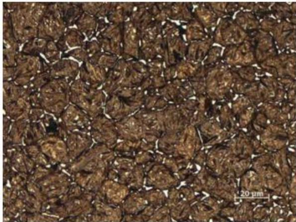

a) Semi-continuous carbide network: Permissible for Grade ML  
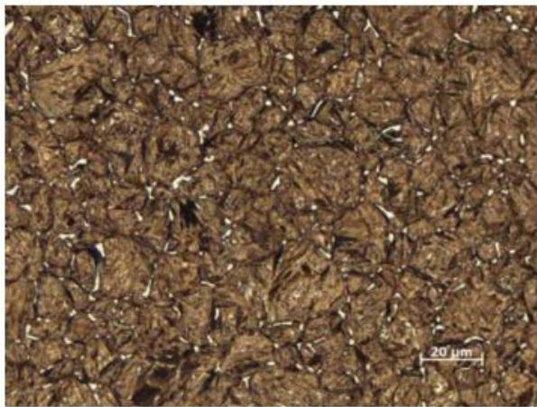

b) Discontinuous carbides: Permissible for ML and MQ  
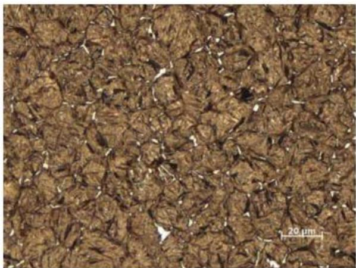  
c) Dispersed carbides: Permissible for ML, MQ and ME  
Figure 20 — Photo micrographs of permissible carbide structures for case carburized gears (5 % nital etch. × 400 magnification)

Table 6 — Induction or flame hardened wrought and cast steels (see Figures 11 and 12)

<table><tr><td>Item</td><td>Requirement</td><td>ML</td><td>MQ</td><td colspan="2">ME</td></tr><tr><td>1</td><td>Chemical analysis</td><td rowspan="6">No specification</td><td colspan="3" rowspan="6">As in Table 3 (through hardened wrought steels: items 1 to 6) or as in Table 4 (through hardened cast steels: items 1 to 3)</td></tr><tr><td>2</td><td>Mechanical properties — after heat treatment</td></tr><tr><td>3</td><td>Cleanliness</td></tr><tr><td>4</td><td>Grain size</td></tr><tr><td>5</td><td>Ultrasonic test</td></tr><tr><td>6</td><td>Extent of forging reduction</td></tr><tr><td>7</td><td>Surface hardness</td><td>All induction-hardened gears should be furnace tempered.a 485 HV to 615 HV or 48 HRC to 56 HRC</td><td>All induction-hardened gears should be furnace tempered.a 500 HV to 615 HV or 50 HRC to 56 HRC</td><td colspan="2">All induction-hardened gears shall be furnace tempered. 500 HV to 615 HV or 50 HRC to 56 HRC</td></tr><tr><td>8</td><td>Hardening depthb, in accordance with ISO 3754</td><td colspan="4">The hardening depth is defined as the distance to the surface from a point where the hardness is equal to 80 % of the required surface hardness. Depth of case to be determined for each part by experience. Location of SHD measurement to be determined on the drawing</td></tr><tr><td>9</td><td>Surface structure</td><td>No specification</td><td>Inspection of statistical samples, mainly fine acicular martensite.</td><td colspan="2">Stricter inspection of statistical samples, fine acicular martensite, ≤10 % non-martensitic structure; no free ferrite permitted.</td></tr><tr><td>10</td><td colspan="5">Non-destructive testing</td></tr><tr><td>10.1</td><td>Surface cracks — not permitted (ASTM E1444)</td><td>Inspection of first batch (magnetic particle, fluorescent magnetic particle penetrant or dye penetrant method).</td><td>Inspection of first batch (magnetic particle, fluorescent magnetic particle penetrant or dye penetrant method).</td><td colspan="2">100 % inspection (magnetic particle, fluorescent magnetic particle penetrant or dye penetrant method).</td></tr><tr><td rowspan="4">10.2</td><td rowspan="4">Magnetic particle inspection (teeth area only) ASTM E1444c</td><td colspan="2" rowspan="4">No specification</td><td>Module</td><td>Max. indication mm</td></tr><tr><td>≤2,5</td><td>1,6</td></tr><tr><td>&gt;2,5 to 8</td><td>2,4</td></tr><tr><td>&gt;8</td><td>3,0</td></tr><tr><td>11</td><td>Prior structure</td><td colspan="4">Quenched and tempered</td></tr></table>

Table 6 (continued)

<table><tr><td>Item</td><td>Requirement</td><td>ML</td><td>MQ</td><td>ME</td></tr><tr><td>12</td><td>Overheating, especially at the tooth tips</td><td>To be avoided</td><td colspan="2">Strict avoidance (&lt;1 000 °C)</td></tr><tr><td colspan="5">NOTE This table applies to spin type flame hardening or spin and tooth-to-tooth type induction hardening with hardened roots, hardness patterns similar to Figures 21 and 22.</td></tr><tr><td colspan="5">a Preferred method is furnace tempering. Caution: non-tempering and induction tempering do carry a certain risk.  b The hardness pattern, depth, facilities and process method shall be established, documented and checked to be repeatable. A representative sample, with the same geometry and material as the work piece, shall be used to qualify the process. The process equipment and methods shall be sufficiently accurate to reproduce the specified results. The hardness pattern shall extend the full length of the teeth and over the full profile, both flanks, both roots and both root fillets.  c No cracks, bursts, seams or laps are permitted in the tooth areas of finished gears, regardless of grade. Limits: maximum of one indication per 25 mm of face width and maximum of five in one tooth flank. No indications allowed below 1/2 of working depth of tooth. Removal of defects which exceed the stated limits is acceptable, with customer approval, provided the integrity of the gear is not compromised.</td></tr></table>

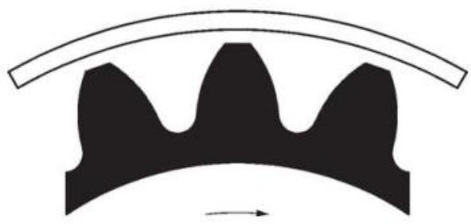  
1 induction coil or flame head

Figure 21 — Example for non-contour spin hardening  
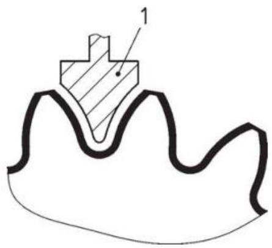

1 induction or flame head

Figure 22 — Example for contour hardening

Table 7 — Nitrided wrought steel, nitriding and through hardening steels, nitrided (see Figures 13 and 14)

<table><tr><td>Item</td><td>Requirement</td><td>ML</td><td>MQ</td><td>ME</td></tr><tr><td>1</td><td>Chemical analysis</td><td colspan="3" rowspan="6">As in Table 3 (through hardened wrought steels: items 1 to 6)</td></tr><tr><td>2</td><td>Mechanical properties — after heat treatment</td></tr><tr><td>3</td><td>Cleanliness</td></tr><tr><td>4</td><td>Grain size</td></tr><tr><td>5</td><td>Ultrasonic test</td></tr><tr><td>6</td><td>Extent of forging reduction</td></tr><tr><td>7</td><td>Nitriding hardening depth</td><td colspan="3"><strong>Minimum value specified</strong> The effective nitride hardening depth is defined as the distance from the surface to a point at which the hardness number is 400 HV or 40,8 HRC. If the core hardness exceeds 380 HV, core hardness +50 HV may be applied. Recommended values of the nitriding hardening depth NHD are shown in 5.6.</td></tr><tr><td>8</td><td colspan="4">Surface hardness</td></tr><tr><td>8.1</td><td>Nitriding steelsa b c</td><td colspan="3">650 HV minimum 900 HV maximumd</td></tr><tr><td>8.2</td><td>Through hardening steelsa</td><td colspan="3">450 HV minimum</td></tr><tr><td>9</td><td>Pre-treatmente</td><td colspan="3">Hardened and tempered without decarburization of finished surfaces. Tempering temperature shall exceed nitriding temperature by a margin sufficient to avoid softening during the nitriding cycle.</td></tr><tr><td>10</td><td>Surface zone: (white layer)</td><td>≤25 μm</td><td>White layer ≤ 25 μm</td><td>White layer ≤ 25 μm thick; proportion of γ' / ε.nitrides &gt; 8</td></tr><tr><td>11</td><td>Core</td><td><math display="inline" xmlns="http://www.w3.org/1998/Math/MathML"><semantics><msub><mi>R</mi><mi mathvariant="normal">m</mi></msub><annotation encoding="application/x-tex">R_{\mathrm{m}}</annotation></semantics></math> not verified</td><td colspan="2"><math display="inline" xmlns="http://www.w3.org/1998/Math/MathML"><semantics><msub><mi>R</mi><mi mathvariant="normal">m</mi></msub><annotation encoding="application/x-tex">R_{\mathrm{m}}</annotation></semantics></math> &gt; 900 N/mm2 (in general, percentage of ferrite less than 5 %)</td></tr><tr><td>12</td><td>Finished condition after nitriding</td><td>—</td><td>Ground only in special cases; be cautious of possible reduction of surface load capacity. If tooth grinding is provided, magnetic particle inspection by ASTM E1444 or EN 10228-1 is recommended.</td><td>Ground only in special cases; be cautious of possible reduction of flank load capacity. If tooth grinding is provided, magnetic particle inspection by ASTM E1444 or EN 10228-1 is required.</td></tr><tr><td colspan="5">The overload capacity of many nitrided gears is low. Since the shape of the S-N curve is flat, the sensitivity to shock should be investigated before proceeding with the design.  a Surface hardness is measured perpendicular to the surface; values measured on a section may be higher. The test load should be appropriate for the case depth and the hardness.  b In aluminum alloy steels, there is a risk of the formation of a continuous grain boundary nitride network, as a result of a prolonged nitriding cycle. The use of these steels requires special precautions in heat treatment.  c Aluminum containing nitriding steels Nitralloy N, Nitralloy 135 and similar are limited to grades ML and MQ. For strength values, see note at Figure 14.  d When values are higher, due to white layer thickness (&gt;10 μm), the endurance values decrease because of embrittlement.  e Pre-heat treatment condition will also apply to the test coupon.</td></tr></table>

Table 8 — Wrought steels, nitrocarburized (see Figures 15 and 16)

<table><tr><td>Item</td><td>Requirement</td><td>ML</td><td>MQ</td><td>ME</td></tr><tr><td>1</td><td>Chemical analysis</td><td colspan="3" rowspan="6">As in Table 3 (through hardened wrought steels: items 1 to 6)</td></tr><tr><td>2</td><td>Mechanical properties — after heat treatment</td></tr><tr><td>3</td><td>Cleanliness</td></tr><tr><td>4</td><td>Grain size</td></tr><tr><td>5</td><td>Ultrasonic test</td></tr><tr><td>6</td><td>Extent of forging reduction</td></tr><tr><td>7</td><td>Nitriding hardening depth</td><td colspan="3"><strong>Minimum value specified</strong> The effective nitriding hardening depth is defined as the distance from the surface to a point at which the hardness number is 400 HV or 40,8 HRC. If the core hardness exceeds 380 HV, core hardness + 50 HV may be applied. Recommended values of the nitriding hardening depth NHD are shown in 5.6.</td></tr><tr><td>8</td><td colspan="4">Surface hardness</td></tr><tr><td>8.1</td><td>Alloyed steelsa</td><td colspan="3">&gt;500 HV</td></tr><tr><td>8.2</td><td>Unalloyed steelsa, b</td><td colspan="3">&gt;300 HV</td></tr><tr><td>9</td><td>Pre-treatment</td><td colspan="3">Hardened and tempered without surface decarburization. Tempering temperature is to exceed nitriding temperature.</td></tr><tr><td>10</td><td>Surface zone: (white layer)</td><td>Detailed inspection not mandatory</td><td colspan="2">White layer, 5 μm to 30 μm thick. Mostly ε. nitrides.</td></tr><tr><td>11</td><td>Nitrocarburized equipment: as bath nitrocarburized</td><td colspan="3">Ventilated titanium heat-resisting alloy (inconel) pot or an inert liner. Iron dissolves in the molten salt inhibiting the nitriding process. Gas nitrocarburizing does not have this problem.</td></tr><tr><td colspan="5">a Surface hardness is measured perpendicular to the surface; values measured on a section may be higher. The test load should be appropriate for the case depth and the hardness. b Because of low hardness of unalloyed steels nitrocarburizing will just serve as surface protection against wear.</td></tr></table>

## 6.5 Coupon

A coupon is a test piece made from a representative grade of material. The selection of a wrought or cast test piece is based on the gear or process being represented. It shall accompany the gear product through all heat treatment stages represented in Tables 2, 3, 4, 5, 6 or 7. The coupon should be chosen to monitor the interactions of the heat treatment process. Options can also be taken to use a representative coupon, which is intended to represent the properties of the work piece. The properties of the standardized coupon may be extrapolated by experience to estimate the properties of the work piece with regard to finished microstructure and properties.

Details of the manufacture of the coupon may be subject to agreement between the supplier and the customer.

Two types of coupons are recognized.

a) Process control test bars: may be of any alloy and shape. They are used to verify the consistency of the heat treatment process. Their microstructure does not represent the microstructure of the finished gear, but it may be extrapolated to estimate the condition of the finished gear. Such extrapolation shall be documented.

b) Representative test bars: designed to represent the quenching rate of the finished part. The hardness and microstructure at the center of the coupon approximate that of the core as designated in Table 5, Lines 8 and 11. Recommended proportions are

1) minimum diameter: $3 \times$ module, and

2) minimum length: $6 \times$ module.

Alternative diameter and/or shape of the test piece are permissible by agreement with the customer.

A fixed sized test piece can be used if the correlation between test piece and part is known.

The coupon material shall be equivalent to the part in chemical composition and hardenability, but not necessarily from the same cast.

## 6.6 Mechanical cleaning by shot blasting

Mechanical cleaning is a technique used to remove scale debris or coatings after the heat treatment operation. Industrial practice includes the use of shot, cut wire, grid, aluminium oxide, sand and glass beads. These, in addition to cleaning a surface, will influence the residual stress — some more significantly (shot, cut wire) than others (grid, aluminium oxide, sand and glass beads). This change in residual stress will influence bending strength and the influence of subsequent operations. In Figure 10, values of MQ bending stress were achieved with adequate industrial cleaning techniques applied and therefore cannot necessarily be achieved after heat treatment alone.

Post-shot blasting processes such as metal removal, heat treatment and shrink fitting are allowed, however, they can alter the residual compressive stress and the bending strength.

## 6.7 Shot peening

### 6.7.1 General

Shot peening is a cold working process performed by bombarding the surface of a part with small spherical media which results in a thin layer of high-magnitude residual compressive stress at the surface. Typical applications of shot peening are discussed in 6.7.2 and 6.7.3. Shot peening should not be confused with the mechanical cleaning operations discussed in 6.6.

The shot peening process shall be controlled. The recommended minimum control should be based on SAE AMS 2430, $^{[7]}$ SAE AMS 2432 $^{[8]}$ or SAE J 2241. $^{[9]}$ Ground surfaces shall be protected against the impact of shot peening, unless the surface is refinished after the shot peening operation.

### 6.7.2 Strength enhancement

The increase of residual compressive stresses by shot peening improves bending strength in the roots of gear teeth. On carburized case hardened gears, following minimum values are attributed to shot peening.

— For quality grade ML, no increase of the allowable stress number for bending $\sigma_{FE}$ is expected.

— For quality grade MQ, the allowable stress number for bending $\sigma_{FE}$ may be increased by 10 %.

— For quality grade ME, the allowable stress number for bending $\sigma_{FE}$ may be increased by 5 %.

Shot peening can be detrimental to surface durability (pitting resistance) due to an increase in surface roughness. It may therefore be required to refinish the tooth flank for achieving the specified surface finish and surface texture.

Post-shot peening processes such as metal removal, heat treatment and shrink fitting are allowed. However, they can alter the residual compressive stress and the bending strength.

### 6.7.3 Salvage

With the agreement of the customer, shot peening may be used as salvage to deviations of residual austenite, intergranular oxidation and grinding temper on case hardened gears (see Table 5). If ground surfaces are exposed to shot peening, the risk of abrasive wear shall be evaluated under consideration of surface roughness and surface hardness, as well as roughness and hardness difference gradients between pinion and gear. Refinishing may be required in order to achieve specified surface finish, surface texture and geometry.

# Annex A (informative) — Considerations of size of controlling section for through hardened gearing

This annex presents approximate maximum controlling section size considerations for through hardened (quench and tempered) gearing. Also presented are factors which affect maximum controlling size, illustrations of how maximum controlling section size is determined for gearing, and recommended maximum controlling section sizes for some low alloy steels.

The controlling section of a part is defined as that section which has the greatest effect in determining the rate of cooling during quenching at the location (section) where the specified mechanical properties (hardness) are required. The maximum controlling section size for steel is based principally on hardenability, specified hardness, depth of desired hardness, quenching and tempering temperature considerations.

Figure A.1 shows controlling sections for quenched gear configurations whose teeth are machined after heat treatment.

Evaluation of the controlling section size for the selection of an appropriate type of steel and/or specified hardness need not include consideration of standard rough stock machining allowances. Other special stock allowances such as those used to minimize distortion during heat treatment shall be considered.

Figure A.2 provides approximate recommended maximum controlling section sizes for oil quenched and tempered gearing (H = 0,5) of low alloy steels, based on specified hardness range, normal stock allowance before hardening, and minimum tempering temperature of 480 °C, to obtain minimum hardness at the roots of teeth.

Maximum controlling section sizes versus specified hardness for section sizes to 200 mm diameter rounds can also be approximated by use of the “Chart predicting approximate cross section hardness of quenched round bars,”[11] and published tempering response/hardenability data.

Maximum controlling section sizes for rounds greater than 200 mm OD generally require in-house heat treatment experiments on larger sections, followed by sectioning and transverse hardness testing.

Normalized and tempered heavy section gearing may also require maximum controlling section size considerations if the design does not permit liquid quenching. Specified hardness able to be obtained with the same type steel (hardenability) is considerably lower, however, and higher hardenability steel may be required. In-house normalized and tempered/hardness testing experiments are required.

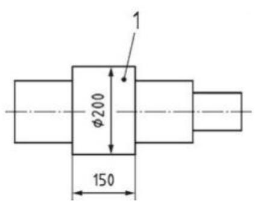  
a) Controlling section: $200 \mathrm{~mm}$ diameter

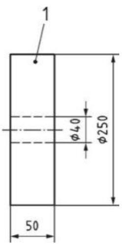  
b) Controlling section: 50 mm face width

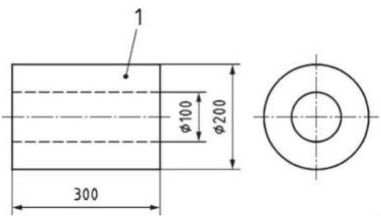  
c) Controlling section: 50 mm wall thickness (if the bore diameter is less than 20 % of the length of the bore, then the outside diameter is the controlling section)

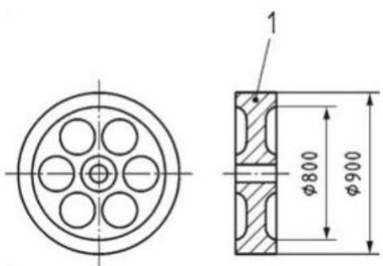  
d) Controlling section 50 mm rim thickness

Key 1 teeth

Figure A.1 — Examples of size of controlling section

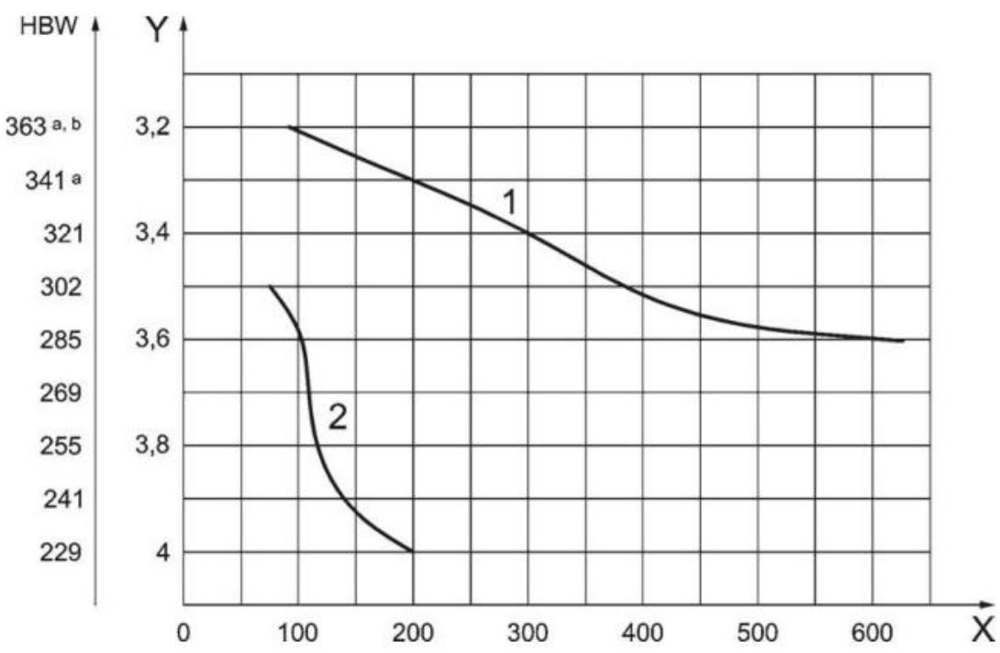  
HBW minimum Brinell hardness  
X recommended controlling section size  
Y Brinell impression, mm  
1 HRC44 to J50 (AISI E4340H) with Jominy distance in mm  
2 HRC40 at J18 (AISI 4140H) with Jominy distance in mm  
a 480 °C minimum temper temperature may be required to meet these hardness specifications.  
b Higher specified hardnesses (e.g. 375 HBW to 415 HBW, 388 HBW to 421 HBW and 401 HBW to 444 HBW) are used for special gearing, but costs should be evaluated due to reduced machinability.  
NOTE Maximum controlling section sizes higher than those above can be recommended when substantiated by test data (heat treat practice).

Figure A.2 — Size of controlling section for two 0,40 % carbon alloy steels

# Annex B (informative) — Core hardness coefficients

Table B.1 — Values of coefficients of $U_{C}$ curves displayed in Figure 19

$U_{\mathrm{C}}=a+b\cdot\sigma_{\mathrm{H}}+c\cdot\sigma_{\mathrm{H}}^2+d\cdot\sigma_{\mathrm{H}}^3$

| Curve No. | $a$ | $b$ | $c$ | $d$ |
| --- | --- | --- | --- | --- |
| 1 | $-4,599\,297$ | $1,315\,460\cdot10^{-2}$ | $-8,291\,160\cdot10^{-6}$ | $2,169\,010\cdot10^{-9}$ |
| 2 | $-5,542\,507$ | $1,425\,472\cdot10^{-2}$ | $-8,658\,576\cdot10^{-6}$ | $2,080\,616\cdot10^{-9}$ |
| 3 | $-7,598\,668$ | $1,773\,498\cdot10^{-2}$ | $-1,104\,475\cdot10^{-5}$ | $2,577\,360\cdot10^{-9}$ |
| 4 | $-9,391\,585$ | $2,009\,680\cdot10^{-2}$ | $-1,230\,944\cdot10^{-5}$ | $2,766\,216\cdot10^{-9}$ |
| 5 | $-16,021\,320$ | $3,247\,710\cdot10^{-2}$ | $-2,035\,296\cdot10^{-5}$ | $4,474\,037\cdot10^{-9}$ |
| 6 | $-40,644\,860$ | $8,094\,566\cdot10^{-2}$ | $-5,221\,782\cdot10^{-5}$ | $1,139\,691\cdot10^{-8}$ |

# Bibliography

[1] ISO 1122-1, Vocabulary of gear terms — Part 1: Definitions related to geometry

[2] ISO 6336-6, Calculation of load capacity of spur and helical gears — Part 6: Calculation of service life under variable load

[3] ISO 6506-1, Metallic materials — Brinell hardness test — Part 1: Test method

[4] ISO 6507-1, Metallic materials — Vickers hardness test — Part 1: Test method

[5] ISO 6508-1, Metallic materials — Rockwell hardness test — Part 1: Test method

[6] ISO 12107, Metallic materials — Fatigue testing — Statistical planning and analysis of data

[7] SAE AMS 2430S, Shot Peening, Automatic, July 2012

[8] SAE AMS 2432D, Shot Peening, Computer Monitored, June 2013

[9] SAE J 2441, Shot Peening, November 2008

[10] FVA-Arbeitsblatt Nr. 8/1: Härtetiefe, Forschungsvereinigung Antriebstechnik e. V., Dezember 1976

[11] PRACTICAL DATA FOR METALLURGISTS. The Timken Steel Co. Canton: Seventeenth Edition, 2011

[^1]: American Society for Testing and Materials

[^2]: Data obtained under different conditions of testing were adjusted to be consistent with reference conditions. It is important to note $\sigma_{H\mathrm{lim}}$ is not the contact pressure under continuous load, but rather the upper limit of the contact pressure derived in accordance with ISO 6336-2, which can be sustained without progressive pitting damage, for a specified number of load cycles.

[^3]: The data of 5.6 may not apply to bevel gears.

[^4]: Definition of case depth according to Table 5, item 9.

[^5]: Definition of nitriding hardening depth according to Table 7, item 7.

[^6]: The material quality grade MX, which existed in the first edition (1995) of this document, was replaced with the ME line in 2003.

[^7]: The material chosen is either that quoted in the relevant grade according to ISO 683-1, ISO 683-2, ISO 683-3, ISO 683-4 or ISO 683-5 (recommended) or an appropriate National or International Standard.

ICS 21.200

Price based on 47 pages

© ISO 2016 – All rights reserved
