ISO 6336-6:2019(E)

INTERNATIONAL STANDARD

Second edition 2019-11

Calculation of load capacity of spur and helical gears —

Part 6: Calculation of service life under variable load

Calcul de la capacité de charge des engrenages cylindriques à dentures droite et hélicoïdale —

Partie 6: Calcul de la durée de vie en service sous charge variable

COPYRIGHT PROTECTED DOCUMENT

© ISO 2019

All rights reserved. Unless otherwise specified, or required in the context of its implementation, no part of this publication may be reproduced or utilized otherwise in any form or by any means, electronic or mechanical, including photocopying, or posting on the internet or an intranet, without prior written permission. Permission can be requested from either ISO at the address below or ISO's member body in the country of the requester.

ISO copyright office

CP 401 • Ch. de Blandonnet 8

CH-1214 Vernier, Geneva

Phone: +41 22 749 01 11

Fax: +41 22 749 09 47

Email: copyright@iso.org

Website: www.iso.org

Published in Switzerland

# Contents

| Contents | Page |
| --- | --- |
| Foreword | iv |
| Introduction | v |
| 1 Scope | 1 |
| 2 Normative references | 1 |
| 3 Terms, definitions, symbols and abbreviated terms | 1 |
| 3.1 Terms and definitions | 1 |
| 3.2 Symbols and abbreviated terms | 1 |
| 4 General | 5 |
| 4.1 Determination of load and stress spectra | 5 |
| 4.2 General calculation of service life | 7 |
| 4.3 Palmgren-Miner rule | 8 |
| 5 Calculation of service strength on the basis of single-stage strength according to ISO 6336 series | 9 |
| 5.1 Basic principles | 9 |
| 5.2 Calculation of stress spectra | 13 |
| 5.3 Determination of pitting and bending strength values | 14 |
| 5.4 Determination of safety factors | 14 |
| Annex A (normative) Determination of application factor, $K_A$, from given load spectrum using equivalent torque, $T_{eq}$ | 16 |
| Annex B (informative) Equivalent cumulative damage | 22 |
| Annex C (informative) Example calculation for safety factor from given load spectrum | 30 |
| Bibliography | 37 |

# Foreword

ISO (the International Organization for Standardization) is a worldwide federation of national standards bodies (ISO member bodies). The work of preparing International Standards is normally carried out through ISO technical committees. Each member body interested in a subject for which a technical committee has been established has the right to be represented on that committee. International organizations, governmental and non-governmental, in liaison with ISO, also take part in the work. ISO collaborates closely with the International Electrotechnical Commission (IEC) on all matters of electrotechnical standardization.

The procedures used to develop this document and those intended for its further maintenance are described in the ISO/IEC Directives, Part 1. In particular, the different approval criteria needed for the different types of ISO documents should be noted. This document was drafted in accordance with the editorial rules of the ISO/IEC Directives, Part 2 (see www.iso.org/directives).

Attention is drawn to the possibility that some of the elements of this document may be the subject of patent rights. ISO shall not be held responsible for identifying any or all such patent rights. Details of any patent rights identified during the development of the document will be in the Introduction and/or on the ISO list of patent declarations received (see www.iso.org/patents).

Any trade name used in this document is information given for the convenience of users and does not constitute an endorsement.

For an explanation of the voluntary nature of standards, the meaning of ISO specific terms and expressions related to conformity assessment, as well as information about ISO's adherence to the World Trade Organization (WTO) principles in the Technical Barriers to Trade (TBT) see www.iso.org/iso/foreword.html.

This document was prepared by Technical Committee ISO/TC 60, Gears, Subcommittee SC 2, Gear capacity calculation.

This second edition cancels and replaces the first edition (ISO 6336-6:2006), which has been technically revised. It also incorporates the Technical Corrigendum ISO 6336-6:2006/Cor.1:2007.

The main changes compared to the previous edition are as follows:

— in Annex A, examples have been revised;

— integration of Annex B "Equivalent cumulative damage".

A list of all parts in the ISO 6336 series can be found on the ISO website.

Any feedback or questions on this document should be directed to the user's national standards body. A complete listing of these bodies can be found at www.iso.org/members.html.

# Introduction

ISO 6336 (all parts) consists of International Standards, Technical Specifications (TS) and Technical Reports (TR) under the general title Calculation of load capacity of spur and helical gears (see Table 1).

— International Standards contain calculation methods that are based on widely accepted practices and have been validated.

— Technical Specifications (TS) contain calculation methods that are still subject to further development.

— Technical Reports (TR) contain data that is informative, such as example calculations.

The procedures specified in parts 1 to 19 of the ISO 6336 series cover fatigue analyses for gear rating. The procedures described in parts 20 to 29 of the ISO 6336 series are predominantly related to the tribological behavior of the lubricated flank surface contact. Parts 30 to 39 of the ISO 6336 series include example calculations. The ISO 6336 series allows the addition of new parts under appropriate numbers to reflect knowledge gained in the future.

Requesting standardized calculations according to the ISO 6336 series without referring to specific parts requires the use of only those parts that are currently designated as International Standards (see Table 1 for listing). When requesting further calculations, the relevant part or parts of the ISO 6336 series need to be specified. Use of a Technical Specification as acceptance criteria for a specific design need to be agreed in advance between the manufacturer and the purchaser.

Table 1 — Parts of the ISO 6336 series (STATUS AS OF DATE OF PUBLICATION)

| Calculation of load capacity of spur and helical gears | International Standard | Technical Specification | Technical Report |
| --- | --- | --- | --- |
| Part 1: Basic principles, introduction and general influence factors | X |  |  |
| Part 2: Calculation of surface durability (pitting) | X |  |  |
| Part 3: Calculation of tooth bending strength | X |  |  |
| Part 4: Calculation of tooth flank fracture load capacity |  | X |  |
| Part 5: Strength and quality of materials | X |  |  |
| Part 6: Calculation of service life under variable load | X |  |  |
| Part 20: Calculation of scuffing load capacity (also applicable to bevel and hypoid gears) — Flash temperature method(replaces: ISO/TR 13989-1) |  | X |  |
| Part 21: Calculation of scuffing load capacity (also applicable to bevel and hypoid gears) — Integral temperature method(replaces: ISO/TR 13989-2) |  | X |  |
| Part 22: Calculation of micropitting load capacity(replaces: ISO/TR 15144-1) |  | X |  |
| Part 30: Calculation examples for the application of ISO 6336-1, 2, 3, 5 |  |  | X |
| Part 31: Calculation examples of micropitting load capacity(replaces: ISO/TR 15144-2) |  |  | X |

Calculation of load capacity of spur and helical gears —

Part 6:

Calculation of service life under variable load

# 1 Scope

This document specifies the information and standardized conditions necessary for the calculation of the service life (or safety factors for a required life) of gears subject to variable loading for only pitting and tooth root bending strength.

If this scope does not apply, refer ISO 6336-1:2019, Clause 4.

# 2 Normative references

The following documents are referred to in the text in such a way that some or all of their content constitutes requirements of this document. For dated references, only the edition cited applies. For undated references, the latest edition of the referenced document (including any amendments) applies.

ISO 1122-1:1998, Vocabulary of gear terms — Part 1: Definitions related to geometry

ISO 6336-1, Calculation of load capacity of spur and helical gears — Part 1: Basic principles, introduction and general influence factors

ISO 6336-2, Calculation of load capacity of spur and helical gears — Part 2: Calculation of surface durability (pitting)

ISO 6336-3, Calculation of load capacity of spur and helical gears — Part 3: Calculation of tooth bending strength

# 3 Terms, definitions, symbols and abbreviated terms

## 3.1 Terms and definitions

For the purposes of this document, the terms and definitions given in ISO 6336-1 and ISO 1122-1:1998 apply.

ISO and IEC maintain terminological databases for use in standardization at the following addresses:

— ISO Online browsing platform: available at http://www.iso.org/obp

— IEC Electropedia: available at http://www.electropedia.org/

## 3.2 Symbols and abbreviated terms

For the purposes of this document, the symbols and abbreviated terms given in ISO 6336-1, ISO 1122-1:1998 and Table 2 apply.

Table 2 — Symbols and abbreviated terms used in this document

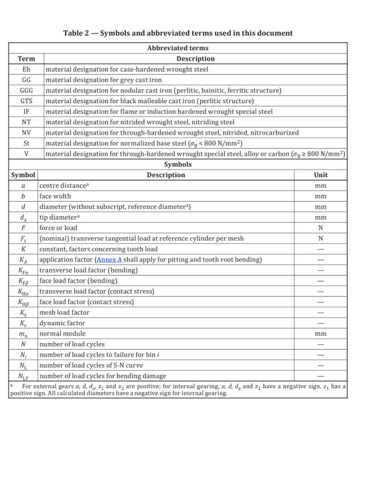

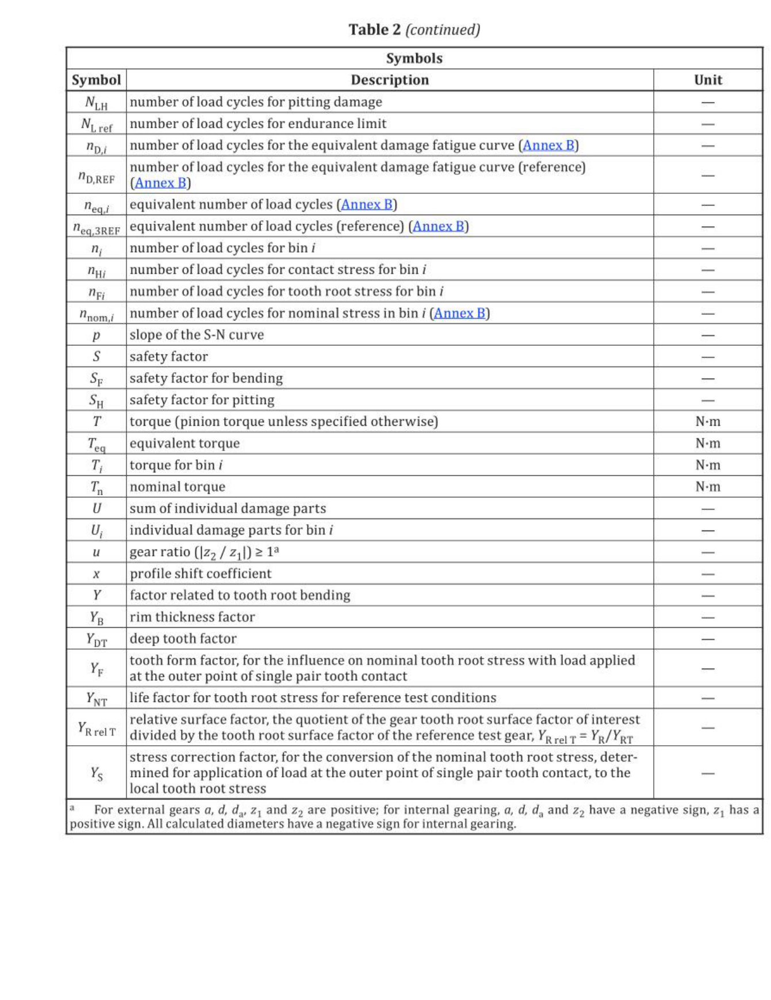

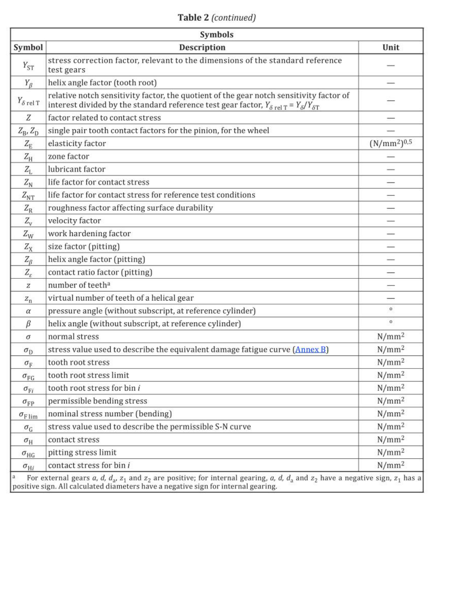

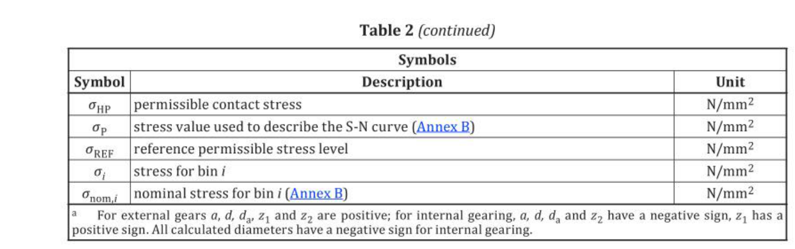

# 4 General

## 4.1 Determination of load and stress spectra

Variable loads resulting from a working process, starting process or from operation at or near a critical speed will cause varying stresses at the gear teeth of a drive system. The magnitude and frequency of these loads depend upon the driven machine(s), the driver(s) or motor(s) and the dynamic mass elastic properties of the system.

These variable loads (stresses) may be determined by such procedures as

— experimental measurement of the operating loads at the machine in question,

— estimation of the spectrum, if this is known, for a similar machine with a similar operating mode, and

— calculation, using known external excitation and a mass elastic simulation of the drive system, preferably followed by experimental testing to validate the calculation.

To obtain the load spectra for fatigue damage calculation, the range of the measured (or calculated) loads is divided into bins or classes. Each bin contains the number of load occurrences recorded in its load range. A widely-used number of bins is 64. These bins can be of an equal size, but it is usually better to use larger bin sizes at the lower loads and smaller bin sizes at the upper loads in the range. In this way, the most damaging loads may be limited to fewer calculated stress cycles and the resulting design is more accurate regarding the effective load. It is recommended that a zero-load bin be included so that the total time used to rate the gears matches the design operating life. For consistency, the usual presentation method is to have the highest torque associated with the lowest numbered bins, such that the most damaging conditions appear towards the top of any table.

The cycle count for the load class corresponding to the load value for the highest loaded tooth is incremented at every load repetition. Table 3 shows as an example of how the torque classes defined in Table 4 can be applied to specific torque levels and correlated numbers of cycles.

Table 3 — Torque classes/numbers of cycles — Example: classes 38 and 39 (see Table 4)

| Torque class,  $T_{i}$ N·m | Number of cycles,  $n_{i}$ |
| --- | --- |
| 11 620 ≤  $T_{38}$  ≤ 12 619 | $n_{38} = 237$ |
| 10 565 ≤  $T_{39}$  ≤ 11 619 | $n_{39} = 252$ |

The torques used to evaluate the tooth loading should include the dynamic effects at different rotational speeds.

This spectrum is only valid for the measured or evaluated time period. If the spectrum is extrapolated to represent the required lifetime, the possibility that there might be torque peaks not frequent enough to be evaluated in that measured spectrum shall be considered. These transient peaks can have an effect on the gear life. Therefore, the evaluated time period could have to be extended to capture extreme load peaks.

Stress spectra concerning bending and pitting can be obtained from the load (torque).

The tooth root stress may also be measured by means of strain gauges in the fillet. The relevant contact stress may be calculated from the measurements.

Table 4 — Example of torque spectrum (with unequal bin sizes for a reducing number of bins) (see Annex C)

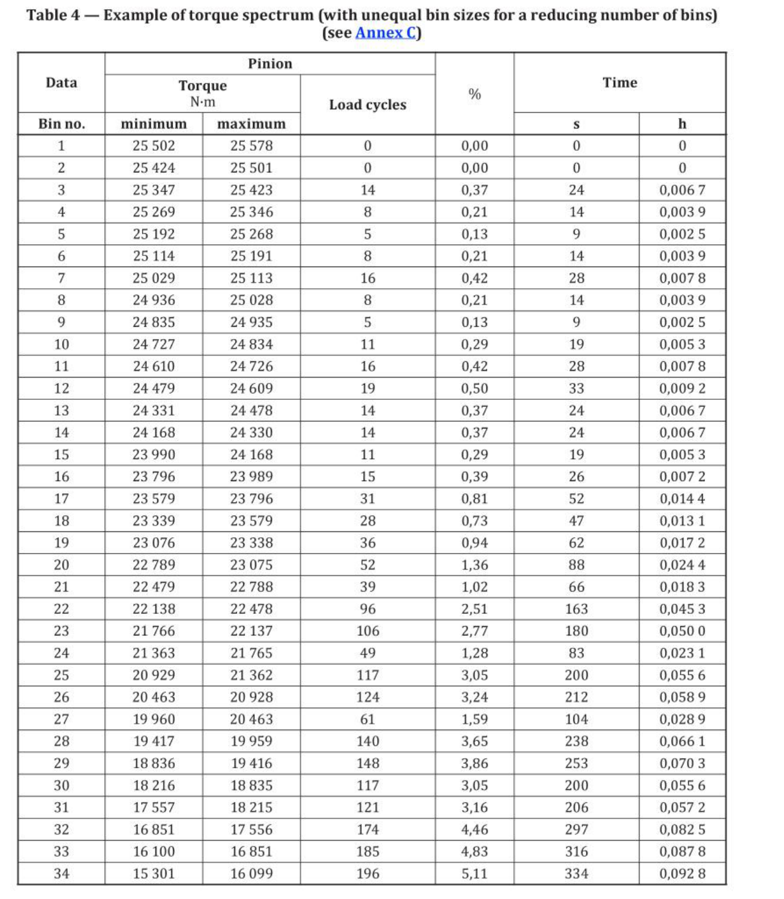

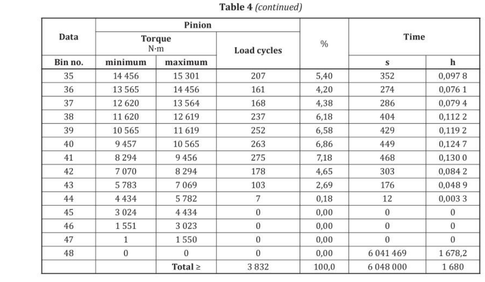

## 4.2 General calculation of service life

The calculated service life is based on the theory that every load cycle (every revolution) is damaging to the gear. The amount of damage depends on the stress level and can be considered as zero for lower stress levels.

The calculated bending or pitting fatigue life of a gear is a measure of its ability to accumulate discrete damage until failure occurs.

The fatigue life calculation requires

a) the stress spectrum,

b) material fatigue properties, and

c) a damage accumulation method.

The stress spectrum is discussed in 5.1.

Strength values based on material fatigue properties are chosen from applicable S-N curves. Many specimens shall be tested by stressing them repeatedly at one stress level until failure occurs. This gives, after a statistical interpretation for a specific probability, a failure cycle number characteristic of this stress level. Repeating the procedure at different stress levels leads to an S-N curve.

An example of a cumulative stress spectrum is given in Figure 1. Figure 2 shows a cumulative contact stress spectrum with an S-N curve for specific material fatigue properties.

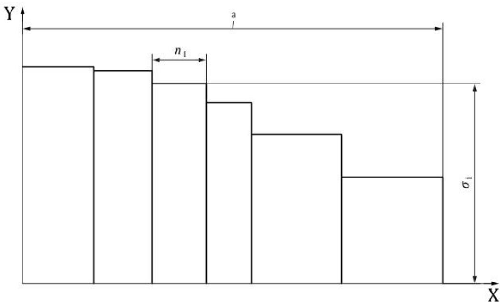

Key

X cumulative number of applied cycles, N (log)

Y stress, σ (log)

a Load spectrum, $\Sigma n_{i}$ , total cycles.

Figure 1 — Example for a cumulative stress spectrum

Linear, non-linear and relative methods are used. Further information can be found in the literature (References [4], [9], [10] and [17]).

## 4.3 Palmgren-Miner rule

The Palmgren Miner rule — in addition to other rules or modifications — is a widely-used linear damage accumulation method. It is assumed that the damaging effect of each stress repetition at a given stress level is equal, which means the first stress cycle at a given stress level is as damaging as the last.

The Palmgren Miner rule operates on the hypothesis that the portion of useful fatigue life used by a number of repeated stress cycles at a particular stress is equal to the ratio of the total number of cycles during the fatigue life at a particular stress level according to the S-N curve established for the material. For example, if a part is stressed for 3 000 cycles at a stress level which would cause failure in 100 000 cycles, $3\%$ of the fatigue life would be expended. Repeated stress at another stress level would consume another similarly calculated portion of the total fatigue life.

The used material fatigue characteristics and endurance data should be related to a specific and required failure probability, e.g. 1%, 5% or 10%.

When 100 % of the fatigue life is expended in this manner, the part could be expected to fail. The order in which each of these individual stress cycles is applied is not considered significant in Palmgren Miner analysis.

Failure could be expected when

$$
\sum_ {i} \frac {n _ {i}}{N _ {i}} = 1, 0\tag{1}
$$

where

$n_{i}$ is the number of load cycles for bin i;

$N_{i}$ is the number of load cycles to failure for bin i (taken from the appropriate S-N curve).

If there is an endurance limit (upper, horizontal line beyond the knee in Figure 2), the calculation is only done for stresses above this endurance limit.

If the appropriate S-N curve shows no endurance limit (decreasing line beyond the knee (kink point) in Figure 3), the calculation shall be done for all stress levels. For each stress level, i, the number of cycles to failure, $N_{i}$ , shall be taken from the corresponding stress level of the S-N curve. Other damage accumulation (including non-linear) hypotheses in addition to the herein described method and permissible damage sums other than one may be used upon agreement of the purchaser and the gear box manufacturer.

# 5 Calculation of service strength on the basis of single-stage strength according to ISO 6336 series

## 5.1 Basic principles

This method is only valid for recalculation. It describes the application of linear cumulative damage calculations according to the Palmgren Miner rule (see 4.3) and has been chosen because it is widely known and easy to apply; the choice does not imply that the method is superior to the others described in the literature (References [4], [9], [10] and [17]).

From the individual torque classes, the torques at the upper limit of each torque class and the associated numbers of cycles shall be listed (see Table 5 for an example).

Table 5 — Torque classes/numbers of cycles — Example: classes 38 and 39

> Editorial note (not part of the ISO text; ISO6-008, printed pages 8 and 10): Table 3 uses lower-case $n_{38}$ and $n_{39}$, while the entries in Table 5 print upper-case $N$ under a lower-case $n_i$ heading. The source is retained pending clarification.

| Upper limit of torque classa,  $T_i$ N·m | Number of cycles,  $n_i$ |
| --- | --- |
| $T_{38} < 12\ 620$ | $N_{38} = 237$ |
| $T_{39} < 11\ 620$ | $N_{39} = 252$ |

a For conservative calculation, sufficiently accurate for a high number of torque classes.

Based on the load spectrum $(T_{i}, n_{i})$ , the effective stress levels $\sigma_{i}$ are determined by help of the methods described in ISO 6336-2 and ISO 6336-3 for the pinion or the wheel to obtain a stress spectrum $(\sigma_{i}, n_{i})$ as shown in Figure 2.

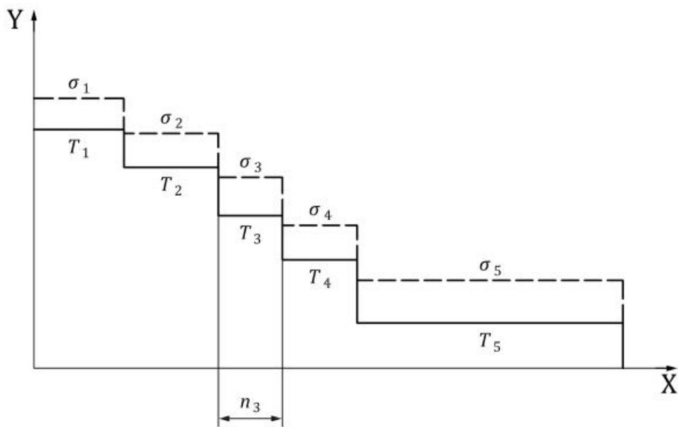

Key

X number of load cycles, N (log)

Y stress, $\sigma$ (log) or torque, $T$ (log)

Figure 2 — Load and stress spectrum

The stress spectrum $(\sigma_{i}, n_{i})$ combined with the S-N curve $\sigma_{\mathrm{G}}(N)$ , allows the determination of the allowable number of cycles $N_{i}$ for each stress level $\sigma_{i}$ (see Figure 3).

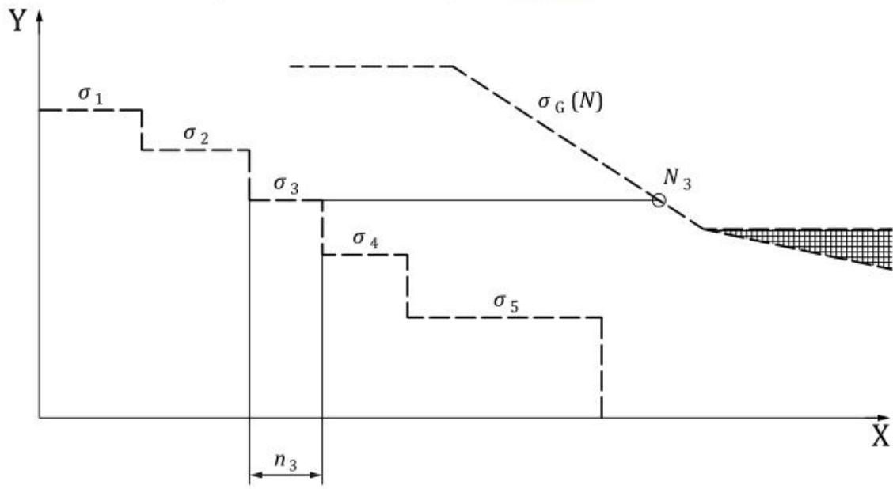  
Key  
X number of load cycles, N (log)

Y stress, $\sigma$ (log)

$\sigma_G(N)$ stress value used to describe the permissible S-N curve

NOTE For each level of stress $\sigma_{i}$ with a number of cycles $n_{i}$ the allowable number of cycles $N_{i}$ can be determined by help of the methods described in ISO 6336-2 and ISO 6336-3 for the pinion or the wheel.

Figure 3 — Stress spectrum and S-N curve

NOTE 1 The representation of the cumulative stress spectrum entirely below the S-N curve does not imply that the part will survive the total accumulative number of stress cycles. This information can be gained from a presentation as shown in Figure 7.

NOTE 2 The value $\sigma_{G}$ is either $\sigma_{HG}$ or $\sigma_{FG}$ .

NOTE 3 The log scale on the vertical axis are different for the stress and the torque in Figure 2.

To evaluate the cumulative damage graphically, it is necessary to shift the damaging load cycles of each stress bin from stress level $\sigma_{i}$ to stress level $\sigma_{i+1}$ in order to keep the cumulated damage constant. Graphically this is equivalent with drawing a line of the same slope than the S-N curve from the extremity of the stress bin $\sigma_{i}$ (see respectively Figures 4 and 5, for the respective cases with and without an endurance limit) to the stress level $\sigma_{i+1}$ .

The equivalent cumulative damage for the given load spectrum is in Figure 4 the ratio $n_{\mathrm{eq3}} / N_3$ for the stress level $\sigma_3$ (respectively $n_{\mathrm{eq4}} / N_4$ for the stress level $\sigma_4$ in Figure 5).

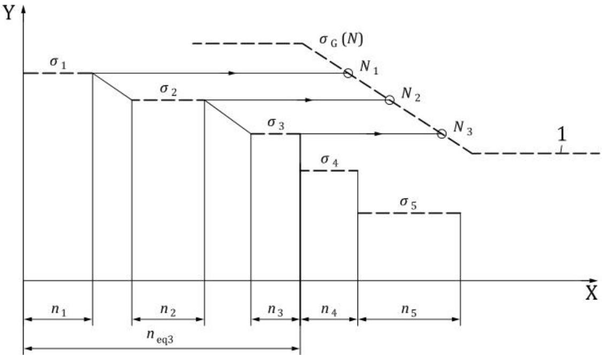

Key

X number of cycles, $N$ (log)

Y stress, $\sigma$ (log)

1 endurance limit

$\sigma_G(N)$ stress value used to describe the permissible S-N curve

NOTE As level $\sigma_{4}$ and $\sigma_{5}$ are below the endurance limit, these bins don't need to be shifted.

Figure 4 — Cumulated stress spectrum and fatigue curve limit when there is an endurance limit

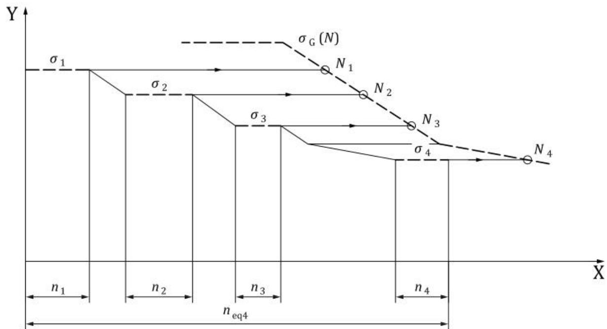

Key

X number of cycles, $N$ (log)

Y stress, $\sigma$ (log)

$\sigma_{G}(N)$ stress value used to describe the permissible S-N curve  
Figure 5 — Cumulated stress spectrum and S-N curve for life factor < 1,0 in the range of long life

The stress spectra for the tooth root $(\sigma_{\mathrm{Fi}}, n_{\mathrm{Fi}})$ and the tooth flank $(\sigma_{\mathrm{Hi}}, n_{\mathrm{Hi}})$ with all relative factors are formed on the basis of this torque spectrum. The load-dependent K-factors are calculated for each new torque class (for the procedure, see 5.2).

With the stress spectra obtained in this way, the calculated values are compared with the strength values (S-N curves, damage lines) determined according to 5.3 using the Palmgren Miner rule, see 4.3. For a graphical representation, see Figure 3.

For all values of $\sigma_{i}$ , individual damage parts are defined as follows:

$$
U _ {i} = \frac {n _ {i}}{N _ {\mathrm{i}}}\tag{2}
$$

The sum of the individual damage parts, $U_{i}$ , results in the cumulated damage condition U, which shall be less than or equal to unity.

$$
U = \sum_ {\mathrm{i}} U _ {\mathrm{i}} = \sum_ {i} \frac {n _ {\mathrm{i}}}{N _ {\mathrm{i}}} \leq 1, 0\tag{3}
$$

NOTE 4 As noted in 4.3, permissible damage sums other than 1,0 can be used.

NOTE 5 The calculation of speed-dependent parameters is based, for each load level, on a mean rotational speed. This also refers to the determination of the S-N curve.

This calculation process shall be applied to each pinion and wheel for both bending and contact stress. Figure 6 shows a presentation from which it can be concluded whether the part will survive the total number of stress cycles.

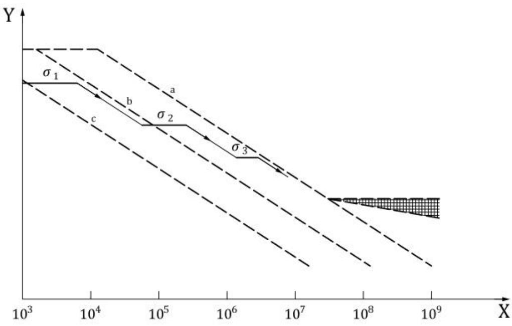

Key  
X number of load cycles, N (log)  
Y stress, $\sigma$ (log)

a Damage sum 100 %.

b Damage sum 10 %.

c Damage sum 1 %.

Figure 6 — Accumulation of damage

In addition, safety factors applied to static load strength should be calculated for the highest stress of the design life. This document is not applicable to stress levels greater than the static stress limit, since stresses in this range can exceed the elastic limit of the gear tooth in bending or in surface contact pressure. In addition, safety factors applied to the static load strength should be calculated for the highest stress of the design life. The highest stress could be either the maximum stress in the load spectrum or an extreme transient load that is not considered in the fatigue analysis. Depending on the material and the load imposed, a single stress cycle above the limited-life range could result in plastic yielding of the gear tooth. The static load strength can be determined according to ISO 6336-2 for pitting and ISO 6336-3 for bending.

## 5.2 Calculation of stress spectra

For each level i of the torque spectrum, the actual stress, $\sigma_{i}$ , shall be determined separately for contact and bending stress in accordance with the following formulae.

— For contact stress (ISO 6336-2:, Method B):

$$
\sigma_ {\mathrm{H} i} = Z _ {\mathrm{H}} \cdot Z _ {\mathrm{E}} \cdot Z _ {\varepsilon} \cdot Z _ {\beta} \cdot Z _ {\mathrm{BD}} \cdot \sqrt {\frac {2000 \cdot T _ {i}}{d _ {1} ^ {2} \cdot b} \cdot \frac {u + 1}{u} \cdot K _ {\gamma i} \cdot K _ {\mathrm{vi}} \cdot K _ {\mathrm{H} \beta i} \cdot K _ {\mathrm{H} \alpha i}}\tag{4}
$$

— For bending stress (ISO 6336-3:, Method B):

$$
\sigma_ {\mathrm{Fi}} = \frac {2000 \cdot T _ {i}}{d _ {1} \cdot b \cdot m _ {\mathrm{n}}} \cdot Y _ {\mathrm{F}} \cdot Y _ {\mathrm{S}} \cdot Y _ {\beta} \cdot Y _ {\mathrm{B}} \cdot Y _ {\mathrm{DT}} \cdot K _ {\gamma i} \cdot K _ {\mathrm{vi}} \cdot K _ {\mathrm{F} \beta i} \cdot K _ {\mathrm{F} \alpha i}\tag{5}
$$

The value $K_{A}$ , defined as the application factor, is set equal to unity (1,0) for this calculation, as all the application load influences should be taken into account by stress levels included in the calculation method.

## 5.3 Determination of pitting and bending strength values

S-N curves for the pitting and bending strength can be determined by experiment or by the rules of ISO 6336-2 and ISO 6336-3.

Where teeth are loaded in both directions (e.g. idler gear), the values determined for the tooth root strength shall be reduced according to ISO 6336-3.

For contact stress, damage accumulation shall be calculated individually for each flank side if both flanks are loaded differently.

## 5.4 Determination of safety factors

In the general case, safety factors cannot directly be deduced from the Miner sum, U. They shall be determined by way of iteration. The procedure is shown in Figure 7.

The safety factor, S, shall be calculated separately for the pinion and the wheel, each for both bending and pitting. The safety factor is only valid for the required life used for each calculation. Annex C shows an example for calculating S.

NOTE Stresses calculated during the iteration process by multiplying the contact stress according to ISO 6336-2 or bending stress according to ISO 6336-3 by the safety factor S can be above the static load strength (see for example Figure C.1). This does not mean that these stresses will occur in real operation.

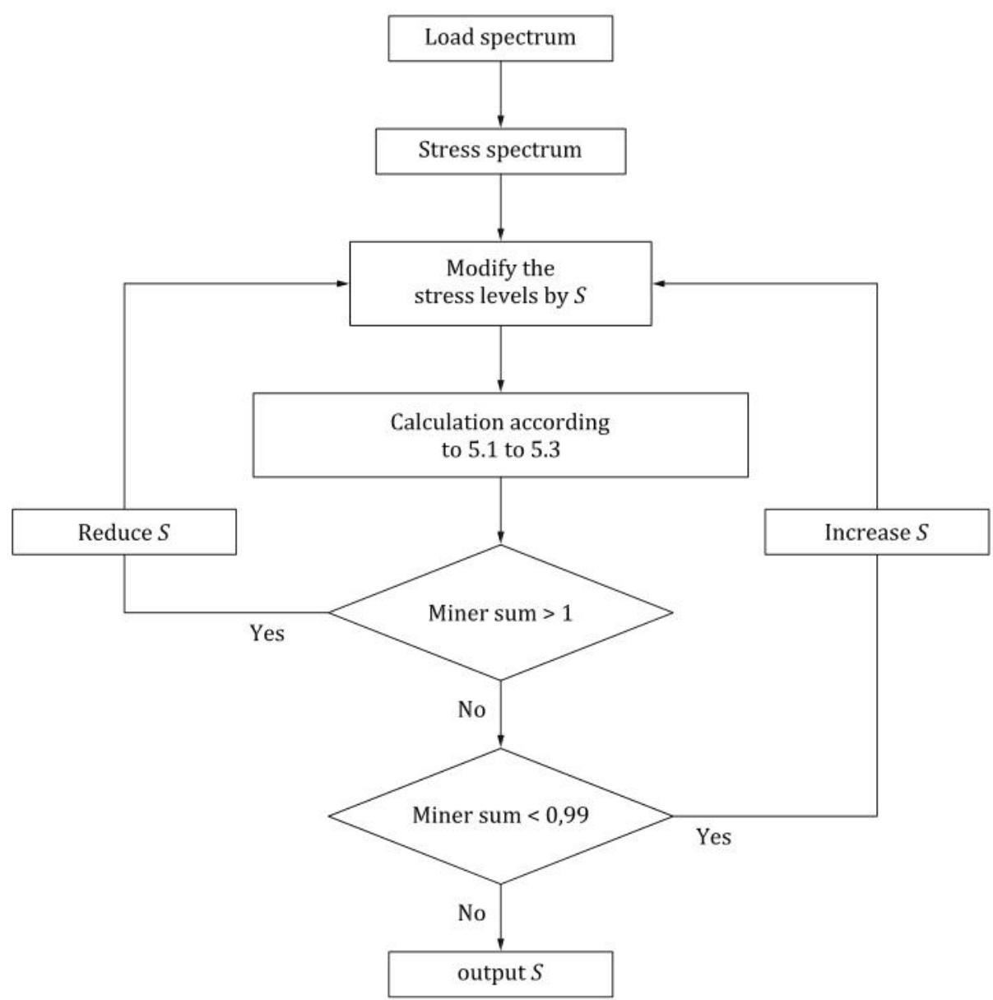  
Figure 7 — Flow chart for the determination of the calculated safety factor for a given load spectrum

# Annex A (normative) — Determination of application factor, $K_{A}$ , from given load spectrum using equivalent torque, $T_{eq}$

## A.1 Purpose

The following calculation method is useful for a first estimation during the gear design stage, where the geometry data of a gear drive is not fixed. This calculation is only valid for the tooth root breakage and pitting damages. If this method is used for determining application factors for other failure modes, this shall be agreed between the purchaser and the gear box manufacturer.

Application factor $K_{A}$ shall be determined separately for the tooth root breakage and the pitting resistance, both for the pinion and the wheel. The highest of these four values shall be used for a gear rating in conformance with ISO 6336 series.

## A.2 Application factor, $K_{A}$

The application factor $K_{A}$ is defined as the ratio between the equivalent torque and the nominal torque:

$$
K _ {\mathrm{A}} = \frac {T _ {\mathrm{eq}}}{T _ {\mathrm{n}}}\tag{A.1}
$$

where

$T_{n}$ is the nominal torque;

$T_{eq}$ is the equivalent torque.

The equivalent torque can be calculated as a simplification according to Formula (A.2). In general, it is recommended to calculate $T_{eq}$ according to the method described in A.3. As a simplification, Formula (A.2) can be used, but it may be on the unsafe side, especially if high number of load cycles occur. Therefore in all cases, it is recommended to use the method described in A.3.

$$
T _ {e q} = \left(\frac {n _ {1} T _ {1} ^ {\mathrm{p}} + n _ {2} T _ {2} ^ {\mathrm{p}} + \dots}{n _ {1} + n _ {2} + \dots}\right) ^ {\frac {1}{p}}\tag{A.2}
$$

where

$n_{i}$ is the number of cycles for bin i;

$T_{i}$ is the torque for bin i;

p is the slope of the S-N curve, see Table A.1.

The slope of the S-N curves used by ISO 6336 series determines that the number of bins to be used in Formula (A.2) may be limited to the bin at which the number of load cycles for endurance limit, $N_{\mathrm{Lref}}$ , is reached, see A.3.3.

## A.3 Determination of the equivalent torque, $T_{eq}$

### A.3.1 General

For this procedure, the load spectrum, the slopes of the S-N curves, p, and the number of load cycles for endurance limit, $N_{Lref}$ , at the reference point shall be known.

### A.3.2 Basis

The following method applies for a design case where the S-N curve is simplified by ignoring all damage which occurs at stresses below some stress limit. It is based upon the fact that while the position of the endurance limit in terms of stress is not known in relation to the gear until the design is available, the position of that endurance limit in terms of cycles does not change as the gear design changes.

It is possible that the reference permissible stress level, $\sigma_{REF}$ , is below the considered bins, when calculating $K_{A}$ according to this annex. If, later in the gear design process, it shows, that there is a significant number of unconsidered load cycles above the reference permissible stress level, $\sigma_{REF}$ , a further detailed calculation according to the main part of this standard is required.

Furthermore, a torque $T_{i}$ in the bin i can be replaced by a torque $T_{j}$ in a new bin, j, so that the damage caused by the torque $T_{i}$ is the same as that caused by the torque $T_{j}$ . This is shown in Figure A.1 and can be expressed by Formula (A.3).

$$
T_i^{p} n_i = T_j^{p} n_j \tag{A.3}
$$

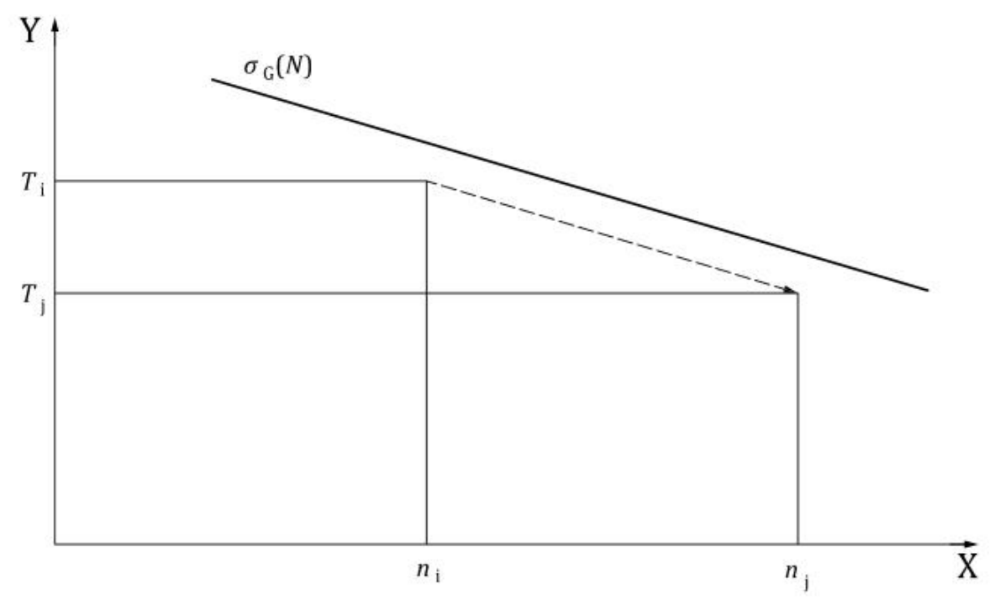  
Key  
X number of load cycles, N (log)  
Y torque, T (log)

Figure A.1 — Load bins with equal damage behaviour according to Formula (A.3)

### A.3.3 Calculation procedure

The load bins shall be denoted as $(T_{i}, n_{i})$ and numbered in descending order of torque, where $T_{1}$ is the highest torque. Then the number of cycles $n_{1}$ at torque $T_{1}$ is equivalent in terms of damage to a larger number of cycles $n_{eq,1}$ , at a lower torque $T_{2}$ , where, according to Formula (A.3):

$$
n _ {\mathrm{eq}, 1} = n _ {1} \left(\frac {T _ {1}}{T _ {2}}\right) ^ {p}\tag{A.4}
$$

As $n_{2c}=n_{2}+n_{eq,1}$ , then bins 1 and 2 can be replaced by a single bin ( $T_{2}, n_{2c}$ ), see Figure A.2.

Similarly, the cycles $n_{2c}$ at torque $T_{2}$ are equivalent to $n_{eq,2}$ at $T_{3}$ , where

$$
n _ {\mathrm{eq}, 2} = n _ {2 \mathrm{c}} \left(\frac {T _ {2}}{T _ {3}}\right) ^ {p}\tag{A.5}
$$

As $n_{3c}=n_{3}+n_{eq,2}$ , then bins 1, 2 and 3 can be replaced by a single bin ( $T_{3}, n_{3c}$ ).

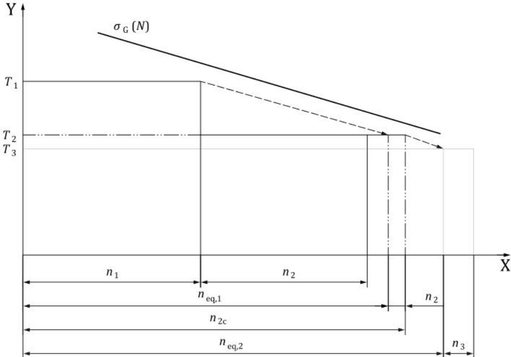

Key

X number of load cycles, N (log)

Y torque, T (log)

NOTE The 2 bins of $n_{2}$ cycles have different length as the scale of the X axis is logarithmic.

Figure A.2 — Bins $(T_1,n_1)$ and $(T_2,n_2)$ replaced by $(T_2,n_{2c})$

This procedure shall be stopped when $n_{eq,i}$ reaches the number of load cycles for endurance limit, $N_{Lref}$ . Once the endurance limit is reached, ensure that no significant numbers of load cycles above the endurance limit have been ignored. If so, further detailed calculation according to the main part of this standard is required.

The required equivalent torque $T_{eq}$ is now between 2 limits:

$$
T _ {i} <   T _ {\mathrm{eq}} <   T _ {i - 1}\tag{A.6}
$$

or

$$
\frac {T _ {i}}{T _ {\mathrm{n}}} <   K _ {\mathrm{A}} <   \frac {T _ {i - 1}}{T _ {\mathrm{n}}}\tag{A.7}
$$

and can be found by linear interpolation on a log-log basis.

The slope exponent, p, and the number of load cycles for endurance limit, $N_{L ref}$ , are a function of the material, heat treatment and damage mechanism. Values to be used in Formulae (A.2), (A.4) and (A.5) are shown in Table A.1.

Table A.1 — Exponent p of S-N curve and number of load cycles for endurance limit, $N_{L ref}$

| Material (acc. ISO 6336-5) | Pitting | Pitting | Tooth root bending | Tooth root bending |
| --- | --- | --- | --- | --- |
| Material (acc. ISO 6336-5) | $p^a$ | $N_{Lref}$ | p | $N_{Lref}$ |
| St, V, GGG (perl., bai.), GTS (perl.) (limited pitting according to ISO 6336-2) | 6,774 8 | $10 \times 10^6$ | 6,224 9 | $3 \times 10^6$ |
| St, V, GGG (perl., bai.), GTS (perl.) (no pitting according to ISO 6336-2) | 6,611 2 | $50 \times 10^6$ | 6,224 9 | $3 \times 10^6$ |
| EH, IF (limited pitting according to ISO 6336-2) | 6,774 8 | $10 \times 10^6$ | 8,737 8 | $3 \times 10^6$ |
| EH, IF (no pitting according to ISO 6336-2) | 6,611 2 | $50 \times 10^6$ | 8,737 8 | $3 \times 10^6$ |
| GG, GGG (ferr.), NT (nitr.), NV (nitr.) | 5,709 1 | $2 \times 10^6$ | 17,035 | $3 \times 10^6$ |
| NV (nitrocar.) | 15,716 | $2 \times 10^6$ | 84,003 | $3 \times 10^6$ |

$^a$  Values p for pitting are given for the torque; to convert for the stress, these values shall be doubled.

## A.4 Example

An example is shown in Figure A.3 and the corresponding Table A.2. In the rightmost column of the table a switch is shown that indicates when the endurance limit has been reached. In this example the application factor $K_{A}$ is between 1,08 and 1,21. From the fact that on row 3 the value of $n_{ie}$ is very close to the endurance limit, the interpolation will give $K_{A} = 1,201$ .

It is important to note that this value of $K_{A}$ should only be used with the same nominal torque used (950 kN m) and with the life factors which match the number of load cycles for endurance limit used ( $50 \times 10^{6}$ ), when doing the gear design.

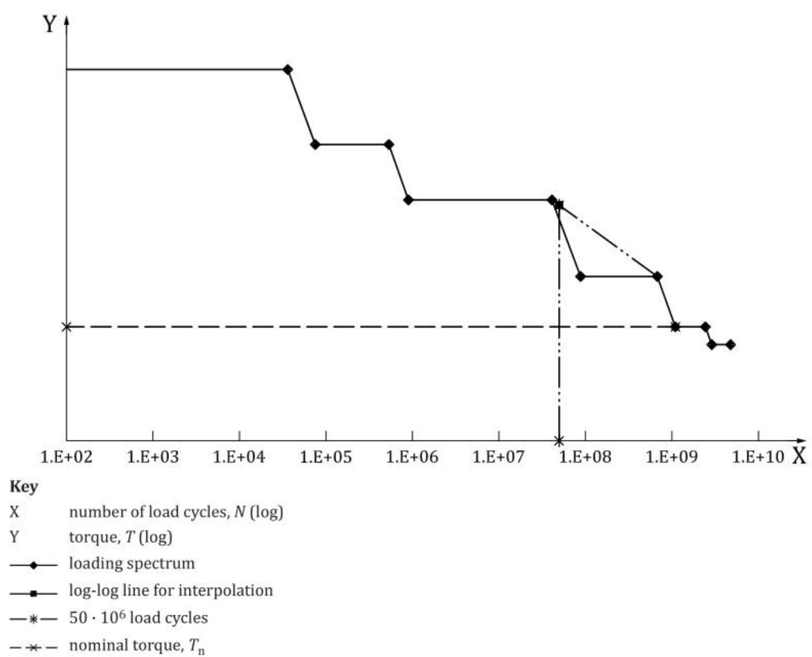  
Figure A.3 — Load spectrum with corresponding equivalent torque, $T_{eq}$

Table A.2 — Example for the calculation of $K_{A}$ from the load spectrum

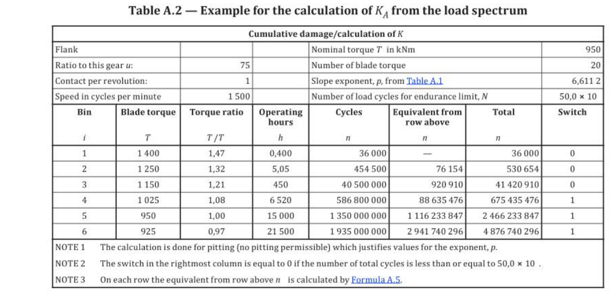

> Editorial note (not part of the ISO text; ISO6-005): Exponents in this scanned table are not reliably legible in the supplied PDF. The original image is retained; consult a clearer authoritative copy.

The equivalent torque $T_{eq}$ for 50 million load cycles is between the ends of bin 3 and 4 and is obtained by using log-log interpolation as follows:

— The slope exponent for log-log interpolation is given by:

$$
p _ {\mathrm{interpol}} = \frac {\log \left(\frac {T _ {3}}{T _ {4}}\right)}{\log \left(\frac {n _ {\mathrm{eq} , 4}}{n _ {\mathrm{eq} , 3}}\right)} = \frac {\log \left(\frac {1150}{1025}\right)}{\log \left(\frac {675435476}{41420910}\right)} = 0, 04122\tag{A.8}
$$

— The equivalent torque for log-log interpolation is given by:

$$
T _ {\mathrm{eq} - 50 \text { million }} = T _ {4} \cdot \left(\frac {n _ {\mathrm{eq} , 4}}{50 \cdot 10 ^ {6}}\right) ^ {p _ {\text { interpol }}} = 1025 \cdot \left(\frac {675435476}{50 \cdot 10 ^ {6}}\right) ^ {0, 04122} = 1141, 11\tag{A.9}
$$

Consequently, the application factor is calculated as follows:

$$
K _ {\mathrm{A}} = \frac {T _ {\mathrm{eq} - 50 \mathrm{million}}}{T _ {\mathrm{n}}} = \frac {1141 , 11}{950} = 1, 201\tag{A.10}
$$

NOTE In this calculation, all load levels between the nominal torque $T_{n}$ and $T_{eq-50million}$ are ignored for the calculation of $K_{A}$ .

# Annex B (informative) — Equivalent cumulative damage

## B.1 Purpose

In order to generalize the equivalence in damage on the basis of Figures 2, 3 and 4 it is possible to calculate an equivalent load for the given load spectrum in term of damage under the assumption of linear damage accumulation.

For a given stress level i and corresponding $n_{i}$ cycles, the individual damage $U_{i}$ is defined by Formula (2), considering that the fatigue curve for the material allows $N_{i}$ cycles before damage.

The equivalent cumulative damage of a given load spectrum is given by the sum of individual damages $U_{i}$ and can be calculated according to Formula (3).

## B.2 Determination of the equivalent stress damage curve, $\sigma_{\mathrm{eq}}$

### B.2.1 General

For this procedure, the load spectrum $(T_{i}, n_{i})$ , the slopes of the considered S-N curves, p, and the number of load cycles, $N_{L}$ , at the reference point shall be known (see Table B.1).

Table B.1 — Exponent p and number of load cycles $N_{L}$

| Material (see ISO 6336-5) | Pitting: $p^a$ | Pitting: $N_L$ | Tooth root bending: $p$ | Tooth root bending: $N_L$ |
| --- | --- | --- | --- | --- |
| St, V, GGG (perl., bai.), GTS (perl.) (limited pitting according to ISO 6336-2) | 6,774 8 | $6\times10^5<N_L\leq10^7$ | 6,224 9; 49,913 (long life) | $10^4<N_L\leq3\times10^6$; $3\times10^6<N_L\leq10^{10}$ (long life) |
| St, V, GGG (perl., bai.), GTS (perl.) (limited pitting according to ISO 6336-2) | 8,776 3 | $10^7<N_L\leq10^9$ | 6,224 9; 49,913 (long life) | $10^4<N_L\leq3\times10^6$; $3\times10^6<N_L\leq10^{10}$ (long life) |
| St, V, GGG (perl., bai.), GTS (perl.) (limited pitting according to ISO 6336-2) | 7,084 1 | $10^9<N_L\leq10^{10}\text{ (long life)}$ | 6,224 9; 49,913 (long life) | $10^4<N_L\leq3\times10^6$; $3\times10^6<N_L\leq10^{10}$ (long life) |
| St, V, GGG (perl., bai.), GTS (perl.) (no pitting according to ISO 6336-2) | 6,611 2 | $10^5<N_L\leq50\times10^6$ | 6,224 9; 49,913 (long life) | $10^4<N_L\leq3\times10^6$; $3\times10^6<N_L\leq10^{10}$ (long life) |
| St, V, GGG (perl., bai.), GTS (perl.) (no pitting according to ISO 6336-2) | 16,301 | $50\times10^6<N_L\leq10^{10}\text{ (long life)}$ | 6,224 9; 49,913 (long life) | $10^4<N_L\leq3\times10^6$; $3\times10^6<N_L\leq10^{10}$ (long life) |
| Eh, IF (limited pitting according to ISO 6336-2) | 6,774 8 | $6\times10^5<N_L\leq10^7$ | 8,737 8; 49,913 (long life) | $10^3<N_L\leq3\times10^6$; $3\times10^6<N_L\leq10^{10}$ (long life) |
| Eh, IF (limited pitting according to ISO 6336-2) | 8,776 3 | $10^7<N_L\leq10^9$ | 8,737 8; 49,913 (long life) | $10^3<N_L\leq3\times10^6$; $3\times10^6<N_L\leq10^{10}$ (long life) |
| Eh, IF (limited pitting according to ISO 6336-2) | 7,084 1 | $10^9<N_L\leq10^{10}\text{ (long life)}$ | 8,737 8; 49,913 (long life) | $10^3<N_L\leq3\times10^6$; $3\times10^6<N_L\leq10^{10}$ (long life) |
| Eh, IF (no pitting according to ISO 6336-2) | 6,611 2 | $10^5<N_L\leq50\times10^6$ | 8,737 8; 49,913 (long life) | $10^3<N_L\leq3\times10^6$; $3\times10^6<N_L\leq10^{10}$ (long life) |
| Eh, IF (no pitting according to ISO 6336-2) | 16,301 | $50\times10^6<N_L\leq10^{10}\text{ (long life)}$ | 8,737 8; 49,913 (long life) | $10^3<N_L\leq3\times10^6$; $3\times10^6<N_L\leq10^{10}$ (long life) |
| GG, GGG (ferr.), NT (nitr.), NV (nitr.) | 5,709 1 | $10^5<N_L\leq2\times10^6$ | 17,035; 49,913 (long life) | $10^3<N_L\leq3\times10^6$; $3\times10^6<N_L\leq10^{10}$ (long life) |
| GG, GGG (ferr.), NT (nitr.), NV (nitr.) | 26,204 | $2\times10^6<N_L\leq10^{10}\text{ (long life)}$ | 17,035; 49,913 (long life) | $10^3<N_L\leq3\times10^6$; $3\times10^6<N_L\leq10^{10}$ (long life) |
| NV (nitrocar.) | 15,716 | $10^5<N_L\leq2\times10^6$ | 84,003; 49,913 (long life) | $10^3<N_L\leq3\times10^6$; $3\times10^6<N_L\leq10^{10}$ (long life) |
| NV (nitrocar.) | 26,204 | $2\times10^6<N_L\leq10^{10}\text{ (long life)}$ | 84,003; 49,913 (long life) | $10^3<N_L\leq3\times10^6$; $3\times10^6<N_L\leq10^{10}$ (long life) |

$^a$ Values $p$ for pitting are given for torque; to convert for stress, these values are to be doubled.

For pitting, the endurance limit is considered:

— beyond $2 \times 10^{6}$ cycles for GG, GGG (ferr.), NT (nitr.), NV (nitr.), NV (nitrocar.);

— beyond $50 \times 10^{6}$ cycles for St, V, GGG (perl., bai.), GTS (perl.), Eh, IF when limited pitting according to ISO 6336-2 is permitted;

> Editorial note (not part of the ISO text; ISO6-004, printed pages 19 and 23): Table A.1 gives $10 \times 10^6$ for limited pitting in these material groups, while B.2.1 states $50 \times 10^6$. The annexes use different damage methods; the endurance-limit terminology requires clarification before exchanging parameters.

— beyond $50 \times 10^{6}$ cycles for St, V, GGG (perl., bai.), GTS (perl.), Eh, IF.

For tooth root bending, the endurance limit is considered beyond $3 \times 10^{6}$ cycles for all materials of Table A.1.

When the long life area is considered, the endurance limit is beyond $10^{10}$ cycles.

### B.2.2 Basis

The first step is to select for which criteria the equivalent stress damage calculation shall be done:

— contact stress at pinion;

— contact stress at wheel;

— bending stress at pinion;

— bending stress at wheel.

The second step is to convert each torque bin $(T_{i}, n_{i})$ in a contact stress bin $(\sigma_{\mathrm{Hi}}, n_{i})$ and/or bending stress bin $(\sigma_{\mathrm{Fi}}, n_{i})$ on the basis of ISO 6336-2 and ISO 6336-3 (see Formulae (4) and (5) in 5.2).

NOTE The transformation from the torque $T_{i}$ to the stress $\sigma_{i}$ is done by using load distribution factors (transverse and facewidth-direction, $K_{H\alpha i}$ and $K_{H\beta i}$ ) taking into account the mean rotational speed during the bin number i via the dynamic factor $K_{vi}$ ;

— For pitting:

— the calculation of the nominal contact stress $\sigma_{H0,i}$ for the torque $T_{i}$ and the calculation of the contact stress for the pinion $\sigma_{H1,i}$ and/or the wheel $\sigma_{H2,i}$ , according to ISO 6336-2:2019, Formulae (3) to (5);

— the calculation of the number of cycles for the pinion $n_{H1,i}$ and/or the wheel $n_{H2,i}$ out of the given time and roational speed for which the torque $T_{i}$ is applied on the concerned tooth flanks;

— the calculation of the permissible contact stress considering a life factor $Z_{NT}$ equal to 1 for the number of cycles for the pinion $\sigma_{HP1}$ and/or the wheel $\sigma_{HP2}$ , according to ISO 6336-2:2019, Formula (6); this calculation gives the reference permissible contact stress level $\sigma_{H\ REF}$ associated to the allowable reference number of cycles $N_{LH\ REF}$ (obtained for the knee of the life factor curve $Z_{NT}$ : beginning of the endurance limit when considered);

— then, the initial load spectrum $(T_{i}, n_{i})$ is transformed in $(\sigma_{\mathrm{H1},i}, n_{\mathrm{H1},i})$ for the pinion or/and $(\sigma_{\mathrm{H2},i}, n_{\mathrm{H2},i})$ for the wheel.

— For tooth root bending:

— the calculation of the nominal bending stress $\sigma_{F0,i}$ for the torque $T_{i}$ and then the calculation of the bending stress for the pinion $\sigma_{F1,i}$ and/or the wheel $\sigma_{F2,i}$ , according to ISO 6336-3:2019, Formula (3);

— the calculation of the number of cycles for the pinion $n_{F1,i}$ and/or the wheel $n_{F2,i}$ out of the given time and roational speed for which the torque $T_{i}$ is applied on the concerned tooth flanks;

— the calculation of the permissible bending stress considering a life factor $Y_{NT}$ equal to 1 for the number of cycles for the pinion $\sigma_{FP1}$ and/or the wheel $\sigma_{FP2}$ , according to ISO 6336-3:2019, Formula (5); this calculation gives the reference permissible bending stress level $\sigma_{F\ REF}$ associated to the allowable reference number of cycles $N_{LF\ REF} = 3,0 \times 10^{6}$ cycles (same value for all materials) (obtained for the knee of the life factor curve $Y_{NT}$ : beginning of the endurance limit when considered);

— then, the initial load spectrum $(T_{i}, n_{i})$ is transformed in $(\sigma_{\mathrm{F1},i}, n_{\mathrm{F1},i})$ for the pinion or/and $(\sigma_{\mathrm{F2},i}, n_{\mathrm{F2},i})$ for the wheel.

To be general, the transformed load spectrum is noted as $(\sigma_{\mathrm{nom},i}, n_{\mathrm{nom},i})$ and the reference permissible stress level is noted as $\sigma_{REF}$ in the rest of the document.

Further on, a stress level $\sigma_{nom,i}$ in the bin i can be replaced by the stress level $\sigma_{nom,j}$ in a new bin j, so that the damage caused by the stress level $\sigma_{nom,j}$ is the same as that caused by the stress level $\sigma_{nom,i}$ . This is shown in Figure B.1 and can be expressed by Formula (B.1).

$$
\sigma_ {\mathrm{nom}, i} ^ {p} \cdot n _ {\mathrm{nom}, i} = \sigma_ {\mathrm{nom}, j} ^ {p} \cdot n _ {\mathrm{nom}, j}\tag{B.1}
$$

### B.2.3 Calculation procedure

The load bins shall be denoted as $(\sigma_{\mathrm{nom},i}, n_{\mathrm{nom},i})$ and numbered in descending order of stress, where $\sigma_{nom,1}$ corresponds to the highest torque. Then the number of cycles $n_{nom,1}$ at the torque $T_{1}$ is equivalent in terms of damage to a larger number of cycles $n_{eq,1}$ , at the lower stress $\sigma_{nom,2}$ , according to Formula (B.2):

$$
n _ {\mathrm{eq}, 1} = n _ {\mathrm{nom}, 1} \cdot \left(\frac {\sigma_ {\mathrm{nom} , 1}}{\sigma_ {\mathrm{nom} , 2}}\right) ^ {p}\tag{B.2}
$$

Then bins 1 and 2 can be replaced by a single bin ( $\sigma_{nom,2}$ , $n_{eq,1} + n_{nom,2}$ ), see Figure B.2.

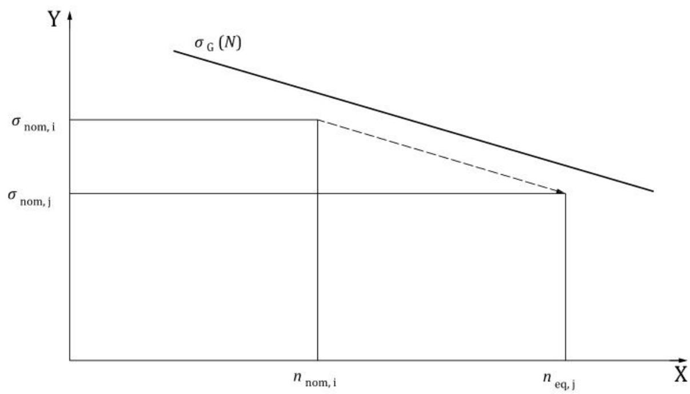  
X number of load cycles, N (log)  
Key  
Y stress, $\sigma$ (log)

Figure B.1 — Load bins with equal damage behaviour according to Formula (B.1)

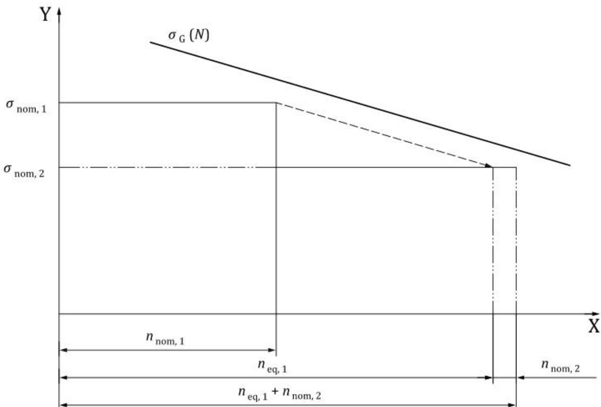

Key

X number of load cycles, N (log)

Y stress, σ (log)

Figure B.2 — Bins $(\sigma_{\mathrm{nom},1}, n_{\mathrm{nom},1})$ and $(\sigma_{\mathrm{nom},2}, n_{\mathrm{nom},2})$ replaced by $(\sigma_{\mathrm{nom},2}, n_{\mathrm{eq},1} + n_{\mathrm{nom},2})$

This procedure can be done for all bins of the spectrum.

## B.3 Equivalent damage curve $\sigma_{\mathrm{D}}(\mathsf{N})$

No endurance limit is always considered.

The initial complete load spectrum of Figure 2 is transformed in the cumulated stress spectrum shown in Figure B.3. In terms of damage, it is equivalent to the stress level $\sigma_{\mathrm{nom},5}$ with a number of cycles $n_{\mathrm{D},5} = n_{\mathrm{eq},5}$ . From this point $(\sigma_{\mathrm{nom},5}, n_{\mathrm{D},5})$ it is possible to draw an equivalent damage fatigue curve $\sigma_{\mathrm{D}}(\mathrm{N})$ parallel to the permissible fatigue curve $\sigma_{\mathrm{P}}(\mathrm{N})$ .

The initial complete spectrum of Figure 2 has also the following equivalent cumulative damage for each level of stresses:

— at stress level $\sigma_{nom,5}$ with a number of cycles $n_{D,5}$ ;

— at stress level $\sigma_{nom,4}$ with a number of cycles $n_{D,4}$ ;

— at stress level $\sigma_{REF}$ with a number of cycles $n_{D,REF}$ ;

— at stress level $\sigma_{nom,3}$ with a number of cycles $n_{D,3}$ ;

— at stress level $\sigma_{nom,2}$ with a number of cycles $n_{D,2}$ ;

— at stress level $\sigma_{nom,1}$ with a number of cycles $n_{D,1}$ .

Those different stress levels $\sigma_{nom,i}$ associated with their respective number of cycles $n_{D,i}$ are all equivalents in terms of damage to the damage obtained for the application of the initial complete load spectrum.

Each equivalent number of cycles $n_{eq,i}$ for each level of stress $\sigma_{nom,i}$ is located on the same parallel to the S-N curve of the material represented in ISO 6336 series by the life factors.

At the stress level $\sigma_{REF}$ the slope of the S-N curve (the life factor curve) might change depending on the material and the chosen parameters. The transformation in equivalent number of cycles ( $n_{eq,3REF}$ on the Figure B.3) shall consider this change.

NOTE 1 After $n_{eq,3REF}$ cycles the slope of the curve changes from the p defined for “limited life” to values $p_{LF}$ from the corresponding life factor given for “long life” for the shown example (see Table B.1).

NOTE 2 In order to be conservative, stress levels lower than the minimum level of the S-N curve at $10^{10}$ cycles, such as $\sigma_{nom,5}$ in Figure B.3, are integrated as it can contribute to the cumulative damage.

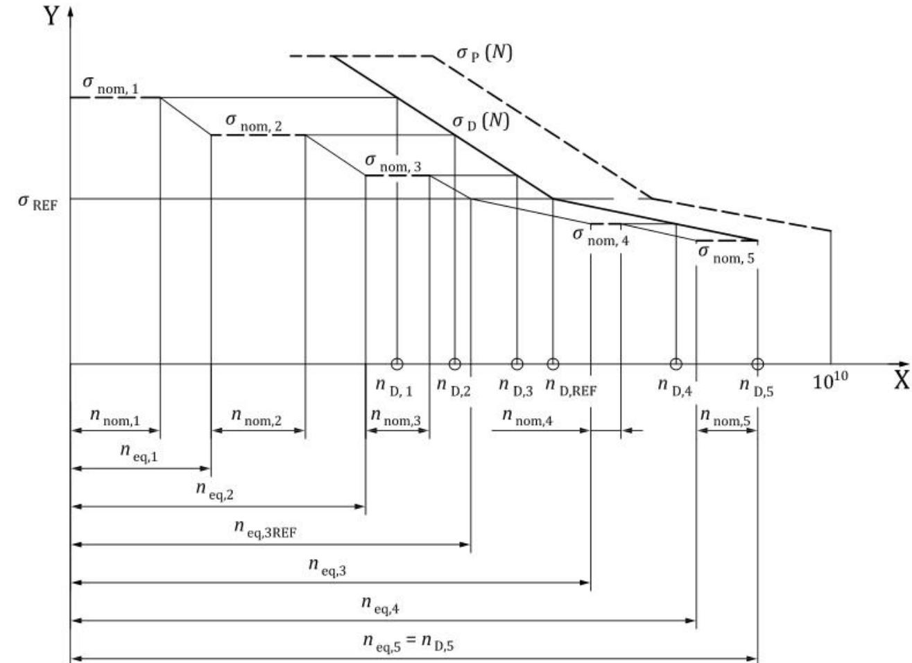

Key  
X number of cycles, N (log)  
Y stress, $\sigma$ (log)  
$\sigma_{D}(N)$ stress value used to describe the equivalent damage fatigue curve  
$\sigma_{P}(N)$ stress value used to describe the S-N curve dependant from the number of load cycles

Figure B.3 — Generalization of equivalent damages when there is no endurance limit

The following are some remarks on the calculation:

— Determination of $n_{eq,3REF}$ on the Figure B.3:

In this calculation the reference permissible stress level $\sigma_{REF}$ is already determined taking into account the safety factor $S_{H\ min}$ for pitting, $S_{F\ min}$ for bending ( $\sigma_{REF} = \sigma_{HG}/S_{H\ min}, \sigma_{REF} = \sigma_{FG}/S_{F\ min}$ ).

On this basis, the calculation of the equivalent number of cycles $n_{eq,3REF}$ is given by:

$$
n _ {\mathrm{eq}, 3 \mathrm{REF}} = \left(n _ {\mathrm{eq}, 2} + n _ {\mathrm{nom}, 3}\right) \left(\frac {\sigma_ {\mathrm{nom} , 3}}{\sigma_ {\mathrm{REF}}}\right) ^ {\mathrm{p}}\tag{B.3}
$$

— Then the slope of the curve changes from p (defined for “limited life”) to $p_{LF}$ from the corresponding life factor given for “long life” and

$$
n _ {\mathrm{eq}, 3} = n _ {\mathrm{eq,REF}} \left(\frac {\sigma_ {\mathrm{REF}}}{\sigma_ {\mathrm{nom} , 4}}\right) ^ {p _ {\mathrm{LF}}}\tag{B.4}
$$

— Formula of equivalent damage fatigue curve $\sigma_{\mathrm{D}}(N)$ for « long life area »

$$
\sigma_ {\mathrm{D}} (N) = \sigma_ {\mathrm{REF}} \cdot \left(\frac {n _ {\mathrm{eq,3REF}}}{N}\right) ^ {1 / p _ {\mathrm{LF}}} \quad \text { for } N <   n _ {\mathrm{eq,3REF}}\tag{B.5}
$$

— Formula of equivalent damage fatigue curve $\sigma_{\mathrm{D}}(N)$ for « limited life area »

$$
\sigma_ {\mathrm{D}} (N) = \sigma_ {\mathrm{REF}} \left(\frac {n _ {\mathrm{eq} , 3 \mathrm{REF}}}{N}\right) ^ {1 / p} \quad \text { for } N \geq n _ {\mathrm{eq}, 3 \mathrm{REF}}\tag{B.6}
$$

> Editorial note (not part of the ISO text; ISO6-002): Formulae (B.5) and (B.6) reproduce the labels and inequalities as printed (printed page 28). The association of “long life area” with $N < n_{\mathrm{eq,3REF}}$ and “limited life area” with $N \geq n_{\mathrm{eq,3REF}}$ appears reversed in relation to the life ranges described above. Authoritative clarification is needed; no correction is assumed here.

## B.4 Use of cumulative damage concept for accelerated tests

The method previously described in B.2 and B.3 for equivalent damage can be used in order to accelerate the testing duration to qualify products in terms of endurance fatigue.

When accelerating tests for a defined type of failure it is recommended to check that the increase of loadings will not lead to other potential damages on the tested component itself and all others implied in the test.

NOTE 2 cases can be considered:

— either it can be proved that there is no damage for the considered loading spectrum and in that case the safety factors considered to calculate the reference permissible stress level are greater or equal to 1;

— or it can be proved that there is damage for the considered loading spectrum and in that case the safety factors considered to calculate the reference permissible stress level are equal to 1.

## B.5 Example of equivalent damage fatigue curve $\sigma_{\mathrm{D}}(N)$

An example is shown in Figure B.4 and the corresponding Table B.2. The right hand column of the table indicates the life factor. In this example the number of load cycles for endurance limit are $50 \times 10^{6}$ and therefore between $Z_{N} = 0,933$ and $Z_{N} = 1,03$ .

Here the examined criterion is the contact pressure, and the cumulated loading spectrum is transformed in a contact stress spectrum which is cumulated as indicated in Figure B.4. Then from the point of the cumulated spectrum with the highest number of cumulated cycles the slope of life factor allows to determine the equivalent damage curve: each point of this curve is equivalent in terms of the contact fatigue damage to the full spectrum.

> Editorial note (not part of the ISO text; ISO6-010, printed page 29): Figure B.4 labels its vertical axis torque $T$, whereas this paragraph and Table B.2 describe contact stress. The source is retained pending clarification.

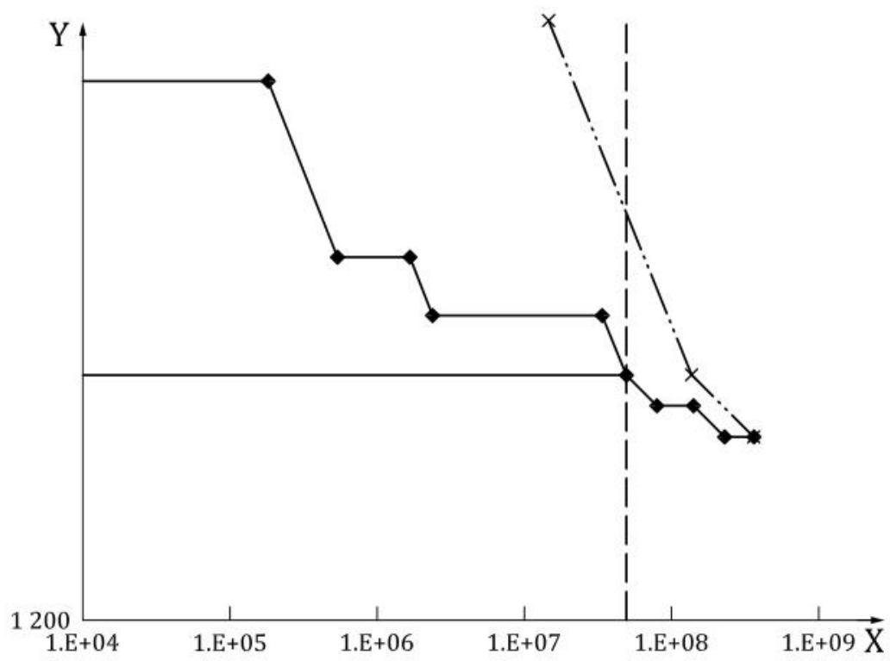

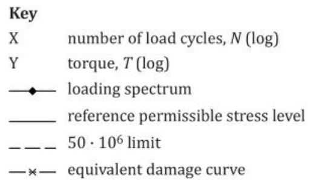  
Figure B.4 — Load spectrum with a corresponding equivalent damage curve

Table B.2 — Example for the calculation of the equivalent damage curve

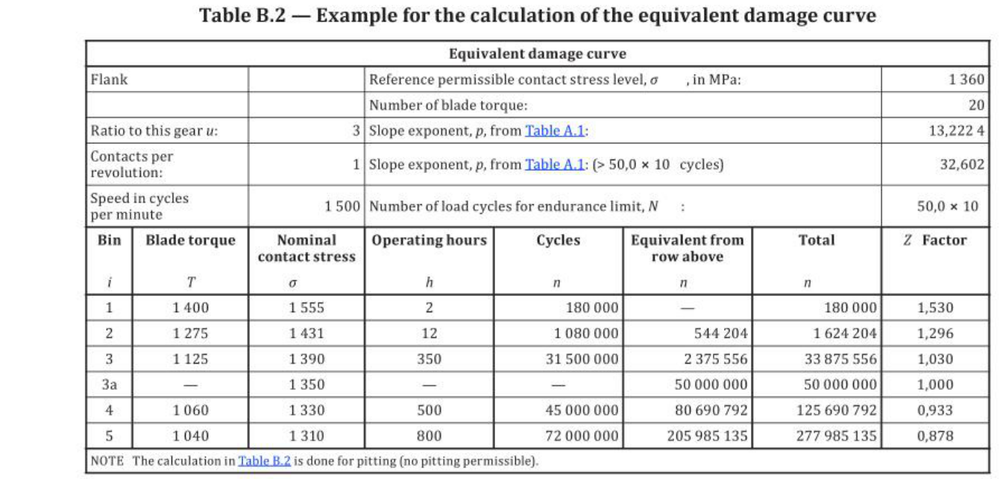

> Editorial note (not part of the ISO text; ISO6-005): Exponents in this scanned table are not reliably legible in the supplied PDF. The original image is retained; consult a clearer authoritative copy.

# Annex C (informative) — Example calculation for safety factor from given load spectrum

## C.1 Background

The example is from a forty-ton container crane boom hoist. This uses the same load spectrum found in Table 4. More specifically, the example is a gear mesh in a reducer, which drives a winch drum for the boom hoist, which raises and lowers the boom for the container crane. This is done via pulleys and a pivot.

The boom is supported by folding support rods when the boom is all the way down (and the crane is in use). The winch shall raise the boom out of the way when the crane is not in use, or to allow ships to move past the crane. Similarly, there is a support that locks the boom upright, once it is completely raised.

The pulley system involves multiple wraps of cable, for a mechanical advantage. The load is constantly varying, since the centre of gravity of the boom changes with respect to the pivot and the angle of the cable changes.

There are load variations from accelerations and decelerations at the start and end of travel. Wind, rain and ice build up can also change the loading.

This boom hoist uses a four-stage reduction gearbox, with a 175,3:1 overall ratio. This example is for the pinion of the fourth reduction low speed mesh, with the geometry, as given in Table C.1.

Table C.1 — Geometry data of the example

| Item | Pinion | Wheel | Unit |
| --- | --- | --- | --- |
| No. of teeth, z | 17 | 60 | — |
| Gear ratio, u | 3,529 | 3,529 | — |
| Normal module,  $m_n$ | 8,467 | 8,467 | — |
| Normal pressure angle, α | 25 | 25 | ° |
| Helix angle, β | 15,5 | 15,5 | ° |
| Centre distance, a | 339,727 | 339,727 | mm |
| Face width, b | 152,4 | 152,4 | mm |
| Tip diameter,  $d_a$ | 169,212 | 544,132 | mm |
| Profile shift coefficient, x | 0,172 0 | 0,001 5 | — |

The set is carburized and ground, MQ, accuracy grade 6 according to ISO 1328-1, cutter addendum is $1,35 \times m_{\mathrm{n}}$ with a full tip radius, zero protuberance and zero grind stock.

## C.2 Define load spectrum

The load spectrum can be found in Table 4. In this case, the boom was raised and lowered 10 times, to simulate 70 days of loading. The pinion speed is $35,2 \mathrm{~min}^{-1}$ .

This spectrum has 48 bins, but the first two bins (Nos. 1 and 2) have no load cycles. This is acceptable, as it is important that the spectrum loads are large enough to include the highest loads the gears will see. Similarly bins No. 45 to No. 47 have no load cycles. This is because the mesh is always under some load, until the weight of the boom is transferred to either the support rods or the support that locks the boom upright.

The last load bin (No. 48) is purposely set to zero load and cycles, but with a specific time interval. This bin is meant to account for the time when there is no load on the mesh. This bin is used to clarify the elapse time period of the sample load spectrum, i.e.

$$
6048000 \text { seconds } = 100800 \text { minutes } = 1680 \text { hours } = 70 \text { days } = 0, 1918 \text { years },
$$

since the gears are unloaded for a significant amount of time. (99,891 9 % of the time).

The desired useful life (30 years) is longer than the spectrum (70 days). So each bin's load cycles will need to be scaled up by a factor of $156,53 = (30 \times 365,25/70)$ .

## C.3 Check for plastic yielding

Using the highest load bin in the spectrum (bin No. 3), calculate the safety factor for $10^{3}$ cycles using ISO 6336-2 and ISO 6336-3. This shall be done to ensure the gears will not fail by plastic yielding (see 5.1).

$$
S _ {\mathrm{H}} = \frac {\sigma_ {\mathrm{HP}}}{\sigma_ {\mathrm{H}}} = \frac {2400 \mathrm{N/mm} ^ {2}}{1747 \mathrm{N/mm} ^ {2}} = 1, 374\tag{C.1}
$$

$$
S _ {F} = \frac {\sigma_ {F P}}{\sigma_ {F}} = \frac {2356 \mathrm{N/mm} ^ {2}}{826 \mathrm{N/mm} ^ {2}} = 2, 852\tag{C.2}
$$

## C.4 Calculate the stress spectra

For each load bin in the spectrum (Nos. 3 to 44), calculate the bending and contact stress in accordance with Formulae (4) and (5). The values are given in Tables C.2 and C.3.

## C.5 Calculate strength values

Using the nominal load conditions, calculate the permissible bending and contact stresses for unity values of life factors in accordance with ISO 6336-2:2019, Formula (6), and ISO 6336-3:2019, Formula (5).

$$
\sigma_ {\mathrm{HP}} = \frac {\sigma_ {\mathrm{Hlim}} \cdot Z _ {\mathrm{L}} \cdot Z _ {\mathrm{v}} \cdot Z _ {\mathrm{R}} \cdot Z _ {\mathrm{W}} \cdot Z _ {\mathrm{X}}}{S _ {\mathrm{Hmin}}}\tag{C.3}
$$

$$
\sigma_ {\mathrm{HP}} = \frac {1500 \mathrm{N} / \mathrm{mm} ^ {2} \cdot 1 , 02 \cdot 0 , 943 \cdot 1 , 01 \cdot 1 \cdot 1}{1 , 0} = 1457 \mathrm{N} / \mathrm{mm} ^ {2}\tag{C.4}
$$

$$
\sigma_ {\mathrm{FP}} = \frac {\sigma_ {\mathrm{Flim}} \cdot Y _ {\mathrm{ST}} \cdot Y _ {\delta \text {relT}} \cdot Y _ {\mathrm{RrelT}} \cdot Y _ {\mathrm{X}}}{S _ {\mathrm{Fmin}}}\tag{C.5}
$$

$$
\sigma_ {\mathrm{FP}} = \frac {461 \mathrm{N} / \mathrm{mm} ^ {2} \cdot 2 , 0 \cdot 1 , 0 \cdot 1 , 054 \cdot 0 , 967}{1 , 0} = 940 \mathrm{N} / \mathrm{mm} ^ {2}\tag{C.6}
$$

## C.6 Calculate damage parts of spectra

For each load bin in the spectrum (bin Nos. 3 to 44), calculate the damage part, $U_{i}$ . The method is the same for both bending and contact stress. The references include: Formula (2); ISO 6336-2:2019, Figure 6 and ISO 6336-3:2019, Figure 11. Exponents are determined from the method given in ISO 6336-2:2019, 5.4.4.2 and ISO 6336-3:2019, 5.4.4.3. The number of cycles, $n_{i}$ , shall be for the complete operating life, not just for the 70 days worth of load cycles measured, as described in C.2. The values are given in Tables C.2 and C.3.

- For contact stress

$$
Z _ {\mathrm{NTi}} = \frac {\sigma_ {\mathrm{Hi}}}{\sigma_ {\mathrm{HPi}}}\tag{C.7}
$$

$$
N _ {i} = \left(\frac {Z _ {\mathrm{NT} i}}{1 , 6}\right) ^ {- 13, 222469} \cdot 10 ^ {5} \text {   if   } Z _ {\mathrm{NT} i} > 1\tag{C.8}
$$

$$
N _ {i} = \left(Z _ {\mathrm{NT} i}\right) ^ {- 32, 60122926} \cdot 50 \cdot 10 ^ {6} \text { if } Z _ {\mathrm{NT} i} \leq 1\tag{C.9}
$$

$$
U _ {i} = \frac {n _ {i}}{N _ {i}}\tag{C.10}
$$

— For bending stress:

$$
Y _ {\mathrm{NT} i} = \frac {\sigma_ {\mathrm{Fi}}}{\sigma_ {\mathrm{FP} i}}\tag{C.11}
$$

$$
N _ {i} = \left(\frac {Y _ {\mathrm{NTi}}}{2 , 5}\right) ^ {- 8, 73724908} \cdot 10 ^ {3} \text {   if   } Y _ {\mathrm{NTi}} \geq 1\tag{C.12}
$$

$$
N _ {i} = \left(Y _ {\mathrm{NTi}}\right) ^ {- 49, 91250338} \cdot 3 \cdot 10 ^ {6} \text { if } Y _ {\mathrm{NTi}} <   1\tag{C.13}
$$

$$
U _ {i} = \frac {n _ {i}}{N _ {i}}\tag{C.14}
$$

## C.7 Calculate the Miner sum

Sum up each damage part of the spectra according to Formula (3). The values are given at the foot of Tables C.2 and C.3.

## C.8 Iterate the safety factor

Following Figure 7, by iterating, change the safety factor up or down as needed and recalculate according to C.4 to C.7 until the sum of damage parts, $U_{i}$ , is between 0,99 and 1,00. For this example, the spreadsheet program function was used to do the iterations. For 30 years of operation, this pinion has a safety factor of 1,428 in pitting and a safety factor of 1,324 in bending.

> Editorial note (not part of the ISO text; ISO6-003, printed pages 32 and 34): The text reports 1,428 (pitting) and 1,324 (bending), whereas Tables C.2 and C.3 are titled 1,275 and 1,662 respectively. The source does not establish which values are correct; authoritative clarification and independent recalculation are needed.

The values are given in Tables C.2 and C.3.

Table C.2 — Example for the calculation of the pitting safety factor from the load spectrum safety factor = 1,275

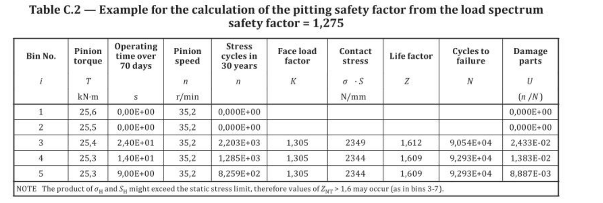

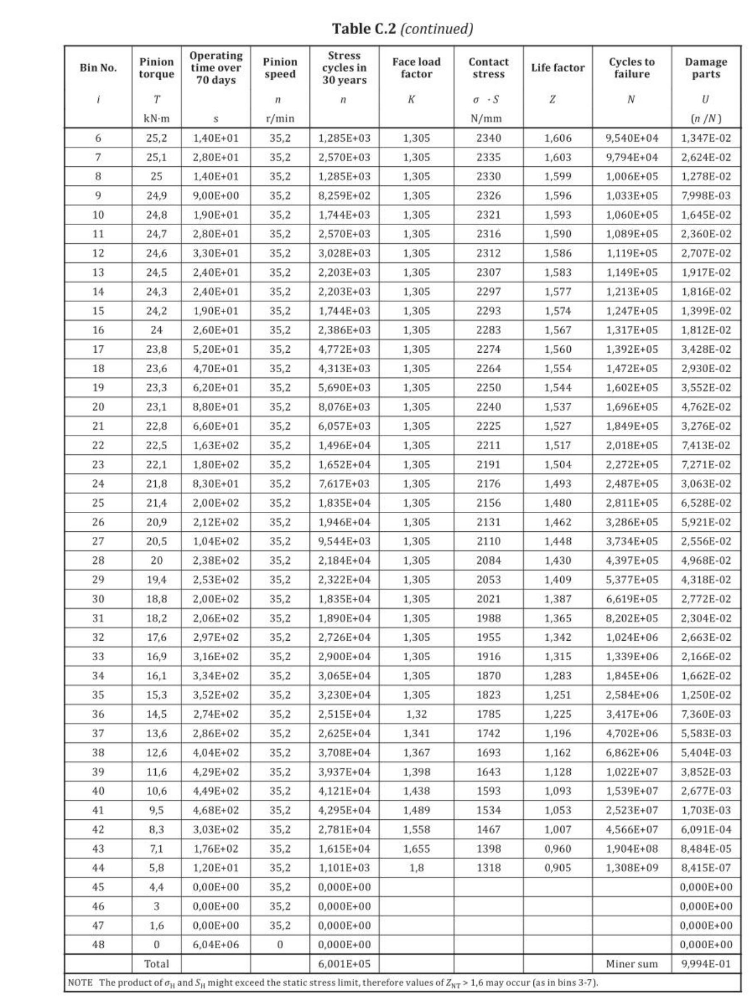

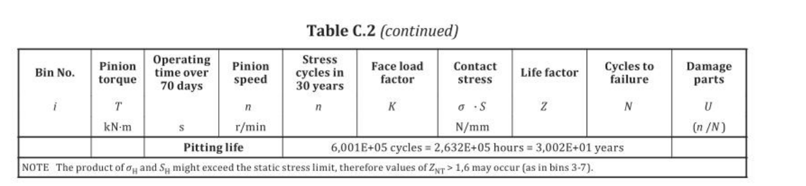

Table C.3 — Example for the calculation of the bending safety factor from the load spectrum safety factor = 1,662

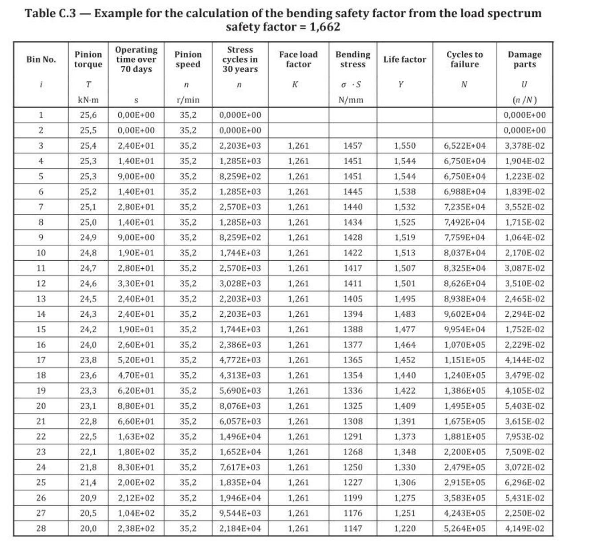

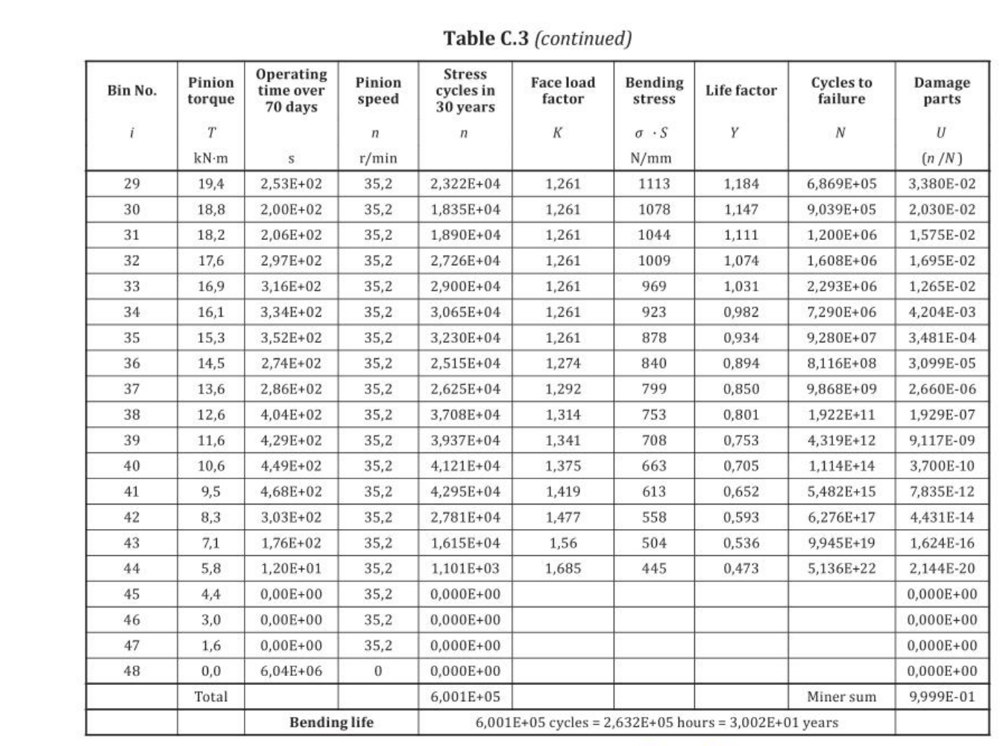

The accumulated load spectra and the S-N curves are shown in Figure C.1.

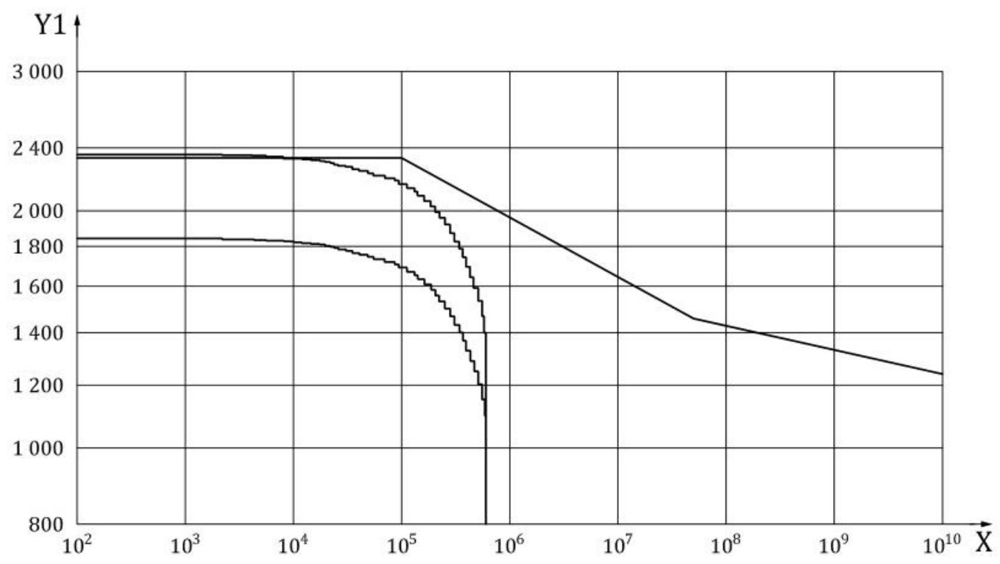

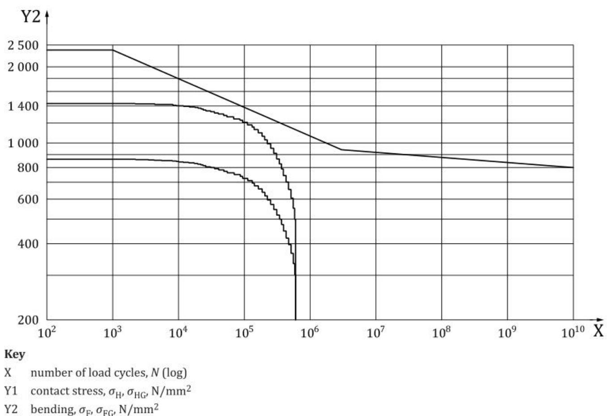  

Figure C.1 — Load spectra and S-N curve

# Bibliography

[1] ISO 701:1998, International gear notation — Symbols for geometrical data

[2] ISO 1328-1, Cylindrical gears — ISO system of flank tolerance classification — Part 1: Definitions and allowable values of deviations relevant to flanks of gear teeth

[3] BUXBAUM O. Betriebsfestigkeit, Verlag Stahleisen (1986)

[4] CORTEN H. T., DOLANT T. J., Cumulative Fatigue Damage. Proceedings of the International Conference on Fatigue of Materials, 1956. pp. 235-246

[5] FRIEDRICH G. Anwendung der Lebensdauerberechnung beim Entwurf und der Auswahl von Zahnradgetrieben, Maschinenbautechnik, Berlin 32 (1983) S. 457 ff

[6] GNILKE W. Lebensdauerberechnung mit Hilfe von Schadenslinien, Antriebstechnik 24 (1985) Nr. 9, S. 62 ff

[7] GOLL S. Auslegung und Lebensdauer von Getriebeelementen. VDI-Berichte Nr. 332 (1979) S. 37 ff

[8] GRIESE F.-W., HEINISCH D. Beitrag zur lebensdauerorientierten Getriebedimensionierung mit Hilfe von Lastkollektiven. FVA-Forschungsheft Nr. 168 (1984)

[9] HAIBACH E. Betriebsfestigkeit — Verfahren und Daten zur Bauteilberechnung, Springer, Berlin [u.a.], 3. Auflage (2006)

[10] HEIN M. Zur ganzheitlichen betriebsfesten Auslegung und Prüfung von Getriebezahnrädern, Dissertation, Technische Universität München (2018)

[11] KRAUSE J.K. Predicting the Life of Mechanical Systems. Machine Design. November 22. 1979, pp. 96-102

[12] MINER M.A., Cumulative Damage in Fatigue, Journal of Applied Mechanics. Vol. 12. 1945. A159 - 164.

[13] NELSON D. Cumulative Fatigue Damage in Metals, Stanford University Ph.D., 1978, University Microfilms International. Ann Arbor. MI.

[14] PALMGREN A. Durability of Ball Bearings, ZDVDI. Vol. 68. No. 14, p. 339 (in German)

[15] RENIUS K.Th., Betriebsfestigkeitsberechnungen von Maschinenelementen in Ackerschleppern mit Hilfe von Lastkollektiven. Konstruktion 29 (1977) S. 85-93

[16] SEIFRIED A., MUELLER P. Wechselnde Betriebsbelastung, Ihre rechnerunterstützte Bestimmung, Auswertung und Berücksichtigung in der Konstruktion von zahnradgetrieben. VDI-Berichte Nr. 434 (1982) S. 29 ff

[17] SINGH A. Development and Validation of an S-N Based Two Phase Bending Fatigue Life Prediction Model. Journal of Mechanical Design 125. Heft 3, S. 540, DOI:10.1115/1.1564572 (2003)

[18] Verein zur Förderung der Forschung und Anwendung von Betriebsfestigkeitserkenntnissen in der Eisenhüttenindustrie (VBFEh) Leitfaden für eine Betriebsfestigkeitsrechnung, Verlag Stahleisen

[19] WETZLER R.M. Editor, Fatigue Under Complex Loading. Analyses and Experiments. Advances in Engineering, Vol. 6, Warrendale, Pennsylvania. SAE. 1977. pp. 137-145

[20] ZENNER H., GRIESE F.-W, RAECKER R., Steigerung der Zuverlässigkeit von Großgetrieben durch gezielte Auswertung vorhandener Betriebsuntersuchungen. Bericht Nr. ABF 31. VBFEh. Düsseldorf (1986)

ISO 6336-6:2019(E)

ICS 21.200

Price based on 37 pages

© ISO 2019 — All rights reserved

