TECHNICAL SPECIFICATION ISO/TS 6336-4:2019(E)

First edition 2019-01

Corrected version 2019-07

Calculation of load capacity of spur and helical gears —

Part 4: Calculation of tooth flank fracture load capacity

Calcul de la capacité de charge des engrenages cylindriques à dentures droite et hélicoïdale —

Partie 4: Calcul de la capacité de charge de la rupture en flanc de dent

COPYRIGHT PROTECTED DOCUMENT

© ISO 2019

All rights reserved. Unless otherwise specified, or required in the context of its implementation, no part of this publication may be reproduced or utilized otherwise in any form or by any means, electronic or mechanical, including photocopying, or posting on the internet or an intranet, without prior written permission. Permission can be requested from either ISO at the address below or ISO's member body in the country of the requester.

ISO copyright office

CP 401 • Ch. de Blandonnet 8

CH-1214 Vernier, Geneva

Phone: +41 22 749 01 11

Fax: +41 22 749 09 47

Email: copyright@iso.org

Website: www.iso.org

Published in Switzerland

# Contents

Foreword iv  
Introduction v  
1 Scope 1  
2 Normative references 1  
3 Terms, definitions, symbols and abbreviated terms 1  
3.1 Terms and definitions 1  
3.2 Symbols and abbreviated terms 2  
3.3 Definition of local contact point, CP, and material depth, y 3  
4 Definition of tooth flank fracture 4  
5 Basic formulae 5  
5.1 General 5  
5.2 Maximum material exposure, $A_{\mathrm{FF,max}}$ 5  
5.3 Local material exposure, $A_{\mathrm{FF,CP}}(y)$ 6  
6 Local occurring equivalent stress, $\tau_{\mathrm{eff,CP}}(y)$ 7  
6.1 General 7  
6.2 Local equivalent stress without consideration of residual stresses, $\tau_{\mathrm{eff,L,CP}}(y)$ 7  
6.2.1 General 7  
6.2.2 Local normal radius of relative curvature, $\rho_{\mathrm{red,CP}}$ 8  
6.2.3 Reduced modulus of elasticity, $E_{\mathrm{r}}$ 8  
6.2.4 Local Hertzian contact stress, $p_{\mathrm{dyn,CP}}$ 9  
6.3 Quasi-stationary residual stress, $\tau_{\mathrm{eff,RS}}(y)$ 21  
6.3.1 General 21  
6.3.2 Method A 21  
6.3.3 Method B 21  
6.4 Influence of the residual stresses on the local equivalent stress, $\Delta \tau_{\mathrm{eff,L,RS,CP}}(y)$ 22  
7 Local material strength, $\tau_{\mathrm{per,CP}}(y)$ 23  
7.1 General 23  
7.2 Hardness conversion factor $K_{\tau,\text{per}}$ 23  
7.3 Material factor $K_{\text{material}}$ 23  
7.4 Hardness depth profile, $HV(y)$ 25  
7.4.1 General 25  
7.4.2 Method A 25  
7.4.3 Method B 25  
7.4.4 Method C1 26  
7.4.5 Method C2 26  
Annex A (informative) Calculation of local equivalent stress without consideration of residual stresses, $\tau_{\mathrm{eff,L,CP}}(y)$ 28  
Bibliography 29

# Foreword

ISO (the International Organization for Standardization) is a worldwide federation of national standards bodies (ISO member bodies). The work of preparing International Standards is normally carried out through ISO technical committees. Each member body interested in a subject for which a technical committee has been established has the right to be represented on that committee. International organizations, governmental and non-governmental, in liaison with ISO, also take part in the work. ISO collaborates closely with the International Electrotechnical Commission (IEC) on all matters of electrotechnical standardization.

The procedures used to develop this document and those intended for its further maintenance are described in the ISO/IEC Directives, Part 1. In particular, the different approval criteria needed for the different types of ISO documents should be noted. This document was drafted in accordance with the editorial rules of the ISO/IEC Directives, Part 2 (see www.iso.org/directives).

Attention is drawn to the possibility that some of the elements of this document may be the subject of patent rights. ISO shall not be held responsible for identifying any or all such patent rights. Details of any patent rights identified during the development of the document will be in the Introduction and/or on the ISO list of patent declarations received (see www.iso.org/patents).

Any trade name used in this document is information given for the convenience of users and does not constitute an endorsement.

For an explanation of the voluntary nature of standards, the meaning of ISO specific terms and expressions related to conformity assessment, as well as information about ISO's adherence to the World Trade Organization (WTO) principles in the Technical Barriers to Trade (TBT) see www.iso.org/iso/foreword.html.

This document was prepared by Technical Committee ISO/TC 60, Gears, Subcommittee SC 2, Gear capacity calculation.

A list of all parts in the ISO 6336 series can be found on the ISO website.

Any feedback or questions on this document should be directed to the user's national standards body. A complete listing of these bodies can be found at www.iso.org/members.html.

This corrected version of ISO 6336-4:2019 incorporates the following corrections:

— mistakes in the formulae have been corrected.

# Introduction

The ISO 6336 series consists of International Standards, Technical Specifications (TS) and Technical Reports (TR) under the general title Calculation of load capacity of spur and helical gears (see Table 1).

— International Standards contain calculation methods that are based on widely accepted practices and have been validated.

— Technical Specifications (TS) contain calculation methods that are still subject to further development.

— Technical Reports (TR) contain data that is informative, such as example calculations.

The procedures specified in ISO 6336-1 to ISO 6336-19 cover fatigue analyses for gear rating. The procedures described in ISO 6336-20 to ISO 6336-29 are predominantly related to the tribological behaviour of the lubricated flank surface contact. ISO 6336-30 to ISO 6336-39 include example calculations. The ISO 6336 series allows the addition of new parts under appropriate numbers to reflect knowledge gained in the future.

Requesting standardized calculations according to the ISO 6336 series without referring to specific parts requires the use of only those parts that are currently designated as International Standards (see Table 1 for listing). When requesting further calculations, the relevant part or parts of the ISO 6336 series need to be specified. Use of a Technical Specification as acceptance criteria for a specific designs need to be agreed in advance between the manufacturer and the purchaser.

Table 1 — Parts of the ISO 6336 series (status as of DATE OF PUBLICATION)

| Calculation of load capacity of spur and helical gears | International Standard | Technical Specification | Technical Report |
| --- | --- | --- | --- |
| Part 1: Basic principles, introduction and general influence factors | X |  |  |
| Part 2: Calculation of surface durability (pitting) | X |  |  |
| Part 3: Calculation of tooth bending strength | X |  |  |
| Part 4: Calculation of tooth flank fracture load capacity |  | X |  |
| Part 5: Strength and quality of materials | X |  |  |
| Part 6: Calculation of service life under variable load | X |  |  |
| Part 20: Calculation of scuffing load capacity (also applicable to bevel and hypoid gears) — Flash temperature method(replaces: ISO/TR 13989-1) |  | X |  |
| Part 21: Calculation of scuffing load capacity (also applicable to bevel and hypoid gears) — Integral temperature method(replaces: ISO/TR 13989-2) |  | X |  |
| Part 22: Calculation of micropitting load capacity(replaces: ISO/TR 15144-1) |  | X |  |
| Part 30: Calculation examples for the application of ISO 6336 parts 1, 2, 3, 5 |  |  | X |
| Part 31: Calculation examples of micropitting load capacity(replaces: ISO/TR 15144-2) |  |  | X |

This document provides principles for the calculation of the tooth flank fracture load capacity of cylindrical involute spur and helical gears with external teeth. The method is based on theoretical and experimental investigations (see References $[9]$ , $[10]$ , $[12]$ and $[15]$ ) on case carburized test gears and gears from different industrial applications.

This document as a part of the ISO 6336 series includes a newly developed method for assessing the risk of tooth flank fracture, which is still subject to further development. It is published in order to gain a broader experience with the obtained results in various scopes of application. The knowledge gained will serve for further development and refinement of this document.

Tooth flank fracture is characterized by a primary fatigue crack in the region of the active contact area, initiated below the surface due to shear stresses caused by the flank contact. Failures due to tooth flank fracture are reported from different industrial gear applications and have also been observed on specially designed test gears for gear running tests. Tooth flank fracture is most often observed on case carburized gears but failures are also known for nitrided and induction hardened gears. Most of the observed tooth flank fractures occurred on the driven partner.

The basis for the calculation of the tooth flank fracture load capacity are sophisticated calculation methods based on the shear stress intensity hypothesis (SIH, see References $[13]$ and $[16]$ ) which were transferred to a calculation method in closed form solution. With only a small set of parameters concerning gear geometry, gear material and gear load condition, a calculation of the local material exposure can be performed in order to calculate the tooth flank fracture load capacity.

It should also be understood that some aspects of this type of failure can be a complex interaction of stress fluctuations and material inhomogeneities. As an example, the presence of retained austenite in the carburized case can result in the transformation during service and its associated volumetric change can cause a minute distortion of the teeth and loss of original contact quality thereby changing the localised stress distribution. Another phenomenon is the development of localised “white etching areas” (local work hardening) which ultimately develop into crack initiation and propagation. Clearly, there is considerable research required to isolate these types of effects and the analysis of case histories is paramount to the understanding of the subject.

Calculation of load capacity of spur and helical gears —

Part 4:

Calculation of tooth flank fracture load capacity

# 1 Scope

This document describes a procedure for the calculation of the tooth flank fracture load capacity of cylindrical spur and helical gears with external teeth.

It is not intended to be used as a rating method in the design and certification process of a gearbox.

The formulae specified are applicable for driving as well as for driven cylindrical gears while the tooth profiles are in accordance with the basic rack specified in ISO 53. They can also be used for teeth conjugate to other racks where the actual transverse contact ratio is less than $\varepsilon_{\alpha} = 2,5$ . The procedure was validated for case carburized[15] gears and the formulae of this document are only applicable to case carburized gears with specifications inside the following limits:

— Hertzian stress: $500 \, N/mm^{2} \leq p_{H} \leq 3000 \, N/mm^{2}$ ;

— Normal radius of relative curvature: 5 mm ≤ $\rho_{red}$ ≤ 150 mm;

— Case hardening depth at 550 HV in finished condition: 0,3 mm ≤ CHD ≤ 4,5 mm.

This document is not applicable for the assessment of types of gear tooth damage other than tooth flank fracture.

# 2 Normative references

The following documents are referred to in the text in such a way that some or all of their content constitutes requirements of this document. For dated references, only the edition cited applies. For undated references, the latest edition of the referenced document (including any amendments) applies.

ISO 1122-1, Vocabulary of gear terms — Part 1: Definitions related to geometry

ISO 1328-1, Cylindrical gears — ISO system of flank tolerance classification — Part 1: Definitions and allowable values of deviations relevant to flanks of gear teeth

ISO 6336-1, Calculation of load capacity of spur and helical gears — Part 1: Basic principles, introduction and general influence factors

ISO 6336-2, Calculation of load capacity of spur and helical gears — Part 2: Calculation of surface durability (pitting)

ISO 21771, Gears — Cylindrical involute gears and gear pairs — Concepts and geometry

# 3 Terms, definitions, symbols and abbreviated terms

## 3.1 Terms and definitions

For the purposes of this document, the terms and definitions given in ISO 1122-1, ISO 6336-1 and ISO 6336-2 apply.

ISO and IEC maintain terminological databases for use in standardization at the following addresses:

— ISO Online browsing platform: available at http://www.iso.org/obp

— IEC Electropedia: available at https://www.electropedia.org/

## 3.2 Symbols and abbreviated terms

The symbols and abbreviated terms used in this document and their units are given in Table 2. The conversions of the units are included in the given formulae.

Table 2 — Symbols, abbreviated terms and units

| Symbol | Description | Unit |
| --- | --- | --- |
| A | Tolerance class which shall be according to ISO 1328-1 | — |
| $A_{\text{FF,CP}}(y)$ | Local material exposure at considered contact point | — |
| $A_{\text{FF,max}}$ | Maximum material exposure | — |
| b | Face width | mm |
| $b^*$ | Tooth width coordinate for contact point CP | mm |
| $b_{\text{H}}$ | Half of the Hertzian contact width | mm |
| $b_{\text{H,CP}}$ | Half of the Hertzian contact width at contact point CP | mm |
| C | Auxiliary constant | mm |
| $c_1$ | Material exposure calibration factor | — |
| CHD | Case hardening depth at 550 HV | mm |
| CP | Considered local contact point CP (all parameters with index CP are defined as local values) | — |
| $d_{\mathrm{a1}}$ | Tip diameter of pinion | mm |
| $d_{\mathrm{a2}}$ | Tip diameter of wheel | mm |
| $d_{\mathrm{b1}}$ | Base diameter of pinion | mm |
| $d_{\mathrm{b2}}$ | Base diameter of wheel | mm |
| $d_{\mathrm{CP1}}$ | Diameter of pinion at the contact point CP | mm |
| $d_{\mathrm{CP2}}$ | Diameter of wheel at the contact point CP | mm |
| $E_1$ | Modulus of elasticity of pinion | $\mathrm{N/mm^2}$ |
| $E_2$ | Modulus of elasticity of wheel | $\mathrm{N/mm^2}$ |
| $E_{\mathrm{r}}$ | Reduced modulus of elasticity | $\mathrm{N/mm^2}$ |
| EAP | End of active profile (for driving pinion: contact point E, for driving wheel: contact point A) | — |
| $F_{\mathrm{t}}$ | (Nominal) Transverse tangential load at reference cylinder per mesh | N |
| $g_{\alpha}$ | Length of the path of contact | mm |
| $g_{\mathrm{CP}}$ | Parameter on the path of contact (distance of local contact point CP from point A) | mm |
| HV | Hardness | HV |
| $HV_{\mathrm{core}}$ | Core hardness | HV |
| $HV_{\mathrm{surface}}$ | Surface hardness | HV |
| $K_{\mathrm{A}}$ | Application factor | — |
| $K_{\mathrm{H}\alpha}$ | Transverse load factor | — |
| $K_{\mathrm{H}\beta}$ | Face load factor | — |
| $K_{\mathrm{material}}$ | Material factor | — |
| $K_{\mathrm{v}}$ | Dynamic factor | — |
| $K_{\gamma}$ | Mesh load factor | — |
| $K_{\tau,\mathrm{per}}$ | Hardness conversion factor | — |
| $p_{dyn}$ | Hertzian contact stress including the load factors, K | $\mathrm{N/mm^2}$ |
| $p_{dyn,CP}$ | Local Hertzian contact stress at the contact point, CP | $\mathrm{N/mm^2}$ |
| $p_{et}$ | Transverse base pitch | mm |
| $p_{H}$ | Nominal Hertzian contact stress | $\mathrm{N/mm^2}$ |
| $r_{CP}$ | Local contact radius | mm |
| $R_{m}$ | Tensile strength of the gear material (see ISO 6336-5). | $\mathrm{N/mm^2}$ |
| SAP | Start of active profile (for driving pinion: contact point A, for driving wheel: contact point E) | — |
| SIH | Shear stress intensity hypothesis | — |
| $s_{t,B-D}$ | Chordal tooth thickness in transverse section at the diameter corresponding to the middle between B and D on the line of action | mm |
| $X_{but,CP}$ | Local buttressing factor | — |
| $X_{CP}$ | Local load sharing factor | — |
| y | Material depth (all parameters depending on y or (y) are defined as local values) | mm |
| $y_{Core}$ | y-coordinate, where HV(y) =  $HV_{Core}$ | mm |
| $y_{HV,max}$ | y-coordinate of the maximum hardness | mm |
| $Z_{E}$ | Elasticity factor | $(\mathrm{N/mm^2})^{0,5}$ |
| $\Delta\tau_{eff,L,RS,CP}(y)$ | Influence of the residual stresses on the local equivalent stress | $\mathrm{N/mm^2}$ |
| $α_{t}$ | Transverse pressure angle | ° |
| $α_{wt}$ | Working pressure angle | ° |
| $β_{b}$ | Base helix angle | ° |
| $ε_{α}$ | Transverse contact ratio | — |
| $ε_{β}$ | Overlap ratio | — |
| $ρ_{t1,CP}$ | Local transverse radius of curvature on the pinion | mm |
| $ρ_{t2,CP}$ | Local transverse radius of curvature on the wheel | mm |
| $ρ_{red,CP}$ | Local normal radius of relative curvature | mm |
| $ρ_{red,t,CP}$ | Local transverse radius of relative curvature at the contact point CP | mm |
| $σ_{RS}(y)$ | Tangential component of the residual stress | $\mathrm{N/mm^2}$ |
| $σ_{RS,max}$ | Maximum residual stress | $\mathrm{N/mm^2}$ |
| $ν_{1}$ | Poisson's ratio of the pinion | — |
| $ν_{2}$ | Poisson's ratio of the wheel | — |
| $τ_{eff,CP}(y)$ | Local equivalent stress | $\mathrm{N/mm^2}$ |
| $τ_{eff,L,CP}(y)$ | Local equivalent stress without consideration of residual stresses | $\mathrm{N/mm^2}$ |
| $τ_{eff,RS}(y)$ | Quasi-stationary residual stress | $\mathrm{N/mm^2}$ |
| $τ_{per,CP}(y)$ | Local material shear strength | $\mathrm{N/mm^2}$ |

## 3.3 Definition of local contact point, CP, and material depth, y

The calculation of the tooth flank fracture load capacity is carried out for defined local contact points, CP, in the area of the active tooth flank. Each local contact point, CP, is specified by the tooth width coordinate, $b^{*}$ , and the tooth height coordinate, $r_{CP}$ , (which is the local contact radius). For a specific contact point, CP, the material depth y is orientated normal to the tooth flank surface in the material and can be defined according to Figure 1. For calculation, a reasonable division of the contact area in order to define single calculation points shall be performed. Influences of tooth flank modifications on the pressure distribution shall be appropriately considered.

NOTE All parameters depending on y respectively (y) are defined as local values in the considered local contact point, CP.

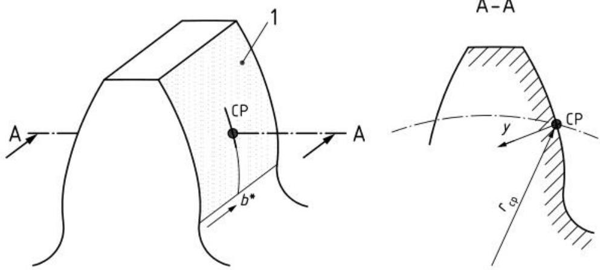  
Key  
1 area of active tooth flank

Figure 1 — Definition of local contact point, CP, and material depth, y, depending on tooth width, $b^{*}$ , and contact radius, $r_{CP}$

# 4 Definition of tooth flank fracture

Tooth flank fracture is characterized by a primary fatigue crack in the region of the active contact area, initiated below the surface due to shear stresses caused by the flank contact. Failures due to tooth flank fracture are reported from different industrial gear applications and have also been observed on specially designed test gears for gear running tests (images of tooth flank fractures can be found in Reference [9]). Tooth flank fracture is most often observed on case carburized gears but failures are also known for nitrided and induction hardened gears. Tooth flank fracture is sometimes also referred as subsurface-initiated bending fatigue crack, sub-surface fatigue or tooth flank breakage. The main failure characteristics are:

— tooth fracture is due to a crack located in the active flank area, often at approximately half the height of the tooth;

— primary crack initiation is at a considerable depth below the surface of the loaded gear flank, typically at or below the case-core interface;

— the primary crack starter is often but not always associated with a small non-metallic inclusion;

— the primary crack propagates from the initial crack starter in both directions — towards the surface of the loaded flank and into the core towards the opposite tooth root section;

— due to the high hardness in the case, the crack propagation towards the surface is smaller than through the core;

— the angle between primary crack and flank surface is approximate $40^{\circ}$ to $50^{\circ}$ ;

— due to the inner primary crack, secondary and subsequent cracks may occur which originate from the surface;

— the crack propagation rate rapidly increases as soon as the primary crack has reached the surface of the loaded gear flank;

— the final breakage of the tooth is due to forced rupture; typically developing according to local bending stress;

— the fractured surfaces show typical fatigue characteristics with a crack lens around the initiation point and a residual zone of forced rupture;

— in many cases (but not all), no indications of surface related failures such as pitting or micropitting are observed on the gear flanks.

Due to these characteristics the failure type of tooth flank fracture can be clearly differentiated from the classical tooth root fatigue failure that is caused by tooth bending stresses in the tooth root area and also from classical pitting damage that is initiated at or close to the flank surface and characterized by shell-shaped material breakouts from the loaded flank surface. Furthermore, tooth flank fracture may occur at loads below the rated allowable loads for pitting and bending strength as well as on gears, which have completely fulfilled all the requirements regarding gear material, heat treatment and gear quality according to existing standards. Failures due to tooth flank fracture occur typically in excess of $10^{7}$ load cycles pointing out the fatigue character of this failure type.

# 5 Basic formulae

## 5.1 General

The calculation method for tooth flank fracture load capacity is based on a local comparison of the total occurring stresses (load induced stresses and residual stresses) and the material strength for each considered point of contact and over the material depth. For the herein presented procedure, the occurring stresses are expressed by the local equivalent stress, $\tau_{\mathrm{eff,CP}}(y)$ , and the material strength is described by the local material shear strength, $\tau_{\mathrm{per,CP}}(y)$ . The calculation of $\tau_{\mathrm{eff,CP}}(y)$ and $\tau_{\mathrm{per,CP}}(y)$ is performed with help of an approximate calculation approach in closed form. This approach was numerically matched with sophisticated calculation methods based on the SIH (see References [10],[12],[13] and [16]) and was verified by experimental investigations and experiences from industrial application.

The quotient of the local equivalent stress, $\tau_{\mathrm{eff,CP}}(y)$ , and the local material shear strength, $\tau_{\mathrm{per,CP}}(y)$ , is expressed as a local material exposure, $A_{\mathrm{FF,CP}}(y)$ . The local material exposure, $A_{\mathrm{FF,CP}}(y)$ , should be calculated for discrete contact points, CP, in the contact area along the tooth width and tooth height and in each considered material depth, y (Method A). If there is no detailed information about the local Hertzian contact stress calculated with a 3D load distribution program, the Hertzian contact stress and the resulting material exposure can also be determined with the formulae according to Method B for some specified points of contact which shall be chosen based upon a reasonable distribution of the contact area. Influences of tooth flank modifications on the pressure distribution shall be appropriately considered.

## 5.2 Maximum material exposure, $A_{FF,max}$

$A_{FF,max}$ is the maximum calculated local material exposure, $A_{FF,CP}(y)$ , for all analysed contact points, CP, over the material depth, y, where y is equal to or greater than half of the Hertzian contact width, $b_{H,CP}$ . The material depth, y, should be chosen to ensure the maximum material exposure, $A_{FF,max}$ , is captured.

$$
A _ {\mathrm{FF}, \max} = \max \left[ A _ {\mathrm{FF}, \mathrm{CP}} (y) \right]\tag{1}
$$

with

$$
y \geq b _ {\mathrm{H,CP}} \tag{2}
$$

where

$A_{FF,max}$ is the maximum material exposure;

$A_{\mathrm{FF,CP}}(y)$ is the local material exposure in the material depth, $y$ , for the contact point, CP;

$b_{H,CP}$ is half of the Hertzian contact width at the contact point, CP.

$$
b _ {\mathrm{H,CP}} = 4 \cdot \rho_ {\mathrm{red,CP}} \cdot \frac {p _ {\mathrm{dyn,CP}}}{E _ {\mathrm{r}}} \tag{3}
$$

where

$p_{dyn,CP}$ is the local Hertzian contact stress at the contact point CP;

$\rho_{red,CP}$ is the local normal radius of relative curvature at the contact point CP;

$E_{r}$ is the reduced modulus of elasticity.

It has been observed from experimental investigations on case carburized gears $^{[15]}$ that a maximum material exposure $A_{FF,max} \geq 0,8$ can lead to tooth flank fractures in the case of a constant input torque.

Currently, there is no experience to give an allowable material exposure for practical applications. The specific influences of load factors (application factor, dynamic factor, load distribution factor), and material properties are not known.

## 5.3 Local material exposure, $A_{\mathrm{FF,CP}}(y)$

In good accordance to sophisticated calculation methods based on the SIH, the local material exposure, $A_{\mathrm{FF,CP}}(y)$ , can be calculated according to Formulae (4) and (5). Based on an extensive comparison between the herein shown calculation method and sophisticated calculation methods, the material exposure calibration factor, $c_{1}$ , was determined for case carburized steels $^{[15]}$ .

As tooth flank fracture is characterized by a primary fatigue crack in the region of the active contact area, initiated below the surface, only material depths deeper than half of the local Hertzian contact width, $b_{H,CP}$ , shall be considered herein for evaluating the maximum local material exposure, $A_{FF,max}$ . For calculated near-surface (i.e. $y < b_{H}$ ) maximum local material exposures it can be assumed that a potential damage would also start near the surface (e.g. pitting). In this case, further influences on the material exposure, for example the influence of surface roughness, lubricant and lubricating condition should be considered (see also ISO 6336-2). These influences are not covered in the herein described approach for the failure mode tooth flank fracture with crack initiation in a considerable depth below the surface.

$$
A _ {\mathrm{FF,CP}} (y) = \frac {\tau_ {\mathrm{eff,CP}} (y)}{\tau_ {\mathrm{per,CP}} (y)} + c _ {1} \tag{4}
$$

$$
y \geq b _ {\mathrm{H}} \tag{5}
$$

where

CP is the considered contact point;

y is the local material depth in the contact point, CP;

$A_{\mathrm{FF,CP}}(y)$ is the local material exposure in the material depth, y, for the contact point, CP;

$\tau_{\text{eff,CP}}(y)$ is the local equivalent stress in the material depth, y, for the contact point, CP;

$\tau_{\text{per,CP}}(y)$ is the local material shear strength in the material depth, y, for the contact point, CP;

$c_{1}$ is the material exposure calibration factor;

$c_{1}=0,04$ for case carburized steels.

# 6 Local occurring equivalent stress, $\tau_{\mathrm{eff,CP}}(y)$

## 6.1 General

The local occurring equivalent stress, $\tau_{\mathrm{eff,CP}}(y)$ , can be calculated according to Formula (6). It is calculated for specific contact points, CP, on the tooth flank and discrete values of $y$ . Basically the local equivalent stress without consideration of residual stresses, $\tau_{\mathrm{eff,L,CP}}(y)$ , is calculated and modified by the influence of the residual stresses, $\Delta \tau_{\mathrm{eff,L,RS,CP}}(y)$ , and the quasi-stationary residual stress, $\tau_{\mathrm{eff,RS}}(y)$ .

$$
\tau_ {\text { eff,CP }} (y) = \tau_ {\text { eff,L,CP }} (y) - \Delta \tau_ {\text { eff,L,RS,CP }} (y) - \tau_ {\text { eff,RS }} (y)\tag{6}
$$

where

$\tau_{\text{eff,L,CP}}(y)$ is the local equivalent stress without consideration of residual stresses;

$\Delta\tau_{\text{eff,L,RS,CP}}(y)$ is the influence of the residual stresses on the local equivalent stress;

$\tau_{\text{eff,RS}}(y)$ is the quasi-stationary residual stress in the material depth, y.

NOTE If $\tau_{\mathrm{eff,CP}}$ is negative, $\tau_{\mathrm{eff,CP}}$ is set to zero.

The local equivalent stress may also be calculated by alternative calculation methods based on the SIH (see References $[10]$ and $[12]$ ) upon agreement between the supplier and the customer if the results are in line with the herein presented calculation approach.

## 6.2 Local equivalent stress without consideration of residual stresses, $\tau_{\mathrm{eff,L,CP}}(y)$

### 6.2.1 General

The calculation of the local equivalent stress without consideration of residual stresses, $\tau_{\mathrm{eff,L,CP}}(y)$ , in the material depth, y, can be performed according to Formula (7) and is a calculation approach that is based on Föppl $^{[8]}$ . This approach was numerically matched with sophisticated calculation methods based on the SIH $^{[15]}$ . The influence of residual stresses is not included in this formula.

$$
\tau_ {\text {eff,L,CP}} (y) = \frac {0,149 \cdot p _ {\mathrm{dyn,CP}} + \frac {y \cdot E _ {\mathrm{r}}}{4 \cdot \rho_ {\mathrm{red,CP}}} - \frac {y ^ {2} \cdot E _ {\mathrm{r}}}{16 \cdot \rho_ {\mathrm{red,CP}} ^ {2} \cdot \sqrt {\left(\frac {p _ {\mathrm{dyn,CP}}}{E _ {\mathrm{r}}}\right) ^ {2} + \left(\frac {y}{4 \cdot \rho_ {\mathrm{red,CP}}}\right) ^ {2}}}}{0,4 \cdot \frac {y \cdot E _ {\mathrm{r}}}{4 \cdot \rho_ {\mathrm{red,CP}} \cdot p _ {\mathrm{dyn,CP}}} + 1,54} \tag{7}
$$

where

$E_{r}$ is the reduced modulus of elasticity;

$\rho_{red,CP}$ is the local normal radius of relative curvature at the contact point, CP;

$p_{dyn,CP}$ is the local Hertzian contact stress at the contact point, CP.

NOTE Formula (7) can also be written in an alternative way, referenced on half of the Hertzian contact width, $b_{\mathrm{H}}$ , see Annex A.

### 6.2.2 Local normal radius of relative curvature, $\rho_{red,CP}$

The local normal radius of relative curvature, $\rho_{red,CP}$ , can be calculated according to Formula (8).

$$
\rho_ {\mathrm{red,CP}} = \frac {\rho_ {\mathrm{red,t,CP}}}{\cos \beta_ {\mathrm{b}}} \tag{8}
$$

where

$\rho_{red,t,CP}$ is the local transverse radius of relative curvature at the contact point CP;

$\beta_{b}$ is the base helix angle.

The local transverse radius of relative curvature $\rho_{red,t,CP}$ can be determined according to Formula (9).

$$
\rho_ {\mathrm{red,t,CP}} = \frac {\rho_ {\mathrm{t1,CP}} \cdot \rho_ {\mathrm{t2,CP}}}{\rho_ {\mathrm{t1,CP}} + \rho_ {\mathrm{t2,CP}}} \tag{9}
$$

$$
\rho_ {\mathrm{t,1,CP}} = \sqrt {\frac {d _ {\mathrm{CP1}} ^ {2} - d _ {\mathrm{b1}} ^ {2}}{4}} \tag{10}
$$

$$
\rho_ {\mathrm{t,2,CP}} = \sqrt {\frac {d _ {\mathrm{CP2}} ^ {2} - d _ {\mathrm{b2}} ^ {2}}{4}} \tag{11}
$$

where

$\rho_{t1,CP}$ is the transverse radius of curvature on the pinion at the contact point, CP;

$\rho_{t2,CP}$ is the transverse radius of curvature on the wheel at the contact point, CP;

$d_{CP1}$ is the diameter of pinion at the contact point, CP;

$d_{b1}$ is the base diameter of the pinion;

$d_{CP2}$ is the diameter of wheel at the contact point, CP;

$d_{b2}$ is the base diameter of the wheel.

### 6.2.3 Reduced modulus of elasticity, $E_{r}$

For mating gears of different material and modulus of elasticity, $E_{1}$ and $E_{2}$ , the reduced modulus of elasticity, $E_{\mathrm{r}}$ , can be determined by Formula (12). For mating gears of the same material $E = E_{1} = E_{2}$ Formula (13) may be used.

$$
E _ {\mathrm{r}} = \frac {2}{\left(\frac {1 - \nu _ {1} ^ {2}}{E _ {1}} + \frac {1 - \nu _ {2} ^ {2}}{E _ {2}}\right)} \tag{12}
$$

$$
E _ {\mathrm{r}} = \frac {E}{1 - \nu^ {2}} \quad \text { for } E _ {1} = E _ {2} = E \text { and } \nu_ {1} = \nu_ {2} = \nu \tag{13}
$$

where

$E_{r}$ is the reduced modulus of elasticity;

$E_{1}$ is the modulus of elasticity of pinion;

$E_{2}$ is the modulus of elasticity of wheel;

$\nu_{1}$ is the Poisson's ratio of the pinion;

$\nu_{2}$ is the Poisson's ratio of the wheel.

### 6.2.4 Local Hertzian contact stress, $p_{dyn,CP}$

#### 6.2.4.1 Method A

By this method, the local nominal Hertzian contact stress, $p_{H,CP,A}$ , in each considered contact point, CP, over face width and height is determined by means of a detailed contact analysis, for example based on a full 3D elastic contact model. This method depends on, e.g. the elastic deflections under load, the static displacements and the stiffness of the whole elastic system.

$$
p _ {\mathrm{dyn}, \mathrm{CP}, \mathrm{A}} = p _ {\mathrm{H}, \mathrm{CP}, \mathrm{A}} \cdot \sqrt {K _ {\mathrm{A}} \cdot K _ {\mathrm{v}}} \tag{14}
$$

where

$p_{H,CP,A}$ is the local nominal Hertzian contact stress, calculated with a 3D load distribution program;

$K_{A}$ is the application factor (according to ISO 6336-1);

$K_{v}$ is the dynamic factor (according to ISO 6336-1).

Where either $K_{A}$ or $K_{v}$ influences are already considered in the 3D elastic mesh contact model either $K_{A}$ or $K_{v}$ or both should be set to 1,0 in Formula (14).

#### 6.2.4.2 Method B

##### 6.2.4.2.1 General

By this method, the local Hertzian contact stress, $p_{dyn,CP,B}$ , is calculated according to Formula (15) for several defined contact points. A detailed contact analysis is not performed. The total load in the case of drive trains with multiple transmission paths or planetary gear systems is not quite evenly distributed over the individual meshes. This shall be taken into consideration by inserting a mesh load factor $K_{\gamma}$ to follow $K_{A}$ in Formula (15), to adjust the average load per mesh as necessary.

$$
p _ {\mathrm{dyn,CP,B}} = p _ {\mathrm{H,CP,B}} \cdot \sqrt {K _ {\mathrm{A}} \cdot K _ {\gamma} \cdot K _ {\mathrm{v}} \cdot K _ {\mathrm{H} \alpha} \cdot K _ {\mathrm{H} \beta}} \tag{15}
$$

where

$p_{H,CP,B}$ is the local nominal Hertzian contact stress;

$K_{A}$ is the application factor (according to ISO 6336-1);

$K_{\gamma}$ is the mesh load factor (according to ISO 6336-1);

$K_{v}$ is the dynamic factor (according to ISO 6336-1);

$K_{H\alpha}$ is the transverse load factor (according to ISO 6336-1);

$K_{H\beta}$ is the face load factor (according to ISO 6336-1).

NOTE Local Hertzian contact stress for gears with a transverse contact ratio $\varepsilon_{\alpha} > 2$ can only be calculated according to Method A.

##### 6.2.4.2.2 Local nominal Hertzian contact stress, $p_{H,CP,B}$

The local nominal Hertzian contact stress, $p_{H,CP,B}$ , is used to determine the local Hertzian contact stress, $p_{dyn,CP,B}$ , (see 6.2.4.2.1). To take the influence of different profile modifications into account, the load sharing factor, $X_{CP}$ , is introduced. For the calculation of the local nominal Hertzian contact stress, the local nominal radius of relative curvature is used.

$$
p _ {\mathrm{H}, \mathrm{CP}, \mathrm{B}} = Z _ {\mathrm{E}} \cdot \sqrt {\frac {F _ {\mathrm{t}} \cdot X _ {\mathrm{CP}}}{b \cdot \rho_ {\mathrm{red} , \mathrm{CP}} \cdot \cos \alpha_ {\mathrm{t}}}} \tag{16}
$$

where

$$
Z _ {\mathrm{E}} = \sqrt {\frac {E _ {\mathrm{r}}}{2 \pi}} \tag{17}
$$

$Z_{E}$ is the elasticity factor (according to ISO 6336-2);

$F_{t}$ is the transverse tangential load at reference cylinder;

$X_{CP}$ is the load sharing factor (see 6.2.4.2.4.1);

b is the face width;

$\rho_{red,CP}$ is the local normal radius of relative curvature (see 6.2.2);

$\alpha_{t}$ is the transverse pressure angle;

$E_{r}$ is the reduced modulus of elasticity (see 6.2.3).

##### 6.2.4.2.3 Definition of contact point, CP, on the path of contact

The contact point, CP, is located between the SAP (start point of active profile; for driving pinion: contact point A, for driving wheel: contact point E) and EAP (end of active profile; for driving pinion: contact point E, for driving wheel: contact point A) on the path of contact according to Figure 2. It describes the actual contact point between pinion and wheel in a certain meshing position $g_{\mathrm{CP}}$ .

According to 6.2.4.2.1, Method B, the calculation may be done for the following contact points, CP:

CP =

$$
\mathrm{A}\quad g_{\mathrm{CP}}=g_{\mathrm{A}}=0\,\mathrm{mm} \tag{18}
$$

the lower end point on the path of contact

$$
\mathrm{AB}\quad g_{\mathrm{CP}}=g_{\mathrm{AB}}=(g_{\alpha}-p_{\mathrm{et}})/2\tag{19}
$$

the midway point between A and B

$$
\mathrm{B}\quad g_{\mathrm{CP}}=g_{\mathrm{B}}=g_{\alpha}-p_{\mathrm{et}} \tag{20}
$$

the lower point of single pair tooth contact

$$
\mathrm{C}\quad g_{\mathrm{CP}}=g_{\mathrm{C}}=\frac{d_{\mathrm{b1}}}{2}\cdot\tan\alpha_{\mathrm{wt}}-\sqrt{\frac{d_{\mathrm{a1}}^2}{4}-\frac{d_{\mathrm{b1}}^2}{4}}+g_{\alpha} \tag{21}
$$

the pitch point

$$
\mathrm{D}\quad g_{\mathrm{CP}}=g_{\mathrm{D}}=p_{\mathrm{et}} \tag{22}
$$

the upper point of single pair tooth contact

$$
\mathrm{DE}\quad g_{\mathrm{CP}}=g_{\mathrm{DE}}=\frac{g_{\alpha}-p_{\mathrm{et}}}{2}+p_{\mathrm{et}} \tag{23}
$$

the midway point between D and E

$$
\mathrm{E}\quad g_{\mathrm{CP}}=g_{\mathrm{E}}=g_{\alpha} \tag{24}
$$

the upper end point on the path of contact
where

$g_{CP}$ is the parameter on the path of contact (see Figure 2);

$g_{\alpha}$ is the length of path of contact (see Figure 2);

$p_{et}$ is the transverse base pitch (see Figure 2);

$d_{b1}$ is the base diameter of pinion (see Figure 2);

$\alpha_{wt}$ is the working pressure angle (see Figure 2);

$d_{a1}$ is the tip diameter of pinion (see Figure 2).

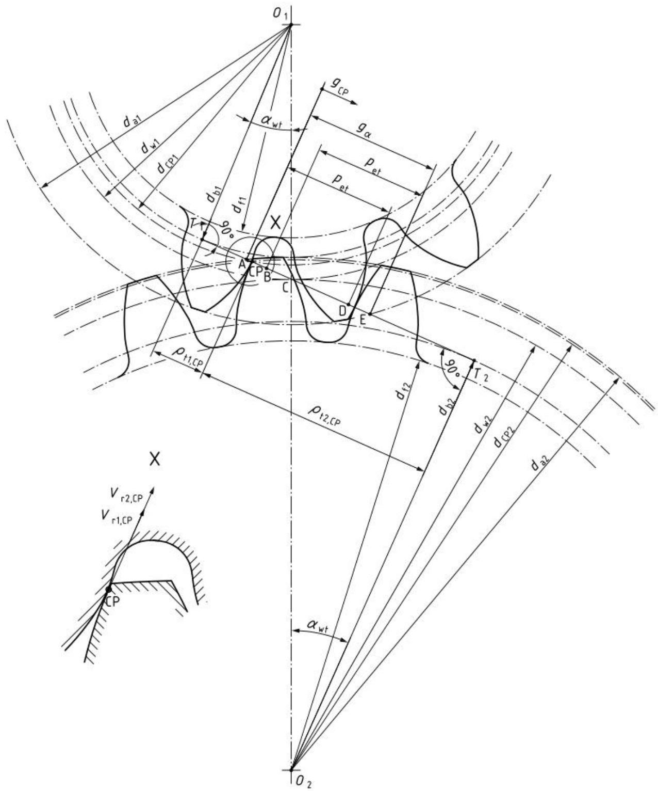  
Figure 2 — Definition of contact point, CP, on the line of action

The CP-circle diameter of pinion, $d_{\mathrm{CP1}}$ , and wheel, $d_{\mathrm{CP2}}$ , are dependent on the location of the contact point, CP, on the path of contact and can be calculated according to Formula (25) and Formula (26).

$$
d _ {\mathrm{CP1}} = 2 \cdot \sqrt {\frac {d _ {\mathrm{b} 1} {} ^ {2}}{4} + \left(\sqrt {\frac {d _ {\mathrm{a} 1} {} ^ {2}}{4} - \frac {d _ {\mathrm{b} 1} {} ^ {2}}{4}} - g _ {\alpha} + g _ {\mathrm{CP}}\right) ^ {2}} \tag{25}
$$

$$
d _ {\mathrm{CP2}} = 2 \cdot \sqrt {\frac {d _ {\mathrm{b} 2} {} ^ {2}}{4} + \left(\sqrt {\frac {d _ {\mathrm{a} 2} {} ^ {2}}{4} - \frac {d _ {\mathrm{b} 2} {} ^ {2}}{4}} - g _ {\mathrm{CP}}\right) ^ {2}} \tag{26}
$$

where

$d_{a2}$ is the tip diameter of wheel (see Figure 2);

$d_{b2}$ is the base diameter of wheel (see Figure 2).

##### 6.2.4.2.4 Local load sharing factor, $X_{CP}$

###### 6.2.4.2.4.1 General

The local load sharing factor, $X_{CP}$ , accounts for the load sharing of succeeding pairs of meshing teeth. The local load sharing factor is presented as a function of the linear parameter, $g_{CP}$ , on the path of contact $^{[6]}$ (see also 6.2.4.2.2).

Due to manufacturing inaccuracies a preceding pair of meshing teeth may cause an instantaneous increase or decrease of the theoretical load sharing factor, independent of the instantaneous increase or decrease caused by inaccuracies of a succeeding pair of meshing teeth at a later time. The value of $X_{CP}$ does not exceed 1,0 (for cylindrical gears), which means full transverse single tooth contact. The region of transverse single tooth contact may be extended by an irregularly varying location of a dynamic load.

The local load sharing factor, $X_{CP}$ , depends on the type of gear transmission and on the profile modification. In case of buttressing of helical teeth (no profile modification) the load sharing factor is combined with a buttressing factor, $X_{but,CP}$ $^{[6]}$ .

###### 6.2.4.2.4.2 Spur gears with unmodified profiles

The local load sharing factor for a spur gear with unmodified profile is conventionally supposed to have a discontinuous trapezoidal shape; see Figure 3. However, due to manufacturing inaccuracies, in each path of double contact the local load sharing factor will increase for protruding flanks and decrease for other flanks. The representative load sharing factor is an envelope of possible curves; see Figure 4.

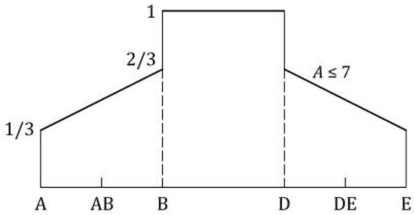  
Figure 3 — Local load sharing factor for cylindrical spur gears with unmodified profiles and tolerance class $A \leq 7$

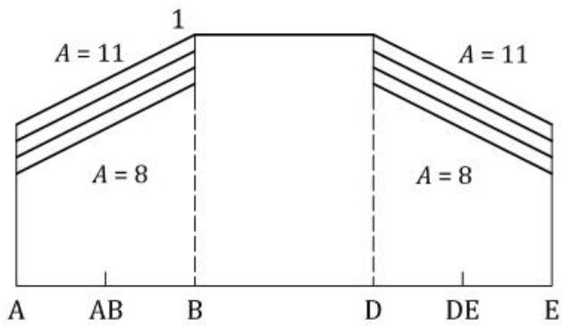  
Figure 4 — Local load sharing factor for cylindrical spur gears with unmodified profiles and tolerance class $8 \leq A \leq 11$

$$
X _ {\mathrm{CP}} = \frac {A - 3}{12} + \frac {1}{3} \cdot \frac {g _ {\mathrm{CP}}}{g _ {\mathrm{B}}}\quad \text { for } g _ {\mathrm{A}} \leq g _ {\mathrm{CP}} <   g _ {\mathrm{B}} \tag{27}
$$

$$
X _ {\mathrm{CP}} = 1,0\quad \mathrm{for} g _ {\mathrm{B}} \leq g _ {\mathrm{CP}} \leq g _ {\mathrm{D}} \tag{28}
$$

$$
X _ {\mathrm{CP}} = \frac {A - 3}{12} + \frac {1}{3} \cdot \frac {g _ {\alpha} - g _ {\mathrm{CP}}}{g _ {\alpha} - g _ {\mathrm{D}}}\quad \mathrm{for} g _ {\mathrm{D}} <   g _ {\mathrm{CP}} \leq g _ {\mathrm{E}} \tag{29}
$$

where

A = 7 for tolerance class ≤ 7 according to ISO 1328-1;

A = tolerance class for class $\geq$ 8 according to ISO 1328-1.

###### 6.2.4.2.4.3 Spur gears with profile modification

a) Local load sharing factor for cylindrical spur gears with adequate profile modification on pinion and wheel

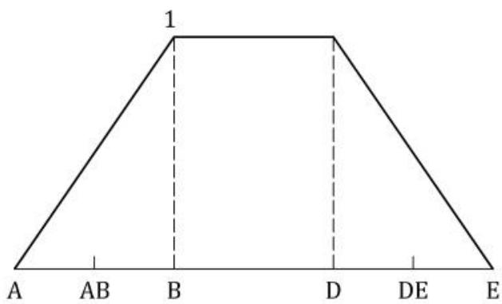  
Figure 5 — Local load sharing factor for cylindrical spur gears with adequate profile modification

$$
X _ {\mathrm{CP}} = \frac {g _ {\mathrm{CP}}}{g _ {\mathrm{B}}}\quad \text { for } g _ {\mathrm{A}} \leq g _ {\mathrm{CP}} \leq g _ {\mathrm{B}} \tag{30}
$$

$$
X _ {\mathrm{CP}} = 1,0\quad \text { for } g _ {\mathrm{B}} <   g _ {\mathrm{CP}} <   g _ {\mathrm{D}} \tag{31}
$$

$$
X _ {\mathrm{CP}} = \frac {g _ {\alpha} - g _ {\mathrm{CP}}}{g _ {\alpha} - g _ {\mathrm{D}}}\quad \text { for } g _ {\mathrm{D}} \leq g _ {\mathrm{CP}} \leq g _ {\mathrm{E}} \tag{32}
$$

b) Local load sharing factor for cylindrical spur gears with adequate profile modification on the addendum of the wheel and/or the dedendum of pinion

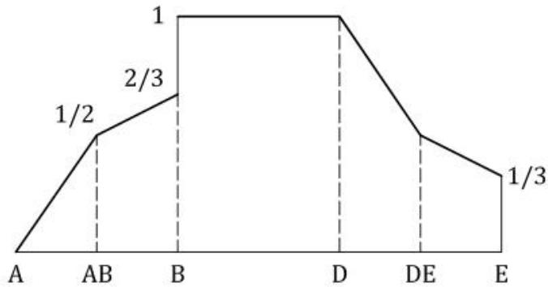  
Figure 6 — Local load sharing factor for cylindrical spur gears with adequate profile modification on the addendum of the wheel and/or the dedendum of pinion

$$
X _ {\mathrm{CP}} = \frac {g _ {\mathrm{CP}}}{g _ {\mathrm{B}}}\quad \text { for } g _ {\mathrm{A}} \leq g _ {\mathrm{CP}} \leq g _ {\mathrm{AB}} \tag{33}
$$

$$
X _ {\mathrm{CP}} = \frac {1}{3} + \frac {1}{3} \cdot \frac {g _ {\mathrm{CP}}}{g _ {\mathrm{B}}}\quad \text { for } g _ {\mathrm{AB}} <   g _ {\mathrm{CP}} <   g _ {\mathrm{B}} \tag{34}
$$

$$
X _ {\mathrm{CP}} = 1,0\quad \text { for } g _ {\mathrm{B}} \leq g _ {\mathrm{CP}} <   g _ {\mathrm{D}} \tag{35}
$$

$$
X _ {\mathrm{CP}} = \frac {g _ {\alpha} - g _ {\mathrm{CP}}}{g _ {\alpha} - g _ {\mathrm{D}}}\quad \text { for } g _ {\mathrm{D}} \leq g _ {\mathrm{CP}} \leq g _ {\mathrm{DE}} \tag{36}
$$

$$
X _ {\mathrm{CP}} = \frac {1}{3} + \frac {1}{3} \cdot \frac {g _ {\alpha} - g _ {\mathrm{CP}}}{g _ {\alpha} - g _ {\mathrm{D}}}\quad \text { for } g _ {\mathrm{DE}} <   g _ {\mathrm{CP}} \leq g _ {\mathrm{E}} \tag{37}
$$

c) Local load sharing factor for cylindrical spur gears with adequate profile modification on the addendum of the pinion and/or the dedendum of the wheel

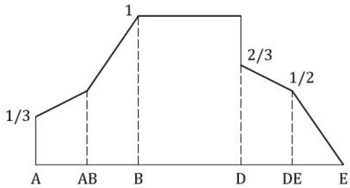  
Figure 7 — Local load sharing factor for cylindrical spur gears with adequate profile modification on the addendum of the pinion and/or the dedendum of the wheel

$$
X _ {\mathrm{CP}} = \frac {1}{3} + \frac {1}{3} \cdot \frac {g _ {\mathrm{CP}}}{g _ {\mathrm{B}}}\quad \text { for } g _ {\mathrm{A}} \leq g _ {\mathrm{CP}} \leq g _ {\mathrm{AB}} \tag{38}
$$

$$
X _ {\mathrm{CP}} = \frac {g _ {\mathrm{CP}}}{g _ {\mathrm{B}}}\quad \text { for } g _ {\mathrm{AB}} <   g _ {\mathrm{CP}} \leq g _ {\mathrm{B}} \tag{39}
$$

$$
X _ {\mathrm{CP}} = 1,0\quad \text { for } g _ {\mathrm{B}} <   g _ {\mathrm{CP}} \leq g _ {\mathrm{D}} \tag{40}
$$

$$
X _ {\mathrm{CP}} = \frac {1}{3} + \frac {1}{3} \cdot \frac {g _ {\alpha} - g _ {\mathrm{CP}}}{g _ {\alpha} - g _ {\mathrm{D}}}\quad \text { for } g _ {\mathrm{D}} <   g _ {\mathrm{CP}} \leq g _ {\mathrm{DE}} \tag{41}
$$

$$
X _ {\mathrm{CP}} = \frac {g _ {\alpha} - g _ {\mathrm{CP}}}{g _ {\alpha} - g _ {\mathrm{D}}}\quad \text { for } g _ {\mathrm{DE}} <   g _ {\mathrm{CP}} \leq g _ {\mathrm{E}} \tag{42}
$$

###### 6.2.4.2.4.4 Local buttressing factor, $X_{but,CP}$

Helical gears may have a buttressing effect near the end points A and E of the path of contact, due to the oblique contact lines. This applies to cylindrical helical gears with no profile modification.

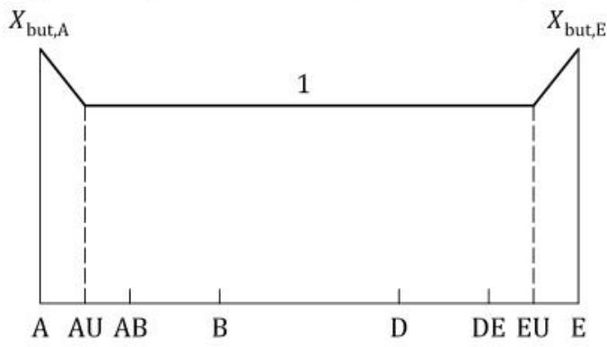  
Figure 8 — Local buttressing factor, $X_{but,CP}$

The local buttressing is expressed by means of a factor $X_{but,CP}$ ; see Figure 8, marked by the following values.

$$
g _ {\mathrm{AU}} - g _ {\mathrm{A}} = g _ {\mathrm{E}} - g _ {\mathrm{EU}} = C _ {\mathrm{X} _ {\text { but,CP }}} \cdot \sin \beta_ {\mathrm{b}} \tag{43}
$$

with

$$
g _ {\mathrm{A}} = 0 \mathrm{mm}
$$

$$
g _ {\mathrm{E}} = g _ {\alpha}
$$

$$
X _ {\text { but }, \mathrm{A}} = X _ {\text { but }, \mathrm{E}} = 1,3\quad \text { if } \varepsilon_ {\beta} \geq 1,0\tag{44}
$$

$$
X _ {\mathrm{but,A}} = X _ {\mathrm{but,E}} = 1 + 0,3 \cdot \varepsilon_ {\beta}\quad \mathrm{if} \varepsilon_ {\beta} <   1,0\tag{45}
$$

$$
X _ {\mathrm{but,AU}} = X _ {\mathrm{but,EU}} = 1,0\tag{46}
$$

$$
X _ {\text { but,CP }} = X _ {\text { but,A }} - \frac {g _ {\mathrm{CP}}}{C _ {\mathrm{X} _ {\text { but,CP }}} \cdot \sin \beta_ {b}} \cdot (X _ {\text { but,A }} - 1) \quad \text { for } g _ {\mathrm{A}} \leq g _ {\mathrm{CP}} <   g _ {\mathrm{AU}} \tag{47}
$$

$$
X _ {\mathrm{but,CP}} = 1,0\quad \text{for } g_{\mathrm{AU}}\leq g_{\mathrm{CP}}\leq g_{\mathrm{EU}} \tag{48}
$$

$$
X _ {\text { but,CP }} = X _ {\text { but,E }} - \frac {g _ {\alpha} - g _ {\mathrm{CP}}}{C _ {\mathrm{X} _ {\text { but,CP }}} \cdot \sin \beta_ {\mathrm{b}}} \cdot (X _ {\text { but,E }} - 1) \quad \text { for } g _ {\mathrm{EU}} <   g _ {\mathrm{CP}} \leq g _ {\mathrm{E}} \tag{49}
$$

where

$\varepsilon_{\beta}$ is the overlap ratio;

$C_{\mathrm{X}_{\mathrm{but,CP}}}$ is $0,2\mathrm{mm}$ .

###### 6.2.4.2.4.5 Helical gears with $\varepsilon_{\beta} \leq 0,8$ and unmodified profiles

Helical gears with a transverse contact ratio $\varepsilon_{\alpha} \geq 1$ and overlap ratio $\varepsilon_{\beta} \leq 0,8$ , have poor single contact of tooth pairs. Hence, they can be treated similar to spur gears, considering the geometry in the transverse plane, as well as the buttressing effect. See Figure 9.

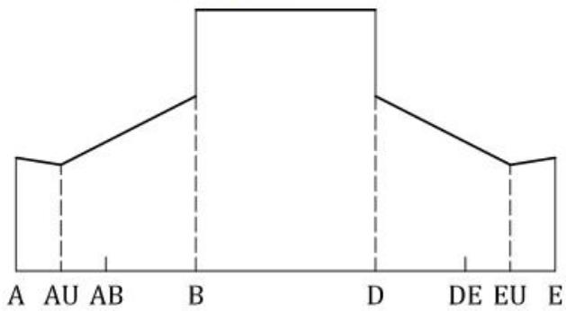  
Figure 9 — Local load sharing factor for cylindrical helical gears with $\varepsilon_{\beta} \leq 0,8$ and unmodified profiles, including the buttressing effect

The local load sharing factor is obtained by multiplying the $X_{CP}$ in 6.2.4.2.4.2 with the buttressing factor, $X_{but,CP}$ , in 6.2.4.2.4.4.

###### 6.2.4.2.4.6 Helical gears with $\varepsilon_{\beta} \leq 0,8$ and profile modification

Helical gears with a transverse contact ratio $\varepsilon_{\alpha} \geq 1$ and overlap ratio $\varepsilon_{\beta} \leq 0,8$ , have poor single contact of tooth pairs. Hence, they can be treated similar to spur gears, considering the geometry in the transverse plane. See Figure 10, Figure 11 and Figure 12.

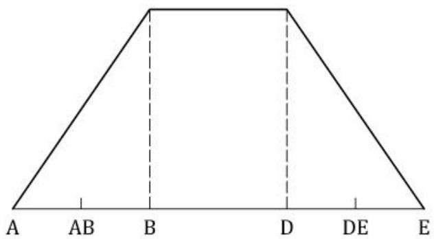  
Figure 10 — Local load sharing factor for cylindrical helical gears with $\varepsilon_{\beta} \leq 0,8$ and adequate profile modification

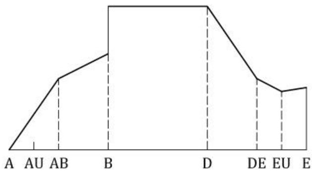

Figure 11 — Local load sharing factor for cylindrical helical gears with $\varepsilon_{\beta} \leq 0,8$ and adequate profile modification on the addendum of the wheel and/or the dedendum of the pinion  
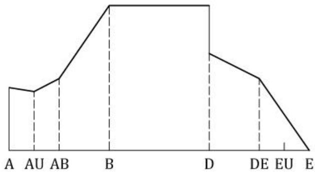  
Figure 12 — Local load sharing factor for cylindrical helical gears with $\varepsilon_{\beta} \leq 0,8$ and adequate profile modification on the addendum of the pinion and/or the dedendum of the wheel

The local load sharing factor is obtained by multiplying the $X_{CP}$ in 6.2.4.2.4.3 with the buttressing factor, $X_{but,CP}$ , in 6.2.4.2.4.4.

###### 6.2.4.2.4.7 Helical gears with $\varepsilon_{\beta} \geq 1,2$ and unmodified profiles

The buttressing effect for helical gears with $\varepsilon_{\alpha} \geq 1$ and $\varepsilon_{\beta} \geq 1,2$ is assumed to occur near points A and E along the line of contact and with a length of $0,2 \mathrm{~mm} \cdot \sin \beta_{\mathrm{b}}$ ; see Figure 13. See also 6.2.4.2.4.4 and Figure 8.

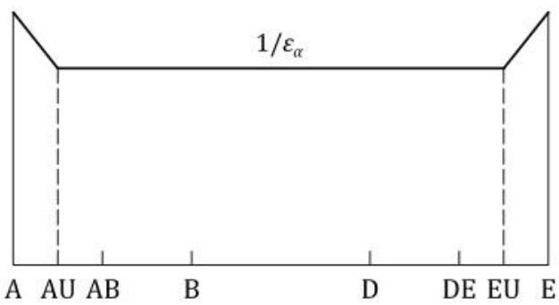  
Figure 13 — Local load sharing factor for cylindrical helical gears with $\varepsilon_{\beta} \geq 1,2$ and unmodified profiles

The local load sharing factor is obtained by multiplying the value $1/\varepsilon_{\alpha}$ , representing the mean load, with the buttressing factor, $X_{but,CP}$ .

$$
X _ {\mathrm{CP}} = \frac {1}{\varepsilon_ {\alpha}} \cdot X _ {\mathrm{but,CP}} \tag{50}
$$

where $\varepsilon_{\alpha}$ is the transverse contact ratio.

###### 6.2.4.2.4.8 Helical gears with $\varepsilon_{\beta} \geq 1,2$ and profile modification

Tip relief on the pinion (respectively wheel) reduces $X_{\mathrm{CP}}$ in the range DE-E (respectively A-AB) and increases $X_{\mathrm{CP}}$ in the range AB-DE, see Figure 14, Figure 15 and Figure 16. The extensions of tip relief at both ends A-AB and DE-E of the path of contact are assumed to be equal and to result in a contact ratio $\varepsilon_{\alpha} = 1$ for unloaded gears; see Figure 14.

a) Local load sharing factor for cylindrical helical gears with $\varepsilon_{\beta} \geq 1,2$ and adequate profile modification on pinion and wheel

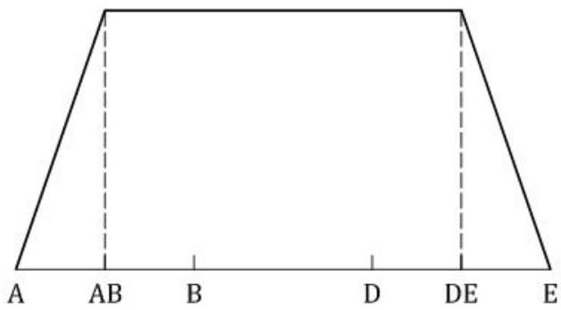  
Figure 14 — Local load sharing factor for cylindrical helical gears with $\varepsilon_{\beta} \geq 1,2$ and adequate profile modification

$$
X _ {\mathrm{CP}} = \left[ \frac {1}{\varepsilon_ {\alpha}} + \frac {(\varepsilon_ {\alpha} - 1)}{\varepsilon_ {\alpha} \cdot (\varepsilon_ {\alpha} + 1)} \right] \cdot \frac {g _ {\mathrm{CP}}}{g _ {\mathrm{AB}}}\quad \mathrm{for} g _ {\mathrm{A}} \leq g _ {\mathrm{CP}} \leq g _ {\mathrm{AB}} \tag{51}
$$

$$
X _ {\mathrm{CP}} = \frac {1}{\varepsilon_ {\alpha}} + \frac {(\varepsilon_ {\alpha} - 1)}{\varepsilon_ {\alpha} \cdot (\varepsilon_ {\alpha} + 1)}\quad \text { for } g _ {\mathrm{AB}} <   g _ {\mathrm{CP}} \leq g _ {\mathrm{DE}} \tag{52}
$$

$$
X _ {\mathrm{CP}} = \left[ \frac {1}{\varepsilon_ {\alpha}} + \frac {(\varepsilon_ {\alpha} - 1)}{\varepsilon_ {\alpha} \cdot (\varepsilon_ {\alpha} + 1)} \right] \cdot \frac {g _ {\alpha} - g _ {\mathrm{CP}}}{g _ {\alpha} - g _ {\mathrm{DE}}}\quad \mathrm{for} g _ {\mathrm{DE}} <   g _ {\mathrm{CP}} \leq g _ {\mathrm{E}} \tag{53}
$$

b) Local load sharing factor for cylindrical helical gears with $\varepsilon_{\beta} \geq 1,2$ and adequate profile modification on the addendum of the wheel and/or the dedendum of the pinion

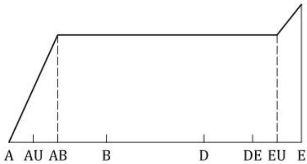  
Figure 15 — Local load sharing factor for cylindrical helical gears with $\varepsilon_{\beta} \geq 1,2$ and adequate profile modification on the addendum of the wheel and/or the dedendum of the pinion

$$
X _ {\mathrm{CP}} = \left[ \frac {1}{\varepsilon_ {\alpha}} + \frac {(\varepsilon_ {\alpha} - 1)}{2 \cdot \varepsilon_ {\alpha} \cdot (\varepsilon_ {\alpha} + 1)} \right] \cdot \frac {g _ {\mathrm{CP}}}{g _ {\mathrm{AB}}}\quad \mathrm{for} g _ {\mathrm{A}} \leq g _ {\mathrm{CP}} \leq g _ {\mathrm{AB}} \tag{54}
$$

$$
X _ {\mathrm{CP}} = \frac {1}{\varepsilon_ {\alpha}} + \frac {(\varepsilon_ {\alpha} - 1)}{2 \cdot \varepsilon_ {\alpha} \cdot (\varepsilon_ {\alpha} + 1)}\quad \text { for } g _ {\mathrm{AB}} <   g _ {\mathrm{CP}} \leq g _ {\mathrm{EU}} \tag{55}
$$

$$
X _ {\mathrm{CP}} = \left[ \frac {1}{\varepsilon_ {\alpha}} + \frac {\left(\varepsilon_ {\alpha} - 1\right)}{2 \cdot \varepsilon_ {\alpha} \cdot \left(\varepsilon_ {\alpha} + 1\right)} \right] \cdot X _ {\mathrm{but,CP}}\quad \mathrm{for} g _ {\mathrm{EU}} <   g _ {\mathrm{CP}} \leq g _ {\mathrm{E}} \tag{56}
$$

c) Local load sharing factor for cylindrical helical gears with $\varepsilon_{\beta} \geq 1,2$ and adequate profile modification on the addendum of the pinion and/or the dedendum of the wheel

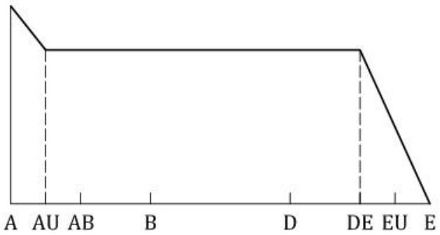  
Figure 16 — Local load sharing factor for cylindrical helical gears with $\varepsilon_{\beta} \geq 1,2$ and adequate profile modification on the addendum of the pinion and/or the dedendum of the wheel

$$
X _ {\mathrm{CP}} = \left[ \frac {1}{\varepsilon_ {\alpha}} + \frac {\left(\varepsilon_ {\alpha} - 1\right)}{2 \cdot \varepsilon_ {\alpha} \cdot \left(\varepsilon_ {\alpha} + 1\right)} \right] \cdot X _ {\mathrm{but,CP}}\quad \text { for } g _ {\mathrm{A}} \leq g _ {\mathrm{CP}} \leq g _ {\mathrm{AU}} \tag{57}
$$

$$
X _ {\mathrm{CP}} = \frac {1}{\varepsilon_ {\alpha}} + \frac {(\varepsilon_ {\alpha} - 1)}{2 \cdot \varepsilon_ {\alpha} \cdot (\varepsilon_ {\alpha} + 1)}\quad \text { for } g _ {\mathrm{AU}} <   g _ {\mathrm{CP}} \leq g _ {\mathrm{DE}} \tag{58}
$$

$$
X _ {\mathrm{CP}} = \left[ \frac {1}{\varepsilon_ {\alpha}} + \frac {(\varepsilon_ {\alpha} - 1)}{2 \cdot \varepsilon_ {\alpha} \cdot (\varepsilon_ {\alpha} + 1)} \right] \cdot \frac {g _ {\alpha} - g _ {\mathrm{CP}}}{g _ {\alpha} - g _ {\mathrm{DE}}}\quad \mathrm{for} g _ {\mathrm{DE}} <   g _ {\mathrm{CP}} \leq g _ {\mathrm{E}} \tag{59}
$$

###### 6.2.4.2.4.9 Helical gears with $0,8 < \varepsilon_{\beta} < 1,2$

Due to the fact that gears are not infinitely stiff, the overlap ratio changes depending on the load. To take this into account, for helical gears with calculated overlap ratios $0,8 < \varepsilon_{\beta} < 1,2$ , an interpolation between the local load sharing factor $X_{\mathrm{CP}}(\varepsilon_{\beta} = 0,8)$ (see 6.2.4.2.4.5 for unmodified profiles respectively and 6.2.4.2.4.6 for modified profiles) and $X_{\mathrm{CP}}(\varepsilon_{\beta} = 1,2)$ (see 6.2.4.2.4.7 for unmodified profiles respectively and 6.2.4.2.4.8 for modified profiles) shall be performed. For helical gears with $0,8 < \varepsilon_{\beta} < 1,2$ , $X_{CP}$ is calculated as follows:

$$
X _ {\mathrm{CP}} \left(\varepsilon_ {\beta}\right) = X _ {\mathrm{CP}} \left(\varepsilon_ {\beta} = 0,8\right) \cdot \frac {1,2 - \varepsilon_ {\beta}}{0,4} + X _ {\mathrm{CP}} \left(\varepsilon_ {\beta} = 1,2\right) \cdot \frac {\varepsilon_ {\beta} - 0,8}{0,4} \tag{60}
$$

## 6.3 Quasi-stationary residual stress, $\tau_{\mathrm{eff},\mathrm{RS}}(y)$

### 6.3.1 General

The calculation of tooth flank fracture load capacity according to the herein defined procedure takes into account compressive residual stresses in the carburized layer. By assumption the tensile residual stresses in the core for typical tooth profiles are small and are therefore neglected. Higher tensile stresses in the core region may increase the risk of tooth flank fracture but are hardly determinable by existing measuring methods and are therefore not included in the calculation approach. The quasi-stationary assumed residual stress, $\tau_{\mathrm{eff},\mathrm{RS}}(y)$ , can be calculated according to Formula (61) $^{[15]}$ . For this calculation, it is assumed that residual stress components tangential and axial to the tooth flank have similar values and components normal to the flank can be neglected $^{[7]}$ .

$$
\tau_ {\mathrm{eff,RS}} (y) = \sqrt {\frac {2}{15}} \cdot \left| \sigma_ {\mathrm{RS}} (y) \right|\tag{61}
$$

with

$$
\sigma_ {\mathrm{RS}} (y) \leq 0\tag{62}
$$

where $\sigma_{\mathrm{RS}}(y)$ is the tangential component of the residual stress at the material depth, y (residual stress depth profile).

### 6.3.2 Method A

By this method, a measured residual stress depth profile, $\sigma_{\mathrm{RS}}(y)$ , (for example residual stresses measured with the X-ray diffractometer according to ISO/TS 21432), representative for the analysed tooth flank condition, is used.

### 6.3.3 Method B

Method B describes a procedure according to Reference [11] to calculate the residual stress depth profile, $\sigma_{\mathrm{RS}}(y)$ , based on the hardness depth profile $HV(y)$ (according to 7.4). These specified formulae are only applicable for case carburized steels and correlate to measurement results on test gears[15].

For $[HV(y) - HV_{\mathrm{core}}]\leq 300$

$$
\sigma_ {\mathrm{RS}} (y) = - 1,25 \cdot [ HV (y) - HV _ {\text { core }} ]\tag{63}
$$

For $[HV(y) - HV_{\mathrm{core}}] > 300$

$$
\sigma_ {\mathrm{RS}} (y) = 0,2857 \cdot [ HV (y) - HV _ {\text { core }} ] - 460\tag{64}
$$

where

$HV_{core}$ is the core hardness;

HV(y) is the local hardness at the material depth, y (hardness depth profile).

NOTE 1 Other analytical methods are applicable upon agreement between the supplier and the customer.

NOTE 2 The calculated value of the residual stress is dependent upon the hardness depth profile. The accuracy of the hardness depth profile depends upon the calculation method chosen to evaluate it. Therefore it is important, that the most accurate method (see 7.4) is selected. Method B is based on hardness measurements and Method C calculates hardness depth profiles based on design specifications.

## 6.4 Influence of the residual stresses on the local equivalent stress, $\Delta \tau_{\mathrm{eff,L,RS,CP}}(y)$

The residual stresses may influence the (total) local equivalent stress in a significant way. This is taken into account by $\Delta \tau_{\mathrm{eff,L,RS,CP}}(y)$ , which can be calculated according to Formula (65). The influence of the residual stresses on the local equivalent stress, $\Delta \tau_{\mathrm{eff,L,RS,CP}}(y)$ , depends on the residual stress depth profile, $\sigma_{\mathrm{RS}}(y)$ , as well as the local Hertzian stress, $p_{\mathrm{dyn,CP}}$ , at the considered contact point, CP. With help of the adjustment factors $K_{1}$ and $K_{2}$ it is possible to describe the influence of the residual stresses on the local equivalent stress, $\Delta \tau_{\mathrm{eff,L,RS,CP}}(y)$ , in a closed form. The following described adjustment factors $K$ are derived from calculations with sophisticated calculation methods[10][15]. Concerning the residual stresses, the same assumptions as in 6.3 shall be made.

$$
\Delta \tau_ {\text { eff }, \mathrm{L}, \mathrm{RS}, \mathrm{CP}} (y) = K _ {1} \cdot \frac {| \sigma_ {\mathrm{RS}} (y) |}{100} \cdot 32 \cdot \tanh (9 \cdot y ^ {1,1}) - K _ {2} \tag{65}
$$

where $K_{1}$ , $K_{2}$ are adjustment factors according to Reference [15],

with

$$
K _ {1} = \left(1 - K _ {\mathrm{pH}, \sigma_ {\mathrm{RS,max}}}\right) \cdot \tanh \left(K _ {CHD} \cdot y ^ {4,58}\right) + K _ {\mathrm{pH}, \sigma_ {\mathrm{RS,max}}} \tag{66}
$$

$$
K _ {2} = \left\{- \tanh \left[ 0,1 \cdot \left(\rho_ {\mathrm{red}, \mathrm{CP}} - 10\right) \right] + 1 \right\}\cdot \left\{\frac {CHD ^ {2}}{16} \cdot \left[ y \cdot \left(\frac {\sigma_ {\mathrm{RS,max}}}{10} \cdot \tanh \left[ \frac {- 2 \cdot \left(\frac {p _ {\mathrm{dyn,CP}}}{100} - 200\right)}{100} \right] + \frac {\sigma_ {\mathrm{RS,max}}}{10}\right)\right]\right\} \tag{67}
$$

and

$$
K_{\mathrm{pH},\sigma_{\mathrm{RS,max}}}=-1,98\cdot\tanh\left[-0,07\cdot\left(\frac{p_{\mathrm{dyn,CP}}}{\sigma_{\mathrm{RS,max}}}\right)^{2,385}\right]-0,98\tag{68}
$$

$$
K_{CHD}=11,25\cdot\mathrm{e}^{-5,151\cdot CHD}+0,115\cdot\mathrm{e}^{-1,834\cdot CHD} \tag{69}
$$

where

CHD is the case hardening depth at 550 HV;

$\sigma_{RS,max}$ is the maximum residual stress.

$$
\sigma_ {\mathrm{RS}, \max} = \max \left[ \left| \sigma_ {\mathrm{RS}} (y) \right| \right]\tag{70}
$$

The residual stress depth profile, $\sigma_{\mathrm{RS}}(y)$ , should be calculated according to Formula (63) or (64) out of the hardness depth profile if there is no reliable measured data available. Influences on the residual stresses which are only effective near the surface (e.g. shot peening) should not be considered for the determination of the maximum residual stress, $\sigma_{RS,max}$ . Due to their limited depth effect, they are not significant for the calculation of tooth flank fracture load capacity.

# 7 Local material strength, $\tau_{\mathrm{per,CP}}(y)$

## 7.1 General

The local material strength, $\tau_{\mathrm{per,CP}}(y)$ , of case carburized gears fulfilling the requirements according to ISO 6336-5, material quality grade MQ, can be calculated according to Formula (71). The calculation is based on the local hardness depth profile, $HV(y)$ , and the used material.

$$
\tau_ {\text { per,CP }} (y) = K _ {\tau , \text { per }} \cdot K _ {\text { material }} \cdot HV (y)\tag{71}
$$

where

$K_{\tau,per}$ is the hardness conversion factor according to 7.2;

$K_{material}$ is the material factor according to 7.3;

HV(y) is the hardness at the material depth, y (hardness depth profile).

## 7.2 Hardness conversion factor $K_{\tau,per}$

Based on several experimental investigations and available practical experience, for this calculation method the hardness conversion factor, $K_{\tau,per}$ , for case carburized steels is set to 0,4 $^{[15]}$ .

$$
K _ {\tau , \text { per }} = 0,4\tag{72}
$$

## 7.3 Material factor $K_{material}$

Values for the material factor, $K_{material}$ , can be calculated according to Formula (73) and (74). This factor considers different ductility and hardenability as well as influences from microstructure for different case carburized steels. Values for $K_{material}$ are derived from testing $^{[15]}$ . As the hardenability is depending on the tooth size, values for $K_{material}$ are specified for different chordal tooth thicknesses, $s_{t,B-D}$ , which shall be calculated according to ISO 21771. Alternative values for the material factor $K_{material}$ can be applied where appropriate testing or field experience is available for specific ranges of material, heat treatment as well as processing combinations and upon agreement between the supplier and the customer. Guidance to evaluate the relevant tensile strength $R_{m}$ of the gear material is given in ISO 18265.

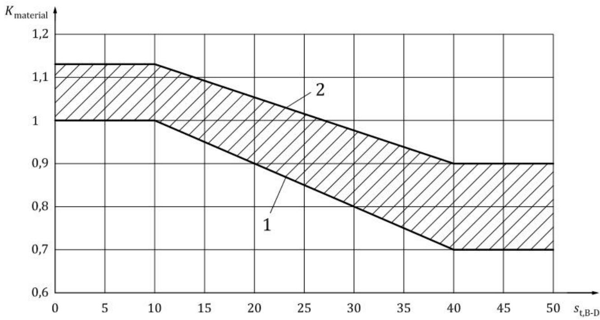

$$
\begin{array}{l l} \text {Key} \\ 1 & K _ {\text {material}} \text {for} R _ {\mathrm{m}} = 800 \mathrm{N} / \mathrm{mm} ^ {2} \\ 2 & K _ {\text {material}} \text {for} R _ {\mathrm{m}} \geq 900 \mathrm{N} / \mathrm{mm} ^ {2} \end{array}
$$

Figure 17 — $K_{\text{material}}$ for $R_{\text{m}} = 800 \, \text{N/mm}^2$ and $R_{\text{m}} \geq 900 \, \text{N/mm}^2$

For $R_{\mathrm{m}}=800\,\mathrm{N/mm^2}$ (see Figure 17, curve 1)

$$
K_{\mathrm{material}}=0,70+\left(C_{K_{\mathrm{material}}}-s_{\mathrm{t,B-D}}\right)\cdot0,01\tag{73}
$$

For $s_{\mathrm{t,B-D}}>40\,\mathrm{mm}$: $s_{\mathrm{t,B-D}}=40\,\mathrm{mm}$

For $s_{\mathrm{t,B-D}}<10\,\mathrm{mm}$: $s_{\mathrm{t,B-D}}=10\,\mathrm{mm}$

For $R_{\mathrm{m}}\geq900\,\mathrm{N/mm^2}$ (see Figure 17, curve 2)

$$
K_{\mathrm{material}}=0,90+\left(C_{K_{\mathrm{material}}}-s_{\mathrm{t,B-D}}\right)\cdot0,007\,7\tag{74}
$$

For $s_{\mathrm{t,B-D}}>40\,\mathrm{mm}$: $s_{\mathrm{t,B-D}}=40\,\mathrm{mm}$

For $s_{\mathrm{t,B-D}}<10\,\mathrm{mm}$: $s_{\mathrm{t,B-D}}=10\,\mathrm{mm}$

where

$R_{m}$ is the tensile strength of the gear material (see ISO 6336-5);

$C_{K_{\mathrm{material}}}$ is $40~\mathrm{mm}$ ;

$s_{t,B-D}$ is the chordal tooth thickness in transverse section at the diameter corresponding to the middle between B and D on the line of action.

NOTE For tensile strength values $R_{m}$ between 800 N/mm $^{2}$ and 900 N/mm $^{2}$ , a linear interpolation between both formulae is applicable.

## 7.4 Hardness depth profile, $HV(y)$

### 7.4.1 General

The determination of the hardness depth profile, $HV(y)$ , can be performed according to method A, method B, method C1 or method C2, respectively. Method A is not specified at the moment. By means of method B, a measured hardness depth profile, $HV(y)$ , is used and approximated by the Thomas approach $^{[14]}$ . Method C1 describes a simplified method for the estimation of the hardness depth profile, $HV(y)$ , according to Lang $^{[11]}$ . This method is only applicable for case carburized steels and an approximation for typical hardness depth profiles as measured on gears. In cases where the sum of $HV_{surface}$ and $HV_{core}$ is significantly different from 1 100 HV, the application of more complex approximation methods for the hardness depth profile, like the one according to Thomas $^{[14]}$ (see Method C2), may be appropriate.

The applicability of either method C1 or method C2 for the investigated material should be aligned with measured hardness depth profiles according to method B for individual cases. Both methods might deliver appropriate hardness depth profiles for different areas of application. Other analytical methods for calculating the hardness depth profile may be applied upon agreement between the supplier and the customer where more appropriate and relevant experience exists.

Regardless of whether method A, method B, method C1 or method C2 is used to evaluate the hardness depth profile, it shall be ensured that the used hardness values are reasonable and form a typical profile for the given heat treatment process. Scattering and single measurement deviations shall be levelled out by an appropriate continuous curve similar to that described by Thomas $^{[14]}$ obtained with the help of more than one independent measurement.

### 7.4.2 Method A

Method A is not specified for the time being.

### 7.4.3 Method B

By means of method B, a measured hardness depth profile, $HV(y)$ , according to the Vickers hardness test in ISO 6507 is used. The material depth increments shall be chosen reasonably. For the measurement specification and requirements, see also ISO 6336-5. From the measured hardness profile, the following parameters shall be evaluated:

— $HV_{surface}$ is the surface hardness;

— $HV_{core}$ is the core hardness;

— CHD is the case hardening depth;

— $y_{HV,max}$ is the y-coordinate of the maximum hardness, use $y_{HV,max} = 0$ if the value is not known.

The calculation of the hardness depth profile is performed by inserting the parameters into the Thomas hardness depth profile calculations by using Formulae (80) to (93).

NOTE This method assumes that the hardness profile is smooth and continuous, with the hardness gradually decreasing from the surface to the core. Discontinuities will cause errors in the calculations.

### 7.4.4 Method C1

Method C1 describes a procedure to calculate the hardness depth profile, $HV(y)$ , according to Lang $^{[11]}$ based on design specifications for $HV_{surface}$ , $HV_{core}$ and CHD. This method with the herein specified coefficients is only applicable for case carburized steels and is an approximation for typical hardness depth profiles as measured on gears.

$$
HV \left(y ^ {*}\right) = HV _ {\text { core }} + \left(HV _ {\text { surface }} - HV _ {\text { core }}\right) \cdot f \left(y ^ {*}\right)\tag{75}
$$

$$
f \left(y ^ {*}\right) = 10 ^ {\left(a + b \cdot y ^ {*}\right) \cdot y ^ {*}} \tag{76}
$$

$$
y ^ {*} = \frac {y}{CHD} \tag{77}
$$

$$
a = - 0,0381\tag{78}
$$

$$
b = - 0,2662\tag{79}
$$

where

$HV_{core}$ is the core hardness;

$HV_{surface}$ is the surface hardness.

NOTE As Formula (75) is an approximation, it is possible that the calculated HV-value for CHD is not exactly 550 HV.

### 7.4.5 Method C2

Method C2 describes a procedure to calculate the hardness depth profile $HV(y)$ for case carburized gears according to Thomas $^{[14]}$ based on design specifications for $HV_{surface}$ , $y_{HV,max}$ , $HV_{core}$ and CHD. If Method C1 does not deliver reasonable results for hardness depth profiles as measured on the investigated gears, the application of Method C2 might be more appropriate.

$$
HV (y) = a _ {\mathrm{a}} \cdot y ^ {2} + b _ {\mathrm{a}} \cdot y + c _ {\mathrm{a}} \quad \text { for } 0 \leq y <   CHD \tag{80}
$$

$$
HV (y) = a _ {\mathrm{b}} \cdot y ^ {2} + b _ {\mathrm{b}} \cdot y + c _ {\mathrm{b}} \quad \text { for } CHD \leq y <   y _ {\text { core }} \tag{81}
$$

$$
HV (y) = HV _ {\text { core }}\quad \text { for } y _ {\text { core }} \leq y \tag{82}
$$

with

$$
a _ {\mathrm{a}} = \frac {550 - HV _ {\text { surface }}}{CHD ^ {2} - 2 \cdot y _ {HV , \max} \cdot CHD} \tag{83}
$$

$$
b _ {a} = - 2 \cdot a _ {a} \cdot y _ {HV, \max} \tag{84}
$$

$$
c _ {\mathrm{a}} = HV _ {\text { surface }} \tag{85}
$$

$$
a _ {\mathrm{b}} = \frac {H ^ {\prime} (CHD)}{2 \cdot (CHD - y _ {\text {core}})} \tag{86}
$$

$$
b _ {\mathrm{b}} = - 2 \cdot a _ {\mathrm{b}} \cdot y _ {\text { core }} \tag{87}
$$

$$
c _ {b} = 550 - a _ {\mathrm{b}} \cdot CHD ^ {2} - b _ {\mathrm{b}} \cdot CHD \tag{88}
$$

$$
H ^ {\prime} (CHD) = 2 \cdot a _ {a} \cdot CHD + b _ {a} \tag{89}
$$

$$
y _ {\text { core }} = \frac {- B + \sqrt {B ^ {2} - 4 \cdot A \cdot C}}{2 \cdot A} \tag{90}
$$

$$
A = - H ^ {\prime} (CHD)\tag{91}
$$

$$
B = 2 \cdot CHD \cdot H ^ {\prime} (CHD) + 2 \cdot \left(HV _ {\text { core }} - 550\right)\tag{92}
$$

$$
C = - CHD ^ {2} \cdot H ^ {\prime} (CHD) - 2 \cdot CHD \cdot \left(HV _ {\text { core }} - 550\right)\tag{93}
$$

where

$y_{HV,max}$ is the y-coordinate of the maximum hardness, use $y_{HV,max} = 0$ if the value is not known;

$y_{core}$ is the y-coordinate, where $HV(y) = HV_{core}$ .

# Annex A (informative) — Calculation of local equivalent stress without consideration of residual stresses, $\tau_{\mathrm{eff,L,CP}}(y)$

By mathematical transformation of Formula (7) for the local equivalent stress without consideration of residual stresses, $\tau_{\mathrm{eff,L,CP}}(y)$ , Formula (7) can also be written as:

$$
\tau_ {\mathrm{eff,L,CP}} (y) = \frac {0,149 \cdot p _ {\mathrm{dyn,CP}} + y \cdot \frac {p _ {\mathrm{dyn,CP}}}{b _ {\mathrm{H,CP}}} \cdot \left(1 - \frac {y}{\sqrt {b _ {\mathrm{H,CP}} ^ {2} + y ^ {2}}}\right)}{0,4 \cdot \frac {y}{b _ {\mathrm{H,CP}}} + 1,54} \tag{A.1}
$$

This formula is referenced on half of the Hertzian contact width, $b_{H,CP}$ . As a result of the equivalence of both formulae, the calculation results do not change. The following formulae were used to transfer Formula (7) to Formula (A.1). They are mainly based on Formula (A.2) for calculating half of the Hertzian contact width.

$$
b _ {\mathrm{H,CP}} = 4 \cdot \frac {\rho_ {\mathrm{red,CP}} \cdot p _ {\mathrm{dyn,CP}}}{E _ {\mathrm{r}}} \tag{A.2}
$$

$$
\frac {E _ {\mathrm{r}}}{4 \cdot \rho_ {\mathrm{red,CP}}} = \frac {p _ {\mathrm{dyn,CP}}}{b _ {\mathrm{H}}} \tag{A.3}
$$

$$
\rho_ {\mathrm{red,CP}} ^ {2} = \frac {b _ {\mathrm{H,CP}} ^ {2} \cdot E _ {\mathrm{r}} ^ {2}}{16 \cdot p _ {\mathrm{dyn,CP}} ^ {2}} \tag{A.4}
$$

$$
\left(\frac {p _ {\mathrm{dyn,CP}}}{b _ {\mathrm{H,CP}}}\right) ^ {2} + \left(\frac {y}{4 \cdot \rho_ {\mathrm{red,CP}}}\right) ^ {2} = 4 \cdot \frac {p _ {\mathrm{dyn,CP}} ^ {2} \cdot \left(b _ {\mathrm{H,CP}} ^ {2} + y ^ {2}\right)}{E _ {\mathrm{r}} ^ {2} \cdot b _ {\mathrm{H,CP}} ^ {2}} \tag{A.5}
$$

> Editorial note (not part of the ISO text): Formula (A.5) is reproduced as printed. Its left-hand first denominator is $b_{\mathrm{H,CP}}$, and its right-hand side has a factor 4; these appear inconsistent with Formulae (7) and (A.2). No mathematical correction has been substituted.

# Bibliography

[1] ISO 53, Cylindrical gears for general and heavy engineering — Standard basic rack tooth profile

[2] ISO 6336-5, Calculation of load capacity of spur and helical gears — Part 5: Strength and quality of materials

[3] ISO 6507 (all parts), Metallic materials — Vickers hardness test

[4] ISO/TS 21432, Non-destructive testing — Standard test method for determining residual stresses by neutron diffraction

[5] ISO 18265, Metallic materials — Conversion of hardness values

[6] Det Norske Veritas Classification Note 41.2, Calculation of gear rating for marine transmissions. 1993

[7] ELSTORPFF M.-G. Einflüsse auf die Grübchentragfähigkeit einsatzgehärteter Zahnräder bis in das höchste Zeitfestigkeitsgebiet. Doctoral Thesis, TU München, 1993

[8] FÖPPL L. Drang und Zwang, Band III — Eine höhere Festigkeitslehre für Ingenieure. Leibnitz Verlag, München, 1947

[9] HEIN M., TOBIE T., STAHL K. Parameter study on the calculated risk of tooth flank fracture of case hardened gears. Proceedings of MPT2017-Kyoto, JSME International Conference on Motion and Power Transmissions, 2017

[10] HERTTER T. Rechnerischer Festigkeitsnachweis der Ermüdungstragfähigkeit vergüteter und einsatzgehärteter Stirnräder. Doctoral Thesis, TU München, 2003

[11] LANG O. R. Berechnung und Auslegung induktiv randschichtgehärteter Bauteile. AWT-Tagung "Induktives Randschichthärten", Darmstadt, 1988

[12] OSTER P. Beanspruchung der Zahnflanken unter Bedingungen der Elastohydrodynamik. Doctoral Thesis, TU München, 1982

[13] SIMBÜRGER A. Festigkeitsverhalten zäher Werkstoffe bei einer mehrachsigen phasenverschobenen Schwingbeanspruchung mit körperfesten und veränderlichen Hauptspannungsrichtungen. Doctoral Thesis, TH Darmstadt, 1975

[14] THOMAS J. Flankentragfähigkeit und Laufverhalten von hart-feinbearbeiteten Kegelrädern, Doctoral Thesis, TU München, 1998

[15] WITZIG J. Flankenbruch — Eine Grenze der Zahnradtragfähigkeit in der Werkstofftiefe. Doctoral Thesis, TU München, 2012

[16] ZENNER H., RICHTER I., Eine Festigkeitshypothese für die Dauerfestigkeit bei beliebigen Beanspruchungskombinationen, Konstruktion 29, S. 11-18, 1977

ICS 21.200

Price based on 29 pages

© ISO 2019 – All rights reserved
